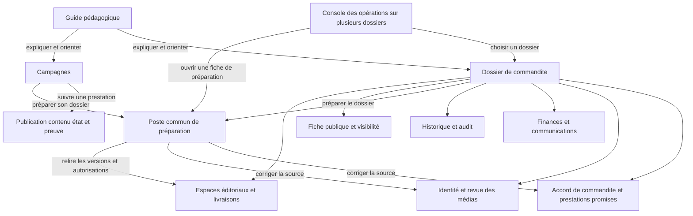

# Blueprint des opérations Guide commandites et campagnes

Inventaire initial du 18 octobre 2026, révision `bc593f7f`. L'évolution appliquée
ci-dessous actualise les entrées concernées ; les autres rangements restent des
propositions.

Le rangement doit clarifier trois unités de travail : un parcours pour apprendre,
un dossier de commandite pour établir ses faits et ses décisions, une prestation
pour suivre une promesse précise. La surface Guide héberge actuellement aussi du
travail sur un ensemble de dossiers. Le principal découpage à prévoir concerne
ces responsabilités et leurs actions ; plusieurs composants sont déjà communs.

## Blueprints par surface

<!-- prettier-ignore -->
| Surface | Entrée actuelle | Inventaire détaillé |
| --- | --- | --- |
| Guide administratif | Barre commune, carte flottante et ses quatre modes ; distinction avec le dialogue de découverte du pilotage | [Zones et actions du Guide](admin-guide-blueprint.md) |
| Détail de commandite | `/admin/fundraiser/sponsors?sponsorshipId=<uuid>` | [Zones et actions du dossier par onglet](admin-sponsorship-dossier-blueprint.md) |
| Campagnes | `/admin/fundraiser/campaigns` | [Zones et actions des prestations](admin-campaigns-blueprint.md) |
| Qualité des commandites | `/admin/fundraiser/sponsors/quality` | Destination des outils globaux extraits du dossier ; [portées de l’audit](../technical/sponsorship-historical-audit.md) |

Les catalogues décrivent les contrôles présents, leurs conditions, leur effet et
leurs composants propriétaires. Une action répétée sur plusieurs lignes représente
la même commande appliquée à des identifiants différents. Les volets, tiroirs,
formulaires et états conditionnels sont rattachés à leur point d'ouverture.

Hors évolution appliquée ci-dessous, les propositions ne modifient ni les écrans
ni leurs autorisations.
Les actions propres aux autres pages sont traitées comme destinations : leur
inventaire complet, par exemple les dépenses ou la configuration, sort de ces trois
surfaces. Les briques communes utiles au rangement sont identifiées séparément.

## Évolution appliquée : détails de l'accord dans Campagnes

Le volet **Détails de l'accord de commandite et traçabilité** appartient désormais à
Campagnes. Le composant commun conserve un seul contrat de présentation typé :
`inline` dans Campagnes, `hidden` dans Commandites et `campaigns` dans le Guide.
Dans Commandites, le volet et sa commande Détails sont retirés. Dans le Guide,
la commande devient **Voir les prestations dans Campagnes**. Relecture du contenu,
approbation, historique et qualification de l'accord d'origine restent à leurs
emplacements et conservent leurs responsabilités.

Le Guide connaît le dossier courant, pas une prestation précise. Il ouvre
`/admin/fundraiser/campaigns?sponsorshipId=<uuid>` : la page conserve une prestation
déjà sélectionnée du même dossier, choisit l'unique résultat ou demande de choisir
parmi plusieurs ; zéro résultat reste un état explicite. Une origine connaissant
un passage exact peut ajouter `obligationId=<uuid>`, avec son dossier obligatoire.
Ces identifiants sont validés et filtrent les données côté API avant pagination.
Voir le [contrat propriétaire](../technical/admin-campaigns.md#entree-contextuelle-et-details-de-laccord)
et les lignes actualisées G-A06, DOS-B.a11/a20 et CAM-P08 dans les trois catalogues.

## Évolution appliquée : premier lot de suppressions

Trois doublons sont retirés : le résumé générique des prestations dans Publication
(le registre **Prestations promises** conserve la qualification de l’accord), les encadrés
d’organisation future dans les six parcours du Guide (l’emplacement actuel reste
consultable), et la commande **Approuver la préparation** du menu Actions. Le bouton
principal conserve ses droits, sa version et sa confirmation, accessibles aussi au
clavier et à la manette. Les autres découpages proposés restent à réaliser.

## Évolution appliquée au rangement de Commandites

**Aperçu** conserve ses faits et une orientation principale. L’Assistant complet
rejoint son écran dédié par un lien portant le dossier ; le lien du cadre
administratif transmet également cette sélection. **Modération éditoriale**,
**Aide pas à pas du dossier** et **Accès au suivi** remplacent la colonne
permanente par des panneaux ouverts à la demande. Les composants existants
conservent leurs confirmations et les identifiants des demandes incertaines.

Dans Publication, le détail répété des prestations devient une synthèse et un
lien vers Campagnes filtré sur le dossier. Les cartes sociales, leur tiroir
d’autorisation et la qualification des engagements restent dans leurs
propriétaires. **Fiche publique** et **Suivi social déclaré** possèdent des
sous-zones distinctes et une sauvegarde versionnée commune.

La destination propriétaire **Qualité des commandites**,
`/admin/fundraiser/sponsors/quality`, reçoit l’inventaire d’adoption et l’audit
global. Le dossier conserve un audit local, sans bascule de portefeuille. Voir
les [parcours actuels](../admin-sponsorship-editing.md#outils-du-dossier-a-la-demande)
et les [portées de l’audit](../technical/sponsorship-historical-audit.md).

Les cartes et constats ci-dessous conservent l’inventaire daté lorsque leur
composition précède ce rangement. Les autres extractions proposées restent à réaliser.

## Lecture des responsabilités

Le [vocabulaire commun des opérations](../technical/admin-campaigns.md#vocabulaire-des-operations)
distingue accord de commandite, approbation de la préparation du dossier,
autorisation de publication, livraison confirmée et dispense. Les libellés
fonctionnels déjà harmonisés en français et en anglais emploient **Fiche de
préparation**, **Vérification du lot**, **Publication 2 sur 3** et **Préparer ce
dossier**. Leurs noms techniques restent stables.

Les noms descriptifs des outils transversaux suivent la même référence :
**Guide administratif** pour la carte commune, **Aide pas à pas du dossier** pour
le volet local, **Revue des médias** pour l'espace `MediaReviewWorkspace` et
**flux de publication** pour les destinations configurées du moteur social.
Le **statut social déclaré** du dossier reste distinct de ces flux et de la
visibilité Web. Un **reçu d'opération** atteste le résultat d'une demande ; il
ne désigne pas la fiche de préparation. Ces noms documentaires ne prouvent pas
un renommage complet de l'interface. Les citations de libellés historiques,
comme « feed », restent identifiées dans les inventaires datés ; cette
harmonisation ne réalise pas les découpages proposés.

Une **zone** rassemble des informations et des commandes au service d'une tâche.
Sa responsabilité décrit ce qu'elle doit permettre de comprendre ou d'accomplir.
Le **propriétaire fonctionnel** est le module qui porte cette responsabilité ; ce
terme ne désigne pas le rôle administratif « propriétaire ».

Une zone mérite une séparation lorsqu'elle combine plusieurs unités de travail,
des décisions indépendantes, des droits différents ou des effets de nature
différente sans les rendre explicites. Plusieurs champs ou boutons au service
d'une même tâche ne suffisent pas à justifier un nouveau module.

<!-- prettier-ignore -->
| Nature d'action | Responsabilité et résultat à annoncer |
| --- | --- |
| Lecture | Consulter ou actualiser des faits serveur ; distinguer chargement, absence et indisponibilité. |
| Navigation | Ouvrir une page, un onglet, un repère ou une pièce ; préciser la destination et préserver le retour. |
| Interface | Choisir une ligne, filtrer, déplier, déplacer, mémoriser ou effacer un repère personnel. |
| Préparation | Créer ou modifier un travail privé enregistré : brouillon, traitement d'assistance ou passage de préparation. |
| Décision | Qualifier un accord, approuver une version, modérer, autoriser ou refuser ; exposer cible, droits et confirmation applicables. |
| Effet externe | Publier, envoyer un courriel ou rembourser ; conserver les préconditions, confirmations, audits et reprises du module métier. |

Une préparation peut écrire sans produire un effet externe. Un libellé de
consultation ne doit donc pas masquer une commande de préparation. Les catalogues
séparent également l'approbation de la préparation, l'autorisation de publication
et la livraison confirmée.

## Carte actuelle des périmètres

<!-- prettier-ignore -->
| Surface | Unité affichée | Responsabilités réunies aujourd'hui | Point de friction |
| --- | --- | --- | --- |
| Guide Découverte et Parcours interactifs | Rubrique et étape pédagogique | Explication, surbrillance, navigation, préférences personnelles | Cohérence pédagogique ; terminologie et reprise à harmoniser avec les autres guides. |
| Guide Parcours du paiement | Paiement suivi explicitement | Lecture d'une prochaine action et navigation vers son écran | Le paiement suivi peut différer du dossier ouvert. |
| Guide Automatique | Ensemble de dossiers, vérification du lot, dossier courant | Lancement et suivi d'une vérification du lot, rapport, carrousel, préparation ciblée et fiche de préparation | La carte d'aide devient une console d'opérations. |
| Dossier Aperçu | Un dossier de commandite | Synthèse, prochaine étape, assistant, note de revue et accès aux décisions | Plusieurs présentations de « quoi faire ensuite » se superposent. |
| Dossier Fiche et médias | Identité et médias d'une commandite | Coordonnées et présentation, préférences photo, fichiers, droits d'usage et modération des médias | Les données d'identité et les décisions sur les médias ont des cycles distincts. |
| Dossier Publication | Accord de commandite, dossier préparé, visibilité et prestations | Qualification historique, assistance, fiche de préparation, prestations promises, calendrier, livraisons et fiche publique | Principal regroupement de périmètres indépendants. |
| Dossier Finances | Paiement et documents d'une commandite | Factures, avoirs, remboursements confirmés, demandes et incidents de communication | Garder les faits et les demandes clairement séparés, avec leurs écrans propriétaires. |
| Dossier Historique | Événements d'une commandite | Consultation et inspection de la trace | Responsabilité stable ; réutilisation de l'inspecteur commun. |
| Campagnes | Une prestation promise par canal, destination et numéro de publication | Recherche transversale, suivi, contenu et preuve, fiche de préparation de tout le dossier | La prestation sélectionnée ne borne pas toutes les actions de la fiche de préparation embarquée. |

Le dossier expose **cinq onglets visibles** : Aperçu, Fiche et médias, Publication,
Finances et Historique. Les valeurs internes `media` et `refund` sont des alias
vers Fiche et médias et Finances. Campagnes n'a aucun onglet propre. Les quatre modes du
Guide sont des sous-vues de sa carte, distinctes de ces onglets.

Sources de composition : [onglets du dossier](../../apps/funding-web/src/app/features/funding/components/admin-sponsors/admin-sponsor-detail-tabs.component.ts),
[dossier](../../apps/funding-web/src/app/features/funding/pages/admin-sponsors-page/admin-sponsors-page.component.html),
[carte Guide](../../apps/funding-web/src/app/features/funding/components/admin-guidance/admin-guidance.component.html),
[Campagnes](../../apps/funding-web/src/app/features/funding/pages/admin-campaigns-page/admin-campaigns-page.component.html).

## Zones et actions de l'enveloppe commune

Les trois surfaces utilisent le même layout. Ces actions s'ajoutent aux catalogues
propres à chaque page ; elles ne doivent pas être recréées dans leurs onglets.

<!-- prettier-ignore -->
| Zone | Actions présentes | Responsabilité et effet | Propriétaire actuel |
| --- | --- | --- | --- |
| ENV01 Navigation | Aller au contenu principal ; réduire/rouvrir la navigation ; ouvrir/fermer le menu étroit, dont Échap. | Présentation et focus, sans décision métier. | Layout et `AdminNavComponent`. |
| ENV02 Destinations | Logo vers l'accueil ; liens des groupes administratifs ; retour conditionnel vers À traiter, Assistant ou la route exacte de Qualité des commandites ; accès propriétaire vers la gestion des accès ; retour au site public. | Navigation vers les pages existantes, compteurs consultatifs. | `AdminNavComponent` et routes déclarées. |
| ENV03 Session | Se déconnecter ; afficher l'échec éventuel et permettre une nouvelle tentative. | Fin de session, purge des contextes privés et retour à la connexion selon le résultat du service. | `AdminNavComponent.clearSession`, service de session. |
| ENV04 Recherche globale | Ouvrir par bouton ou Ctrl/⌘ K ; saisir ; réessayer ; choisir un résultat de dossier, contribution, facture ou publication ; prévisualiser la facture ; page précédente/suivante ; fermer ou Échap. | Lire une recherche privée et rejoindre une entité ou son aperçu. | `AdminGlobalSearchComponent`, inspecteur pour l'aperçu. |
| ENV05 Nouveau passage | Démarrer un nouveau passage depuis le compteur de l'en-tête. | Ouvrir le mode Automatique et son traitement borné ; détail de l'action G-A01 dans le catalogue Guide. | Guide et contrôleur de passage ; décision autorisée côté API. |
| ENV06 Activité des contributions | Ouvrir l'activité ; ouvrir un toast ; déplier ses raisons ; fermer le toast ; sélectionner une ligne ; revenir à la liste ; afficher la suite ; fermer le tiroir. | Lire confirmation, préparation privée, notifications et historique. Fermer un toast ne supprime aucun fait. | `ContributionActivityComponent` et service d'activité. |
| ENV07 Destinations de l'activité | Ouvrir le dossier ; ouvrir les réglages des flux de publication lorsque le worker est arrêté. | Navigation vers la source du travail, sans démarrage du worker. | Tiroir d'activité, Dossier et Automatisation. |
| ENV08 Assistant et langue | Ouvrir l'Assistant, avec le dossier de contexte lorsque disponible ; basculer FR/EN. | Navigation pour le premier contrôle ; présentation pour le second. L'identité affichée dans l'en-tête n'est pas une commande. | Layout et service i18n. |
| ENV09 Guide administratif | Ouvrir/réduire le Guide et utiliser ses modes. | Actions détaillées dans le [catalogue Guide](admin-guide-blueprint.md). | `AdminGuidanceComponent`. |
| ENV10 Manette | Ouvrir le menu d'aide si une manette est connectée ; ouvrir le Guide depuis ce menu ; fermer le menu. | Accès alternatif aux mêmes intentions et aide de saisie. | `AdminControllerComponent` ; les déclarations contextuelles de la fiche de préparation et du dossier restent propriétaires des commandes. |
| ENV11 Choix à la manette | Choisir une option ; Annuler ; Appliquer la sélection. | Modifier le contrôle d'interface ciblé, en respectant ses options désactivées. | Sélecteur commun de la manette. |
| ENV12 Éditeur à la manette | Insérer les caractères ; Majuscules ; Espace ; nouvelle ligne si permise ; retour arrière ; effacer ; gauche/droite ; début/fin ; Annuler ou Échap ; Appliquer. | Éditer le champ ciblé ; appliquer la saisie ne soumet pas à lui seul sa décision métier. | `AdminControllerEditorComponent` et formulaire propriétaire. |
| ENV13 Simulateur local | Ouvrir/réduire et fermer la manette virtuelle lorsque la sandbox est disponible. | Entrée conditionnelle d'une installation de test. Les créations de paiements des scénarios Sandbox relèvent de son guide propre. | Contrôleur et [sandbox](../operations/admin-sandbox.md). |
| ENV14 Inspecteur transversal | Ouvrir un aperçu depuis une pièce ; réessayer ; ouvrir PDF/preuve ; ouvrir la pleine page ; revenir/fermer. | Lecture contextuelle, avec les droits de la ressource. | Inspecteur partagé ; point d'ouverture décrit dans chaque catalogue. |
| ENV15 Confirmation d'action | Confirmer ; annuler ; fermer le tiroir. | Répondre à la demande en attente. L'effet métier reste celui de la commande appelante. | `AdminConfirmationService` et sa vue. |
| ENV16 Modération éditoriale | Ouvrir le panneau de modération depuis sa cible et utiliser son formulaire de décision. | Décision distincte de la préparation ; actions inventoriées avec le [dossier](admin-sponsorship-dossier-blueprint.md). | Panneau de modération global et service métier. |

Sources : [layout](../../apps/funding-web/src/app/features/funding/components/admin-layout/admin-layout.component.ts),
[navigation](../../apps/funding-web/src/app/features/funding/components/admin-nav/admin-nav.component.ts),
[recherche](../../apps/funding-web/src/app/features/funding/components/admin-search/admin-global-search.component.html),
[activité](../../apps/funding-web/src/app/features/funding/components/contribution-activity/contribution-activity.component.html),
[manette](../../apps/funding-web/src/app/features/funding/components/admin-controller/admin-controller.component.html),
[éditeur](../../apps/funding-web/src/app/features/funding/components/admin-controller/admin-controller-editor.component.html).
Les comportements internes des autres pages et les scénarios de la sandbox
restent hors de ce catalogue d'opérations.

## Briques transversales existantes

Les noms de cette table sont définis dans les
[outils transversaux de la référence propriétaire](../technical/admin-campaigns.md#outils-transversaux).

<!-- prettier-ignore -->
| Brique | Responsabilité actuelle | Rangement recommandé |
| --- | --- | --- |
| [Cadre administratif commun](../../apps/funding-web/src/app/features/funding/components/admin-layout/admin-layout.component.ts) | Navigation, recherche globale, Guide administratif, vérification du lot, Assistant, langue et hôtes des panneaux communs. | Conserver une seule implantation. Les pages fournissent leur contexte métier. Le lancement d'une vérification du lot doit rester identifiable comme opération. |
| [Recherche globale](../../apps/funding-web/src/app/features/funding/components/admin-search/admin-global-search.component.html) | Rechercher des dossiers et pièces, ouvrir une destination ou un aperçu, paginer, réessayer et fermer. | Conserver pour retrouver une entité. Les filtres Campagnes organisent un ensemble de prestations et gardent leur responsabilité propre. |
| [Guide administratif](../../apps/funding-web/src/app/features/funding/components/admin-guidance/admin-guidance.component.html) | Carte commune et modes d'orientation, de suivi et de préparation. | Distinguer son apprentissage des opérations qu'il héberge ; ne pas le confondre avec l'aide locale du dossier. |
| [Aide pas à pas du dossier](../../apps/funding-web/src/app/features/funding/components/admin-sponsors/admin-sponsorship-guide.component.html) | Explications repliables et accès aux sections du dossier ouvert. | Garder sa portée locale explicite ; ne pas recréer une priorité métier indépendante de la progression. |
| [Assistant contextuel](../../apps/funding-web/src/app/features/funding/components/admin-assistant/admin-assistant-context.component.html) | Synthèse, recommandations, brouillons et communication dans le contexte d'un dossier. | Conserver le dossier à l'ouverture de l'Assistant ; séparer proposition, confirmation d'envoi et suivi du courriel. |
| [Revue assistée de l'accord](../../apps/funding-web/src/app/features/funding/components/admin-sponsors/admin-sponsorship-commitments.component.html) | Source privée, extraction et revue des clauses avant qualification de l'accord de commandite. | Garder le formulaire métier versionné ; l'Assistant contextuel général ne remplace pas cette qualification. |
| [Fiche de préparation](../../apps/funding-web/src/app/features/funding/components/admin-sponsors/admin-sponsorship-preparation.component.ts) | Lire les contrôles et contenus, ouvrir les corrections, approuver explicitement leur version lorsque permis. | Organisme partagé entre Commandites et Campagnes. Le carrousel du Guide utilise directement le rendu commun `AdminPreparationReceipt` avec son contexte de vérification du lot. Réorganiser l'enveloppe sans créer trois règles de préparation. |
| [Navigation de préparation](../../apps/funding-web/src/app/features/funding/components/admin-preparation/preparation-navigation.ts) | Atteindre la cause exacte d'un blocage et borner les informations conservées pour le retour. | Étendre le contrat de retour à Campagnes. Une équivalence visuelle de la fiche de préparation ne prouve pas l'équivalence de navigation. |
| [Prochaine étape du dossier](../../apps/funding-web/src/app/features/funding/components/admin-sponsors/admin-sponsorship-next-step.component.ts) | Présenter la prochaine étape du dossier et ouvrir son point d'action. | Harmoniser sa présentation avec le parcours du paiement ; garder explicite la différence entre dossier ouvert et paiement suivi. |
| [Revue des médias](../../apps/funding-web/src/app/features/funding/components/media-review/media-review-workspace.component.html) | Galerie, droits d'utilisation, analyse et décisions sur les fichiers du dossier. | Réutiliser l'espace existant et ses manifestes ; distinguer acceptation du fichier, droits d'utilisation, sélection pour le site et autorisation de publication. |
| [Éditeur des droits d'utilisation](../../apps/funding-web/src/app/features/funding/components/sponsor-media-usage/sponsor-media-usage-editor.component.html) | Règles de droits, restrictions, crédits, périmètre et couverture des fichiers actuels ou futurs. | Réutiliser l'éditeur ; conserver la distinction entre preuve de droits et décision éditoriale sur le fichier. |
| [Inspecteur transversal](../../apps/funding-web/src/app/features/funding/components/admin-inspector/admin-inspector.component.html) | Aperçu d'une facture, d'un média, d'une trace ou d'une preuve ; réessai, ouverture de pièce, pleine page et fermeture. | Réutiliser pour les aperçus compatibles. Une revue de droits ou une décision sur un média reste dans son composant métier. |
| [Tiroir commun](../../apps/funding-web/src/app/features/funding/components/admin-ui/admin-drawer.component.ts) | Enveloppe des panneaux, ouverture, fermeture et focus. | Conserver le composant d'interface ; les formulaires propriétaires gardent leurs validations et leurs décisions. |
| [Contrôleur d'actions contextuelles](../../apps/funding-web/src/app/features/funding/components/admin-context-controller/context-controller.component.ts) | Afficher les commandes du sujet courant avec leurs états et leur portée. | Réutiliser le contrôle ; une même enveloppe ne rend pas les commandes ou leurs droits interchangeables. |
| [Confirmation d'action](../../apps/funding-web/src/app/features/funding/components/admin-ui/admin-confirmation.component.ts) | Afficher la cible et le message d'une commande ; confirmer, annuler ou fermer. | Réutiliser l'enveloppe. Conserver les validations de version, de droits et de confirmation dans chaque commande serveur. Tous les formulaires ne passent pas actuellement par ce tiroir. |
| [Tiroir de livraison sociale](../../apps/funding-web/src/app/features/funding/components/admin-publications/publication-delivery-drawer.component.html) | Examiner le contenu exact d'une livraison et les actions de son état, y compris l'autorisation de publication avant envoi. | Garder une revue commune contextualisée depuis le dossier et les espaces de publication. Une fiche publique Web ne devient pas une livraison sociale ; une livraison encore en brouillon n'est pas une livraison confirmée. |
| [Modération éditoriale](../../apps/funding-web/src/app/features/funding/components/admin-moderation/funding-moderation-actions.component.ts) | Porter une décision éditoriale versionnée sur une cible. | Conserver le module commun et un seul chemin de décision. La revue du commanditaire, les droits médias et l'autorisation de publication restent des décisions différentes. |
| [File de courriels](../../apps/funding-web/src/app/features/funding/pages/admin-email-queue-page/admin-email-queue-page.component.ts) | Suivre le message ciblé et son issue ; gérer la reprise dans son écran propriétaire. | Ouvrir avec le `messageId` réel ; ne pas ajouter un deuxième retry SMTP au dossier. |
| [Factures et avoirs](../../apps/funding-web/src/app/features/funding/pages/admin-invoices-page/admin-invoices-page.component.ts) | Consulter les pièces dans la rubrique Factures, filtrées par contribution. | Conserver `contributionId` et réutiliser l'Inspecteur transversal pour les aperçus disponibles. |
| [À traiter](../../apps/funding-web/src/app/features/funding/pages/admin-attention-page/admin-attention-page.component.ts) | Examiner l'incident correspondant à son type et à son identifiant. | Garder l'alerte dans le dossier et ouvrir le traitement ciblé, notamment pour un événement Stripe échoué. |
| [Suivi des prestations promises](../../apps/funding-web/src/app/features/funding/pages/admin-campaigns-page/admin-campaigns-page.component.ts) | Parcours de la rubrique Campagnes, filtrable par dossier et prestation. | Utiliser les identifiants validés ; la fiche de préparation conserve sa portée sur tout le dossier. |
| [Qualité des commandites](../../apps/funding-web/src/app/features/funding/pages/admin-sponsors-quality-page/admin-sponsors-quality-page.component.ts) | Inventaire d’adoption et audit historique de portefeuille, réservés au propriétaire. | Réutiliser les contrôleurs existants ; le dossier garde son audit local et un retour contextuel. |

L'inventaire détaillé de la [fiche de préparation partagée](admin-sponsorship-dossier-blueprint.md#fiche-de-preparation-partagee)
sert de référence aux trois points d'entrée. Le nombre de contrôles applicables
varie avec la fiche ; les autorisations non requises et les blocages complémentaires
ne doivent pas être transformés en un nombre fixe de cases à cocher.

## Zones à éclater ou à remplacer

<!-- prettier-ignore -->
| Repère | Constat dans l'existant | Décision proposée | Ordre |
| --- | --- | --- | --- |
| R01 | Le Guide combine apprentissage, suivi d'un paiement et exécution de préparations. | Séparer l'aide pédagogique de la console d'opérations ; conserver des liens contextuels entre les deux. | Clarifier les effets immédiatement, puis découper. |
| R02 | Dans le rapport automatique, « Examiner le dossier » ou « Voir le suivi » émet `prepare`, puis appelle `preparePayment`. | Distinguer « Consulter le dossier » de « Préparer ce dossier » et annoncer le changement d'activité avant lancement. | Premier lot. |
| R03 | Publication mélange engagements commerciaux, assistance, préparation, visibilité et livraisons. | Donner un espace propre à l'accord et un poste de préparation commun ; garder visibilité et livraisons dans des sous-zones nommées. | Deuxième lot. |
| R04 | Campagnes sélectionne une prestation et affiche une fiche de préparation dont l'approbation porte sur tout le dossier. | Montrer une synthèse de la fiche et une entrée explicite « Préparer ce dossier » ; conserver la prestation sélectionnée comme contexte de retour. | Premier lot pour le périmètre, deuxième pour la composition. |
| R05 | Aperçu, prochaine étape du dossier, Assistant contextuel, Aide pas à pas du dossier et parcours du paiement expliquent le travail restant. | Choisir une synthèse principale par dossier, alimentée par les contrats existants ; les autres surfaces expliquent ou approfondissent sans recréer un moteur de priorité. | Deuxième lot. |
| R06 | Fiche et médias combine correction de l'identité et décisions sur les médias ; certaines actions restent dans une colonne permanente. | Sous-zones Identité et Revue des médias, avec leur contexte de décision explicite ; rendre les outils de côté pertinents pour l'onglet courant. | Deuxième lot. |
| R07 | L'aperçu d'adoption et certaines lectures historiques multi-dossiers sont accessibles depuis un dossier individuel. | Déplacer la consultation multi-dossiers vers une entrée d'opérations ; conserver dans le dossier ses faits et ses décisions unitaires. | Deuxième lot. |
| R08 | Un historique sans offre ni obligation n'apparaît pas dans Campagnes. | Exposer un état « Dossiers à qualifier » et une destination vers l'accord, sans inventer de prestation ni appliquer le barème actuel à l'historique. | Premier lot. |
| R09 | Les liens vers l'accord et l'assistance fonctionnent depuis Campagnes, mais la tentative de conserver leur origine est refusée : le retour sans passage n'admet que Commandites. | Ajouter un contexte de retour Campagnes borné ; conserver requête et sélection dans le store existant, sans données privées dans l'URL. | Premier lot. |
| R10 | Une page Campagnes devenue hors limites renvoie zéro ligne et masque aussi sa pagination. | Distinguer absence de résultat et page hors limites ; proposer un retour à la première page. | Premier lot. |
| R11 | Certains états, commandes et explications de préparation sont exposés dans plusieurs emplacements du même dossier. | Réutiliser les mêmes composants et faits. Réduire les répétitions visuelles ; ne pas supprimer les traces ni les décisions distinctes. | Deuxième lot. |

Les sources et les conditions de chaque constat figurent dans le catalogue de
la surface concernée. R02 est établi dans le [rapport automatique](../../apps/funding-web/src/app/features/funding/components/admin-automatic/admin-automatic-portfolio.component.ts)
et son [parent de préparation](../../apps/funding-web/src/app/features/funding/components/admin-automatic/admin-automatic.component.ts).
R08 à R10 sont détaillés dans le [blueprint Campagnes](admin-campaigns-blueprint.md).

## Organisation cible proposée

Ce schéma répartit les responsabilités ; il ne prescrit ni sept nouveaux onglets
ni de nouvelles routes. La console multi-dossiers et l'espace distinct pour
l'accord sont des compositions à réaliser. Les modules de préparation, de revue
des livraisons, de médias, de modération et d'inspection existent déjà.

Le dossier doit rester le point d'entrée d'une commandite. Campagnes doit porter
la comparaison et le suivi de ses prestations avec celles des autres commandites.
Le poste commun prépare un dossier/version et conduit vers ses écrans sources.
Le Guide pédagogique explique ces tâches, met en évidence leurs zones et ouvre
leurs destinations.

Les espaces de publication actuels sont `/admin/fundraiser/publications/drafts`,
`/batches`, `/calendar` et `/automation` sous le même préfixe. Leur existence permet
de garder les outils éditoriaux propriétaires plutôt que de les reconstruire
dans chaque point d'entrée ; elle ne suffit pas à prouver qu'un transfert complet
de toutes les actions du dossier est déjà possible. Voir les [routes](../../apps/funding-web/src/app/admin.routes.ts).

## Contrat commun des actions

Toute commande réutilisée doit conserver :

1. Une cible explicite : paiement, dossier, version de la fiche de préparation, prestation promise, média,
   brouillon, livraison ou ensemble figé de dossiers.
2. Un effet annoncé : consulter, ouvrir, préparer, enregistrer, approuver,
   autoriser, envoyer, rembourser ou masquer.
3. Les droits API et la confirmation propres à cet effet. La même apparence de
   bouton ou le passage par le Guide ne change aucune autorisation.
4. Le résultat serveur, la nouvelle version éventuelle et l'invalidation des vues
   concernées ; aucune approbation ni livraison déduite d'un simple clic.
5. Une reprise adaptée : retour à la sélection, réessai idempotent lorsque prévu,
   ou examen d'un résultat incertain avant toute répétition.

Les préférences personnelles de lecture restent distinctes des faits métier.
Les repères persistés ne contiennent pas le texte des accords, des décisions ou
des contenus privés. Le store Campagnes conserve ses résultats API en mémoire
dans le contexte de session, les invalide après mutation et les purge lorsque ce
contexte change ; il ne remplace pas une lecture serveur autorisée.

## Lots de rangement et critères de recette

<!-- prettier-ignore -->
| Lot | Résultat attendu | Critères de recette |
| --- | --- | --- |
| 1 Clarté des actions et continuité | Corriger les ambiguïtés de périmètre, les entrées invisibles et les retours. | Chaque action annonce son effet et sa cible ; un historique à qualifier a une destination ; une page hors limites offre un retour ; le passage Campagnes → correction → Campagnes retrouve la prestation sélectionnée. |
| 2 Composition des zones | Alléger le Guide, découper Publication et clarifier les outils communs du dossier. | Le Guide pédagogique n'exécute pas une préparation ; les opérations multi-dossiers sont identifiées ; la même fiche de préparation/version alimente les trois entrées ; visibilité Web et livraison restent distinctes. |
| 3 Harmonisation des composants | Réduire les duplications de synthèse, aperçu, décision et navigation. | Un propriétaire par règle ; composants communs lorsque les contrats sont équivalents ; actions spécifiques conservées dans leur domaine ; retours, droits et audit couverts par les recettes existantes et celles du changement. |

Pour les trois lots, vérifier les rôles lecteur, opérateur et propriétaire,
les états partiels, la session révoquée, les versions périmées, le clavier et le
focus des panneaux, les confirmations et le retour après annulation. Le besoin
d'approbation de préparation ne vaut jamais autorisation de publication.
Les liens directs existants, notamment les alias `tab=media` et `tab=refund`,
doivent continuer à rejoindre leur sous-zone après le rangement.

Ce blueprint est une analyse du code et de ses contrats. Il ne constitue pas une
nouvelle recette navigateur ni une validation de production. Sa création ne
modifie aucune donnée et ne lance aucune opération métier.
