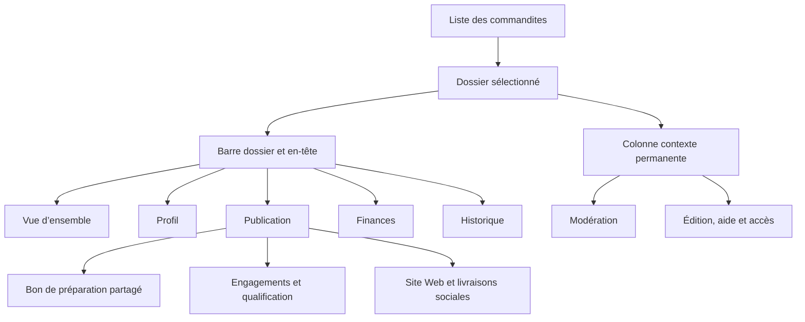

# Blueprint du dossier administratif d’une commandite

Inventaire initial du code au **18 octobre 2026**, révision `bc593f7f`. Périmètre :
`/admin/fundraiser/sponsors?sponsorshipId=<uuid>`, ses cinq onglets visibles,
ses outils permanents et ses panneaux conditionnels. Cette analyse décrit
l’interface ; l'évolution appliquée à DOS-B.a11/a20 est précisée ci-dessous.
Le découpage proposé en fin de document reste une proposition.
Aucune opération métier ni modification de données n’a été exécutée pour l’analyse.

Le [blueprint général](admin-operations-blueprint.md) compare ce dossier,
le [Guide transversal](admin-guide-blueprint.md) et Campagnes. Le **guide du dossier**
inventorié ici est un volet `
` ; il est distinct de la carte Guide
transversale et du dialogue « Guide pas à pas ».

## Conventions et limites

Les identifiants `DOS-…` désignent une zone, `DOS-….a…` une action. Dans les tables :
**L** = lecture/affichage local ; **N** = navigation/focus ; **P** = préparation
d’un brouillon ou d’un manifeste ; **M** = mutation persistante ; **E** = effet externe
possible, y compris mise en file d’un courriel. Une action de préparation peut
persister un brouillon privé : ce n’est pas une autorisation de publication.

Rôles : **T** = lecteur, opérateur et propriétaire ; **G** = opérateur/propriétaire ;
**O** = propriétaire. Le mode token local utilise certaines branches sans identité
OIDC ; il ne faut pas interpréter cette compatibilité comme un nouveau rôle.
Les conditions présentées viennent des composants et contrôleurs observés.
L’API reste l’autorité des droits, versions et préconditions ; cette revue statique
ne constitue pas une recette de chacun des endpoints. Les responsabilités
financières et éditoriales suivent les [règles financières](financial-rules.md),
les [règles commandites](sponsorship-rules.md) et les
[rôles administratifs](../operations/admin-identity-and-alerts.md).

Un champ modifiable figure dans les tables comme action de saisie. Les familles
répétées, par prestation, clause, fichier, canal ou décision, conservent un ID
stable auquel ajouter l’ID de l’objet. Les récurrences du même bouton dans un
manifeste ou un inspecteur réutilisent le même parcours métier.

## Composition réelle et navigation

Source : [page et câblage des sorties][page], [orchestration][page-ts],
[onglets][tabs], [navigation][navigation], [contrats de panneaux][panels].
`admin-sponsor-dossier-panels.ts` définit des événements typés ; il ne constitue
pas le registre des onglets. Celui-ci est dans le composant d’onglets.

<!-- prettier-ignore -->
| ID | Onglet affiché | Valeur d’URL | Responsabilité actuelle | Surface additionnelle |
| --- | --- | --- | --- | --- |
| DOS-O | Vue d’ensemble | `overview` | Comprendre le dossier et la prochaine intervention | Assistant, synthèse, incidents Stripe, note interne, décisions de revue |
| DOS-I | Profil | `identity` | Identité, coordonnées, soumission commanditaire et médias | Galerie complète, droits, analyses et modération de média |
| DOS-P | Publication | `publication` | Aller des engagements à leur livraison | Bon de préparation, accord historique, assistance, échéances, audit global, visibilité Web et publications sociales |
| DOS-F | Finances | `billing` | Lire documents et remboursements, ouvrir le remboursement | Factures/avoirs, courriels défaillants, suivi Stripe |
| DOS-H | Historique | `audit` | Consulter les événements disponibles du dossier | Filtre par domaine, inspecteur transversal |

Les valeurs internes `media` et `refund` restent acceptées et affichent respectivement
**Profil** et **Finances** comme onglets actifs. Elles ciblent des sous-zones ; elles
ne créent pas deux onglets visibles supplémentaires. Le paramètre `sponsorshipId`
porte l’identifiant de contribution utilisé comme identifiant métier du dossier.
Les fragments `#dossier-…` ciblent une zone précise. Les commandes d’actualisation
du dossier et des sous-composants ne rechargent pas toutes le même jeu de données.

### DOS-L — Liste qui reste voisine du dossier

Responsabilité : retrouver et changer de dossier dans le contexte des filtres et
de la page courante. En mode dossier, l’en-tête général et les compteurs de synthèse
sont masqués ; la liste devient compacte. Sources : [filtres][list-filters],
[résultats][list-results], [pagination][list-pages], [page][page].

<!-- prettier-ignore -->
| Action | Commande | Responsabilité, effet et conditions |
| --- | --- | --- |
| DOS-L.a01 | Rechercher | L/N, T : modifier la requête de recherche ; le chargement de liste appartient au contrôleur de page. |
| DOS-L.a02 | Ouvrir/replier les filtres | L, T : afficher les critères et leur compteur actif. |
| DOS-L.a03 | Filtrer la revue | L/N, T : toutes, en attente, approuvées ou refusées ; ne décide pas une revue. |
| DOS-L.a04 | Filtrer visibilité/statut feed | L/N, T : sélectionner le statut déclaré ; ce filtre mélange deux vocabulaires dans son libellé. |
| DOS-L.a05 | Filtrer le paiement | L/N, T : tous, payé, remboursé ou litige. |
| DOS-L.a06 | Réinitialiser | L/N, T : effacer les filtres actifs ; désactivé sans critère actif. |
| DOS-L.a07 | Ouvrir une ligne | N, T : sélectionner `sponsorshipId` et ouvrir son dossier ; les badges ne sont pas des commandes. |
| DOS-L.a08 | Page précédente / suivante | L/N, T : parcourir les résultats ; bornes désactivées. |
| DOS-L.a09 | Changer le nombre par page | L/N, T : changer la pagination de liste. |
| DOS-L.a10 | Réessayer après erreur | L, T : relire la liste ; aucun traitement financier. |
| DOS-L.a11 | Actualiser / ouvrir le site public | L ou N, T : commandes de l’en-tête général visibles après fermeture du dossier ; route publique `/fonds-des-batisseurs`. |

### DOS-T — Barre d’outils, en-tête et orientation permanents

Responsabilité : identifier le dossier, distinguer ses états indépendants et
rejoindre l’intervention utile. Sources : [page][page], [en-tête][header],
[prochain point][next], [progression][progress]. La progression est chargée sur
tous les onglets ; sa synthèse repliable ne s’affiche que sur Vue d’ensemble.

<!-- prettier-ignore -->
| Zone / action | Responsabilité et comportement |
| --- | --- |
| DOS-T.z01 — En-tête | L, T : entreprise, initiales, montant/palier ; revue, visibilité Web, paiement, état de remboursement restent des badges séparés. |
| DOS-T.a01 — Revenir à la liste | N, T : fermer le dossier sélectionné ; ne refuse ni n’annule la commandite. |
| DOS-T.a02 — Note interne | N, T : rejoint Vue d’ensemble puis ouvre le tiroir de note DOS-O.z05. |
| DOS-T.a03 — Activité | N, T : rejoint Historique ; n’ouvre pas le journal d’interventions. |
| DOS-T.a04 — Suivi / interventions | N/L, T : ouvre DOS-J, avec prochaine date de revue si connue. |
| DOS-T.a05 — Actualiser le dossier | L, T : relire les faits ; désactivé pendant chargement/action. |
| DOS-T.a06 — Dossier précédent / suivant | N, T : ouvre le voisin disponible dans le contexte de la liste ; désactivé à la borne. |
| DOS-T.a07 — Détails d’en-tête | L, T : déplier référence, date de soumission et dernière revue. |
| DOS-T.z02 — Alerte de paiement | L, T : expliquer l’inadmissibilité ; le paiement n’est jamais corrigé par le navigateur. |
| DOS-T.a08 — Actualiser après conflit | L, T : relire une version devenue obsolète ; ne rejoue pas automatiquement la décision. |
| DOS-T.a09 — Choisir un des cinq onglets | N, T : afficher le domaine et son état projeté ; ne complète aucun jalon. |
| DOS-T.a10 — Consulter l’activité de préparation | N/L, T : si `preparationActivityId` existe, ouvrir le tiroir d’activité avec `activity.openPreparation`. Voir ENV06 dans les [zones communes](admin-operations-blueprint.md#zones-et-actions-de-lenveloppe-commune). Ce tiroir est distinct du Parcours du paiement du Guide. |
| DOS-T.a11 — Rejoindre le prochain point | N, T : lien paramétré vers onglet/fragment décidé par la projection de progression. |
| DOS-T.a12 — Déplier les blocages de publication | L, T : lire les causes et la responsabilité du traitement ; chaque cause donne un lien N vers sa zone propriétaire. |
| DOS-T.a13 — Réessayer la lecture de progression | L, T : visible en erreur/indisponibilité, relire les faits de progression. |
| DOS-T.a14 — Déplier le résumé d’avancement | L, T, Vue d’ensemble : lire les jalons et le nombre résolu. Dans cette page `streamlined=true`, ce résumé n’est pas le parcours complet non compact du composant. |

## Vue d’ensemble

### DOS-O.z01 — Contexte et assistant du dossier

Responsabilité actuelle : reformuler les faits, conseiller une prochaine étape,
préparer note, publication ou demande de renseignements, et éventuellement mettre
un courriel en file après revue. L’instance est `compact=true`, `inlineDossier=true`.
Source : [assistant contextuel][assistant] et [contrôleur][assistant-controller].
Le bouton d’actualisation propre au composant est masqué dans cette instance.

<!-- prettier-ignore -->
| Action | Responsabilité, effet et conditions |
| --- | --- |
| DOS-O.a01 | Déplier les faits : L, T ; paiement, remboursement, revue, visibilité déclarée, consentement, médias, canaux promis/couverts et champs manquants. |
| DOS-O.a02 | « Ouvrir » la recommandation : N, T ; ici émet `dossierOpen` et donne le focus à la synthèse du même dossier, au lieu de suivre `context.adminUrl` comme dans une instance non intégrée. |
| DOS-O.a03 | Préparer une demande de renseignements : P, G et capacité serveur ; préparer `sponsorship_reminder`, sans envoi à ce clic. |
| DOS-O.a04 | Préparer une note : P, G ; obtenir un brouillon `admin_note`, distinct de l’enregistrement de la note du dossier. |
| DOS-O.a05 | Préparer une publication : P, G, si prochaine étape `prepare_publication` ; brouillon privé, pas publication. |
| DOS-O.a06 | Ouvrir l’espace Assistant : N, si lien activé par le composant ; `/admin/fundraiser/assistant?sponsorshipId=…`. |
| DOS-O.a07 | Modifier objet / corps de la demande : P, deux champs distincts ; destinataire affiché en lecture seule, longueur et contenu contrôlés. |
| DOS-O.a08 | Revoir l’envoi : P, ouvre la confirmation locale avec destinataire, objet et corps exacts ; exige un objet et un message. |
| DOS-O.a09 | Annuler / Échap dans cette confirmation : L, referme sans envoi. |
| DOS-O.a10 | Confirmer l’envoi : M/E, G avec capacités ; mise en file du message, résultat attendu du serveur ; ne signifie pas réception du courriel. |
| DOS-O.a11 | Voir le courriel : N, vers `/admin/fundraiser/email-queue?messageId=…` après résultat d’envoi. |
| DOS-O.a12 | Saisir une question / demander : P/L, T lorsque conversation activée ; interroger le contexte. Le composant indique le mode simulé ; une réponse n’est pas une décision. |
| DOS-O.a21 | Ouvrir l’action du brouillon : N, selon la proposition ; suivre `draft.adminUrl` vers le formulaire propriétaire. Aucun texte automatiquement enregistré par ce lien. |
| DOS-O.a22 | Ouvrir un lien de réponse : N, T ; chaque lien fourni rejoint sa destination administrative, sans appliquer une recommandation. |

Le brouillon affiché est rendu par [AdminAssistantDraft][assistant-draft] et la réponse
par [AdminAssistantAnswer][assistant-answer] ; leur consultation ne vaut ni application
automatique de la note, ni confirmation d’une publication. Ces présentations et leurs
liens éventuels appartiennent à l’Assistant transversal.

### DOS-O.z02 à DOS-O.z05 — Incidents synthèse message et note

Sources : [faits][facts], [synthèse et tiroir de note][overview],
[workflow de revue][review-workflow].

<!-- prettier-ignore -->
| Zone / action | Responsabilité, effet et conditions |
| --- | --- |
| DOS-O.z02 — Incidents Stripe | L, T, seulement si événements échoués : type et référence ; pas de réparation automatique. |
| DOS-O.a13 — Ouvrir l’incident | N, T : `/admin/fundraiser/attention?type=stripe_event_failed&itemId=…`. |
| DOS-O.z03 — Commandite | L, T : référence publique et avantages affichés ; lien d’aide vers les Finances. Cette synthèse n’est pas le registre détaillé des engagements. |
| DOS-O.a14 — Copier la référence | L, T : presse-papiers, sans mutation du dossier ; désactivé si référence absente, retour de statut local. |
| DOS-O.a15 — Ouvrir le Profil | N, T : sélectionne `identity`. |
| DOS-O.a16 — Ouvrir les Finances | N, T : sélectionne `billing`. |
| DOS-O.z04 — Message du commanditaire | L, T, conditionnel : message reçu, distinct d’une note interne. |
| DOS-O.z05 — Note interne | L, T : aperçu privé, brouillon non enregistré, compteur et état de sauvegarde dans le tiroir. |
| DOS-O.a17 — Lire/modifier la note | N/L, T ; l’ouverture reste possible en lecture seule. |
| DOS-O.a18 — Saisir la note | P, G : maximum 1 000 caractères ; aucune sauvegarde au fil de frappe. |
| DOS-O.a19 — Enregistrer la note | M, G : seulement si modifiée ; sauvegarde par le workflow de revue, ne modifie pas la décision de revue. |
| DOS-O.a20 — Fermer la note | L : fermeture du tiroir ; indisponible pendant sauvegarde. Le libellé « Fermer » ne promet pas d’abandonner le brouillon. |

La [barre de décisions DOS-D](#decisions-de-revue-et-remboursement) est présente
sur cet onglet pour G. Le refus ouvre un panneau conditionnel dans le corps du dossier.

## Profil

### DOS-I.z01 — Coordonnées et soumission

Responsabilité : afficher l’identité et distinguer les renseignements saisis par
l’administration de la soumission effective du commanditaire. Sources :
[identité][identity], [tiroir d’édition][edit], [contrôleur de correction][edit-controller].

<!-- prettier-ignore -->
| Action / zone | Responsabilité, effet et conditions |
| --- | --- |
| DOS-I.z01 — Coordonnées | L, T : entreprise, nom public, personne-ressource, courriel, site Web ; état complet/manquant. |
| DOS-I.a01 — Modifier les coordonnées | N/P, G : ouvre le même tiroir que « Modifier le dossier » en colonne contexte. |
| DOS-I.z02 — Soumission commanditaire | L, T : date et état soumis/en attente. Une correction administrative ne fabrique pas `sponsor_details_submitted_at`. |
| DOS-I.a02 — Accès de suivi | N, O, si soumission manquante : ouvre DOS-A ; ce clic n’envoie pas encore de courriel. |
| DOS-I.a03 — Comprendre la différence de saisie | L, T : déplier l’explication administration/commanditaire. |
| DOS-I.a04 | Saisir l’entreprise (`companyName`) : P, G ; champ obligatoire du tiroir. |
| DOS-I.a05 | Saisir le nom public (`publicName`) : P, G. |
| DOS-I.a06 | Saisir le contact (`contactName`) : P, G. |
| DOS-I.a07 | Saisir le courriel du contact (`contactEmail`) : P, G ; correction d’identité distincte du destinataire d’un courriel déjà émis. |
| DOS-I.a08 | Saisir le site Web (`websiteUrl`) : P, G ; URL validée. |
| DOS-I.a09 | Choisir le motif : P, G ; correction, mise à jour du contact ou de l’organisation. |
| DOS-I.a10 — Enregistrer la correction | M, G : changement validé, confirmation du dossier cible, version attendue et identifiant de requête ; conflit impose relecture. |
| DOS-I.a11 — Annuler / fermer l’édition | L : ferme sans soumettre ; bloqué pendant traitement. |

La barre DOS-D de revue est également visible sur Profil. L’alias `tab=media`
affiche cette même composition, pas uniquement la galerie.

### DOS-M — Médias du Profil

Responsabilité actuelle : lire le logo, revoir la préférence du commanditaire,
gérer les fichiers et leurs droits, analyser et modérer les médias. Le composant
[détail médias][media-detail] assemble trois sous-surfaces indépendantes.

#### DOS-M.z01 — Logo actuel et préférence commanditaire

Sources : [logo][logo], [préférence média][preference]. Dans ce dossier, le logo
est rendu avec `hideControls=true`, `disabled=true` : **les anciens boutons d’import
et de suppression du composant Logo ne sont pas affichés**. L’import/suppression
actifs sont ceux de la galerie DOS-M.z02.

<!-- prettier-ignore -->
| Action / zone | Responsabilité, effet et conditions |
| --- | --- |
| DOS-M.a01 — Déplier le logo actuel | L, T : aperçu et lien éventuel ; états absent/indisponible distincts. |
| DOS-M.a02 — Ouvrir l’URL du logo | N, T : nouvel onglet, seulement si URL présente. |
| DOS-M.z02 — Préférence du commanditaire | L, T : état, photo souhaitée, correction demandée, disponibilité et explication administrative. N’accorde pas des droits d’utilisation. |
| DOS-M.a03 — Saisir l’explication de préférence | P, G, préférence en attente : minimum 10 caractères. |
| DOS-M.a04 — Confirmer la revue de préférence | P, G : cocher la confirmation explicite. |
| DOS-M.a05 — Accepter la préférence | M, G : confirmation et explication requises ; photo encore disponible ; version de préférence vérifiée. |
| DOS-M.a06 — Refuser la préférence | M, G : confirmation et explication requises ; ne refuse pas le commanditaire. |
| DOS-M.a07 — Reprendre une décision incertaine | M, G : renvoie la même requête en attente ; pas une nouvelle décision différente. |
| DOS-M.a08 — Réessayer la lecture de préférence | L, T : visible après erreur de chargement. |

#### DOS-M.z03 — Galerie et sélection

Sources : [workspace médias][media-workspace], [commandes][media-commands],
[contrôleur][media-controller]. Les blocs d’états, compteurs et reçus expliquent
chargement, absence de fichiers, résultat filtré vide, blocages et résultat incertain.

<!-- prettier-ignore -->
| Action | Responsabilité, effet et conditions |
| --- | --- |
| DOS-M.a09 — Actualiser | L, T : relire le workspace ; désactivé pendant mutation. |
| DOS-M.a10 — Choisir la nature d’import | P, G : logo ou image complémentaire. |
| DOS-M.a11 — Importer des fichiers | M, G : sélection multiple JPEG/PNG/WebP ; résultat reçu/échoué, sans approbation automatique. |
| DOS-M.a12 — Arrêter l’analyse en cours | P : demander l’arrêt des analyses restantes ; ne supprime pas les résultats déjà produits. |
| DOS-M.a13 — Vérifier le reçu incertain | L, G : réconcilier l’opération avant autre mutation ; ne rejoue pas aveuglément le lot. |
| DOS-M.a14 — Modifier les droits par défaut | N/P, G : ouvrir DOS-M.z06 au périmètre dossier. |
| DOS-M.a15 — Rechercher un fichier | L, T : filtre local de galerie. |
| DOS-M.a16 — Choisir un lot | L, T : filtrer par lot et revenir à la première page. |
| DOS-M.a17 — Nouveau lot | N/P, G : ouvrir DOS-M.z07. |
| DOS-M.a18 — Filtrer tout/prêt/à revoir/bloqué | L, T : sélection locale du filtre et compteurs ; aucun fichier approuvé par ce choix. |
| DOS-M.a19 — Sélectionner la page | L, G : sélectionner les fichiers visibles. |
| DOS-M.a20 — Sélectionner les prêts | L, G : sélectionner les fichiers prêts du workspace ; le compteur de prêts vient du contrôleur. |
| DOS-M.a21 — Vider la sélection | L : ne touche pas aux fichiers ; bloqué pendant mutation/résultat incertain. |
| DOS-M.a22 — Cocher un fichier | L, G : ajouter/retirer cet ID de la sélection. |
| DOS-M.a23 — Inspecter une vignette | L/N, T : sélectionner l’élément inspecté et ouvrir son aperçu ; distinct de la sélection de lot. |
| DOS-M.a24 — Page précédente / suivante | L, T : pagination locale de galerie, bornes désactivées. |
| DOS-M.a25 — Approuver la sélection | P, G, admissibilité requise : préparer un manifeste exact DOS-M.z08, sans approbation à ce clic. |
| DOS-M.a26 — Analyser la sélection | P/M, G et capacité : analyses privées séquentielles, pas de décision de publication. |
| DOS-M.a27 — Droits de la sélection | N/P, G : ouvre DOS-M.z06 ; portée et couverture exactes doivent être relues. |
| DOS-M.a28 — Refuser la sélection | N/P, G : ouvre le formulaire de motifs DOS-M.z07. |
| DOS-M.a29 — Supprimer la sélection | P, G : préparer le manifeste de suppression, pas supprimer au premier clic. |
| DOS-M.a30 — Choisir le lot de destination | P : préparer l’option du déplacement. |
| DOS-M.a31 — Déplacer | P, G : préparer le manifeste de déplacement vers le lot choisi ou hors lot. |

#### DOS-M.z04 — Inspecteur d’un média

Responsabilité : vérifier le fichier exact, sa disponibilité et ses droits avant
décision. Source : [workspace médias][media-workspace].

<!-- prettier-ignore -->
| Action / zone | Responsabilité, effet et conditions |
| --- | --- |
| DOS-M.z04 — Aperçu et faits | L, T : grande image, dimensions, taille, état, motifs de blocage, héritage des droits, crédit et restrictions. |
| DOS-M.a32 — Fermer l’inspecteur | L, T : désélectionne l’élément inspecté ; ne détruit pas le fichier. |
| DOS-M.a33 — Modifier le texte alternatif | P, G : brouillon de 300 caractères maximum ; pris en compte dans la décision préparée. |
| DOS-M.a34 — Accuser lecture des restrictions | P, G : lorsqu’elles existent et n’ont pas déjà été revues. |
| DOS-M.a35 — Revoir et approuver ce fichier | P, G, admissibilité : manifeste unitaire DOS-M.z08. |
| DOS-M.a36 — Refuser ce fichier | P, G : formulaire de motifs, puis manifeste. |
| DOS-M.a37 — Déplier les options avancées | L, T : expose droits individuels, sélection Web, suppression et modération. |
| DOS-M.a38 — Personnaliser les droits | N/P, G : ouvrir DOS-M.z06 au périmètre média. |
| DOS-M.a39 — Restaurer l’héritage | P/M, G, exception média existante : parcours de droits avec `usage=null`, preuve et confirmation ; pas un simple reset visuel. |
| DOS-M.a40 — Choisir / retirer pour le site Web | P/M, G, média approuvé : manifeste `website_select`/`website_deselect` ; peut modifier l’exposition du média sur une fiche déjà visible. |
| DOS-M.a41 — Supprimer ce fichier | P/M, G : manifeste et confirmation ; effet distinct de « Fermer ». |
| DOS-M.a42 — Modérer ce média | P/M, G : même composant et panneau transversal que [DOS-C](#colonne-contexte-et-moderation), sujet `{type:'media', id}`. |
| DOS-M.a43 — Actions contextuelles | L/N/P : ouvrir/replier le contrôleur transversal sur l’élément inspecté ; commandes Aperçu, Approuver, Refuser et Droits, avec contexte ID/version. Aperçu donne le focus à la grande image ; les trois autres réutilisent les formulaires et manifestes déjà inventoriés. |

#### DOS-M.z05 — Analyse assistée et historique privé du média

Sources : [analyse][media-analysis], [historique][media-history].

<!-- prettier-ignore -->
| Action | Responsabilité, effet et conditions |
| --- | --- |
| DOS-M.a44 — Déplier l’analyse | L : affiche capacités techniques/assistance, état, péremption, signaux et décision de revue. |
| DOS-M.a45 — Analyser / réanalyser | P/M, G : lancer l’analyse du fichier ; ne l’approuve pas. |
| DOS-M.a46 — Préremplir depuis l’analyse | P, G, résultat réussi et à jour, sans brouillon humain existant : reprendre la suggestion dans le brouillon local. |
| DOS-M.a47 — Choisir la classification | P, G : classification humaine du résultat. |
| DOS-M.a48 — Enregistrer la revue d’analyse | M, G : conserver une revue `save`. |
| DOS-M.a49 — Accepter la suggestion d’analyse | M, G : décision `accept` de cette analyse ; reste distincte de la revue et de l’exposition du média. |
| DOS-M.a50 — Rejeter la suggestion d’analyse | M, G : décision `reject`, sans refus global de la commandite. |
| DOS-M.a51 — Déplier l’historique privé | L, G : journal du média, dates, acteur et références de preuve ; masqué aux lecteurs dans cette instance. |
| DOS-M.a52 — Déplier une référence de preuve | L, G : révéler la preuve privée de l’événement concerné. |
| DOS-M.a53 — Actualiser après erreur / charger la suite | L, G : deux commandes de lecture, pagination du journal. |

#### DOS-M.z06 — Tiroir des droits d’utilisation

Sources : [commandes][media-commands], [éditeur partagé de droits][usage-editor],
[orchestration de commandes][media-commands-ts]. Responsabilité : documenter les
droits pour une couverture précise, sans en faire une approbation éditoriale.

<!-- prettier-ignore -->
| Action | Responsabilité, effet et conditions |
| --- | --- |
| DOS-M.a54 — Choisir la portée | P, G : dossier, lot ou média ; le périmètre média n’est disponible qu’avec un élément inspecté. |
| DOS-M.a55 — Choisir le lot des droits | P, G, portée lot : définit l’objet cible. |
| DOS-M.a56 — Inclure les imports futurs | P, G, portée dossier/lot : élargissement explicite, distinct de la sélection présente ; absent en restauration d’héritage. |
| DOS-M.a74 — Cocher les canaux d’utilisation | P, G : modifier chaque canal autorisé, indépendamment des cibles et des transformations. |
| DOS-M.a57 — Cocher les cibles d’utilisation | P, G : modifier chaque destination autorisée. |
| DOS-M.a58 — Cocher les transformations | P, G : modifier chaque transformation autorisée. |
| DOS-M.a59 — Saisir crédit | P, G : 200 caractères maximum. |
| DOS-M.a60 — Saisir restrictions | P, G : 1 000 caractères maximum. |
| DOS-M.a61 — Saisir la preuve des droits | P, G : preuve requise par cette instance administrative. |
| DOS-M.a62 — Confirmer les droits | P, G : case explicite de déclaration, pas revue éditoriale. |
| DOS-M.a63 — Enregistrer les droits / restaurer l’héritage | M, G : couverture exacte, preuve, révision attendue et confirmation du scope ; possible même sans fichiers actuels si couverture future explicitement choisie. |
| DOS-M.a64 — Fermer / annuler | L : fermeture du tiroir sans soumettre ; indisponible pendant traitement. |

La couverture effective peut prendre la sélection, ou les éléments du workspace
si elle est vide, puis appliquer le scope de lot. Ce comportement mérite un libellé
et un manifeste explicites ; « droits par défaut » et « droits de la sélection »
ouvrent actuellement le même dispositif.

#### DOS-M.z07 et DOS-M.z08 — Lot, refus et manifeste

Sources : [tiroir de commandes][media-commands], [orchestrateur][media-commands-ts].

<!-- prettier-ignore -->
| Action / zone | Responsabilité, effet et conditions |
| --- | --- |
| DOS-M.a65 — Saisir le nom du lot | P, G : 120 caractères maximum. |
| DOS-M.a66 — Créer le lot | M, G : nom non vide, révision du workspace et confirmation de la commandite cible. |
| DOS-M.a67 — Choisir le motif de refus média | P, G : motifs permis pour N3. |
| DOS-M.a68 — Saisir la raison interne média | P, G : privée, distincte du message commanditaire. |
| DOS-M.a69 — Saisir l’explication commanditaire média | P, G : requise pour préparer le refus. |
| DOS-M.a70 — Préparer la décision de refus | P : obtenir le manifeste serveur des médias concernés. |
| DOS-M.z08 — Manifeste | L, G : action, fichiers exacts/version, miniature, texte alternatif, droits, crédit, restrictions, blocages et conséquence d’exposition. |
| DOS-M.a71 — Confirmer la lecture humaine du manifeste | P, G : case obligatoire ; impossible si le plan a des blocages. |
| DOS-M.a72 — Confirmer et exécuter | M, G : appliquer le plan approuvé, unitaire ou multiple ; reçu serveur et réconciliation des résultats incertains. |
| DOS-M.a73 — Fermer le manifeste | L : annule le plan local et son accusé de lecture ; ne défait pas une action déjà confirmée par le serveur. |

## Publication

### DOS-P.z01 — Assemblage du parcours

Sources : [parcours de publication][publication], [faits][facts]. L’ordre livré est :
bon de préparation → avantages → tableau de livraison Web/social → engagements
enregistrés (avec assistance et qualification) → lien vers le moteur. Le panneau
de paramètres avancés du site et de déclaration historique arrive ensuite dans
la page. Le titre « Publication » couvre donc plusieurs domaines et plusieurs
niveaux de décisions, pas seulement la rédaction d’un contenu.

### Bon de préparation partagé

**DOS-B** est le même organisme métier dans Publication, dans Campagnes et dans
le carrousel du Guide. Leurs hôtes pilotent chargement et approbation ; ils ne
doivent pas inventer trois interprétations d’un bon. Sources : [hôte dossier][preparation],
[bon][receipt], [pilotage][pilot], [projection][pilot-projection],
[catalogue contextuel][pilot-actions], [détail de contrôle][issue-detail].
Pour les commandes du carrousel et le passage de lot : [Guide transversal][guide-blueprint].

**Évolution appliquée après l'inventaire initial** : le contrat de présentation
`PreparationDetailsMode` réserve le volet **Détails de l'accord et traçabilité**
au mode `inline` de Campagnes. L'hôte Commandites utilise `hidden` : le volet et
sa commande Détails sont absents, sans lien de remplacement dans le dossier.
Le Guide utilise `campaigns` et propose la navigation vers Campagnes. Cela ne
retire ni la qualification de l'accord dans DOS-E, ni la relecture du contenu,
ni l'approbation et son historique dans le bon partagé.

Le dossier comporte **trois contrôles** et **trois autorisations** possibles :

<!-- prettier-ignore -->
| ID de contrôle | Nature | Responsabilité et propriétaire de la correction |
| --- | --- | --- |
| `payment_confirmed` | Contrôle | Lire le fait financier confirmé ; dossier/Finances et opérations Stripe. Aucun bouton du bon ne confirme artificiellement le paiement. |
| `accepted_offer` | Contrôle | Vérifier l’offre acceptée ou la qualification historique et ses prestations ; Engagements DOS-E. L’assistance ne vaut pas qualification. |
| `content_prepared` | Contrôle | Vérifier la préparation du contenu ; peut agréger plusieurs blocages, y compris hors seule présentation. Les destinations dépendent des blocages serveur : identité, médias, brouillons, conditions d’admissibilité. |
| `public_consent` | Autorisation | Vérifier le consentement requis ; le lire ne permet pas de le donner à la place du commanditaire. |
| `sponsor_review` | Autorisation | Vérifier la revue commanditaire ; propriétaire fonctionnel DOS-D / modération. |
| `moderation_review` | Autorisation | Vérifier l’autorisation de modération de la version courante ; panneau transversal DOS-C. |

Le compteur est **dynamique** : les éléments `not_required` sont exclus ; les
blocages supplémentaires ne rajoutent pas artificiellement des contrôles.
Dans le Guide de lot, `dossier_examined` peut s’ajouter. Il ne faut donc pas
dessiner un invariant universel « six contrôles à valider ». Une préparation
approuvée reste rattachée à sa version ; elle n’est ni une livraison ni une
autorisation d’envoi social.

<!-- prettier-ignore -->
| Zone / action | Responsabilité, effet et conditions |
| --- | --- |
| DOS-B.z01 — Identité du bon | L, T : référence, version courte/complète et état incomplet, à revoir, prêt ou approuvé. |
| DOS-B.z02 — Paiement et offre | L, T : montant/devise, état confirmé, prestations/quantités/canal/cible/délai ; absence d’offre explicitée. |
| DOS-B.z03 — Synthèse préparation | L, T : canaux applicables, autorisations et état privé des brouillons ; ce résumé ne donne aucune autorisation supplémentaire. |
| DOS-B.a01 — Actualiser le bon | L, T : relire le bon et le résumé d’assistance ; bloqué pendant lecture/approbation. |
| DOS-B.a02 — Sélectionner un contrôle/blocage | L, T : afficher son explication et sélectionner ID ; aucun contrôle validé au clic. |
| DOS-B.a03 — Déplier « Pourquoi » | L, T : causes serveur pour le contrôle choisi. |
| DOS-B.a04 — Déplier l’explication d’assistance | L, O, contrôle `accepted_offer` : état local, décomptes de clauses, limites et péremption ; aucun texte privé de source dans ce résumé. |
| DOS-B.a05 — Actualiser l’assistance en erreur | L, O : relire son résumé, désactivé pendant activité. |
| DOS-B.a06 — Actions | L/N, T : ouvrir le contrôleur contextuel ; aucune décision enregistrée. |
| DOS-B.a07 — Rejoindre le point propriétaire | N, T : action primaire selon le contrôle : inspecter, accord, modération ou présentation. Les URL administratives sont filtrées ; correction dans le formulaire métier. |
| DOS-B.a08 — Examiner la proposition assistée | N, O et capacité/état : rejoindre `#dossier-assistance-review` de la commandite, mémoriser le point de retour. |
| DOS-B.a09 — Voir la source assistée | N, O : rejoindre `#dossier-assistance-source` ; même mécanisme de retour temporaire. |
| DOS-B.a10 — Relancer l’assistance | P/M, O : job explicite pour la révision attendue ; bloqué pendant job actif/activité ; n’applique pas de prestations. |
| DOS-B.a11 — Détails / traçabilité | **Retiré de Commandites** (`hidden`). Dans Campagnes (`inline`), déplier et cibler CAM-P08, L/N, T. Dans le Guide (`campaigns`), remplacé par **Voir les prestations dans Campagnes**, N, T, avec le dossier courant. |
| DOS-B.a12 — Historique des approbations | L/N, T : déplier l’historique ou revenir au bon s’il est absent. |
| DOS-B.a13 — Revenir / Échap du contrôleur | L, T : fermer les actions et restaurer le focus. |
| DOS-B.a14 — Approuver la préparation, dans le contrôleur | P puis M, G : ouvrir la confirmation habituelle si le serveur dit `canApprove`, version et rôle valides. |
| DOS-B.a15 — Approuver la préparation, bouton du bon | Même commande que a14, même confirmation ; masqué si déjà approuvé. |
| DOS-B.a16 — Annuler la confirmation | L : aucun accord transmis. |
| DOS-B.a17 — Confirmer l’approbation | M, G : version exacte, référence cible, `requestId` et `confirmed=true` ; reçu serveur et audit. Lecture/approbation en cours, résultat incertain et erreur de configuration bloquent l’accord. |
| DOS-B.a18 — Déplier le contenu exact | L, T : titre, corps, divulgation, canal/cible et version de chaque brouillon. |
| DOS-B.a19 — Ouvrir la source d’un brouillon | N, T : vers son écran propriétaire, URL administrative filtrée. |
| DOS-B.a20 — Déplier l’accord / traçabilité | **Retiré de Commandites et du Guide** ; disponible seulement dans Campagnes en CAM-P08 (`inline`), L, T : date de paiement, version/clauses de l’offre, format/durée/exigences, états de brouillons, bilan des obligations, version complète et portée de l’approbation. |
| DOS-B.a21 — Déplier l’estampille approuvée | L, T : acteur, date, version et référence d’audit de l’accord actuel. |
| DOS-B.a22 — Déplier l’historique des accords | L, T : accords précédents et leurs versions/audits, sans les réactiver. |

Une nouvelle sélection, version de bon ou révision d’assistance referme les actions
et invalide les gestes retardés. Lecture et fermeture ne valent aucune validation.
Le clavier/la manette activent les mêmes commandes natives ; le focus et le retour
au neutre relèvent du contrôleur transversal. Le nombre de blocages et le terme
« présentation » ne doivent pas faire croire que `content_prepared` possède
à lui seul tous les domaines qui peuvent empêcher la préparation.

### DOS-P.z02 à DOS-P.z04 — Avantages, Web et social

Sources : [tableau de livraison][publication], [planification][publication-ts],
[workflow de visibilité][publication-workflow].

<!-- prettier-ignore -->
| Zone / action | Responsabilité, effet et conditions |
| --- | --- |
| DOS-P.z02 — Avantages | L, T : liste synthétique et explication de l’absence d’accord connu ; ce n’est pas l’éditeur des termes DOS-E. |
| DOS-P.z03 — Livraison | L, T : avancement confirmé et responsabilité (humain/moteur), date proposée ou programmée, raisons d’attente. |
| DOS-P.z06 — Console par obligation | L, T : pour chaque obligation, canal/cible/ordinal, état, responsabilité et raison ; date de livraison qualifiée ou horaire programmé. Cette console coexiste avec les cartes par canal et le registre DOS-E. |
| DOS-P.a12 — Voir la preuve d’une obligation | N, T, URL qualifiée disponible : ouvrir le post justifiant cette prestation dans un nouvel onglet ; ce clic n’atteste pas une nouvelle livraison. |
| DOS-P.a13 — Examiner / résoudre une obligation | N/L, T, `deliveryId` et responsabilité admin : ouvrir DOS-S sur la livraison liée ; le libellé dépend de la nécessité d’autorisation ou de résolution. |
| DOS-P.a01 — Actualiser la planification après erreur | L, T : relire le sous-workspace de planification, sans préparer de livraison. |
| DOS-P.z04 — Fiche Web | L, T : état visible/masqué, admissibilité et motifs de blocage. |
| DOS-P.a02 — Voir sur le site | N, T, fiche visible : nouvel onglet `/commanditaires`. |
| DOS-P.a03 — Modifier la fiche | N/P : ouvrir le panneau avancé DOS-W ; le bouton est rendu même pour lecture seule, l’enregistrement reste protégé. |
| DOS-P.a04 — Publier / masquer la fiche Web | M, G : confirmation explicite, version attendue du site ; publier exige `site.canPublish`. N’envoie pas de post social. |
| DOS-P.z05 — Carte sociale par canal/cible | L, T : Facebook/LinkedIn × OpenG7/OpenG20, état, pause, simulation, date et erreur ; simulation distincte d’une preuve réelle. |
| DOS-P.a05 — Ouvrir une ancienne publication | N, T, publication sans livraison liée : `/admin/fundraiser/publications?draftId=…`. |
| DOS-P.a06 — Voir la publication externe | N, T, URL disponible : nouvel onglet public ; sa consultation n’enregistre pas une preuve. |
| DOS-P.a07 — Examiner / consulter une livraison | N/L, T : ouvrir le tiroir partagé DOS-S pour l’ID de livraison. |
| DOS-P.a08 — Modifier le créneau | N/P, selon `canEdit` : ouvrir DOS-S en édition ; absence de saisie automatique de décision. |
| DOS-P.a09 — Préparer pour un feed | P/M, selon `canPrepare(source)` : créer/préparer le brouillon privé pour cette source ; pas d’autorisation d’envoi. |
| DOS-P.a10 — Voir les détails du moteur | N, T, si aucune action directe admissible : vers `/admin/fundraiser/publications/automation` avec contexte. |
| DOS-P.a11 — Ouvrir le moteur en pied de parcours | N, T : même écran propriétaire des livraisons et feeds. |

### DOS-W — Paramètres avancés : fiche publique et déclaration historique

Source : [panneau avancé][website-panel], [workflow][publication-workflow].
Responsabilité actuelle double : modifier l’adresse/le résumé de la fiche Web
et maintenir une déclaration historique de suivi social. **Un statut déclaré
« publié » n’est pas une preuve qualifiée de livraison d’une prestation.**

<!-- prettier-ignore -->
| Action | Responsabilité, effet et conditions |
| --- | --- |
| DOS-W.a01 — Déplier/replier les paramètres | L, T : ouvrir le formulaire et sa prévisualisation non publiée. |
| DOS-W.a02 — Saisir le slug public | P, G : adresse publique, erreur de slug bloquante. |
| DOS-W.a03 — Choisir la destination historique | P, G : aucune, OpenG7 ou OpenG20 ; ne déplace pas automatiquement une obligation enregistrée. |
| DOS-W.a04 — Choisir le statut déclaré | P, G : déclaration de suivi ; distinct du statut de livraison du moteur. |
| DOS-W.a05 — Cocher Facebook | P, G : canal déclaré ; impossible de retirer un canal promis verrouillé. |
| DOS-W.a06 — Cocher LinkedIn | P, G : même règle. |
| DOS-W.a07 — Saisir le résumé public | P, G : maximum 500 caractères ; aperçu non publié. |
| DOS-W.a08 — Saisir l’URL de publication | P, G : maximum 2 048 caractères, déclaration historique. |
| DOS-W.a09 — Saisir les notes feed | P, G : maximum 1 000 caractères. |
| DOS-W.a10 — Enregistrer | M, G : brouillon modifié, admissible, sans erreur de slug ; version attendue. Le passage vers/depuis le statut déclaré `published` ouvre une confirmation explicite. |
| DOS-W.a11 — Confirmer / annuler la déclaration sensible | M ou L : confirmation cible avant sauvegarde, sans appel de fournisseur social. |
| DOS-W.z01 — Prévisualisation non publiée | L, T : logo, nom public, résumé, destination, canaux et URL déclarés ; ne vaut ni revue ni publication. |

### DOS-E — Engagements enregistrés et qualification historique

Sources : [engagements][commitments], [contrôleur][commitments-controller].
Responsabilité : conserver l’offre et ses termes, dériver les obligations et
leurs preuves, qualifier un accord historique documenté, ajuster sans réécriture
rétroactive des faits. Les nouveaux achats ont une offre figée au Checkout ;
la qualification manuelle sert l’historique sans offre enregistrée.

<!-- prettier-ignore -->
| Action / zone | Responsabilité, effet et conditions |
| --- | --- |
| DOS-E.a01 — Actualiser | L, T : relire les engagements, version et obligations. |
| DOS-E.z01 — Offre enregistrée | L, T : provenance/version, montant/devise, bénéfices, quantités, canal/cible, format, exigences, délai/durée. |
| DOS-E.z02 — Obligations courantes | L, T : état, ordinal/version, preuve qualifiée éventuelle ; l’offre d’origine n’est pas remplacée par ces états. |
| DOS-E.a02 — Ajuster une obligation | N/P, O, si non `fulfilled` et non `adjusted` : sélectionner l’obligation et ouvrir DOS-E.z04. |
| DOS-E.z03 — Qualification historique | P, O, `needs_confirmation`, CAD : documenter les termes prouvés, pas appliquer le barème actuel à un ancien paiement. |
| DOS-E.a03 — Revenir à la clause | N/L, si documentation issue d’une suggestion : rejoindre la clause source sans confirmer le brouillon. |
| DOS-E.a04 — Choisir le canal d’une prestation | P, O : site Web, Facebook, LinkedIn. |
| DOS-E.a05 — Choisir la cible | P, O : OpenG7/OpenG20. |
| DOS-E.a06 — Saisir la quantité | P, O : entier borné 1–100. |
| DOS-E.a07 — Choisir le format social | P, O : format explicite/indéterminé ; absent pour Web. |
| DOS-E.a08 — Exiger le nom d’entreprise | P, O : case propre à la prestation. |
| DOS-E.a09 — Exiger la présentation approuvée | P, O : autre exigence indépendante. |
| DOS-E.a10 — Exiger le logo approuvé | P, O : autre exigence indépendante. |
| DOS-E.a11 — Saisir le délai en jours | P, O : délai contractuel, pas un créneau d’envoi. |
| DOS-E.a12 — Saisir la durée en jours | P, O : durée promise, avec limites de prise en charge expliquées. |
| DOS-E.a13 — Ajouter une prestation | P, O : maximum trois entrées dans le formulaire livré. |
| DOS-E.a14 — Retirer une entrée de brouillon | P, O : ne supprime pas une obligation déjà enregistrée. |
| DOS-E.a15 — Documenter la preuve d’accord | P, O : référence/texte, lecture seule lorsque rattachée à l’assistance. |
| DOS-E.a16 — Saisir le motif de qualification | P, O : saisie partagée avec la revue assistée lorsqu’elle est active, sans second motif global. |
| DOS-E.a17 — Recopier l’identifiant de commandite | P, O : confirmation de cible, pas un simple acquittement de lecture. |
| DOS-E.a18 — Rejoindre un blocage du formulaire | N/L, O : focus sur clause/champ à compléter ; résumé borné aux premiers blocages. |
| DOS-E.a19 — Qualifier / appliquer les prestations | M, O : valide les termes, preuve, motif, confirmation et version ; assistance applicable si sélectionnée. Ne publie rien. |
| DOS-E.z04 — Ajustement | P, O : formulaire versionné de modification d’une obligation existante. |
| DOS-E.a20 — Choisir destination / format / dispense | P, O : type d’ajustement ; format absent pour Web. |
| DOS-E.a21 — Choisir nouvelle cible | P, O, ajustement destination. |
| DOS-E.a22 — Choisir nouveau format | P, O, ajustement format. |
| DOS-E.a23 — Reconnaître la dispense | P, O, ajustement waiver : case explicite, sans fausse preuve de livraison. |
| DOS-E.a24 — Saisir la raison d’ajustement | P, O : justification tracée. |
| DOS-E.a25 — Recopier l’ID d’obligation | P, O : confirmer l’objet ajusté. |
| DOS-E.a26 — Enregistrer l’ajustement | M, O : nouvelle transition versionnée/auditée ; pas réécriture de l’offre acceptée. |
| DOS-E.a27 — Déplier la requête en attente | L, O : ID de requête/version/payload, motif, preuve et termes, après résultat incertain. |
| DOS-E.a28 — Réessayer la requête exacte | M, O : même requête idempotente après réconciliation ; pas nouvel ordre arbitraire. |

#### DOS-E.z05 — Revue assistée de l’accord historique

Sources : [assistance][assistance], [table de propositions][proposal],
[contrôleur d’assistance][assistance-controller]. Le propriétaire seul y accède,
pour une provenance différente de `accepted_offer`. Les capacités serveur,
révisions, péremption et modifications humaines verrouillent les commandes.
La source, l’analyse, la revue et l’application possèdent leurs propres versions.

<!-- prettier-ignore -->
| Action / zone | Responsabilité, effet et conditions |
| --- | --- |
| DOS-EA.z01 — Source → revue → confirmation | L, O : repères d’étape ; le résultat d’analyse seul ne complète pas le contrôle d’offre du bon. |
| DOS-EA.a01 — Actualiser | L, O : relire source, job, suggestion et revue. |
| DOS-EA.a02 — Réinitialiser la source après conflit | P/L, O : abandonner le brouillon obsolète au profit de la source courante ; ne supprime pas l’historique. |
| DOS-EA.a03 — Retourner au Pilotage | N/L, si origine temporaire connue : relire le bon et restaurer le contrôle ; aucun texte privé conservé dans le repère de retour. |
| DOS-EA.a04 — Modifier la source | N/P, O et capacité : afficher l’éditeur. |
| DOS-EA.a05 — Saisir le titre de source | P, O : 200 caractères maximum. |
| DOS-EA.a06 — Saisir le texte d’accord | P, O : texte d’origine privé, longueur maximale configurée. |
| DOS-EA.a07 — Enregistrer la source | M, O : versionner la source ; exige titre/texte, changement réel et absence de conflit. |
| DOS-EA.a08 — Voir la source complète | L, O : déplier texte et empreinte ; pas une nouvelle extraction. |
| DOS-EA.a09 — Analyser / réanalyser | P/M, O, capacité : lancer le job explicite ; bloqué par brouillons source/revue non enregistrés et activité courante. |
| DOS-EA.a10 — Qualification manuelle | N/P, O : rejoindre le formulaire habituel ; ne crée pas immédiatement un accord. |
| DOS-EA.z02 — Résultat d’analyse | L, O : état/phase, activité indéterminée, erreurs/péremption, revue existante et éventuelle application. Aucun pourcentage de confiance inventé. |
| DOS-EA.a11 — Réinitialiser la revue | P/L, O : reprendre la version de revue connue après brouillon/conflit. |
| DOS-EA.a12 — Prochaine clause incomplète | N/L, O : focus sur le premier point non résolu. |
| DOS-EA.a13 — Déplier faits cités | L, O, par clause : lire références exactes, quantité/cible/format, faits critiques et citations. |
| DOS-EA.a14 — Déplier informations manquantes | L, O, par clause : lire les lacunes détectées, sans les inventer. |
| DOS-EA.a15 — Documenter cette prestation | N/P, O, clause prise en charge : ouvrir/préremplir un brouillon du formulaire métier ; n’applique pas la suggestion. |
| DOS-EA.a16 — Choisir la disposition de clause | P, O : résoudre humainement la clause ; inclusion interdite aux termes non pris en charge. |
| DOS-EA.a17 — Lier une prestation à la clause incluse | P, O : choisir le bénéfice du brouillon courant. |
| DOS-EA.a18 — Saisir la note de clause | P, O : justification locale de cette résolution. |
| DOS-EA.a19 — Modifier le motif global | N/P, O : donne le focus à l’unique motif partagé DOS-E.a16. |
| DOS-EA.a20 — Utiliser le formulaire | P, O : sélectionner/lier cette revue au brouillon métier, sans qualification à ce clic. |
| DOS-EA.a21 — Enregistrer la revue | M, O : conserver les résolutions et le motif sur la version attendue ; ne crée pas d’obligations. |
| DOS-EA.a22 — Rejeter la proposition | M, O : rejeter la suggestion/version ; ne refuse pas la commandite. |
| DOS-EA.a23 — Appliquer après confirmation | Renvoi vers DOS-E.a19 : seul le formulaire métier qualifie l’accord avec ses préconditions et confirmation. |

#### DOS-E.z06 — Temporalité des obligations

Source : [temporalité][timing]. Présente pour les obligations avec délai/durée.
Responsabilité : établir l’origine contractuelle, observer la visibilité et attester
une durée distinctement de la programmation et de la présence actuelle d’un post.

<!-- prettier-ignore -->
| Action / zone | Responsabilité, effet et conditions |
| --- | --- |
| DOS-ET.z01 — Échéance/durée | L, T : origine, échéance, durée/état, début observé, date minimale, dernière observation publique, retard/redémarrage requis. |
| DOS-ET.a01 — Gérer la temporalité | L, O, navigateur, obligation pending/blocked et durée non attestée : déplier le formulaire. |
| DOS-ET.a02 — Saisir une origine | P, O : seulement si origine manquante et délai contractuel connu. |
| DOS-ET.a03 — Saisir la preuve | P, O : référence de preuve temporelle. |
| DOS-ET.a04 — Saisir la raison | P, O : justification de l’opération. |
| DOS-ET.a05 — Recopier l’ID d’obligation | P, O : confirmation de cible. |
| DOS-ET.a06 — Enregistrer l’origine | M, O : origine versionnée, sans modifier le paiement. |
| DOS-ET.a07 — Observer | M, O, Web/OpenG7 avec durée : conserver une observation du fait public ; ne prouve pas à elle seule toute la durée. |
| DOS-ET.a08 — Attester la continuité | P, O : case requise avant attestation de durée, début existant et pas de redémarrage requis. |
| DOS-ET.a09 — Attester la durée | M, O : preuve humaine et préconditions temporelles, distinctes de l’instant de publication. |
| DOS-ET.a10 — Réessayer la requête en attente | M, O : reprise de la même demande, formulaire verrouillé tant qu’en attente. |

#### DOS-E.z07 et DOS-E.z08 — Outils de portefeuille dans un dossier

Sources : [aperçu d’adoption][commitments], [audit historique][historical-audit].
Ces deux zones dépassent potentiellement le dossier sélectionné.

<!-- prettier-ignore -->
| Action / zone | Responsabilité, effet et conditions |
| --- | --- |
| DOS-EI.z01 — Aperçu d’adoption | L, O : inventaire de plusieurs commandites, classification et compteurs d’obligations/preuves/déclarations. |
| DOS-EI.a01 — Déplier l’inventaire | L, O : rendre l’outil visible. |
| DOS-EI.a02 — Choisir 25 / 50 | L, O : taille de lecture, pas taille d’un traitement. |
| DOS-EI.a03 — Charger l’aperçu | L, O : lire une page d’inventaire ; ne migre aucun accord. |
| DOS-EI.a04 — Ouvrir un dossier inventorié | N, O : autre `sponsorshipId`, onglet Publication. |
| DOS-EI.a05 — Page suivante | L, O : curseur d’inventaire. |
| DOS-EH.z01 — Audit de preuves historiques | L, O : anomalies d’exigences/durée/snapshot et dernières conclusions ; l’audit ne fabrique pas de nouvelle preuve. |
| DOS-EH.a01 — Charger | L, O : lire l’audit. |
| DOS-EH.a02 — Basculer en global | L, O : change le périmètre de lecture au-delà de la commandite courante ; verrouillé pendant requête en attente. |
| DOS-EH.a03 — Filtrer les constats | L, O : choisir le type d’anomalie à examiner. |
| DOS-EH.a04 — Examiner une preuve | P/L, O : sélectionner la preuve et ouvrir sa revue. |
| DOS-EH.a05 — Lire la page suivante | L, O : curseur d’audit. |
| DOS-EH.a06 — Choisir la conclusion | P, O : conclusion de revue humaine de cette preuve. |
| DOS-EH.a07 — Saisir la raison | P, O : justification obligatoire. |
| DOS-EH.a08 — Cocher la confirmation | P, O : reconnaissance explicite du périmètre. |
| DOS-EH.a09 — Enregistrer la revue historique | M, O : conclusion tracée ; pas une publication ni une réécriture du fait livré. |
| DOS-EH.a10 — Réessayer le résultat incertain | M, O : même requête en attente ; champs protégés. |

### DOS-S — Tiroir partagé de livraison sociale

Sources : [tiroir][delivery], [contrôleur de livraison][delivery-controller].
Responsabilité : revoir le message, média, destination et horaire exacts, autoriser
l’envoi, puis traiter son résultat. Équivalent réellement partagé avec Publications
automatiques ; le dossier ne doit pas réimplémenter ses décisions.

Les mentions G ci-dessous désignent les mutations du périmètre opérateur/propriétaire.
Dans le tiroir observé, `editable()` dépend d’abord de l’état de livraison ; tous les
boutons ne sont pas masqués ou désactivés par un contrôle de rôle local. La sécurité
ne doit donc jamais être déduite de leur présence ou de leur absence. Harmoniser
la présentation en lecture seule mérite une vérification distincte des droits API.

<!-- prettier-ignore -->
| Action / zone | Responsabilité, effet et conditions |
| --- | --- |
| DOS-S.z01 — Contexte et blocages | L, T : feed, compte, mode, état, reprise, erreur et commanditaires liés ; « mock » reste une simulation. |
| DOS-S.a01 — Fermer | L, T : fermer le tiroir ; bloqué pendant opération, sans annuler un envoi déjà autorisé. |
| DOS-S.a02 — Ouvrir le dossier bloquant | N, T : lien vers Profil/médias, Vue d’ensemble ou Finances selon le blocage de source, revue ou paiement. |
| DOS-S.a03 — Modifier les brouillons sources | N, T : `/admin/fundraiser/publications/drafts` si contenu source manquant. |
| DOS-S.a04 — Modérer la livraison | P/M, G : DOS-C avec sujet `publication_delivery`, désactivé si brouillon modifié/non enregistré ou occupé. |
| DOS-S.z02 — Aperçu exact | L, T : message, horaire/fuseau, image exacte ou aperçu source, collection et crédits ; distinct du formulaire d’édition. |
| DOS-S.a05 — Modifier | P, si livraison éditable : passer en édition locale. |
| DOS-S.a06 — Choisir feed / nature | P, mode composition uniquement : options du composant partagé, pas une commande exposée par les cartes du dossier pour composer librement. |
| DOS-S.a07 — Saisir le message | P : 2 900 caractères maximum. |
| DOS-S.a08 — Choisir date et heure | P : horaire exact, fuseau du navigateur affiché. |
| DOS-S.a09 — Choisir format de publication | P, livraison de commandite : formats disponibles selon le dossier et le contenu. |
| DOS-S.a10 — Choisir une photo par commanditaire | P, format dérivé : uniquement ses options qualifiées ; crédit affiché. |
| DOS-S.a11 — Revoir les photos du commanditaire | N : Profil via `tab=media` du dossier source. |
| DOS-S.a12 — Choisir l’image directe | P, format non dérivé : image disponible ou aucune ; aperçu/crédit visibles. |
| DOS-S.a13 — Enregistrer le brouillon de livraison | M, G et éditable : message/horaire/média valides ; révoque une autorisation obsolète selon les règles de version. |
| DOS-S.a14 — Ouvrir un commanditaire en attente | N : depuis la liste de revue préalable. |
| DOS-S.a15 — Cocher l’accord d’envoi | P : reconnaître le contenu exact ; si des commanditaires sont en attente, le texte indique l’approbation combinée. |
| DOS-S.a16 — Accepter et programmer / approuver | M/E, G, état draft : case d’accord puis panneau de modération N0 de chaque commanditaire en attente et de la livraison ; contenu enregistré, présentation requise et média exact disponibles. Autorise l’envoi différé avec revue commanditaire combinée éventuelle ; ne rend pas sa fiche Web visible. |
| DOS-S.a17 — Refuser la livraison | M, G, éditable : panneau de décision N3 avec confirmation ; refus de cette publication, pas refus automatique du commanditaire. |
| DOS-S.a18 — Annuler l’autorisation | M, G, état approved : confirmation ; ne vaut pas suppression d’un post déjà publié. |
| DOS-S.a19 — Saisir une référence externe | P, état uncertain sans image : identifier le post à réconcilier. |
| DOS-S.a20 — Réconcilier | M, G : rattacher un résultat externe, pas relancer un envoi ambigu. |
| DOS-S.a21 — Déplier l’attestation d’absence | L : pour état uncertain ou reprise de compte requise. |
| DOS-S.a22 — Saisir le motif d’absence | P : minimum 20 caractères. |
| DOS-S.a23 — Confirmer l’absence vérifiée | P : case explicite. |
| DOS-S.a24 — Attester l’absence | M, G : sortie encadrée de quarantaine avec raison/confirmation ; une nouvelle autorisation demeure distincte. |
| DOS-S.a25 — Voir le post externe | N, URL fournie : nouvel onglet. |
| DOS-S.a26 — Vérifier la visibilité | M/L, G, publication live publiée : confirmation dédiée puis observation externe conservée ; pas une preuve rétroactive de toute la durée. |

Les confirmations exactes sont pilotées par le contrôleur de livraison et les
services transversaux ; les champs éditables ne confèrent pas un droit serveur.
L’état incertain, l’envoi fournisseur reçu et sa finalisation locale sont distincts,
conformément au [runbook de publication](../operations/publication-automation.md).

## Finances

Sources : [assemblage][page], [faits financiers][facts], [historique remboursement][refund-history].
Responsabilité : rapprocher les faits confirmés, documents et traitement du
remboursement. Les montants et devises restent explicites ; le statut d’une
demande de remboursement ne remplace pas le montant confirmé.

<!-- prettier-ignore -->
| Zone / action | Responsabilité, effet et conditions |
| --- | --- |
| DOS-F.z01 — Remboursements confirmés | L, T : état et montant confirmé, avertissement en cas de vérification nécessaire. |
| DOS-F.z02 — Documents | L, T : factures/avoirs, numéro, date, montant/devise ; avoir manquant signalé. |
| DOS-F.a01 — Ouvrir les factures du dossier | N, T : `/admin/fundraiser/invoices?contributionId=…`. |
| DOS-F.a02 — Prévisualiser une facture | L/N, T : inspecteur transversal `inspection.invoice` avec contribution cible. Le numéro d’avoir est actuellement du texte, pas le même bouton. |
| DOS-F.a03 — Ouvrir un courriel défaillant/incertain | N, T : `/admin/fundraiser/email-queue?messageId=…` ; ici aucun retry SMTP direct. |
| DOS-F.z03 — Suivi du remboursement | L, T : état du workflow, montant d’origine, référence, montant d’opération, raison et référence Stripe. |
| DOS-F.z04 — Jalons remboursement | L, T : chronologie et états, séparés des écritures confirmées. |
| DOS-F.z05 — Notes et erreurs remboursement | L, T : note privée et dernière erreur. |
| DOS-F.z06 — Actions administratives liées | L, T : événements d’audit du remboursement. |
| DOS-F.a04 — Déplier le détail d’acteur | L, T : identification détaillée pour l’événement concerné. |
| DOS-F.a05 — Rembourser Stripe | N/P, O, admissibilité : ouvre DOS-R. La barre financière n’apparaît pas à l’opérateur. |

## Historique

Sources : [historique dossier][audit], [inspecteur][inspection].
Responsabilité : montrer les événements disponibles pour cette commandite et leur
provenance. Ce n’est pas nécessairement l’intégralité de tous les historiques
spécialisés : médias, préparation, interventions et engagements ont leurs lectures.

<!-- prettier-ignore -->
| Action / zone | Responsabilité, effet et conditions |
| --- | --- |
| DOS-H.z01 — Chronologie | L, T : plus récent d’abord, événement, date, détails, acteur ; périmètre disponible explicité. |
| DOS-H.a01 — Filtrer par domaine | L, T : tout ou domaine disponible, compteur visible/total ; aucune relecture financière. |
| DOS-H.a02 — Déplier un acteur | L, T : afficher l’identifiant détaillé si présent. |
| DOS-H.a03 — Inspecter l’historique | L/N, T : `inspection.history(selected)`, inspecteur transversal éphémère ; les actions propres à l’inspecteur sont inventoriées dans le [blueprint général](admin-operations-blueprint.md). |

## Colonne contexte et modération

### DOS-C — Actions de modération présentes sur tous les onglets

Sources : [actions de modération][moderation-actions], [composant][moderation-actions-ts],
[panneau de décision][moderation-panel]. Responsabilité : créer/lire une décision
sur un sujet et une version de contenu explicites, traiter ses recours et sa
revue indépendante. Même organisme pour commandite, média et livraison.

<!-- prettier-ignore -->
| Action / zone | Responsabilité, effet et conditions |
| --- | --- |
| DOS-C.z01 — Sujet de commandite | L, G : `{type:'sponsorship', id:selected.id}` ; bloc entièrement masqué aux lecteurs. |
| DOS-C.a01 — Choisir le niveau | P, G : N0/N1/N2/N4/N5 pour commandite ; N3 remplace N4 pour média/livraison. |
| DOS-C.a02 — Ouvrir la décision | P/L : charger le contenu exact et ouvrir le panneau transversal ; ne décide rien au premier clic. |
| DOS-C.a03 — Déplier l’historique de modération | L, G : charge cas, décisions et recours. |
| DOS-C.a04 — Réessayer la lecture/affectation | L, O si lecture des comptes nécessaire : relire après erreur. |
| DOS-C.a05 — Choisir un responsable | P, O : compte actif non lecteur ou non attribué. |
| DOS-C.a06 — Enregistrer l’affectation | M, O : confirmation avec cible/responsable et valeur précédente attendue ; ce n’est pas une décision éditoriale. |
| DOS-C.a07 — Traiter un recours ouvert | P puis M, G : ouvre le même panneau, explication obligatoire ; une correction ne réactive pas une autorisation de publication. |
| DOS-C.a08 — Revue indépendante | M, G avec identité distincte requise : confirmation de la décision courante en attente ; refus serveur si acteur inadmissible. |
| DOS-C.z02 — Décisions passées | L, G : niveau, motif, explication commanditaire, politique, version de contenu et date. |

#### DOS-C.z03 — Panneau transversal de décision

<!-- prettier-ignore -->
| Action | Responsabilité, effet et conditions |
| --- | --- |
| DOS-C.a09 — Réessayer le chargement du contenu | L : après erreur, aucune mutation. |
| DOS-C.a10 — Voir le contenu exact | L : déplier snapshot et version réellement examinés. |
| DOS-C.a11 — Choisir le motif principal | P : décision défavorable, catalogue versionné de motifs. |
| DOS-C.a12 — Déplier / cocher les motifs secondaires | L/P : motifs complémentaires, distincts du principal. |
| DOS-C.a13 — Choisir la disposition éditoriale | P : requis si incompatibilité éditoriale invoquée. |
| DOS-C.a14 — Saisir la raison interne | P : requise dans les cas défavorables ; privée. |
| DOS-C.a15 — Saisir l’explication commanditaire | P : si nécessaire selon décision/recours ; distincte de la raison interne. |
| DOS-C.a16 — Confirmer l’examen | P : case explicite ; une modification de texte/motif réinitialise la confirmation. |
| DOS-C.a17 — Annuler / fermer | L : `moderation.answer(null)` ; aucune décision persistée. |
| DOS-C.a18 — Continuer | P puis M : renvoyer la décision complète au demandeur, qui exécute sa propre mutation (revue, visibilité ou modération directe). Le panneau n’est pas une deuxième API métier universelle. |

### DOS-U — Utilitaires permanents

<!-- prettier-ignore -->
| Zone / action | Responsabilité, effet et conditions |
| --- | --- |
| DOS-U.a01 — Modifier le dossier | N/P, G : même tiroir de correction DOS-I.a04–a11, visible dans la colonne sur tous les onglets. |
| DOS-U.z01 — Guide du dossier | L, T : volet d’explication du parcours courant, séparé de la carte Guide globale et du dialogue Guide pas à pas. |
| DOS-U.a02 — Déplier le guide | L, T : affiche position, sujet, état, raison, qui intervient, trois instructions et condition d’achèvement. |
| DOS-U.a03 — Modifier l’identité depuis le guide | N/P, G si `identity_missing` : réutilise le tiroir DOS-I. |
| DOS-U.a04 — Ouvrir l’accès depuis le guide | N, O si `identity_submission_pending` : réutilise DOS-A. |
| DOS-U.a05 — Ouvrir la section conseillée | N, T : lien vers le même dossier avec onglet/fragment ; ne réalise pas le jalon. |
| DOS-U.a06 — Étape précédente / suivante | L, T : parcourir les explications, sans changement métier. |
| DOS-U.a07 — Revenir à la recommandation | L, T : revenir au premier point conseillé si dossier incomplet. |
| DOS-U.a08 — Déplier l’accès commanditaire | L/N, O : affiche DOS-A ; réservé propriétaire. |

Source du guide local : [guide du dossier][dossier-guide]. Il coexiste avec la
prochaine action, le contexte Assistant, le bon de préparation et le Guide global :
ce sont plusieurs dispositifs d’orientation, pas cinq décisions métier distinctes.

### DOS-A — Accès au suivi commanditaire

Source : [accès][access], [contrôleur][access-controller].

<!-- prettier-ignore -->
| Action | Responsabilité, effet et conditions |
| --- | --- |
| DOS-A.a01 — Envoyer l’accès | P, O : lire le destinataire effectif côté serveur puis afficher sa confirmation. |
| DOS-A.a02 — Annuler la confirmation | L : aucun message mis en file. |
| DOS-A.a03 — Confirmer l’accès à ce destinataire | M/E, O : renvoi idempotent avec identifiant de requête ; statut `queued` ne signifie pas message reçu. |

Ce parcours ne doit pas être confondu avec la demande de renseignements DOS-O,
le journal d’un appel DOS-J, le courriel de refus DOS-D ou le courriel de remboursement DOS-R.

## Journal d’interventions

**DOS-J** est ouvert depuis la barre dossier, pas un sixième onglet.
Sources : [interventions][interventions], [contrôleur][interventions-controller].
Responsabilité : garder la trace privée d’un contact/intervention et d’une
prochaine revue. « Courriel » comme nature d’entrée documente une intervention ;
ce choix ne crée pas un envoi SMTP.

<!-- prettier-ignore -->
| Action / zone | Responsabilité, effet et conditions |
| --- | --- |
| DOS-J.a01 — Ouvrir / fermer le suivi | L/N, T : tiroir privé, fermeture bloquée pendant sauvegarde. |
| DOS-J.a02 — Actualiser | L, T : relire le suivi et le journal. |
| DOS-J.z01 — Synthèse de suivi | L, T : état, âge du paiement, prochaine revue, dernier courriel connu, dernière intervention. |
| DOS-J.a03 — Déplier les consignes | L, T : explication des délais et périmètre du suivi. |
| DOS-J.a04 — Ouvrir l’accès commanditaire | N, O, suivi ni complet ni inactif : fermer le journal puis ouvrir DOS-A. |
| DOS-J.a05 — Ajouter une intervention | N/P, G : focus sur le formulaire. |
| DOS-J.a06 — Choisir la nature | P, G : courriel, téléphone, interne, prolongation, revue du remboursement. |
| DOS-J.a07 — Choisir la prochaine date | P, G, prolongation : échéance de revue obligatoire. |
| DOS-J.a08 — Saisir la note | P, G : maximum 2 000 caractères, privée. |
| DOS-J.a09 — Enregistrer l’intervention | M, G : ajouter un fait tracé, sans courriel ni remboursement implicite ; même requête conservée lors d’un résultat incertain. |
| DOS-J.a10 — Déplier un acteur | L, T : détail d’identité si présent. |
| DOS-J.a11 — Charger la suite | L, T : pagination du journal privé. |

## Décisions de revue et remboursement

### DOS-D — Barre de décision de revue commanditaire

Sources : [barre de décisions][decisions], [workflow revue][review-workflow].
La barre est affichée pour G sur Vue d’ensemble et Profil ; elle est absente sur
Publication et Historique. Sur Finances, elle devient une barre de remboursement
réservée à O. La revue du commanditaire n’est pas l’accord sur le bon ni la
permission d’exposition Web ni l’accord d’envoi d’une livraison sociale.

<!-- prettier-ignore -->
| Action | Responsabilité, effet et conditions |
| --- | --- |
| DOS-D.a01 — Remettre en attente | M, G : confirmation dédiée, puis panneau de modération N2 ; absent si déjà en attente/occupé. |
| DOS-D.a02 — Refuser | P, G : ouvrir DOS-D.z02 ; aucune mutation au clic initial. |
| DOS-D.a03 — Accepter | P puis M, G, paiement admissible et `canApprove` : panneau de modération N0, confirmation du contenu, version attendue, résultat serveur. |
| DOS-D.z01 — Retour d’action | L, G : cible, référence et état de revue pending/success/error ; pas de succès avant réponse confirmée. |

#### DOS-D.z02 — Formulaire de refus

Source : [formulaire refus][rejection] et [workflow revue][review-workflow].
L’ouverture rejoint Vue d’ensemble et referme le remboursement. Le formulaire
peut encore être rendu tant que son état reste ouvert ; ce n’est pas un onglet autonome.

<!-- prettier-ignore -->
| Action | Responsabilité, effet et conditions |
| --- | --- |
| DOS-D.a04 — Saisir la raison interne du refus | P, G : même note de revue du dossier, privée. |
| DOS-D.a05 — Saisir le message commanditaire | P, G : explication adressée au commanditaire. |
| DOS-D.a06 — Demander le courriel de refus | P, G : option explicite d’envoi. |
| DOS-D.a07 — Modifier le destinataire de refus | P, G si notification : adresse à confirmer dans la décision finale ; distincte de l’identité d’origine. |
| DOS-D.a08 — Choisir le suivi de remboursement | P, G : aucun pour l’instant, manuel à traiter ou manuel déclaré effectué ; ne confirme pas un remboursement Stripe. |
| DOS-D.a09 — Saisir la note de remboursement | P, G : note explicative du traitement envisagé. |
| DOS-D.a10 — Annuler / fermer le refus | L : aucune décision ; bloqué pendant action. |
| DOS-D.a11 — Confirmer le refus | P puis M/E, G : validation puis décision de modération, version et cible ; peut mettre le courriel choisi en file ; revue indépendante si la gravité l’exige. Ne rembourse pas implicitement Stripe. |

### DOS-R — Formulaire de remboursement Stripe

Sources : [remboursement][refund], [workflow][refund-workflow].
Présent seulement pour O ; ouverture sur Finances et fermeture du refus. Il s’agit
d’une opération financière avec effets réels selon l’environnement, contrairement
à une note ou une préparation. Ce blueprint n’en autorise aucune exécution.

<!-- prettier-ignore -->
| Action / zone | Responsabilité, effet et conditions |
| --- | --- |
| DOS-R.z01 — Avertissement financier | L, O : montant demandé comparé au paiement ; ne remplace pas les contrôles de solde serveur. |
| DOS-R.a01 — Saisir le montant | P, O : saisie décimale UI convertie/validée pour l’API ; le fait comptable reste en unités mineures entières. |
| DOS-R.a02 — Choisir la raison Stripe | P, O : demande client, doublon ou fraude. |
| DOS-R.a03 — Recopier le texte de confirmation | P, O : confirmation explicite de cible/opération. |
| DOS-R.a04 — Demander le courriel de remboursement | P, O : option d’envoi, sans effet sur la réussite financière. |
| DOS-R.a05 — Saisir le destinataire | P, O si notification : adresse validée. |
| DOS-R.a06 — Saisir le message commanditaire | P, O si notification : contenu obligatoire dans ce cas. |
| DOS-R.a07 — Saisir la note de remboursement | P, O : justification privée. |
| DOS-R.a08 — Annuler / fermer | L : aucune demande financière ; bloqué pendant traitement. |
| DOS-R.a09 — Rembourser Stripe | M/E, O : préconditions, montant restant, texte de confirmation, validation serveur, idempotence et audit ; confirmation fournisseur, avoir et courriel ont leurs propres issues. |

## Responsabilités à séparer et équivalents réels

Cette section propose un rangement. Elle n’affirme pas qu’une nouvelle route, un
nouvel onglet ou une extraction technique a été livré. Un équivalent « existant »
signifie un composant/service/parcours réellement réutilisé ou un écran propriétaire
identifiable ; une simple ressemblance de panneau ne suffit pas.

<!-- prettier-ignore -->
| ID | Constat actuel et périmètres mélangés | Découpage proposé | Équivalent existant / limite |
| --- | --- | --- | --- |
| DOS-X01 | Publication assemble contrat, extraction, préparation, modération, visibilité, planning, preuve et inventaire global. | Distinguer **Engagements**, **Préparation**, **Livraisons**, **Fiche publique** ; dossier garde une synthèse et des accès ciblés. Ne pas ajouter tous ces panneaux dans Campagnes. | Bon DOS-B et tiroir DOS-S déjà partagés ; Campagnes porte la vue portefeuille des prestations. Aucun écran dédié complet « Engagements » n’est prouvé par cette analyse. |
| DOS-X02 | Inventaire d’adoption et bascule d’audit global se trouvent dans un dossier individuel. | Sortir la lecture globale vers une surface de portefeuille/qualité ; dossier préfiltré sur sa contribution. | Audit et API existent ; leur présence imbriquée ne prouve pas une page autonome existante. Campagnes peut orienter vers la qualification sans inventer des prestations. |
| DOS-X03 | Paramètres avancés mélangent slug/résumé public et statut social historique ; le mot Publication désigne aussi la visibilité réelle. | Éditeur **Fiche publique** distinct du **Suivi historique déclaré** ; preuve qualifiée et envoi automatique restent dans leurs propriétaires. | Workflow de visibilité Web et moteur social existent déjà, séparés côté services. Le formulaire avancé n’est pas un équivalent de l’autorisation sociale. |
| DOS-X04 | Profil regroupe coordonnées/soumission et workspace média complet (droits, lots, analyse, modération, suppression). | Profil présente identité/soumission et résumé des médias ; ouvrir un espace médias focalisé, ou sections clairement séparées. | `MediaReviewWorkspace` et l’éditeur de droits sont déjà des organismes réutilisables ; le logo ancien n’est qu’une lecture dans cette instance, ne pas réactiver ses commandes cachées. |
| DOS-X05 | Colonne contexte identique sur tous les onglets : modération, édition, guide, accès ; elle peut concurrencer une action de domaine. | Une zone de contexte factuelle et un lanceur d’actions contextuelles ; ouvrir les outils dans leur panneau propriétaire selon le besoin. | `ContextController`, `AdminDrawer`, panneau de modération et service de confirmation existent ; ils partagent l’interaction, pas les permissions métier. |
| DOS-X06 | Prochain point, guide dossier, assistant, bon et Guide global expliquent parfois la même intervention avec des modèles différents. | Un contrat d’orientation avec destination/rôle/raison ; Guide enseigne, dossier exécute, bon évalue sa version, Assistant propose. | Projections `AdminSponsorshipProgress`, bon partagé et navigation de préparation existent. Aucun remplacement complet par le Guide global n’est actuellement réalisé. |
| DOS-X07 | Assistant intégré à Vue d’ensemble peut préparer puis envoyer une vraie demande ; la responsabilité dépasse une simple synthèse. | Garder la recommandation et l’accès ; déplacer la rédaction/conversation vers l’Assistant et l’envoi vers son parcours de confirmation existant. | Route Assistant et file courriel existent ; ne pas assimiler « préparer » à « envoyer ». |
| DOS-X08 | Note courante, interventions datées et journal d’audit contiennent tous du texte interne, mais servent des usages différents. | Conserver une note synthétique, un journal de suivi append-only et un audit des décisions ; afficher leurs frontières explicitement. | Tiroirs et historiques existent. Fusionner le texte en un champ commun ferait perdre responsabilité et preuve. |
| DOS-X09 | Barre « Accepter/Refuser » et modération permanente peuvent proposer des portes différentes sur une décision proche ; la première impose N0/N2 et la seconde laisse choisir le niveau. | Un lanceur contextuel unique vers la revue de commandite, conservant le panneau de modération partagé et les parcours financiers séparés. | Panneau DOS-C déjà utilisé par DOS-D ; ne pas supprimer les exigences indépendantes ou confondre le niveau avec le statut final. |
| DOS-X10 | Plusieurs boutons d’actualisation relisent liste, progression, bon, engagements, assistance, planning ou médias. | Nommer la portée de l’actualisation et harmoniser l’invalidation après mutation. | Services/contrôleurs existants ; un bouton partagé visuellement ne prouve pas une transaction globale de lecture. |
| DOS-X11 | `content_prepared` peut agréger des blocages de paiement, revue, source, média et brouillon ; son libellé suggère une présentation étroite. | Afficher des sous-responsabilités et leurs propriétaires ; éviter de transformer ce contrôle en formulaire universel. | Projection des contrôles/destinations déjà partagée ; le serveur continue de décider l’admissibilité. |
| DOS-X12 | Droits par défaut, sélection actuelle et imports futurs passent par le même tiroir de règles. | Montrer objet, couverture actuelle et couverture future comme choix séparés, avec confirmation explicite des fichiers affectés. | Éditeur de droits et scope versionné existent ; l’approbation d’un média reste une autre décision. |
| DOS-X13 | « Accepter » peut viser commanditaire, suggestion, préférence, média, préparation ou livraison. | Ajouter le complément métier dans chaque action et confirmer son effet exact. | Réutiliser confirmations et tiroirs existants ; aucun « Accepter tout » transversal. |

## Priorités de rangement du dossier

La répartition cible commune aux trois surfaces est portée par le
[blueprint général](admin-operations-blueprint.md). Les constats DOS-X01 à DOS-X13
précisent ici les déplacements et réutilisations propres au dossier.

Les premières extractions utiles sont DOS-X02 (global hors dossier), DOS-X03
(fiche Web séparée du suivi historique) et DOS-X06 (orientation cohérente).
Les extractions de Profil et de Publication doivent préserver les liens profonds
`media`/`refund`, les garde-fous de rôle/version et le retour au bon courant.

## Sources propriétaires

Les liens de source suivants permettent de retrouver les inventaires sans figer
des numéros de ligne. La liste reflète les composants effectivement branchés,
pas toutes les fonctionnalités possibles de composants anciens non montés.

[page]: ../../apps/funding-web/src/app/features/funding/pages/admin-sponsors-page/admin-sponsors-page.component.html
[page-ts]: ../../apps/funding-web/src/app/features/funding/pages/admin-sponsors-page/admin-sponsors-page.component.ts
[navigation]: ../../apps/funding-web/src/app/features/funding/pages/admin-sponsors-page/admin-sponsors-navigation.adapter.ts
[panels]: ../../apps/funding-web/src/app/features/funding/models/admin-sponsor-dossier-panels.ts
[tabs]: ../../apps/funding-web/src/app/features/funding/components/admin-sponsors/admin-sponsor-detail-tabs.component.ts
[list-filters]: ../../apps/funding-web/src/app/features/funding/components/admin-sponsors/list-filters/admin-sponsors-filters.component.html
[list-results]: ../../apps/funding-web/src/app/features/funding/components/admin-sponsors/list-results/admin-sponsors-results.component.html
[list-pages]: ../../apps/funding-web/src/app/features/funding/components/admin-sponsors/list-results/admin-sponsors-pagination.component.html
[header]: ../../apps/funding-web/src/app/features/funding/components/admin-sponsors/admin-sponsor-detail-header.component.ts
[next]: ../../apps/funding-web/src/app/features/funding/components/admin-sponsors/admin-sponsorship-next-step.component.html
[progress]: ../../apps/funding-web/src/app/features/funding/components/admin-sponsors/admin-sponsorship-progress.component.html
[assistant]: ../../apps/funding-web/src/app/features/funding/components/admin-assistant/admin-assistant-context.component.html
[assistant-controller]: ../../apps/funding-web/src/app/features/funding/components/admin-assistant/admin-assistant-context-controller.ts
[assistant-draft]: ../../apps/funding-web/src/app/features/funding/components/admin-assistant/admin-assistant-draft.component.ts
[assistant-answer]: ../../apps/funding-web/src/app/features/funding/components/admin-assistant/admin-assistant-answer.component.ts
[facts]: ../../apps/funding-web/src/app/features/funding/components/admin-sponsors/admin-sponsorship-facts.component.html
[overview]: ../../apps/funding-web/src/app/features/funding/components/admin-sponsors/admin-sponsor-detail-overview.component.ts
[identity]: ../../apps/funding-web/src/app/features/funding/components/admin-sponsors/admin-sponsor-detail-identity.component.html
[edit]: ../../apps/funding-web/src/app/features/funding/components/admin-sponsors/admin-sponsor-edit.component.html
[edit-controller]: ../../apps/funding-web/src/app/features/funding/components/admin-sponsors/admin-sponsor-edit-controller.ts
[media-detail]: ../../apps/funding-web/src/app/features/funding/components/admin-sponsors/admin-sponsor-detail-media.component.ts
[logo]: ../../apps/funding-web/src/app/features/funding/components/admin-sponsors/detail-media/admin-sponsor-logo-panel.component.html
[preference]: ../../apps/funding-web/src/app/features/funding/components/sponsor-media-usage/admin-sponsor-media-preference.component.ts
[media-workspace]: ../../apps/funding-web/src/app/features/funding/components/media-review/media-review-workspace.component.html
[media-controller]: ../../apps/funding-web/src/app/features/funding/components/media-review/media-review-workspace.controller.ts
[media-commands]: ../../apps/funding-web/src/app/features/funding/components/media-review/media-review-commands.component.html
[media-commands-ts]: ../../apps/funding-web/src/app/features/funding/components/media-review/media-review-commands.ts
[media-analysis]: ../../apps/funding-web/src/app/features/funding/components/media-review/media-review-analysis.component.html
[media-history]: ../../apps/funding-web/src/app/features/funding/components/media-review/media-review-history.component.html
[usage-editor]: ../../apps/funding-web/src/app/features/funding/components/sponsor-media-usage/sponsor-media-usage-editor.component.html
[publication]: ../../apps/funding-web/src/app/features/funding/components/admin-sponsors/admin-sponsorship-publication.component.html
[publication-ts]: ../../apps/funding-web/src/app/features/funding/components/admin-sponsors/admin-sponsorship-publication.component.ts
[preparation]: ../../apps/funding-web/src/app/features/funding/components/admin-sponsors/admin-sponsorship-preparation.component.ts
[receipt]: ../../apps/funding-web/src/app/features/funding/components/admin-preparation/admin-preparation-receipt.component.html
[pilot]: ../../apps/funding-web/src/app/features/funding/components/admin-preparation/preparation-pilot.component.html
[pilot-projection]: ../../apps/funding-web/src/app/features/funding/components/admin-preparation/preparation-pilot.projection.ts
[pilot-actions]: ../../apps/funding-web/src/app/features/funding/components/admin-preparation/preparation-context-actions.ts
[issue-detail]: ../../apps/funding-web/src/app/features/funding/components/admin-preparation/preparation-issue-detail.component.ts
[commitments]: ../../apps/funding-web/src/app/features/funding/components/admin-sponsors/admin-sponsorship-commitments.component.html
[commitments-controller]: ../../apps/funding-web/src/app/features/funding/components/admin-sponsors/admin-sponsorship-commitments-controller.ts
[assistance]: ../../apps/funding-web/src/app/features/funding/components/admin-preparation/preparation-assistance-review.component.html
[proposal]: ../../apps/funding-web/src/app/features/funding/components/admin-preparation/preparation-assistance-proposal-table.component.html
[assistance-controller]: ../../apps/funding-web/src/app/features/funding/components/admin-preparation/preparation-assistance.controller.ts
[timing]: ../../apps/funding-web/src/app/features/funding/components/admin-sponsors/admin-sponsorship-timing.component.html
[historical-audit]: ../../apps/funding-web/src/app/features/funding/components/admin-sponsors/admin-sponsorship-historical-audit.component.html
[website-panel]: ../../apps/funding-web/src/app/features/funding/components/admin-sponsors/admin-sponsor-publication-panel.component.html
[publication-workflow]: ../../apps/funding-web/src/app/features/funding/services/admin-sponsor-publication-workflow.ts
[delivery]: ../../apps/funding-web/src/app/features/funding/components/admin-publications/publication-delivery-drawer.component.html
[delivery-controller]: ../../apps/funding-web/src/app/features/funding/components/admin-publications/publication-delivery-controller.ts
[refund-history]: ../../apps/funding-web/src/app/features/funding/components/admin-sponsors/admin-sponsor-refund-history.component.html
[audit]: ../../apps/funding-web/src/app/features/funding/components/admin-sponsors/admin-sponsor-audit-history.component.html
[inspection]: ../../apps/funding-web/src/app/features/funding/services/admin-inspection.service.ts
[moderation-actions]: ../../apps/funding-web/src/app/features/funding/components/admin-moderation/funding-moderation-actions.component.html
[moderation-actions-ts]: ../../apps/funding-web/src/app/features/funding/components/admin-moderation/funding-moderation-actions.component.ts
[moderation-panel]: ../../apps/funding-web/src/app/features/funding/components/admin-moderation/funding-moderation-panel.component.html
[dossier-guide]: ../../apps/funding-web/src/app/features/funding/components/admin-sponsors/admin-sponsorship-guide.component.html
[access]: ../../apps/funding-web/src/app/features/funding/components/admin-sponsors/admin-sponsorship-access.component.ts
[access-controller]: ../../apps/funding-web/src/app/features/funding/components/admin-sponsors/admin-sponsorship-access-controller.ts
[interventions]: ../../apps/funding-web/src/app/features/funding/components/admin-sponsors/admin-sponsorship-interventions.component.html
[interventions-controller]: ../../apps/funding-web/src/app/features/funding/components/admin-sponsors/admin-sponsorship-interventions-controller.ts
[decisions]: ../../apps/funding-web/src/app/features/funding/components/admin-sponsors/admin-sponsor-decision-actions.component.html
[review-workflow]: ../../apps/funding-web/src/app/features/funding/services/admin-sponsor-review-workflow.ts
[rejection]: ../../apps/funding-web/src/app/features/funding/components/admin-sponsors/admin-sponsor-rejection-panel.component.html
[refund]: ../../apps/funding-web/src/app/features/funding/components/admin-sponsors/admin-sponsor-refund-panel.component.html
[refund-workflow]: ../../apps/funding-web/src/app/features/funding/services/admin-sponsor-refund-workflow.ts
[guide-blueprint]: admin-guide-blueprint.md
