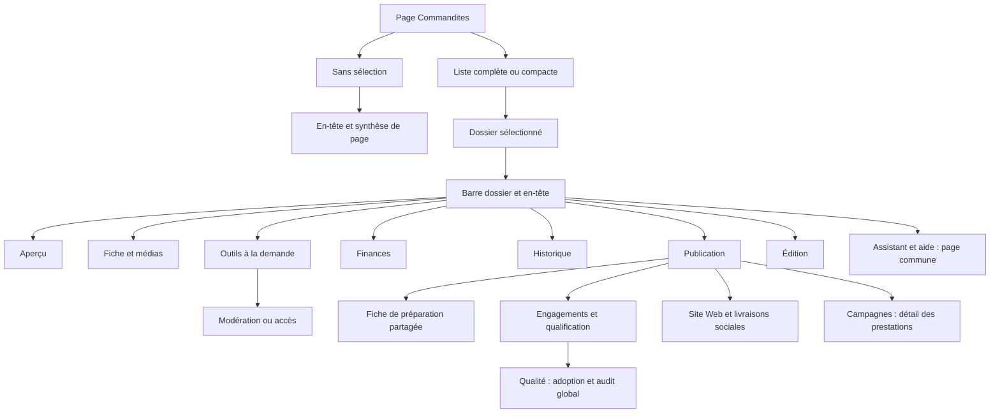

# Blueprint de la page Commandites et de ses onglets

La page `/admin/fundraiser/sponsors` permet de retrouver une commandite, d’établir
ses faits et de prendre les décisions propres à son dossier. Elle présente une
liste puis, avec `sponsorshipId=<uuid>`, un dossier à cinq onglets, ses commandes
de dossier et ses outils à la demande.

Le rangement appliqué allège **Publication**, délègue les lectures globales à
**Qualité des commandites** et rassemble l’orientation principale dans un seul
bandeau. **Fiche et médias** conserve l’identité et la revue des médias. Les
responsabilités conservées et les pistes restantes figurent après l’inventaire.

Inventaire initial au **18 octobre 2026**, révision `bc593f7f`, complété le même
jour à partir de `abffb2f3` et des changements locaux présents. Les libellés
d’onglets ci-dessous reflètent les traductions FR actuelles. Le rangement local
appliqué le même jour est décrit ci-dessous ; les anciens repères des surfaces
retirées restent explicitement historiques. Ce document n’atteste aucun déploiement
ni aucune exécution de publication, de remboursement ou de traitement de données.

Le [blueprint général](admin-operations-blueprint.md) compare ce dossier,
le [Guide administratif](admin-guide-blueprint.md) et Campagnes. L’**aide pas à pas du dossier**
inventoriée ici est un volet `
` sur la page **Assistant et aide** ; elle
est distincte de la carte du Guide administratif et du dialogue « Guide pas à pas ».

La barre du dossier propose une seule entrée **Assistant et aide** vers
`/admin/fundraiser/assistant?sponsorshipId=<uuid>`, avec le retour au dossier
d’origine. L’Assistant occupe les deux tiers gauches et l’aide le tiers droit ;
ils sont empilés sous 1 100 px. Le guide quitte les outils locaux du dossier,
qui conservent modération et accès au suivi ; l’édition reste dans la barre.
Le raccourci **Consulter l’activité** est retiré : l’onglet Historique reste
l’accès au même contenu. Ce regroupement ne déclenche aucune action métier.

Le [vocabulaire harmonisé des opérations](../technical/admin-campaigns.md#vocabulaire-des-operations)
est appliqué aux libellés actuels : dossier de commandite, accord de commandite,
prestations promises, fiche de préparation et historique des approbations. Les
repères `DOS-…` de l’inventaire initial sont conservés.

Les noms des [outils transversaux](../technical/admin-campaigns.md#outils-transversaux)
suivent la même référence : **Revue des médias**, **Fiche de préparation**,
**Guide administratif**, **Inspecteur transversal** et **flux de publication**.
Les citations de libellés historiques sont signalées ; les noms de composants,
clés de traduction et valeurs d’API restent ceux du code.

La revue visuelle complémentaire est consignée image par image :
[C01 — Bandeau « Prochaine étape du dossier »](#c01-bandeau-prochaine-etape).
Les repères `C…` relient les éléments des captures aux repères `DOS-…` existants ;
leurs recommandations sont distinguées du comportement actuel.

## Rangement appliqué — état avant et état actuel

Cette section décrit le code local actuel. Les repères `DOS-…` sont conservés pour
relier l’inventaire initial aux changements ; un bloc marqué **historique** ne
décrit plus une zone montée dans le dossier. Sources : [page][page],
[orchestration][page-ts], [publication][publication], [paramètres][website-panel]
et [page Qualité][quality-page].

<!-- prettier-ignore -->
| Zone | Avant le rangement | État actuel et propriétaire |
| --- | --- | --- |
| Aperçu / DOS-O.z01 | Assistant intégré : faits, recommandation, rédaction et envoi confirmé. | Instance retirée. **Assistant et aide**, dans la barre, transmet `sponsorshipId` et l’origine de retour ; l’Assistant de l’enveloppe reçoit aussi ce contexte. Les actions DOS-O.a01–a12/a21/a22 sont un catalogue historique de l’ancienne instance. |
| Orientation / DOS-T | Prochain point et recommandations répétées dans plusieurs surfaces. | Un bandeau principal `AdminSponsorshipNextStep` ; progression factuelle repliable dans Aperçu. L’aide du dossier explique à la demande, la fiche de préparation évalue sa propre version. |
| Contexte / DOS-C et DOS-U | Colonne permanente de modération, édition, aide et accès. | Colonne retirée. **Modération éditoriale** et **Accès au suivi** ouvrent un panneau non modal depuis la barre, selon les rôles ; le même tiroir d’édition est accessible dans la barre et depuis l’identité. L’aide rejoint la page commune **Assistant et aide**. |
| Publication / DOS-P.z06 | Console complète de chaque obligation, doublant les prestations et les cartes sociales. | Synthèse d’avancement, responsabilité et motif ; lien **Voir les prestations de cette commandite** vers Campagnes avec `sponsorshipId`. Les cartes sociales et leur tiroir partagé restent actifs. |
| Paramètres / DOS-W | Slug, résumé public et déclaration sociale présentés dans une même grille. | Section **Fiche publique** avec aperçu privé ; **Suivi social déclaré** replié séparément. Une sauvegarde versionnée commune enregistre les champs modifiés, sans publier ni autoriser d’envoi. |
| Portefeuille / DOS-EI et DOS-EH | Inventaire d’adoption et bascule d’audit global dans un dossier individuel. | `/admin/fundraiser/sponsors/quality`, réservé au propriétaire, héberge adoption et audit de portefeuille. L’audit conservé dans Publication est strictement lié à sa contribution ; un lien vers Qualité conserve un identifiant de retour au dossier. |
| Préparation / DOS-B | Détails d’accord et traçabilité répétés dans Commandites, Guide et Campagnes. | `PreparationDetailsMode` réserve ces détails à Campagnes ; Commandites conserve contrôles, contenu exact, approbation et historique. |

Les sous-outils du panneau sont montés à leur première ouverture puis masqués
sans être recréés pour le même dossier. Fermer ou changer d’outil conserve ainsi
les requêtes en attente et leurs identifiants idempotents. Une opération en cours
bloque la fermeture ou le changement d’outil ; un panneau de confirmation ou de
modération garde sa priorité. Le retour au neutre et les droits API restent
ceux des parcours propriétaires. Le rangement ne transforme aucune préparation
en approbation ni aucun statut déclaré en preuve financière ou de livraison.

**Périmètres conservés :** identité et revue des médias dans le même onglet,
accord/qualification historique et temporalité dans Publication, note synthétique,
journal d’interventions et audit séparés. Une page autonome Médias ou Engagements
et une fusion de leurs décisions ne sont pas livrées par ce rangement.

## Conventions et limites

Les identifiants `DOS-…` désignent une zone, `DOS-….a…` une action. Dans les tables :
**L** = lecture/affichage local ; **N** = navigation/focus ; **P** = préparation
d’un brouillon ou d’un manifeste ; **M** = mutation persistante ; **E** = effet externe
possible, y compris mise en file d’un courriel. Une action de préparation peut
persister un brouillon privé : ce n’est pas une autorisation de publication.

Rôles : **T** = lecteur, opérateur et propriétaire ; **G** = opérateur/propriétaire ;
**O** = propriétaire. Le mode token local utilise certaines branches sans identité
OIDC ; il ne faut pas interpréter cette compatibilité comme un nouveau rôle.
Les conditions présentées viennent des composants et contrôleurs observés.
L’API reste l’autorité des droits, versions et préconditions ; cette revue statique
ne constitue pas une recette de chacun des endpoints. Les responsabilités
financières et éditoriales suivent les [règles financières](financial-rules.md),
les [règles commandites](sponsorship-rules.md) et les
[rôles administratifs](../operations/admin-identity-and-alerts.md).

Un champ modifiable figure dans les tables comme action de saisie. Les familles
répétées, par prestation, clause, fichier, canal ou décision, conservent un ID
stable auquel ajouter l’ID de l’objet. Les récurrences du même bouton dans un
manifeste ou un inspecteur réutilisent le même parcours métier.

## Composition réelle et navigation

Source : [page et câblage des sorties][page], [orchestration][page-ts],
[onglets][tabs], [libellés FR][labels], [navigation][navigation],
[contrôleur de liste][list-controller], [contrats de panneaux][panels].
`admin-sponsor-dossier-panels.ts` définit des événements typés ; il ne constitue
pas le registre des onglets. Celui-ci est dans le composant d’onglets.

**Deux modes partagent cette route.** Sans dossier sélectionné, l’en-tête, la
synthèse « Sur cette page » et la liste complète sont visibles ; le panneau sans
sélection du template est masqué par les styles. Avec un dossier sélectionné,
l’en-tête et la synthèse sont masqués, la liste devient compacte et les outils
du dossier apparaissent. En dessous de 1 440 px, cette liste est masquée au profit
du dossier ; **Toutes les commandites** permet d’y revenir. Il n’existe pas
d’onglets de liste distincts des cinq onglets du dossier. Source de présentation :
[styles de la page][workspace-styles].

<!-- prettier-ignore -->
| ID | Onglet affiché | Valeur d’URL | Responsabilité actuelle | Surface additionnelle |
| --- | --- | --- | --- | --- |
| DOS-O | Aperçu | `overview` | Comprendre le dossier et la prochaine intervention | Progression factuelle, synthèse, incidents Stripe, note interne, décisions de revue |
| DOS-I | Fiche et médias | `identity` | Identité, coordonnées, soumission commanditaire et médias | Galerie complète, droits, analyses et modération de média |
| DOS-P | Publication | `publication` | Aller des engagements à leur livraison | Fiche de préparation, accord historique, assistance, échéances, audit du dossier, visibilité Web, cartes sociales et synthèse vers Campagnes |
| DOS-F | Finances | `billing` | Lire documents et remboursements, ouvrir le remboursement | Factures/avoirs, courriels défaillants, suivi Stripe |
| DOS-H | Historique | `audit` | Consulter les événements disponibles du dossier | Filtre par domaine, inspecteur transversal |

Les valeurs internes `media` et `refund` restent acceptées et affichent respectivement
**Fiche et médias** et **Finances** comme onglets actifs. Elles ciblent des sous-zones ; elles
ne créent pas deux onglets visibles supplémentaires. Le paramètre `sponsorshipId`
porte l’identifiant de contribution utilisé comme identifiant métier du dossier.
Les fragments `#dossier-…` ciblent une zone précise. Les commandes d’actualisation
du dossier et des sous-composants ne rechargent pas toutes le même jeu de données.

### DOS-G — Zones de la page sans dossier sélectionné

Responsabilité : orienter vers les dossiers et rendre explicite la portée de la
liste. Sources : [page][page], [synthèse][summary], [liste][list-panel],
[calcul des compteurs][list-controller] et [revues en attente][page-ts].

<!-- prettier-ignore -->
| Zone / action | Responsabilité, effet et conditions |
| --- | --- |
| DOS-G.z01 — En-tête de page | L, T : fil d’Ariane, titre **Commandites**, explication et commandes de page ; masqué si dossier sélectionné. |
| DOS-G.a01 — Revenir au cockpit | N, T : lien du fil d’Ariane vers `/admin/fundraiser` ; ne ferme aucune opération serveur. |
| DOS-G.z02 — Sur cette page | L, T : trois compteurs calculés sur les seuls enregistrements chargés, après filtres et pagination. Aucun compteur n’est cliquable. |
| DOS-G.z02.1 — À réviser | L : nombre de dossiers chargés en `pending_review`. |
| DOS-G.z02.2 — Revue approuvée et consentement | L : revue `approved` et consentement public ; le nom interne `visibleCount` ne mesure pas la visibilité Web effective. |
| DOS-G.z02.3 — Actives | L : paiement `paid` et revue différente de `rejected` ; ne signifie ni publiée ni prestation livrée. |
| DOS-G.z03 — Titre et total de liste | L, T : **Dossiers de commandite**, aide en mode complet et total serveur des résultats filtrés ; ce total dépasse éventuellement les dossiers chargés de la page. |
| DOS-G.z04 — Aucun dossier sélectionné | Bloc du template invitant à ouvrir une ligne, actuellement masqué par `.sponsor-detail-panel.is-empty` ; aucune action visible à inventorier dans ce bloc. |

Les compteurs affichent « — » tant que l’état n’est pas `ready`, y compris après
erreur. Le total de liste et les trois compteurs n’ont donc pas le même périmètre.
L’actualisation et l’accès au site public sont DOS-L.a11 et DOS-L.a12.

### DOS-L — Liste qui reste voisine du dossier

Responsabilité : retrouver et changer de dossier dans le contexte des filtres et
de la page courante. En mode dossier, l’en-tête général et les compteurs de synthèse
sont masqués ; la liste devient compacte. Sources : [liste][list-panel], [filtres][list-filters],
[résultats][list-results], [pagination][list-pages], [page][page].

<!-- prettier-ignore -->
| Zone | Responsabilité |
| --- | --- |
| DOS-L.z01 — Recherche et filtres | Borner la lecture par recherche, revue, statut social déclaré et paiement ; le volet affiche aussi le nombre de critères actifs. |
| DOS-L.z02 — Résultats | Identifier entreprise/contact/date, montant/palier, revue/visibilité, déclaration sociale et paiement/remboursement. Une ligne entière ouvre le dossier ; ses badges sont informatifs. |
| DOS-L.z03 — Pagination | Distinguer tranche affichée, total filtré et page courante ; changer de page ne complète aucune revue. |
| DOS-L.z04 — États de lecture | Séparer chargement, erreur, absence de commandites et résultat filtré vide ; proposer seulement la reprise ou la réinitialisation pertinente. |

<!-- prettier-ignore -->
| Action | Commande | Responsabilité, effet et conditions |
| --- | --- | --- |
| DOS-L.a01 | Rechercher | L/N, T : chaque saisie relance une lecture serveur depuis la première page ; aucun bouton « Appliquer » distinct. |
| DOS-L.a02 | Ouvrir/replier les filtres | L, T : afficher les critères et leur compteur actif. |
| DOS-L.a03 | Filtrer la revue | L/N, T : toutes, en attente, approuvées ou refusées ; ne décide pas une revue. |
| DOS-L.a04 | Filtrer le statut social déclaré | L/N, T : libellé historique « Visibilite / statut feed » ; sélectionner la déclaration sociale, pas la visibilité Web effective. |
| DOS-L.a05 | Filtrer le paiement | L/N, T : tous, payé, remboursé ou litige. |
| DOS-L.a06 | Réinitialiser | L/N, T : effacer les filtres actifs ; désactivé sans critère actif. |
| DOS-L.a07 | Ouvrir une ligne | N, T : sélectionner `sponsorshipId` et ouvrir son dossier en conservant l’onglet actif ; les badges ne sont pas des commandes. |
| DOS-L.a08 | Page précédente / suivante | L/N, T : parcourir les résultats ; bornes désactivées. |
| DOS-L.a09 | Changer le nombre par page | L/N, T : changer la pagination de liste. |
| DOS-L.a10 | Réessayer après erreur | L, T : relire la liste ; aucun traitement financier. |
| DOS-L.a11 | Actualiser la page | L, T : commande de l’en-tête général, masquée en mode dossier ; relire la liste et ses dépendances, sans décision financière. |
| DOS-L.a12 | Voir le site public | N, T : commande de l’en-tête général vers `/fonds-des-batisseurs` ; ce lien n’est pas l’aperçu exact de la fiche sélectionnée. |

Recherche, changement de filtre, réinitialisation et changement de taille
repartent à la première page. La liste utilise un tri de priorité fixé dans le
contrôleur : aucun contrôle de tri, création, export ou traitement massif n’est
exposé ici. Les voisins du dossier sont ceux de la page chargée, sans traversée
automatique de pagination. Un accès direct à un identifiant non chargé lance une
recherche par cet identifiant ; si aucun résultat ne le contient, la sélection
est retirée. Sources : [contrôleur de liste][list-controller].

Le cadre administratif commun réunit accès au contenu, navigation et
recherche globales, activité, Assistant, langue, Guide administratif, contrôleur
d’actions contextuelles, inspecteur transversal, confirmation d’action et modération
éditoriale. Ses zones et actions sont inventoriées
dans [ENV01 à ENV16 du blueprint général](admin-operations-blueprint.md#zones-et-actions-de-lenveloppe-commune).
Elles ne deviennent pas des responsabilités propres aux Commandites.

### DOS-T — Barre d’outils, en-tête et orientation permanents

Responsabilité : identifier le dossier, distinguer ses états indépendants et
rejoindre l’intervention utile. Sources : [page][page], [en-tête][header],
[prochain point][next], [progression][progress]. La progression est chargée sur
tous les onglets ; sa synthèse repliable ne s’affiche que sur Aperçu.

<!-- prettier-ignore -->
| Zone / action | Responsabilité et comportement |
| --- | --- |
| DOS-T.z01 — En-tête | L, T : entreprise, initiales, montant/palier ; revue, visibilité Web, paiement, état de remboursement restent des badges séparés. |
| DOS-T.a01 — Revenir à la liste | N, T : fermer le dossier sélectionné ; ne refuse ni n’annule la commandite. |
| DOS-T.a02 — Note interne | N, T : rejoint Aperçu puis ouvre le tiroir de note DOS-O.z05. |
| DOS-T.a03 — Activité (retiré) | Le raccourci de la barre est supprimé ; l’onglet Historique reste l’accès au même contenu. |
| DOS-T.a04 — Suivi / interventions | N/L, T : ouvre DOS-J, avec prochaine date de revue si connue. |
| DOS-T.a05 — Actualiser le dossier | L, T : relire les faits ; désactivé pendant chargement/action. |
| DOS-T.a06 — Dossier précédent / suivant | N, T : ouvre le voisin disponible dans le contexte de la liste ; désactivé à la borne. |
| DOS-T.a07 — Détails d’en-tête | L, T : déplier référence, date de soumission et dernière revue. |
| DOS-T.z02 — Alerte de paiement | L, T : expliquer l’inadmissibilité ; le paiement n’est jamais corrigé par le navigateur. |
| DOS-T.a08 — Actualiser après conflit | L, T : relire une version devenue obsolète ; ne rejoue pas automatiquement la décision. |
| DOS-T.a09 — Choisir un des cinq onglets | N, T : afficher le domaine et son état projeté ; ne complète aucun jalon. |
| DOS-T.a10 — Consulter l’activité de préparation | N/L, T : si `preparationActivityId` existe, ouvrir le tiroir d’activité avec `activity.openPreparation`. Voir ENV06 dans les [zones communes](admin-operations-blueprint.md#zones-et-actions-de-lenveloppe-commune). Ce tiroir est distinct du Parcours du paiement du Guide. |
| DOS-T.a11 — Rejoindre le prochain point | N, T : lien paramétré vers onglet/fragment décidé par la projection de progression. |
| DOS-T.a12 — Déplier les blocages de publication | L, T : lire les causes et la responsabilité du traitement ; chaque cause donne un lien N vers sa zone propriétaire. |
| DOS-T.a13 — Réessayer la lecture de progression | L, T : visible en erreur/indisponibilité, relire les faits de progression. |
| DOS-T.a14 — Déplier le résumé d’avancement | L, T, Aperçu : lire les jalons et le nombre résolu. Dans cette page `streamlined=true`, ce résumé n’est pas le parcours complet non compact du composant. |
| DOS-T.a15 — Assistant et aide | N, T : entrée unique `dossier-assistant` vers `/admin/fundraiser/assistant?sponsorshipId=…` ; conserve le dossier courant et son origine de retour pour l’Assistant et le guide sur leur page commune. L’enveloppe reçoit aussi ce contexte. |
| DOS-T.a16 — Modifier le dossier | N/P, G : ouvrir le tiroir de correction DOS-I.a04–a11 depuis la barre ; même instance que les raccourcis d’identité. |
| DOS-T.a17 — Ouvrir un outil du dossier | L/N : Modération pour G, Accès pour O. Un panneau non modal affiche un outil à la fois. L’aide se consulte sur la page Assistant et aide. |
| DOS-T.a18 — Fermer / Échap de l’outil | L : masquer le panneau et restaurer le focus sur sa commande ; bloqué pendant activité de modération ou d’accès. Les confirmations/dialogues prioritaires gardent leur propre fermeture. |

#### C01 — Image 1 : bandeau « Prochaine étape du dossier »

Revue de la première capture fournie, recoupée avec le code le **18 octobre 2026**.
Un composant métier, `AdminSponsorshipNextStepComponent`, explique l’intervention
attendue et donne accès aux parcours existants. Sources : [template][next],
[projection de navigation][next-navigation] et [activité transversale][contribution-activity].

<!-- prettier-ignore -->
| Repère visuel | Élément observé | Type et responsabilité actuelle |
| --- | --- | --- |
| C01.1 | **À traiter** | Indicateur textuel d’une intervention attendue ; aucune action. |
| C01.2 | **L’accord d’origine doit être qualifié avant de confirmer les prestations attendues.** | Motif `commitment_needs_confirmation` ; expliquer le préalable métier. |
| C01.3 / DOS-T.a10 | **Voir la préparation** | Bouton secondaire : ouvre le tiroir transversal d’activité sur `preparationActivityId`, sans changer d’URL. Il consulte l’activité enregistrée, pas la Fiche de préparation. |
| C01.4 / DOS-T.a11 | **Voir les publications** | Lien principal : rejoint le même dossier, `tab=publication`, fragment `#dossier-publication`, en conservant les autres paramètres. Ce clic ne qualifie ni ne publie rien. |

**Périmètres :** orientation vers l’intervention métier et consultation d’une
activité enregistrée. Leur présence dans un même bandeau ne justifie pas, à elle
seule, de le scinder ; le tiroir d’activité transversal est déjà réutilisé.

**Recommandations non appliquées :** préciser **Voir l’activité de préparation**
pour C01.3. Pour le cas C01.2, nommer l’action principale **Qualifier l’accord
d’origine** et cibler la section Accord, `tab=publication#dossier-agreement`,
avec les droits du parcours existant. La cible actuelle est plus large que le
blocage annoncé. Ces propositions ne décrivent pas un changement livré de l’UI.

## Aperçu

### DOS-O.z01 — Ancien Assistant intégré — catalogue historique

**Instance retirée d’Aperçu.** Les actions ci-dessous décrivent l’intégration
initiale et sont conservées pour la traçabilité des repères ; elles ne sont plus
des commandes de cet onglet. Le parcours actuel rejoint l’Assistant transversal
avec le dossier courant par DOS-T.a15, sans envoi au clic de navigation.

Responsabilité de l’ancienne instance : reformuler les faits, conseiller une prochaine étape,
préparer note, publication ou demande de renseignements, et éventuellement mettre
un courriel en file après revue. L’instance est `compact=true`, `inlineDossier=true`.
Source : [assistant contextuel][assistant] et [contrôleur][assistant-controller].
Le bouton d’actualisation propre au composant est masqué dans cette instance.

<!-- prettier-ignore -->
| Action | Responsabilité, effet et conditions |
| --- | --- |
| DOS-O.a01 | Déplier les faits : L, T ; paiement, remboursement, revue, visibilité déclarée, consentement, médias, canaux promis/couverts et champs manquants. |
| DOS-O.a02 | « Ouvrir » la recommandation : N, T ; ici émet `dossierOpen` et donne le focus à la synthèse du même dossier, au lieu de suivre `context.adminUrl` comme dans une instance non intégrée. |
| DOS-O.a03 | Préparer une demande de renseignements : P, G et capacité serveur ; préparer `sponsorship_reminder`, sans envoi à ce clic. |
| DOS-O.a04 | Préparer la revue : P, G ; libellé actuel de `admin.context.prepareNote`, qui produit un brouillon `admin_note`, distinct de l’enregistrement de la note du dossier et de la décision de revue. |
| DOS-O.a05 | Préparer une publication : P, G, si prochaine étape `prepare_publication` ; brouillon privé, pas publication. |
| DOS-O.a06 | Ouvrir l’espace Assistant : N, si lien activé par le composant ; `/admin/fundraiser/assistant?sponsorshipId=…`. |
| DOS-O.a07 | Modifier objet / corps de la demande : P, deux champs distincts ; destinataire affiché en lecture seule, longueur et contenu contrôlés. |
| DOS-O.a08 | Revoir l’envoi : P, ouvre la confirmation locale avec destinataire, objet et corps exacts ; exige un objet et un message. |
| DOS-O.a09 | Annuler / Échap dans cette confirmation : L, referme sans envoi. |
| DOS-O.a10 | Confirmer l’envoi : M/E, G avec capacités ; mise en file du message, résultat attendu du serveur ; ne signifie pas réception du courriel. |
| DOS-O.a11 | Voir le courriel : N, vers `/admin/fundraiser/email-queue?messageId=…` après résultat d’envoi. |
| DOS-O.a12 | Saisir une question / demander : P/L, T lorsque conversation activée ; interroger le contexte. Le composant indique le mode simulé ; une réponse n’est pas une décision. |
| DOS-O.a21 | Ouvrir l’action du brouillon : N, selon la proposition ; suivre `draft.adminUrl` vers le formulaire propriétaire. Aucun texte automatiquement enregistré par ce lien. |
| DOS-O.a22 | Ouvrir un lien de réponse : N, T ; chaque lien fourni rejoint sa destination administrative, sans appliquer une recommandation. |

Le brouillon affiché est rendu par [AdminAssistantDraft][assistant-draft] et la réponse
par [AdminAssistantAnswer][assistant-answer] ; leur consultation ne vaut ni application
automatique de la note, ni confirmation d’une publication. Ces présentations et leurs
liens éventuels appartiennent à l’Assistant transversal.

### DOS-O.z02 à DOS-O.z05 — Incidents synthèse message et note

Sources : [faits][facts], [synthèse et tiroir de note][overview],
[workflow de revue][review-workflow].

<!-- prettier-ignore -->
| Zone / action | Responsabilité, effet et conditions |
| --- | --- |
| DOS-O.z02 — Incidents Stripe | L, T, seulement si événements échoués : type et référence ; pas de réparation automatique. |
| DOS-O.a13 — Ouvrir l’incident | N, T : `/admin/fundraiser/attention?type=stripe_event_failed&itemId=…`. |
| DOS-O.z03 — Commandite | L, T : référence publique et avantages affichés ; lien d’aide vers les Finances. Cette synthèse n’est pas le registre détaillé des engagements. |
| DOS-O.a14 — Copier la référence | L, T : presse-papiers, sans mutation du dossier ; désactivé si référence absente, retour de statut local. |
| DOS-O.a15 — Consulter la fiche et les médias | N, T : sélectionne `identity`. |
| DOS-O.a16 — Ouvrir les Finances | N, T : sélectionne `billing`. |
| DOS-O.z04 — Message du commanditaire | L, T, conditionnel : message reçu, distinct d’une note interne. |
| DOS-O.z05 — Note interne | L, T : aperçu privé, brouillon non enregistré, compteur et état de sauvegarde dans le tiroir. |
| DOS-O.a17 — Lire/modifier la note | N/L, T ; l’ouverture reste possible en lecture seule. |
| DOS-O.a18 — Saisir la note | P, G : maximum 1 000 caractères ; aucune sauvegarde au fil de frappe. |
| DOS-O.a19 — Enregistrer la note | M, G : seulement si modifiée ; sauvegarde par le workflow de revue, ne modifie pas la décision de revue. |
| DOS-O.a20 — Fermer la note | L : fermeture du tiroir ; indisponible pendant sauvegarde. Le libellé « Fermer » ne promet pas d’abandonner le brouillon. |

La [barre de décisions DOS-D](#decisions-de-revue-et-remboursement) est présente
sur cet onglet pour G. Le refus ouvre un panneau conditionnel dans le corps du dossier.

## Fiche et médias

### DOS-I.z01 — Coordonnées et soumission

Responsabilité : afficher l’identité et distinguer les renseignements saisis par
l’administration de la soumission effective du commanditaire. Sources :
[identité][identity], [tiroir d’édition][edit], [contrôleur de correction][edit-controller].

<!-- prettier-ignore -->
| Action / zone | Responsabilité, effet et conditions |
| --- | --- |
| DOS-I.z01 — Coordonnées | L, T : entreprise, nom public, personne-ressource, courriel, site Web ; état complet/manquant. |
| DOS-I.a01 — Modifier les coordonnées | N/P, G : ouvre le même tiroir que « Modifier le dossier » dans la barre du dossier. |
| DOS-I.z02 — Soumission commanditaire | L, T : date et état soumis/en attente. Une correction administrative ne fabrique pas `sponsor_details_submitted_at`. |
| DOS-I.a02 — Accès de suivi | N, O, si soumission manquante : ouvre DOS-A ; ce clic n’envoie pas encore de courriel. |
| DOS-I.a03 — Comprendre la différence de saisie | L, T : déplier l’explication administration/commanditaire. |
| DOS-I.a04 | Saisir l’entreprise (`companyName`) : P, G ; champ obligatoire du tiroir. |
| DOS-I.a05 | Saisir le nom public (`publicName`) : P, G. |
| DOS-I.a06 | Saisir le contact (`contactName`) : P, G. |
| DOS-I.a07 | Saisir le courriel du contact (`contactEmail`) : P, G ; correction d’identité distincte du destinataire d’un courriel déjà émis. |
| DOS-I.a08 | Saisir le site Web (`websiteUrl`) : P, G ; URL validée. |
| DOS-I.a09 | Choisir le motif : P, G ; correction, mise à jour du contact ou de l’organisation. |
| DOS-I.a10 — Enregistrer la correction | M, G : changement validé, confirmation du dossier cible, version attendue et identifiant de requête ; conflit impose relecture. |
| DOS-I.a11 — Annuler / fermer l’édition | L : ferme sans soumettre ; bloqué pendant traitement. |

La barre DOS-D de revue est également visible sur Fiche et médias. L’alias `tab=media`
affiche cette même composition, pas uniquement la galerie.

### DOS-M — Revue des médias de la fiche

Responsabilité actuelle : lire le logo, revoir la préférence du commanditaire,
gérer les fichiers et leurs droits, analyser et modérer les médias. Le composant
[détail médias][media-detail] assemble trois sous-surfaces indépendantes.

#### DOS-M.z01 — Logo actuel et préférence commanditaire

Sources : [logo][logo], [préférence média][preference]. Dans ce dossier, le logo
est rendu avec `hideControls=true`, `disabled=true` : **les anciens boutons d’import
et de suppression du composant Logo ne sont pas affichés**. L’import/suppression
actifs sont ceux de la galerie DOS-M.z03.

<!-- prettier-ignore -->
| Action / zone | Responsabilité, effet et conditions |
| --- | --- |
| DOS-M.a01 — Déplier le logo actuel | L, T : aperçu et lien éventuel ; états absent/indisponible distincts. |
| DOS-M.a02 — Ouvrir l’URL du logo | N, T : nouvel onglet, seulement si URL présente. |
| DOS-M.z02 — Préférence du commanditaire | L, T : état, photo souhaitée, correction demandée, disponibilité et explication administrative. N’accorde pas des droits d’utilisation. |
| DOS-M.a03 — Saisir l’explication de préférence | P, G, préférence en attente : minimum 10 caractères. |
| DOS-M.a04 — Confirmer la revue de préférence | P, G : cocher la confirmation explicite. |
| DOS-M.a05 — Accepter la préférence | M, G : confirmation et explication requises ; photo encore disponible ; version de préférence vérifiée. |
| DOS-M.a06 — Refuser la préférence | M, G : confirmation et explication requises ; ne refuse pas le commanditaire. |
| DOS-M.a07 — Reprendre une décision incertaine | M, G : renvoie la même requête en attente ; pas une nouvelle décision différente. |
| DOS-M.a08 — Réessayer la lecture de préférence | L, T : visible après erreur de chargement. |

#### DOS-M.z03 — Galerie et sélection

Sources : [revue des médias][media-workspace], [commandes][media-commands],
[contrôleur][media-controller]. Les blocs d’états, compteurs et reçus d’opération expliquent
chargement, absence de fichiers, résultat filtré vide, blocages et résultat incertain.

<!-- prettier-ignore -->
| Action | Responsabilité, effet et conditions |
| --- | --- |
| DOS-M.a09 — Actualiser | L, T : relire l’espace de revue des médias ; désactivé pendant mutation. |
| DOS-M.a10 — Choisir la nature d’import | P, G : logo ou image complémentaire. |
| DOS-M.a11 — Importer des fichiers | M, G : sélection multiple JPEG/PNG/WebP ; résultat reçu/échoué, sans approbation automatique. |
| DOS-M.a12 — Arrêter l’analyse en cours | P : demander l’arrêt des analyses restantes ; ne supprime pas les résultats déjà produits. |
| DOS-M.a13 — Vérifier le reçu d’opération incertain | L, G : réconcilier l’opération avant autre mutation ; ne rejoue pas aveuglément le lot. |
| DOS-M.a14 — Modifier les droits par défaut | N/P, G : ouvrir DOS-M.z06 au périmètre dossier. |
| DOS-M.a15 — Rechercher un fichier | L, T : filtre local de galerie. |
| DOS-M.a16 — Choisir un lot | L, T : filtrer par lot et revenir à la première page. |
| DOS-M.a17 — Nouveau lot | N/P, G : ouvrir DOS-M.z07. |
| DOS-M.a18 — Filtrer tout/prêt/à revoir/bloqué | L, T : sélection locale du filtre et compteurs ; aucun fichier approuvé par ce choix. |
| DOS-M.a19 — Sélectionner la page | L, G : sélectionner les fichiers visibles. |
| DOS-M.a20 — Sélectionner les prêts | L, G : sélectionner les fichiers prêts de l’espace de revue ; le compteur de prêts vient du contrôleur. |
| DOS-M.a21 — Vider la sélection | L : ne touche pas aux fichiers ; bloqué pendant mutation/résultat incertain. |
| DOS-M.a22 — Cocher un fichier | L, G : ajouter/retirer cet ID de la sélection. |
| DOS-M.a23 — Inspecter une vignette | L/N, T : sélectionner l’élément inspecté et ouvrir son aperçu ; distinct de la sélection de lot. |
| DOS-M.a24 — Page précédente / suivante | L, T : pagination locale de galerie, bornes désactivées. |
| DOS-M.a25 — Approuver la sélection | P, G, admissibilité requise : préparer un manifeste exact DOS-M.z08, sans approbation à ce clic. |
| DOS-M.a26 — Analyser la sélection | P/M, G et capacité : analyses privées séquentielles, pas de décision de publication. |
| DOS-M.a27 — Droits de la sélection | N/P, G : ouvre DOS-M.z06 ; portée et couverture exactes doivent être relues. |
| DOS-M.a28 — Refuser la sélection | N/P, G : ouvre le formulaire de motifs DOS-M.z07. |
| DOS-M.a29 — Supprimer la sélection | P, G : préparer le manifeste de suppression, pas supprimer au premier clic. |
| DOS-M.a30 — Choisir le lot de destination | P : préparer l’option du déplacement. |
| DOS-M.a31 — Déplacer | P, G : préparer le manifeste de déplacement vers le lot choisi ou hors lot. |

#### DOS-M.z04 — Inspecteur d’un média

Responsabilité : vérifier le fichier exact, sa disponibilité et ses droits avant
décision. Source : [revue des médias][media-workspace].

<!-- prettier-ignore -->
| Action / zone | Responsabilité, effet et conditions |
| --- | --- |
| DOS-M.z04 — Aperçu et faits | L, T : grande image, dimensions, taille, état, motifs de blocage, héritage des droits, crédit et restrictions. |
| DOS-M.a32 — Fermer l’inspecteur | L, T : désélectionne l’élément inspecté ; ne détruit pas le fichier. |
| DOS-M.a33 — Modifier le texte alternatif | P, G : brouillon de 300 caractères maximum ; pris en compte dans la décision préparée. |
| DOS-M.a34 — Accuser lecture des restrictions | P, G : lorsqu’elles existent et n’ont pas déjà été revues. |
| DOS-M.a35 — Revoir et approuver ce fichier | P, G, admissibilité : manifeste unitaire DOS-M.z08. |
| DOS-M.a36 — Refuser ce fichier | P, G : formulaire de motifs, puis manifeste. |
| DOS-M.a37 — Déplier les options avancées | L, T : expose droits individuels, sélection Web, suppression et modération. |
| DOS-M.a38 — Personnaliser les droits | N/P, G : ouvrir DOS-M.z06 au périmètre média. |
| DOS-M.a39 — Restaurer l’héritage | P/M, G, exception média existante : parcours de droits avec `usage=null`, preuve et confirmation ; pas un simple reset visuel. |
| DOS-M.a40 — Choisir / retirer pour le site Web | P/M, G, média approuvé : manifeste `website_select`/`website_deselect` ; peut modifier l’exposition du média sur une fiche déjà visible. |
| DOS-M.a41 — Supprimer ce fichier | P/M, G : manifeste et confirmation ; effet distinct de « Fermer ». |
| DOS-M.a42 — Modérer ce média | P/M, G : même composant et panneau transversal que [DOS-C](#colonne-contexte-et-moderation), sujet `{type:'media', id}`. |
| DOS-M.a43 — Actions contextuelles | L/N/P : ouvrir/replier le contrôleur transversal sur l’élément inspecté ; commandes Aperçu, Approuver, Refuser et Droits, avec contexte ID/version. Aperçu donne le focus à la grande image ; les trois autres réutilisent les formulaires et manifestes déjà inventoriés. |

#### DOS-M.z05 — Analyse assistée et historique privé du média

Sources : [analyse][media-analysis], [historique][media-history].

<!-- prettier-ignore -->
| Action | Responsabilité, effet et conditions |
| --- | --- |
| DOS-M.a44 — Déplier l’analyse | L : affiche capacités techniques/assistance, état, péremption, signaux et décision de revue. |
| DOS-M.a45 — Analyser / réanalyser | P/M, G : lancer l’analyse du fichier ; ne l’approuve pas. |
| DOS-M.a46 — Préremplir depuis l’analyse | P, G, résultat réussi et à jour, sans brouillon humain existant : reprendre la suggestion dans le brouillon local. |
| DOS-M.a47 — Choisir la classification | P, G : classification humaine du résultat. |
| DOS-M.a48 — Enregistrer la revue d’analyse | M, G : conserver une revue `save`. |
| DOS-M.a49 — Accepter la suggestion d’analyse | M, G : décision `accept` de cette analyse ; reste distincte de la revue et de l’exposition du média. |
| DOS-M.a50 — Rejeter la suggestion d’analyse | M, G : décision `reject`, sans refus global de la commandite. |
| DOS-M.a51 — Déplier l’historique privé | L, G : journal du média, dates, acteur et références de preuve ; masqué aux lecteurs dans cette instance. |
| DOS-M.a52 — Déplier une référence de preuve | L, G : révéler la preuve privée de l’événement concerné. |
| DOS-M.a53 — Actualiser après erreur / charger la suite | L, G : deux commandes de lecture, pagination du journal. |

#### DOS-M.z06 — Éditeur des droits d’utilisation

Sources : [commandes][media-commands], [éditeur partagé de droits][usage-editor],
[orchestration de commandes][media-commands-ts]. Responsabilité : documenter les
droits pour une couverture précise, sans en faire une approbation éditoriale.

<!-- prettier-ignore -->
| Action | Responsabilité, effet et conditions |
| --- | --- |
| DOS-M.a54 — Choisir la portée | P, G : dossier, lot ou média ; le périmètre média n’est disponible qu’avec un élément inspecté. |
| DOS-M.a55 — Choisir le lot des droits | P, G, portée lot : définit l’objet cible. |
| DOS-M.a56 — Inclure les imports futurs | P, G, portée dossier/lot : élargissement explicite, distinct de la sélection présente ; absent en restauration d’héritage. |
| DOS-M.a74 — Cocher les canaux d’utilisation | P, G : modifier chaque canal autorisé, indépendamment des cibles et des transformations. |
| DOS-M.a57 — Cocher les cibles d’utilisation | P, G : modifier chaque destination autorisée. |
| DOS-M.a58 — Cocher les transformations | P, G : modifier chaque transformation autorisée. |
| DOS-M.a59 — Saisir crédit | P, G : 200 caractères maximum. |
| DOS-M.a60 — Saisir restrictions | P, G : 1 000 caractères maximum. |
| DOS-M.a61 — Saisir la preuve des droits | P, G : preuve requise par cette instance administrative. |
| DOS-M.a62 — Confirmer les droits | P, G : case explicite de déclaration, pas revue éditoriale. |
| DOS-M.a63 — Enregistrer les droits / restaurer l’héritage | M, G : couverture exacte, preuve, révision attendue et confirmation du scope ; possible même sans fichiers actuels si couverture future explicitement choisie. |
| DOS-M.a64 — Fermer / annuler | L : fermeture du tiroir sans soumettre ; indisponible pendant traitement. |

La couverture effective peut prendre la sélection, ou les éléments de l’espace de revue
si elle est vide, puis appliquer le scope de lot. Ce comportement mérite un libellé
et un manifeste explicites ; « droits par défaut » et « droits de la sélection »
ouvrent actuellement le même dispositif.

#### DOS-M.z07 et DOS-M.z08 — Lot, refus et manifeste

Sources : [tiroir de commandes][media-commands], [orchestrateur][media-commands-ts].

<!-- prettier-ignore -->
| Action / zone | Responsabilité, effet et conditions |
| --- | --- |
| DOS-M.a65 — Saisir le nom du lot | P, G : 120 caractères maximum. |
| DOS-M.a66 — Créer le lot | M, G : nom non vide, révision de l’espace de revue et confirmation de la commandite cible. |
| DOS-M.a67 — Choisir le motif de refus média | P, G : motifs permis pour N3. |
| DOS-M.a68 — Saisir la raison interne média | P, G : privée, distincte du message commanditaire. |
| DOS-M.a69 — Saisir l’explication commanditaire média | P, G : requise pour préparer le refus. |
| DOS-M.a70 — Préparer la décision de refus | P : obtenir le manifeste serveur des médias concernés. |
| DOS-M.z08 — Manifeste | L, G : action, fichiers exacts/version, miniature, texte alternatif, droits, crédit, restrictions, blocages et conséquence d’exposition. |
| DOS-M.a71 — Confirmer la lecture humaine du manifeste | P, G : case obligatoire ; impossible si le plan a des blocages. |
| DOS-M.a72 — Confirmer et exécuter | M, G : appliquer le plan approuvé, unitaire ou multiple ; reçu d’opération serveur et réconciliation des résultats incertains. |
| DOS-M.a73 — Fermer le manifeste | L : annule le plan local et son accusé de lecture ; ne défait pas une action déjà confirmée par le serveur. |

## Publication

### DOS-P.z01 — Assemblage du parcours

Sources : [parcours de publication][publication], [faits][facts]. L’ordre actuel est :
fiche de préparation → résumé générique des avantages → avancement et synthèse vers Campagnes → cartes Web/social → engagements
enregistrés (avec assistance et qualification) → lien vers le moteur. Le panneau
de paramètres avancés du site et de déclaration historique arrive ensuite dans
la page. La console répétée par obligation a été retirée ; le résumé générique
des avantages reste affiché. Campagnes porte la lecture détaillée des prestations et leurs
preuves. **Prestations promises** conserve ici l’accord, la qualification et les
ajustements. Le titre « Publication » couvre donc plusieurs domaines et plusieurs
niveaux de décisions, pas seulement la rédaction d’un contenu.

### Fiche de préparation partagée

**DOS-B** présente la même fiche de préparation dans Publication, dans Campagnes et dans
le carrousel du Guide. Commandites et Campagnes partagent l’organisme de préparation ;
le carrousel du Guide monte directement son rendu commun `AdminPreparationReceipt`.
Leurs hôtes pilotent chargement et approbation ; ils ne
doivent pas inventer trois interprétations d’une fiche. Sources : [hôte dossier][preparation],
[fiche][receipt], [pilotage de la préparation][pilot], [projection][pilot-projection],
[catalogue contextuel][pilot-actions], [détail de contrôle][issue-detail].
Pour les commandes du carrousel et le passage de lot : [Guide administratif][guide-blueprint].

**Évolution appliquée après l'inventaire initial** : le contrat de présentation
`PreparationDetailsMode` réserve le volet **Détails de l'accord et traçabilité**
au mode `inline` de Campagnes. L'hôte Commandites utilise `hidden` : le volet et
sa commande Détails sont absents, sans lien de remplacement dans le dossier.
Le Guide utilise `campaigns` et propose la navigation vers Campagnes. Cela ne
retire ni la qualification de l'accord dans DOS-E, ni la relecture du contenu,
ni l'approbation et son historique dans la fiche partagée.

Le dossier comporte **trois contrôles** et **trois autorisations** possibles :

<!-- prettier-ignore -->
| ID de contrôle | Nature | Responsabilité et propriétaire de la correction |
| --- | --- | --- |
| `payment_confirmed` | Contrôle | Lire le fait financier confirmé ; dossier/Finances et opérations Stripe. Aucun bouton de la fiche ne confirme artificiellement le paiement. |
| `accepted_offer` | Contrôle | Vérifier l’offre acceptée ou la qualification historique et ses prestations ; Engagements DOS-E. L’assistance ne vaut pas qualification. |
| `content_prepared` | Contrôle | Vérifier la préparation du contenu ; peut agréger plusieurs blocages, y compris hors seule présentation. Les destinations dépendent des blocages serveur : identité, médias, brouillons, conditions d’admissibilité. |
| `public_consent` | Autorisation | Vérifier le consentement requis ; le lire ne permet pas de le donner à la place du commanditaire. |
| `sponsor_review` | Autorisation | Vérifier la revue commanditaire ; propriétaire fonctionnel DOS-D / modération. |
| `moderation_review` | Autorisation | Vérifier l’autorisation de modération de la version courante ; panneau transversal DOS-C. |

Le compteur est **dynamique** : les éléments `not_required` sont exclus ; les
blocages supplémentaires ne rajoutent pas artificiellement des contrôles.
Dans le Guide de lot, `dossier_examined` peut s’ajouter. Il ne faut donc pas
dessiner un invariant universel « six contrôles à valider ». Une préparation
approuvée reste rattachée à sa version ; elle n’est ni une livraison ni une
autorisation d’envoi social.

<!-- prettier-ignore -->
| Zone / action | Responsabilité, effet et conditions |
| --- | --- |
| DOS-B.z01 — Identité de la fiche | L, T : référence, version courte/complète et état incomplet, à revoir, prêt ou approuvé. |
| DOS-B.z02 — Paiement et offre | L, T : montant/devise, état confirmé, prestations/quantités/canal/cible/délai ; absence d’offre explicitée. |
| DOS-B.z03 — Synthèse préparation | L, T : canaux applicables, autorisations et état privé des brouillons ; ce résumé ne donne aucune autorisation supplémentaire. |
| DOS-B.a01 — Actualiser la fiche de préparation | L, T : relire la fiche et le résumé d’assistance ; bloqué pendant lecture/approbation. |
| DOS-B.a02 — Sélectionner un contrôle/blocage | L, T : afficher son explication et sélectionner ID ; aucun contrôle validé au clic. |
| DOS-B.a03 — Déplier « Pourquoi » | L, T : causes serveur pour le contrôle choisi. |
| DOS-B.a04 — Déplier l’explication d’assistance | L, O, contrôle `accepted_offer` : état local, décomptes de clauses, limites et péremption ; aucun texte privé de source dans ce résumé. |
| DOS-B.a05 — Actualiser l’assistance en erreur | L, O : relire son résumé, désactivé pendant activité. |
| DOS-B.a06 — Actions | L/N, T : ouvrir le contrôleur d’actions contextuelles ; aucune décision enregistrée. |
| DOS-B.a07 — Rejoindre le point propriétaire | N, T : action primaire selon le contrôle : inspecter, accord, modération ou présentation. Les URL administratives sont filtrées ; correction dans le formulaire métier. |
| DOS-B.a08 — Examiner la proposition assistée | N, O et capacité/état : rejoindre `#dossier-assistance-review` de la commandite, mémoriser le point de retour. |
| DOS-B.a09 — Voir la source assistée | N, O : rejoindre `#dossier-assistance-source` ; même mécanisme de retour temporaire. |
| DOS-B.a10 — Relancer l’assistance | P/M, O : job explicite pour la révision attendue ; bloqué pendant job actif/activité ; n’applique pas de prestations. |
| DOS-B.a11 — Détails / traçabilité | **Retiré de Commandites** (`hidden`). Dans Campagnes (`inline`), déplier et cibler CAM-P08, L/N, T. Dans le Guide (`campaigns`), remplacé par **Voir les prestations dans Campagnes**, N, T, avec le dossier courant. |
| DOS-B.a12 — Historique des approbations | L/N, T : déplier l’historique ou revenir à la fiche s’il est absent. |
| DOS-B.a13 — Revenir / Échap du contrôleur | L, T : fermer les actions et restaurer le focus. |
| DOS-B.a14 — Approuver la préparation, dans le contrôleur | P puis M, G : ouvrir la confirmation habituelle si `canApprove` serveur, version et rôle valides ; même commande que le bouton principal DOS-B.a15. |
| DOS-B.a15 — Approuver la préparation, bouton de la fiche | P puis M, G : même confirmation que a14 ; masqué si déjà approuvé. Accessible au clavier et à la manette. |
| DOS-B.a16 — Annuler la confirmation | L : aucune approbation transmise. |
| DOS-B.a17 — Confirmer l’approbation | M, G : version exacte, référence cible, `requestId` et `confirmed=true` ; reçu d’opération serveur et audit. Lecture/approbation en cours, résultat incertain et erreur de configuration bloquent l’approbation. |
| DOS-B.a18 — Déplier le contenu exact | L, T : titre, corps, divulgation, canal/cible et version de chaque brouillon. |
| DOS-B.a19 — Ouvrir la source d’un brouillon | N, T : vers son écran propriétaire, URL administrative filtrée. |
| DOS-B.a20 — Déplier l’accord / traçabilité | **Retiré de Commandites et du Guide** ; disponible seulement dans Campagnes en CAM-P08 (`inline`), L, T : date de paiement, version/clauses de l’offre, format/durée/exigences, états de brouillons, bilan des obligations, version complète et portée de l’approbation. |
| DOS-B.a21 — Déplier l’approbation actuelle | L, T : acteur, date, version et référence d’audit de l’approbation de la préparation. |
| DOS-B.a22 — Déplier l’historique des approbations | L, T : approbations précédentes et leurs versions/audits, sans les réactiver. |

Une nouvelle sélection, version de fiche ou révision d’assistance referme les actions
et invalide les gestes retardés. Lecture et fermeture ne valent aucune validation.
Le clavier/la manette activent les mêmes commandes natives ; le focus et le retour
au neutre relèvent du contrôleur transversal. Le nombre de blocages et le terme
« présentation » ne doivent pas faire croire que `content_prepared` possède
à lui seul tous les domaines qui peuvent empêcher la préparation.

### DOS-P.z02 à DOS-P.z04 — Avantages, Web et social

Sources : [tableau de livraison][publication], [planification][publication-ts],
[workflow de visibilité][publication-workflow].

<!-- prettier-ignore -->
| Zone / action | Responsabilité, effet et conditions |
| --- | --- |
| DOS-P.z02 — Avantages | L, T : résumé générique des avantages de l’offre connue, ou absence d’accord explicitée ; DOS-E conserve la qualification et les termes détaillés. Le retrait de ce résumé reste une piste. |
| DOS-P.z03 — Livraison | L, T : avancement confirmé, responsabilité et raison agrégées ; dates et décisions propres à une livraison dans sa carte sociale. |
| DOS-P.z06 — Synthèse des prestations | L, T : remplace l’ancienne console par obligation ; état, responsabilité et motif du workflow, sans répéter son inventaire détaillé. |
| DOS-P.a12 — Voir la preuve d’une obligation | **Historique, retiré de la console du dossier** : la preuve détaillée se consulte dans Campagnes. Les liens publics des cartes sociales restent DOS-P.a06. |
| DOS-P.a13 — Examiner / résoudre une obligation | **Historique, retiré de la console du dossier** : les cartes sociales ouvrent toujours le même tiroir via DOS-P.a07. |
| DOS-P.a14 — Voir les prestations de cette commandite | N, T : Campagnes avec `sponsorshipId`, sans sélectionner arbitrairement une obligation ni exécuter une décision. |
| DOS-P.a01 — Actualiser la planification après erreur | L, T : relire l’espace de planification, sans préparer de livraison. |
| DOS-P.z04 — Fiche Web | L, T : état visible/masqué, admissibilité et motifs de blocage. |
| DOS-P.a02 — Voir sur le site | N, T, fiche visible : nouvel onglet `/commanditaires`. |
| DOS-P.a03 — Modifier la fiche | N/P : ouvrir le panneau avancé DOS-W ; le bouton est rendu même pour lecture seule, l’enregistrement reste protégé. |
| DOS-P.a04 — Publier / masquer la fiche Web | M, G : confirmation explicite, version attendue du site ; publier exige `site.canPublish`. N’envoie pas de post social. |
| DOS-P.z05 — Carte sociale par canal/cible | L, T : Facebook/LinkedIn × OpenG7/OpenG20, état, pause, simulation, date et erreur ; simulation distincte d’une preuve réelle. |
| DOS-P.a05 — Ouvrir une ancienne publication | N, T, publication sans livraison liée : `/admin/fundraiser/publications?draftId=…`. |
| DOS-P.a06 — Voir la publication externe | N, T, URL disponible : nouvel onglet public ; sa consultation n’enregistre pas une preuve. |
| DOS-P.a07 — Examiner / consulter une livraison | N/L, T : ouvrir le tiroir partagé DOS-S pour l’ID de livraison. |
| DOS-P.a08 — Modifier le créneau | N/P, selon `canEdit` : ouvrir DOS-S en édition ; absence de saisie automatique de décision. |
| DOS-P.a09 — Préparer pour un flux de publication | P/M, selon `canPrepare(source)` : créer/préparer le brouillon privé pour cette source ; pas d’autorisation d’envoi. |
| DOS-P.a10 — Voir les détails du moteur | N, T, si aucune action directe admissible : vers `/admin/fundraiser/publications/automation` avec contexte. |
| DOS-P.a11 — Ouvrir le moteur en pied de parcours | N, T : même écran propriétaire des livraisons et flux de publication. |

### DOS-W — Paramètres avancés de la fiche publique et du suivi social déclaré

Source : [panneau avancé][website-panel], [workflow][publication-workflow].
Responsabilité actuelle double : modifier l’adresse/le résumé de la fiche Web
et maintenir une déclaration historique de suivi social, dans deux sous-surfaces
distinctes. **Fiche publique** contient slug, résumé et aperçu ; **Suivi social
déclaré** est replié séparément et contient destination, statut, canaux, lien et
notes. Un bouton **Enregistrer les modifications** conserve une mutation
versionnée commune ; il enregistre les champs modifiés des deux sous-surfaces.
La décision de visibilité Web et l’autorisation d’une livraison restent ailleurs.
**Un statut déclaré
« publié » n’est pas une preuve qualifiée de livraison d’une prestation.**

<!-- prettier-ignore -->
| Action | Responsabilité, effet et conditions |
| --- | --- |
| DOS-W.a01 — Déplier/replier les paramètres | L, T : ouvrir le formulaire et sa prévisualisation non publiée. |
| DOS-W.a12 — Déplier/replier le suivi social déclaré | L, T : afficher les champs historiques, repliés par défaut ; ouverture sans mutation ni appel fournisseur. |
| DOS-W.a02 — Saisir le slug public | P, G : adresse publique, erreur de slug bloquante. |
| DOS-W.a03 — Choisir la destination historique | P, G : aucune, OpenG7 ou OpenG20 ; ne déplace pas automatiquement une obligation enregistrée. |
| DOS-W.a04 — Choisir le statut déclaré | P, G : déclaration de suivi ; distinct du statut de livraison du moteur. |
| DOS-W.a05 — Cocher Facebook | P, G : canal déclaré ; impossible de retirer un canal promis verrouillé. |
| DOS-W.a06 — Cocher LinkedIn | P, G : même règle. |
| DOS-W.a07 — Saisir le résumé public | P, G : maximum 500 caractères ; aperçu non publié. |
| DOS-W.a08 — Saisir l’URL de publication | P, G : maximum 2 048 caractères, déclaration historique. |
| DOS-W.a09 — Saisir les notes du suivi social déclaré | P, G : champ historique « Notes feed », maximum 1 000 caractères. |
| DOS-W.a10 — Enregistrer | M, G : brouillon modifié, admissible, sans erreur de slug ; version attendue. Le passage vers/depuis le statut déclaré `published` ouvre une confirmation explicite. |
| DOS-W.a11 — Confirmer / annuler la déclaration sensible | M ou L : confirmation cible avant sauvegarde, sans appel de fournisseur social. |
| DOS-W.z01 — Aperçu privé de la fiche | L, T : logo, nom public et résumé uniquement ; les références et notes sociales restent dans leur sous-surface, sans entrer dans cet aperçu. |

### DOS-E — Engagements enregistrés et qualification historique

Sources : [engagements][commitments], [contrôleur][commitments-controller].
Responsabilité : conserver l’offre et ses termes, dériver les obligations et
leurs preuves, qualifier un accord historique documenté, ajuster sans réécriture
rétroactive des faits. Les nouveaux achats ont une offre figée au Checkout ;
la qualification manuelle sert l’historique sans offre enregistrée.

<!-- prettier-ignore -->
| Action / zone | Responsabilité, effet et conditions |
| --- | --- |
| DOS-E.a01 — Actualiser | L, T : relire les engagements, version et obligations. |
| DOS-E.z01 — Offre enregistrée | L, T : provenance/version, montant/devise, bénéfices, quantités, canal/cible, format, exigences, délai/durée. |
| DOS-E.z02 — Obligations courantes | L, T : état, ordinal/version, preuve qualifiée éventuelle ; l’offre d’origine n’est pas remplacée par ces états. |
| DOS-E.a02 — Ajuster une obligation | N/P, O, si non `fulfilled` et non `adjusted` : sélectionner l’obligation et ouvrir DOS-E.z04. |
| DOS-E.z03 — Qualification historique | P, O, `needs_confirmation`, CAD : documenter les termes prouvés, pas appliquer le barème actuel à un ancien paiement. |
| DOS-E.a03 — Revenir à la clause | N/L, si documentation issue d’une suggestion : rejoindre la clause source sans confirmer le brouillon. |
| DOS-E.a04 — Choisir le canal d’une prestation | P, O : site Web, Facebook, LinkedIn. |
| DOS-E.a05 — Choisir la cible | P, O : OpenG7/OpenG20. |
| DOS-E.a06 — Saisir la quantité | P, O : entier borné 1–100. |
| DOS-E.a07 — Choisir le format social | P, O : format explicite/indéterminé ; absent pour Web. |
| DOS-E.a08 — Exiger le nom d’entreprise | P, O : case propre à la prestation. |
| DOS-E.a09 — Exiger la présentation approuvée | P, O : autre exigence indépendante. |
| DOS-E.a10 — Exiger le logo approuvé | P, O : autre exigence indépendante. |
| DOS-E.a11 — Saisir le délai en jours | P, O : délai contractuel, pas un créneau d’envoi. |
| DOS-E.a12 — Saisir la durée en jours | P, O : durée promise, avec limites de prise en charge expliquées. |
| DOS-E.a13 — Ajouter une prestation | P, O : maximum trois entrées dans le formulaire livré. |
| DOS-E.a14 — Retirer une entrée de brouillon | P, O : ne supprime pas une obligation déjà enregistrée. |
| DOS-E.a15 — Documenter la preuve d’accord | P, O : référence/texte, lecture seule lorsque rattachée à l’assistance. |
| DOS-E.a16 — Saisir le motif de qualification | P, O : saisie partagée avec la revue assistée lorsqu’elle est active, sans second motif global. |
| DOS-E.a17 — Recopier l’identifiant de commandite | P, O : confirmation de cible, pas un simple acquittement de lecture. |
| DOS-E.a18 — Rejoindre un blocage du formulaire | N/L, O : focus sur clause/champ à compléter ; résumé borné aux premiers blocages. |
| DOS-E.a19 — Qualifier / appliquer les prestations | M, O : valide les termes, preuve, motif, confirmation et version ; assistance applicable si sélectionnée. Ne publie rien. |
| DOS-E.z04 — Ajustement | P, O : formulaire versionné de modification d’une obligation existante. |
| DOS-E.a20 — Choisir destination / format / dispense | P, O : type d’ajustement ; format absent pour Web. |
| DOS-E.a21 — Choisir nouvelle cible | P, O, ajustement destination. |
| DOS-E.a22 — Choisir nouveau format | P, O, ajustement format. |
| DOS-E.a23 — Reconnaître la dispense | P, O, ajustement waiver : case explicite, sans fausse preuve de livraison. |
| DOS-E.a24 — Saisir la raison d’ajustement | P, O : justification tracée. |
| DOS-E.a25 — Recopier l’ID d’obligation | P, O : confirmer l’objet ajusté. |
| DOS-E.a26 — Enregistrer l’ajustement | M, O : nouvelle transition versionnée/auditée ; pas réécriture de l’offre acceptée. |
| DOS-E.a27 — Déplier la requête en attente | L, O : ID de requête/version/payload, motif, preuve et termes, après résultat incertain. |
| DOS-E.a28 — Réessayer la requête exacte | M, O : même requête idempotente après réconciliation ; pas nouvel ordre arbitraire. |

#### DOS-E.z05 — Revue assistée de l’accord historique

Sources : [assistance][assistance], [table de propositions][proposal],
[contrôleur d’assistance][assistance-controller]. Le propriétaire seul y accède,
pour une provenance différente de `accepted_offer`. Les capacités serveur,
révisions, péremption et modifications humaines verrouillent les commandes.
La source, l’analyse, la revue et l’application possèdent leurs propres versions.

<!-- prettier-ignore -->
| Action / zone | Responsabilité, effet et conditions |
| --- | --- |
| DOS-EA.z01 — Source → revue → confirmation | L, O : repères d’étape ; le résultat d’analyse seul ne complète pas le contrôle d’offre de la fiche de préparation. |
| DOS-EA.a01 — Actualiser | L, O : relire source, job, suggestion et revue. |
| DOS-EA.a02 — Réinitialiser la source après conflit | P/L, O : abandonner le brouillon obsolète au profit de la source courante ; ne supprime pas l’historique. |
| DOS-EA.a03 — Retourner au pilotage de la préparation | N/L, si origine temporaire connue : relire la fiche de préparation et restaurer le contrôle ; aucun texte privé conservé dans le repère de retour. |
| DOS-EA.a04 — Modifier la source | N/P, O et capacité : afficher l’éditeur. |
| DOS-EA.a05 — Saisir le titre de source | P, O : 200 caractères maximum. |
| DOS-EA.a06 — Saisir le texte d’accord | P, O : texte d’origine privé, longueur maximale configurée. |
| DOS-EA.a07 — Enregistrer la source | M, O : versionner la source ; exige titre/texte, changement réel et absence de conflit. |
| DOS-EA.a08 — Voir la source complète | L, O : déplier texte et empreinte ; pas une nouvelle extraction. |
| DOS-EA.a09 — Analyser / réanalyser | P/M, O, capacité : lancer le job explicite ; bloqué par brouillons source/revue non enregistrés et activité courante. |
| DOS-EA.a10 — Qualification manuelle | N/P, O : rejoindre le formulaire habituel ; ne crée pas immédiatement un accord. |
| DOS-EA.z02 — Résultat d’analyse | L, O : état/phase, activité indéterminée, erreurs/péremption, revue existante et éventuelle application. Aucun pourcentage de confiance inventé. |
| DOS-EA.a11 — Réinitialiser la revue | P/L, O : reprendre la version de revue connue après brouillon/conflit. |
| DOS-EA.a12 — Prochaine clause incomplète | N/L, O : focus sur le premier point non résolu. |
| DOS-EA.a13 — Déplier faits cités | L, O, par clause : lire références exactes, quantité/cible/format, faits critiques et citations. |
| DOS-EA.a14 — Déplier informations manquantes | L, O, par clause : lire les lacunes détectées, sans les inventer. |
| DOS-EA.a15 — Documenter cette prestation | N/P, O, clause prise en charge : ouvrir/préremplir un brouillon du formulaire métier ; n’applique pas la suggestion. |
| DOS-EA.a16 — Choisir la disposition de clause | P, O : résoudre humainement la clause ; inclusion interdite aux termes non pris en charge. |
| DOS-EA.a17 — Lier une prestation à la clause incluse | P, O : choisir le bénéfice du brouillon courant. |
| DOS-EA.a18 — Saisir la note de clause | P, O : justification locale de cette résolution. |
| DOS-EA.a19 — Modifier le motif global | N/P, O : donne le focus à l’unique motif partagé DOS-E.a16. |
| DOS-EA.a20 — Utiliser le formulaire | P, O : sélectionner/lier cette revue au brouillon métier, sans qualification à ce clic. |
| DOS-EA.a21 — Enregistrer la revue | M, O : conserver les résolutions et le motif sur la version attendue ; ne crée pas d’obligations. |
| DOS-EA.a22 — Rejeter la proposition | M, O : rejeter la suggestion/version ; ne refuse pas la commandite. |
| DOS-EA.a23 — Appliquer après confirmation | Renvoi vers DOS-E.a19 : seul le formulaire métier qualifie l’accord avec ses préconditions et confirmation. |

#### DOS-E.z06 — Temporalité des obligations

Source : [temporalité][timing]. Présente pour les obligations avec délai/durée.
Responsabilité : établir l’origine contractuelle, observer la visibilité et attester
une durée distinctement de la programmation et de la présence actuelle d’un post.

<!-- prettier-ignore -->
| Action / zone | Responsabilité, effet et conditions |
| --- | --- |
| DOS-ET.z01 — Échéance/durée | L, T : origine, échéance, durée/état, début observé, date minimale, dernière observation publique, retard/redémarrage requis. |
| DOS-ET.a01 — Gérer la temporalité | L, O, navigateur, obligation pending/blocked et durée non attestée : déplier le formulaire. |
| DOS-ET.a02 — Saisir une origine | P, O : seulement si origine manquante et délai contractuel connu. |
| DOS-ET.a03 — Saisir la preuve | P, O : référence de preuve temporelle. |
| DOS-ET.a04 — Saisir la raison | P, O : justification de l’opération. |
| DOS-ET.a05 — Recopier l’ID d’obligation | P, O : confirmation de cible. |
| DOS-ET.a06 — Enregistrer l’origine | M, O : origine versionnée, sans modifier le paiement. |
| DOS-ET.a07 — Observer | M, O, Web/OpenG7 avec durée : conserver une observation du fait public ; ne prouve pas à elle seule toute la durée. |
| DOS-ET.a08 — Attester la continuité | P, O : case requise avant attestation de durée, début existant et pas de redémarrage requis. |
| DOS-ET.a09 — Attester la durée | M, O : preuve humaine et préconditions temporelles, distinctes de l’instant de publication. |
| DOS-ET.a10 — Réessayer la requête en attente | M, O : reprise de la même demande, formulaire verrouillé tant qu’en attente. |

#### DOS-E.z07 et DOS-E.z08 — Outils extraits vers Qualité et audit local

Sources : [inventaire d’adoption][adoption], [audit historique][historical-audit],
[page Qualité][quality-page]. **L’ancien emplacement dans le dossier est
historique.** DOS-EI est maintenant dans Qualité des commandites ; DOS-EH est
réutilisé avec deux périmètres explicites : contribution courante dans le dossier,
portefeuille dans Qualité. L’interface ne permet plus de basculer de l’un à
l’autre au sein du dossier.

<!-- prettier-ignore -->
| Action / zone | Responsabilité, effet et conditions |
| --- | --- |
| DOS-EI.z01 — Aperçu d’adoption | L, O : inventaire de plusieurs commandites, classification et compteurs d’obligations/preuves/déclarations. |
| DOS-EI.a01 — Déplier l’inventaire | **Historique, retiré** : Qualité présente directement la section d’adoption ; son chargement reste explicite. |
| DOS-EI.a02 — Choisir 25 / 50 | L, O : taille de lecture, pas taille d’un traitement. |
| DOS-EI.a03 — Charger l’aperçu | L, O : lire une page d’inventaire ; ne migre aucun accord. |
| DOS-EI.a04 — Ouvrir un dossier inventorié | N, O : autre `sponsorshipId`, onglet Publication. |
| DOS-EI.a05 — Page suivante | L, O : curseur d’inventaire. |
| DOS-EH.z01 — Audit de preuves historiques | L, O : anomalies d’exigences/durée/snapshot et dernières conclusions ; l’audit ne fabrique pas de nouvelle preuve. |
| DOS-EH.a01 — Charger | L, O : lire l’audit. |
| DOS-EH.a02 — Basculer en global | **Historique, retiré** : le dossier impose `contributionId` et Qualité fixe le périmètre portefeuille ; aucun contrôle ne change cette portée en place. |
| DOS-EH.a03 — Filtrer les constats | L, O : choisir le type d’anomalie à examiner. |
| DOS-EH.a04 — Examiner une preuve | P/L, O : sélectionner la preuve et ouvrir sa revue. |
| DOS-EH.a05 — Lire la page suivante | L, O : curseur d’audit. |
| DOS-EH.a06 — Choisir la conclusion | P, O : conclusion de revue humaine de cette preuve. |
| DOS-EH.a07 — Saisir la raison | P, O : justification obligatoire. |
| DOS-EH.a08 — Cocher la confirmation | P, O : reconnaissance explicite du périmètre. |
| DOS-EH.a09 — Enregistrer la revue historique | M, O : conclusion tracée ; pas une publication ni une réécriture du fait livré. |
| DOS-EH.a10 — Réessayer le résultat incertain | M, O : même requête en attente ; champs protégés. |
| DOS-EH.a11 — Ouvrir Qualité depuis l’audit local | N, O : `/admin/fundraiser/sponsors/quality?returnSponsorshipId=…`, lecture de portefeuille explicite ; le retour rejoint Publication et `#dossier-agreement`. |

### DOS-S — Tiroir partagé de livraison sociale

Sources : [tiroir][delivery], [contrôleur de livraison][delivery-controller].
Responsabilité : revoir le message, média, destination et horaire exacts, autoriser
l’envoi, puis traiter son résultat. Équivalent réellement partagé avec Publications
automatiques ; le dossier ne doit pas réimplémenter ses décisions.

Les mentions G ci-dessous désignent les mutations du périmètre opérateur/propriétaire.
Dans le tiroir observé, `editable()` dépend d’abord de l’état de livraison ; tous les
boutons ne sont pas masqués ou désactivés par un contrôle de rôle local. La sécurité
ne doit donc jamais être déduite de leur présence ou de leur absence. Harmoniser
la présentation en lecture seule mérite une vérification distincte des droits API.

<!-- prettier-ignore -->
| Action / zone | Responsabilité, effet et conditions |
| --- | --- |
| DOS-S.z01 — Contexte et blocages | L, T : flux de publication, compte, mode, état, reprise, erreur et commanditaires liés ; « mock » reste une simulation. |
| DOS-S.a01 — Fermer | L, T : fermer le tiroir ; bloqué pendant opération, sans annuler un envoi déjà autorisé. |
| DOS-S.a02 — Ouvrir le dossier bloquant | N, T : lien vers Fiche et médias, Aperçu ou Finances selon le blocage de source, revue ou paiement. |
| DOS-S.a03 — Modifier les brouillons sources | N, T : `/admin/fundraiser/publications/drafts` si contenu source manquant. |
| DOS-S.a04 — Modérer la livraison | P/M, G : DOS-C avec sujet `publication_delivery`, désactivé si brouillon modifié/non enregistré ou occupé. |
| DOS-S.z02 — Aperçu exact | L, T : message, horaire/fuseau, image exacte ou aperçu source, collection et crédits ; distinct du formulaire d’édition. |
| DOS-S.a05 — Modifier | P, si livraison éditable : passer en édition locale. |
| DOS-S.a06 — Choisir le flux de publication et la nature | P, mode composition uniquement : options du composant partagé, pas une commande exposée par les cartes du dossier pour composer librement. |
| DOS-S.a07 — Saisir le message | P : 2 900 caractères maximum. |
| DOS-S.a08 — Choisir date et heure | P : horaire exact, fuseau du navigateur affiché. |
| DOS-S.a09 — Choisir format de publication | P, livraison de commandite : formats disponibles selon le dossier et le contenu. |
| DOS-S.a10 — Choisir une photo par commanditaire | P, format dérivé : uniquement ses options qualifiées ; crédit affiché. |
| DOS-S.a11 — Revoir les photos du commanditaire | N : Fiche et médias via `tab=media` du dossier source. |
| DOS-S.a12 — Choisir l’image directe | P, format non dérivé : image disponible ou aucune ; aperçu/crédit visibles. |
| DOS-S.a13 — Enregistrer le brouillon de livraison | M, G et éditable : message/horaire/média valides ; révoque une autorisation obsolète selon les règles de version. |
| DOS-S.a14 — Ouvrir un commanditaire en attente | N : depuis la liste de revue préalable. |
| DOS-S.a15 — Cocher l’accord d’envoi | P : reconnaître le contenu exact ; si des commanditaires sont en attente, le texte indique l’approbation combinée. |
| DOS-S.a16 — Accepter et programmer / approuver | M/E, G, état draft : case d’accord puis panneau de modération N0 de chaque commanditaire en attente et de la livraison ; contenu enregistré, présentation requise et média exact disponibles. Autorise l’envoi différé avec revue commanditaire combinée éventuelle ; ne rend pas sa fiche Web visible. |
| DOS-S.a17 — Refuser la livraison | M, G, éditable : panneau de décision N3 avec confirmation ; refus de cette publication, pas refus automatique du commanditaire. |
| DOS-S.a18 — Annuler l’autorisation | M, G, état approved : confirmation ; ne vaut pas suppression d’un post déjà publié. |
| DOS-S.a19 — Saisir une référence externe | P, état uncertain sans image : identifier le post à réconcilier. |
| DOS-S.a20 — Réconcilier | M, G : rattacher un résultat externe, pas relancer un envoi ambigu. |
| DOS-S.a21 — Déplier l’attestation d’absence | L : pour état uncertain ou reprise de compte requise. |
| DOS-S.a22 — Saisir le motif d’absence | P : minimum 20 caractères. |
| DOS-S.a23 — Confirmer l’absence vérifiée | P : case explicite. |
| DOS-S.a24 — Attester l’absence | M, G : sortie encadrée de quarantaine avec raison/confirmation ; une nouvelle autorisation demeure distincte. |
| DOS-S.a25 — Voir le post externe | N, URL fournie : nouvel onglet. |
| DOS-S.a26 — Vérifier la visibilité | M/L, G, publication live publiée : confirmation dédiée puis observation externe conservée ; pas une preuve rétroactive de toute la durée. |

Les confirmations exactes sont pilotées par le contrôleur de livraison et les
services transversaux ; les champs éditables ne confèrent pas un droit serveur.
L’état incertain, l’envoi fournisseur reçu et sa finalisation locale sont distincts,
conformément au [runbook de publication](../operations/publication-automation.md).

## Finances

Sources : [assemblage][page], [faits financiers][facts], [historique remboursement][refund-history].
Responsabilité : rapprocher les faits confirmés, documents et traitement du
remboursement. Les montants et devises restent explicites ; le statut d’une
demande de remboursement ne remplace pas le montant confirmé.

<!-- prettier-ignore -->
| Zone / action | Responsabilité, effet et conditions |
| --- | --- |
| DOS-F.z01 — Remboursements confirmés | L, T : état et montant confirmé, avertissement en cas de vérification nécessaire. |
| DOS-F.z02 — Documents | L, T : factures/avoirs, numéro, date, montant/devise ; avoir manquant signalé. |
| DOS-F.a01 — Ouvrir les factures du dossier | N, T : `/admin/fundraiser/invoices?contributionId=…`. |
| DOS-F.a02 — Prévisualiser une facture | L/N, T : inspecteur transversal `inspection.invoice` avec contribution cible. Le numéro d’avoir est actuellement du texte, pas le même bouton. |
| DOS-F.a03 — Ouvrir un courriel défaillant/incertain | N, T : `/admin/fundraiser/email-queue?messageId=…` ; ici aucun retry SMTP direct. |
| DOS-F.z03 — Suivi du remboursement | L, T : état du workflow, montant d’origine, référence, montant d’opération, raison et référence Stripe. |
| DOS-F.z04 — Jalons remboursement | L, T : chronologie et états, séparés des écritures confirmées. |
| DOS-F.z05 — Notes et erreurs remboursement | L, T : note privée et dernière erreur. |
| DOS-F.z06 — Actions administratives liées | L, T : événements d’audit du remboursement. |
| DOS-F.a04 — Déplier le détail d’acteur | L, T : identification détaillée pour l’événement concerné. |
| DOS-F.a05 — Rembourser Stripe | N/P, O, admissibilité : ouvre DOS-R. La barre financière n’apparaît pas à l’opérateur. |

## Historique

Sources : [historique dossier][audit], [inspecteur][inspection].
Responsabilité : montrer les événements disponibles pour cette commandite et leur
provenance. Ce n’est pas nécessairement l’intégralité de tous les historiques
spécialisés : médias, préparation, interventions et engagements ont leurs lectures.

<!-- prettier-ignore -->
| Action / zone | Responsabilité, effet et conditions |
| --- | --- |
| DOS-H.z01 — Chronologie | L, T : plus récent d’abord, événement, date, détails, acteur ; périmètre disponible explicité. |
| DOS-H.a01 — Filtrer par domaine | L, T : tout ou domaine disponible, compteur visible/total ; aucune relecture financière. |
| DOS-H.a02 — Déplier un acteur | L, T : afficher l’identifiant détaillé si présent. |
| DOS-H.a03 — Inspecter l’historique | L/N, T : `inspection.history(selected)`, inspecteur transversal éphémère ; les actions propres à l’inspecteur sont inventoriées dans le [blueprint général](admin-operations-blueprint.md). |

## Suivi du dossier et modération éditoriale

### DOS-C — Outil de modération accessible depuis tous les onglets

Sources : [actions de modération][moderation-actions], [composant][moderation-actions-ts],
[panneau de décision][moderation-panel]. Responsabilité : créer/lire une décision
sur un sujet et une version de contenu explicites, traiter ses recours et sa
revue indépendante. Même organisme pour commandite, média et livraison.
L’ancien emplacement dans une colonne permanente est retiré : pour la commandite,
DOS-T.a17 ouvre maintenant cet organisme dans le panneau non modal à la demande.

<!-- prettier-ignore -->
| Action / zone | Responsabilité, effet et conditions |
| --- | --- |
| DOS-C.z01 — Sujet de commandite | L, G : `{type:'sponsorship', id:selected.id}` ; bloc entièrement masqué aux lecteurs. |
| DOS-C.a01 — Choisir le niveau | P, G : N0/N1/N2/N4/N5 pour commandite ; N3 remplace N4 pour média/livraison. |
| DOS-C.a02 — Ouvrir la décision | P/L : charger le contenu exact et ouvrir le panneau transversal ; ne décide rien au premier clic. |
| DOS-C.a03 — Déplier l’historique de modération | L, G : charge cas, décisions et recours. |
| DOS-C.a04 — Réessayer la lecture/affectation | L, O si lecture des comptes nécessaire : relire après erreur. |
| DOS-C.a05 — Choisir un responsable | P, O : compte actif non lecteur ou non attribué. |
| DOS-C.a06 — Enregistrer l’affectation | M, O : confirmation avec cible/responsable et valeur précédente attendue ; ce n’est pas une décision éditoriale. |
| DOS-C.a07 — Traiter un recours ouvert | P puis M, G : ouvre le même panneau, explication obligatoire ; une correction ne réactive pas une autorisation de publication. |
| DOS-C.a08 — Revue indépendante | M, G avec identité distincte requise : confirmation de la décision courante en attente ; refus serveur si acteur inadmissible. |
| DOS-C.z02 — Décisions passées | L, G : niveau, motif, explication commanditaire, politique, version de contenu et date. |

#### DOS-C.z03 — Panneau transversal de décision

<!-- prettier-ignore -->
| Action | Responsabilité, effet et conditions |
| --- | --- |
| DOS-C.a09 — Réessayer le chargement du contenu | L : après erreur, aucune mutation. |
| DOS-C.a10 — Voir le contenu exact | L : déplier snapshot et version réellement examinés. |
| DOS-C.a11 — Choisir le motif principal | P : décision défavorable, catalogue versionné de motifs. |
| DOS-C.a12 — Déplier / cocher les motifs secondaires | L/P : motifs complémentaires, distincts du principal. |
| DOS-C.a13 — Choisir la disposition éditoriale | P : requis si incompatibilité éditoriale invoquée. |
| DOS-C.a14 — Saisir la raison interne | P : requise dans les cas défavorables ; privée. |
| DOS-C.a15 — Saisir l’explication commanditaire | P : si nécessaire selon décision/recours ; distincte de la raison interne. |
| DOS-C.a16 — Confirmer l’examen | P : case explicite ; une modification de texte/motif réinitialise la confirmation. |
| DOS-C.a17 — Annuler / fermer | L : `moderation.answer(null)` ; aucune décision persistée. |
| DOS-C.a18 — Continuer | P puis M : renvoyer la décision complète au demandeur, qui exécute sa propre mutation (revue, visibilité ou modération directe). Le panneau n’est pas une deuxième API métier universelle. |

### DOS-U — Utilitaires accessibles à la demande

L’ancienne colonne permanente est **historique**. Les actions ci-dessous
conservent leurs composants propriétaires ; la barre du dossier ouvre l’édition,
l’accès ou la page Assistant et aide, plutôt que de les afficher à côté de chaque onglet.

<!-- prettier-ignore -->
| Zone / action | Responsabilité, effet et conditions |
| --- | --- |
| DOS-U.a01 — Modifier le dossier | N/P, G : même tiroir de correction DOS-I.a04–a11 ; commande dans la barre, aussi accessible depuis l’identité. |
| DOS-U.z01 — Aide pas à pas du dossier | L, T : volet d’explication du parcours courant, déplacé sur la page Assistant et aide ; séparé de la carte du Guide administratif et du dialogue « Guide pas à pas ». |
| DOS-U.a02 — Déplier l’aide du dossier | L, T : affiche position, sujet, état, raison, qui intervient, trois instructions et condition d’achèvement. |
| DOS-U.a03 — Modifier l’identité depuis l’aide du dossier | N/P, G si `identity_missing` : revient au même dossier avec `tab=identity&action=edit-identity` pour ouvrir le tiroir DOS-I. |
| DOS-U.a04 — Ouvrir l’accès depuis l’aide du dossier | N, O si `identity_submission_pending` : revient au même dossier avec `tab=identity&action=followup-access` pour ouvrir DOS-A. |
| DOS-U.a05 — Ouvrir la section conseillée | N, T : lien vers le même dossier avec onglet/fragment ; ne réalise pas le jalon. |
| DOS-U.a06 — Étape précédente / suivante | L, T : parcourir les explications, sans changement métier. |
| DOS-U.a07 — Revenir à la recommandation | L, T : revenir au premier point conseillé si dossier incomplet. |
| DOS-U.a08 — Ouvrir l’accès commanditaire | L/N, O : outil à la demande DOS-A ; l’ancien `
` de la colonne a été retiré. |

La [page Assistant et aide][assistant-page] réutilise l’[aide pas à pas du dossier][dossier-guide]
et la projection serveur de progression pour le même dossier. Chargement, erreur
avec reprise, absence et refus de lecture restent explicites ; une lecture
indisponible ne devient pas un jalon réussi. Sans `sponsorshipId`, la page
Assistant conserve sa vue d’ensemble globale.

Les retours du guide conservent le même `sponsorshipId` et les droits des contrôles
existants. Le paramètre `action` est consommé une fois puis retiré par `replaceUrl`
avant l’ouverture : aucune correction ni demande d’accès n’est soumise au clic,
et un rechargement ne répète pas l’ouverture. Les confirmations et droits API
restent ceux des parcours DOS-I et DOS-A.
La prochaine action, la fiche de préparation et le Guide administratif conservent
leurs responsabilités ; réunir Assistant et aide ne fusionne aucune décision métier.

### DOS-A — Accès au suivi commanditaire

Source : [accès][access], [contrôleur][access-controller].

<!-- prettier-ignore -->
| Action | Responsabilité, effet et conditions |
| --- | --- |
| DOS-A.a01 — Envoyer l’accès | P, O : lire le destinataire effectif côté serveur puis afficher sa confirmation. |
| DOS-A.a02 — Annuler la confirmation | L : aucun message mis en file. |
| DOS-A.a03 — Confirmer l’accès à ce destinataire | M/E, O : renvoi idempotent avec identifiant de requête ; statut `queued` ne signifie pas message reçu. |

Ce parcours ne doit pas être confondu avec la demande de renseignements dans l’Assistant,
le journal d’un appel DOS-J, le courriel de refus DOS-D ou le courriel de remboursement DOS-R.

## Journal d’interventions

**DOS-J** est ouvert depuis la barre dossier, pas un sixième onglet.
Sources : [interventions][interventions], [contrôleur][interventions-controller].
Responsabilité : garder la trace privée d’un contact/intervention et d’une
prochaine revue. « Courriel » comme nature d’entrée documente une intervention ;
ce choix ne crée pas un envoi SMTP.

<!-- prettier-ignore -->
| Action / zone | Responsabilité, effet et conditions |
| --- | --- |
| DOS-J.a01 — Ouvrir / fermer le suivi | L/N, T : tiroir privé, fermeture bloquée pendant sauvegarde. |
| DOS-J.a02 — Actualiser | L, T : relire le suivi et le journal. |
| DOS-J.z01 — Synthèse de suivi | L, T : état, âge du paiement, prochaine revue, dernier courriel connu, dernière intervention. |
| DOS-J.a03 — Déplier les consignes | L, T : explication des délais et périmètre du suivi. |
| DOS-J.a04 — Ouvrir l’accès commanditaire | N, O, suivi ni complet ni inactif : fermer le journal puis ouvrir DOS-A. |
| DOS-J.a05 — Ajouter une intervention | N/P, G : focus sur le formulaire. |
| DOS-J.a06 — Choisir la nature | P, G : courriel, téléphone, interne, prolongation, revue du remboursement. |
| DOS-J.a07 — Choisir la prochaine date | P, G, prolongation : échéance de revue obligatoire. |
| DOS-J.a08 — Saisir la note | P, G : maximum 2 000 caractères, privée. |
| DOS-J.a09 — Enregistrer l’intervention | M, G : ajouter un fait tracé, sans courriel ni remboursement implicite ; même requête conservée lors d’un résultat incertain. |
| DOS-J.a10 — Déplier un acteur | L, T : détail d’identité si présent. |
| DOS-J.a11 — Charger la suite | L, T : pagination du journal privé. |

## Décisions de revue et remboursement

### DOS-D — Barre de décision de revue commanditaire

Sources : [barre de décisions][decisions], [workflow revue][review-workflow].
La barre est affichée pour G sur Aperçu et Fiche et médias ; elle est absente sur
Publication et Historique. Sur Finances, elle devient une barre de remboursement
réservée à O. La revue du commanditaire, l’approbation de la préparation,
la décision de visibilité Web et l’autorisation de publication d’une livraison
sociale sont des décisions distinctes.

<!-- prettier-ignore -->
| Action | Responsabilité, effet et conditions |
| --- | --- |
| DOS-D.a01 — Remettre en attente | M, G : confirmation dédiée, puis panneau de modération N2 ; bouton désactivé si déjà en attente ou actions indisponibles. |
| DOS-D.a02 — Refuser | P, G : ouvrir DOS-D.z02 ; aucune mutation au clic initial. |
| DOS-D.a03 — Accepter | P puis M, G, paiement admissible et `canApprove` : panneau de modération N0, confirmation du contenu, version attendue, résultat serveur. |
| DOS-D.z01 — Retour d’action | L, G : cible, référence et état de revue pending/success/error ; pas de succès avant réponse confirmée. |

#### DOS-D.z02 — Formulaire de refus

Source : [formulaire refus][rejection] et [workflow revue][review-workflow].
L’ouverture rejoint Aperçu et referme le remboursement. Le formulaire
peut encore être rendu tant que son état reste ouvert ; ce n’est pas un onglet autonome.

<!-- prettier-ignore -->
| Action | Responsabilité, effet et conditions |
| --- | --- |
| DOS-D.a04 — Saisir la raison interne du refus | P, G : même note de revue du dossier, privée. |
| DOS-D.a05 — Saisir le message commanditaire | P, G : explication adressée au commanditaire. |
| DOS-D.a06 — Demander le courriel de refus | P, G : option explicite d’envoi. |
| DOS-D.a07 — Modifier le destinataire de refus | P, G si notification : adresse à confirmer dans la décision finale ; distincte de l’identité d’origine. |
| DOS-D.a08 — Choisir le suivi de remboursement | P, G : aucun pour l’instant, manuel à traiter ou manuel déclaré effectué ; ne confirme pas un remboursement Stripe. |
| DOS-D.a09 — Saisir la note de remboursement | P, G : note explicative du traitement envisagé. |
| DOS-D.a10 — Annuler / fermer le refus | L : aucune décision ; bloqué pendant action. |
| DOS-D.a11 — Confirmer le refus | P puis M/E, G : validation puis décision de modération, version et cible ; peut mettre le courriel choisi en file ; revue indépendante si la gravité l’exige. Ne rembourse pas implicitement Stripe. |

### DOS-R — Formulaire de remboursement Stripe

Sources : [remboursement][refund], [workflow][refund-workflow].
Présent seulement pour O ; ouverture sur Finances et fermeture du refus. Il s’agit
d’une opération financière avec effets réels selon l’environnement, contrairement
à une note ou une préparation. Ce blueprint n’en autorise aucune exécution.

<!-- prettier-ignore -->
| Action / zone | Responsabilité, effet et conditions |
| --- | --- |
| DOS-R.z01 — Avertissement financier | L, O : montant demandé comparé au paiement ; ne remplace pas les contrôles de solde serveur. |
| DOS-R.a01 — Saisir le montant | P, O : saisie décimale UI convertie/validée pour l’API ; le fait comptable reste en unités mineures entières. |
| DOS-R.a02 — Choisir la raison Stripe | P, O : demande client, doublon ou fraude. |
| DOS-R.a03 — Recopier le texte de confirmation | P, O : confirmation explicite de cible/opération. |
| DOS-R.a04 — Demander le courriel de remboursement | P, O : option d’envoi, sans effet sur la réussite financière. |
| DOS-R.a05 — Saisir le destinataire | P, O si notification : adresse validée. |
| DOS-R.a06 — Saisir le message commanditaire | P, O si notification : contenu obligatoire dans ce cas. |
| DOS-R.a07 — Saisir la note de remboursement | P, O : justification privée. |
| DOS-R.a08 — Annuler / fermer | L : aucune demande financière ; bloqué pendant traitement. |
| DOS-R.a09 — Rembourser Stripe | M/E, O : préconditions, montant restant, texte de confirmation, validation serveur, idempotence et audit ; confirmation fournisseur, avoir et courriel ont leurs propres issues. |

## Diagnostics initiaux, rangement appliqué et équivalents réels

Cette section conserve les diagnostics initiaux et distingue le rangement
appliqué des pistes restantes. Un équivalent « existant »
signifie un composant/service/parcours réellement réutilisé ou un écran propriétaire
identifiable ; une simple ressemblance de panneau ne suffit pas.

<!-- prettier-ignore -->
| ID | Constat initial et périmètres mélangés | Rangement appliqué ou restant | Équivalent existant / limite |
| --- | --- | --- | --- |
| DOS-X01 | Publication assemble accord de commandite, extraction, préparation, modération, visibilité Web, planification, preuve de livraison et inventaire global. | **Partiellement appliqué** : synthèse des prestations vers Campagnes, global extrait vers Qualité, paramètres séparés ; qualification et temporalité restent proches de l’accord. | Fiche DOS-B et tiroir DOS-S partagés ; aucun écran complet autonome « Engagements » n’a été créé. |
| DOS-X02 | Inventaire d’adoption et bascule d’audit global se trouvent dans un dossier individuel. | **Appliqué** : Qualité des commandites héberge l’adoption et l’audit de portefeuille ; audit du dossier strictement local. | Route `/admin/fundraiser/sponsors/quality`, propriétaire seul, composants et API existants réutilisés. |
| DOS-X03 | Paramètres avancés mélangent slug/résumé public et statut social déclaré ; le mot Publication désigne aussi la visibilité réelle. | **Appliqué** : section Fiche publique et Suivi social déclaré replié, aperçu public recentré, sauvegarde versionnée commune explicite. | Visibilité Web et moteur social gardent leurs autorisations ; sauvegarder ce formulaire n’en remplace aucune. |
| DOS-X04 | Fiche et médias regroupe coordonnées/soumission et revue complète des médias (droits, lots, analyse, modération, suppression). | La fiche présente identité/soumission et résumé des médias ; ouvrir un espace de revue des médias focalisé, ou sections clairement séparées. | `MediaReviewWorkspace` et l’éditeur des droits d’utilisation sont déjà des organismes réutilisables ; le logo ancien n’est qu’une lecture dans cette instance, ne pas réactiver ses commandes cachées. |
| DOS-X05 | Colonne contexte identique sur tous les onglets : modération, édition, guide, accès ; elle peut concurrencer une action de domaine. | **Appliqué** : colonne retirée, outils non modaux à la demande et correction dans la barre. | Composants métier, confirmation et panneau de modération existants ; sous-outils conservés montés après ouverture pour leurs requêtes en attente. |
| DOS-X06 | Prochaine étape, aide du dossier, Assistant, fiche de préparation et Guide administratif expliquent parfois la même intervention avec des modèles différents. | **Appliqué à la composition** : un bandeau principal, progression factuelle et page commune Assistant et aide, accessible par une seule entrée de la barre. | `AdminSponsorshipProgress` et le guide existants sont réutilisés ; les actions reviennent aux contrôles du dossier sans mutation automatique. Aucune fusion des règles de progression, préparation et pédagogie. |
| DOS-X07 | Assistant intégré à Aperçu peut préparer puis envoyer une vraie demande ; la responsabilité dépasse une simple synthèse. | **Appliqué** : instance retirée ; rédaction/conversation dans l’Assistant avec `sponsorshipId`, envoi dans son parcours confirmé. | Lien de barre et lien d’enveloppe conservent la cible ; préparer reste distinct d’envoyer. |
| DOS-X08 | Note courante, interventions datées et journal d’audit contiennent tous du texte interne, mais servent des usages différents. | Conserver une note synthétique, un journal de suivi append-only et un audit des décisions ; afficher leurs frontières explicitement. | Tiroirs et historiques existent. Fusionner le texte en un champ commun ferait perdre responsabilité et preuve. |
| DOS-X09 | Barre « Accepter/Refuser » et modération permanente peuvent proposer des portes différentes sur une décision proche ; la première impose N0/N2 et la seconde laisse choisir le niveau. | **Allégé, décisions conservées** : modération explicite à la demande et barre de revue métier ; pas de fusion de leurs mutations. | Panneau DOS-C partagé avec DOS-D ; les niveaux, statuts et exigences de revue indépendante restent distincts. |
| DOS-X10 | Plusieurs boutons d’actualisation relisent liste, progression, fiche de préparation, engagements, revue assistée de l’accord, planification ou médias. | Nommer la portée de l’actualisation et harmoniser l’invalidation après mutation. | Services/contrôleurs existants ; un bouton partagé visuellement ne prouve pas une transaction globale de lecture. |
| DOS-X11 | `content_prepared` peut agréger des blocages de paiement, revue, source, média et brouillon ; son libellé suggère une présentation étroite. | Afficher des sous-responsabilités et leurs propriétaires ; éviter de transformer ce contrôle en formulaire universel. | Projection des contrôles/destinations déjà partagée ; le serveur continue de décider l’admissibilité. |
| DOS-X12 | Droits par défaut, sélection actuelle et imports futurs passent par le même tiroir de règles. | Montrer objet, couverture actuelle et couverture future comme choix séparés, avec confirmation explicite des fichiers affectés. | Éditeur de droits et scope versionné existent ; l’approbation d’un média reste une autre décision. |
| DOS-X13 | « Accepter » peut viser commanditaire, suggestion, préférence, média, préparation ou livraison. | Ajouter le complément métier dans chaque action et confirmer son effet exact. | Réutiliser confirmations et tiroirs existants ; aucun « Accepter tout » transversal. |

## Décision de rangement par zone

**Conserver** signifie que la zone a une responsabilité cohérente. **Alléger**
garde une synthèse et les accès utiles. **Scinder** sépare les responsabilités
dans la présentation sans imposer une nouvelle route. **Réutiliser** conserve
un propriétaire transversal déjà présent. **Sortir du dossier** réserve une
surface à un travail portant sur plusieurs commandites.

<!-- prettier-ignore -->
| Zones concernées | Périmètre et diagnostic initial | Décision appliquée ou restante | Propriétaire ou équivalent à employer |
| --- | --- | --- | --- |
| DOS-G.z01 — En-tête | Une entrée dans le registre des commandites. | Conserver. | Page Commandites ; navigation commune pour quitter le registre. |
| DOS-G.z02 — Compteurs | Trois lectures de la page chargée ; aucune action métier. | Conserver la portée explicite « Sur cette page ». | Projection actuelle ; ne pas en faire des totaux du portefeuille ni un compteur de fiches visibles. |
| DOS-G.z03/z04 — Total et sans sélection | Total filtré ; bloc sans sélection présent dans le template mais masqué. | Conserver la distinction entre total serveur et compteurs locaux ; décider de l’utilité du bloc masqué avant de l’exposer. | Liste et état vide existants. |
| DOS-L.z01 — Filtres | Recherche, revue, déclaration sociale et paiement ; libellé ambigu de visibilité. | Conserver les critères, clarifier le statut social déclaré. | Contrôleur de liste ; aucun remplacement par le filtre de visibilité Web. DOS-X03. |
| DOS-L.z02/z03/z04 — Liste, pagination, états | Une collection et ses états de lecture. | Conserver la sélection et la reprise. | Liste existante ; aucune raison de créer un second registre transversal. |
| DOS-T — Barre, en-tête et prochain point | Navigation du dossier et états indépendants ; orientation répétée ailleurs. | **Appliqué** : identité/navigation conservées, un bandeau principal et progression factuelle. | Projection de progression et `AdminSponsorshipNextStep` ; DOS-X06. |
| DOS-O.z01 — Assistant | Synthèse, recommandation, brouillons, conversation et communication. | **Appliqué** : instance retirée ; accès contextuel vers l’Assistant. | Route Assistant avec dossier depuis barre/enveloppe ; parcours d’envoi confirmé puis file courriel. DOS-X07. |
| DOS-O.z02 — Incidents Stripe | Alerte liée au dossier, puis traitement opérationnel. | Conserver l’alerte et orienter. | À traiter avec type et identifiant d’incident ; aucun outil Stripe à recréer ici. |
| DOS-O.z03/z04 — Commandite et message | Lire référence, avantages synthétiques et message reçu. | Conserver ; déléguer le détail des engagements et les finances. | DOS-E et DOS-F ; les liens existants suffisent. |
| DOS-O.z05 — Note interne | Synthèse privée mutable. | Conserver son tiroir unique. | DOS-O.a17–a20 ; ni journal d’interventions ni historique d’audit. DOS-X08. |
| DOS-I.z01/z02 — Identité et soumission | Corriger la fiche et constater la soumission du commanditaire sont distincts. | Conserver une section Identité ; réutiliser le même tiroir depuis tous les raccourcis. | `AdminSponsorEdit` ; accès DOS-A pour une soumission manquante. |
| DOS-M.z01/z02 — Logo et préférence | Aperçu du logo, puis décision sur le souhait du commanditaire. | Séparer clairement lecture et décision ; conserver les deux. | Logo en lecture seule et parcours de préférence versionné ; aucune approbation de fichier implicite. |
| DOS-M.z03/z04/z05 — Galerie, inspecteur, analyse | Revue complète des médias, de portée différente des coordonnées. | Scinder visuellement l’identité et la revue des médias, ou ouvrir la revue dans un panneau focalisé. | `MediaReviewWorkspace`, inspecteur transversal et analyse existants ; aucune route Médias autonome actuelle. DOS-X04. |
| DOS-M.z06/z07/z08 — Droits, lot, manifeste | Droits présents/futurs et décisions sur des fichiers exacts. | Réutiliser les panneaux existants, afficher séparément objet et couverture. | Éditeur des droits d’utilisation et manifeste versionné ; ne pas fusionner droit d’utilisation, acceptation du fichier et sélection Web. DOS-X12. |
| DOS-B — Préparation du dossier | Lire les préconditions puis approuver une version du dossier entier. | Réutiliser la fiche de préparation ; garder l’échelle dossier explicite. | Rendu de fiche partagé ; organisme de préparation commun à Commandites/Campagnes, carrousel de passage dans le Guide administratif. Détails d’accord déjà réservés à Campagnes. |
| DOS-P.z02/z03/z06 — Avantages et prestations | Synthèse et console par obligation, également décrites dans DOS-E et Campagnes. | **Partiellement appliqué** : console retirée, synthèse de workflow et accès Campagnes ; résumé générique conservé. | Campagnes filtrée par dossier ; registre DOS-E conservé pour l’accord et sa qualification. DOS-X01. |
| DOS-P.z04 et DOS-W — Fiche publique et paramètres | Visibilité effective, slug/résumé et déclaration sociale historique cohabitent. | **Appliqué** : Fiche publique et Suivi social déclaré replié ; une sauvegarde versionnée explicite. | Visibilité Web actuelle et formulaire versionné ; aucune déclaration historique ne devient une preuve de livraison. DOS-X03. |
| DOS-P.z05 et DOS-S — Social | Préparer, revoir, autoriser et résoudre une livraison précise. | Conserver les cartes synthétiques et réutiliser le tiroir partagé. | `PublicationDeliveryDrawer` et moteur de publications ; aucun second formulaire d’autorisation. |
| DOS-E.z01–z04 — Engagements | Offre figée, obligations, qualification et ajustement tracés. | Constituer une section **Engagements** identifiable, séparée de la programmation. | Contrôleur existant ; aucun écran complet autonome d’engagements à substituer actuellement. |
| DOS-E.z05 / DOS-EA — Accord assisté | Source privée, extraction, revue puis qualification humaine. | Conserver comme sous-parcours des engagements ; ouvrir depuis le contrôle concerné. | Revue d’assistance et formulaire métier actuels ; Assistant général ne remplace pas l’application versionnée. |
| DOS-E.z06 / DOS-ET — Temporalité | Origine contractuelle, observation et attestation de durée. | Conserver près de l’obligation ; distinguer l’échéance du créneau d’envoi. | Contrôleur de temporalité ; calendrier social ne constitue pas une attestation. |
| DOS-E.z07 / DOS-EI — Adoption | Plusieurs dossiers lus depuis une commandite sélectionnée. | **Appliqué** : inventaire dans Qualité des commandites. | Organisme d’adoption extrait et API réutilisée ; page propriétaire `/admin/fundraiser/sponsors/quality`. DOS-X02. |
| DOS-E.z08 / DOS-EH — Preuves historiques | Audit du dossier pouvant basculer sur tout le portefeuille. | **Appliqué** : dossier strictement local, audit de portefeuille dans Qualité. | Même organisme d’audit avec scope explicite ; lien Qualité et retour au dossier. DOS-X02. |
| DOS-F — Finances | Faits, pièces et suivi financier du même dossier. | Conserver ; réutiliser les consultations transversales. | Factures, file courriel et inspecteur ; pas de retry SMTP à ajouter au dossier. |
| DOS-H — Historique | Chronologie disponible et filtre de domaine. | Conserver la portée annoncée et l’inspection. | `AdminInspectionService` ; les historiques spécialisés gardent leur provenance. |
| DOS-C et DOS-D — Modération et revue | Deux entrées proches ; effets et préconditions propres à chaque demandeur. | **Allégé** : outil de modération à la demande ; barre de revue métier conservée. | Panneau transversal de modération ; même panneau ne signifie pas même mutation. DOS-X09. |
| DOS-U — Utilitaires et aide du dossier | Correction, accès et pédagogie concurrencent le domaine actif. | **Appliqué** : colonne retirée ; édition et accès depuis la barre, aide sur la page commune Assistant et aide. | Mêmes contrôles et guide ; conservation des sous-outils locaux montés pour les requêtes en attente. DOS-X05/X06. |
| DOS-A — Accès privé | Renvoi d’un lien au destinataire vérifié par le serveur. | Conserver le parcours confirmé, accessible depuis la fiche et le suivi. | Composant existant ; la file courriel suit l’envoi sans remplacer la génération d’accès. |
| DOS-J — Interventions | Journal privé chronologique et prochaine revue. | Conserver séparément de la note et de l’audit. | Tiroir actuel ; un type « courriel » ou « remboursement » n’exécute pas l’opération. DOS-X08. |
| DOS-R — Remboursement | Opération financière sur un paiement, avec issues serveur et Stripe. | Conserver dans Finances, propriétaire seul. | Workflow financier actuel ; confirmation générique ou moteur social ne le remplace pas. |

## Destinations transversales et continuité du contexte

Un remplacement de zone n’est utilisable que si sa destination reçoit la bonne
cible. Les routes ci-dessous sont présentes ; les écrans non dédiés restent
désignés comme composants. Sources : [routes admin][routes], [enveloppe][layout],
[Assistant contextuel][assistant], [faits][facts], [publication][publication-ts],
[navigation de préparation][preparation-navigation] et [navigation du dossier][navigation].

<!-- prettier-ignore -->
| Besoin | Équivalent actuel et cible | Limite ou condition de rangement |
| --- | --- | --- |
| Rédiger ou interroger l’Assistant, consulter l’aide du dossier | `/admin/fundraiser/assistant?sponsorshipId=<id>` depuis **Assistant et aide** ; `AdminLayout` reçoit aussi le contexte courant pour son lien Assistant. | Navigation sans envoi ; aucun Assistant de rédaction intégré dans Aperçu. `returnTo` conserve le même dossier, l’onglet et le fragment propriétaire cohérent. |
| Parcourir les prestations promises | `/admin/fundraiser/campaigns?sponsorshipId=<id>` ; ajouter `obligationId=<id>` si la prestation exacte est connue. | L’entrée filtre avant pagination ; plusieurs prestations demandent un choix. Une obligation inconnue ne doit pas être remplacée arbitrairement par la première ligne. |
| Examiner une livraison sociale | Tiroir partagé DOS-S avec `deliveryId`, ou `/admin/fundraiser/publications/automation?sponsorshipId=<id>&deliveryId=<id>` si l’ID est disponible. | Sans livraison connue, conserver le dossier comme filtre et ne pas présumer un envoi sélectionné. |
| Corriger un brouillon source | `/admin/fundraiser/publications/drafts`, ou lien administratif fourni pour le brouillon exact dans DOS-B. | L’écran source garde l’édition ; le dossier n’enregistre pas une copie concurrente du texte. |
| Revoir les médias | `MediaReviewWorkspace` dans le dossier, `sponsorshipId=<id>&tab=media` pour y revenir. | Pas de route administrative Médias autonome ; une nouvelle page serait une création, pas un remplacement disponible. |
| Consulter les pièces | `/admin/fundraiser/invoices?contributionId=<id>` ; aperçu exact par `inspection.invoice`. | Préserver la contribution cible ; ouvrir une facture n’émet pas de nouvelle pièce. |
| Suivre un courriel | `/admin/fundraiser/email-queue?messageId=<id>`. | Conserver l’identifiant du message réel ; un état de mise en file ne prouve pas sa réception. |
| Traiter un événement Stripe échoué | `/admin/fundraiser/attention?type=stripe_event_failed&itemId=<id-incident>`. | Employer l’identifiant d’incident construit par la projection, pas l’ID de commandite à sa place. |
| Inspecter | `AdminInspectionService` avec nature de cible, ID et, selon le cas, contribution liée. | Consultation éphémère, fermée à la navigation ; aucun contrat de version ni décision métier dans l’ouverture d’un aperçu. |
| Modérer | Service et panneau transversaux avec sujet, ID et version du contenu examiné. | Décision propre au demandeur ; une consultation d’aperçu ne vaut pas modération. |
| Lire adoption ou qualité globales | `/admin/fundraiser/sponsors/quality`, propriétaire seul ; composants DOS-EI/DOS-EH et API réutilisés. | Depuis l’audit local, `returnSponsorshipId=<id>` prépare le retour vers Publication / `#dossier-agreement`. Le dossier ne change jamais son audit en global. |

Le retour local **Toutes les commandites** restaure la position de liste et le
focus de la ligne, ou la recherche si la ligne n’est plus présente. Les filtres
et la pagination vivent dans le contrôleur de page ; l’URL ne constitue pas une
sauvegarde complète de cet état après changement de page administrative.

Depuis Assistant et aide, **Retour au dossier** retrouve l’origine validée ;
**Ouvrir le dossier** conserve la destination recommandée. Le retour explicite
reste disponible en cas d’erreur de lecture. `returnTo` est reconstruit pour le
même dossier et ne conserve que l’onglet connu et son fragment propriétaire
cohérent, sans question, brouillon ni paramètre privé. Dans le même onglet,
le marqueur transitoire existant restaure le focus sur l’entrée Assistant du
dossier ou du cadre administratif ; après rechargement, seul le fragment valide
restaure sa section. Ce contexte de retour reste distinct des intentions `action`
à usage unique des raccourcis d’édition et d’accès.

Le mécanisme de retour de préparation connaît actuellement les origines
`dossier` et `guide`, pas une origine Campagnes autonome. Le menu commun borne
son retour contextuel à À traiter, Assistant ou la route exacte de Qualité des
commandites. Un nouveau déplacement vers un
outil transversal doit donc prévoir explicitement le retour au dossier,
à l’onglet et au fragment concernés, sans présumer qu’un simple lien ou une
fusion de paramètres restaure tout le contexte. Sources :
[retour de préparation][preparation-navigation], [menu commun][admin-nav].

## Rangement appliqué et pistes restantes

La répartition cible commune aux trois surfaces est portée par le
[blueprint général](admin-operations-blueprint.md). Les constats DOS-X01 à DOS-X13
précisent ici les déplacements et réutilisations propres au dossier.

Les extractions DOS-X02 (global hors dossier), DOS-X03 (paramètres séparés),
DOS-X05 (outils à la demande), DOS-X06 (orientation) et DOS-X07 (Assistant)
sont appliquées dans le code local. La lecture détaillée des prestations est
orientée vers Campagnes ; l’accord/qualification et la temporalité restent dans
le dossier. Les évolutions éventuelles de Fiche et médias ou de Publication doivent préserver les liens profonds
`media`/`refund`, les garde-fous de rôle/version et le retour à la fiche de préparation courante.

Les critères de contrôle et les pistes restantes sont :

<!-- prettier-ignore -->
| État | Rangement | Critère de contrôle |
| --- | --- | --- |
| Appliqué | Outils globaux DOS-EI/EH dans Qualité. | Ouvrir un dossier ne déclenche ni n’affiche une lecture globale implicite ; l’audit local reste borné à son dossier. |
| Appliqué | Fiche publique et suivi social déclaré DOS-W séparés. | Modifier une déclaration sociale ne publie pas une fiche, ne qualifie pas une preuve et n’autorise pas un envoi. |
| Appliqué | Orientation principale et accès Assistant contextuel. | Recommandation, motif et destination concordent ; liens de barre/enveloppe conservent le dossier. |
| Partiel, responsabilités conservées | Préparation, prestations vers Campagnes et accord local. | Chaque bouton nomme son objet et sa portée ; l’approbation de la préparation ne remplace ni la visibilité Web ni l’autorisation d’une livraison. |
| Piste restante | Focaliser davantage la revue des médias. | Alias `tab=media`, cible fichier, droits d’utilisation, manifestes, sélection Web, focus et retour restent utilisables. |
| Appliqué à la composition | Colonne retirée, outils non modaux à la demande. | Chaque entrée rejoint la même implémentation propriétaire ; rôle, version, confirmation et requête en attente sont conservés. Les décisions métier ne sont pas fusionnées. |

Pour l’ensemble : vérifier lecture seule, chargement/erreur/vide, conflit de
version, résultat incertain et changement de dossier pendant une opération.
Sur petit écran, préserver un accès visible au retour de liste et aux actions
de l’onglet ; au clavier, restaurer le focus après fermeture des panneaux.
Ces critères décrivent les garanties à vérifier ; les fichiers de tests et le
compte rendu de validation portent les résultats réellement exécutés. Ce
blueprint ne transforme pas une recette simulée en preuve de livraison réelle.

## Sources propriétaires

Les liens de source suivants permettent de retrouver les inventaires sans figer
des numéros de ligne. La liste reflète les composants branchés et les anciennes
instances explicitement marquées historiques, sans rendre actives leurs anciennes commandes.

[page]: ../../apps/funding-web/src/app/features/funding/pages/admin-sponsors-page/admin-sponsors-page.component.html
[page-ts]: ../../apps/funding-web/src/app/features/funding/pages/admin-sponsors-page/admin-sponsors-page.component.ts
[quality-page]: ../../apps/funding-web/src/app/features/funding/pages/admin-sponsors-quality-page/admin-sponsors-quality-page.component.ts
[adoption]: ../../apps/funding-web/src/app/features/funding/components/admin-sponsors/admin-sponsorship-adoption.component.html
[workspace-styles]: ../../apps/funding-web/src/app/features/funding/pages/admin-sponsors-page/admin-sponsors-workspace.css
[routes]: ../../apps/funding-web/src/app/admin.routes.ts
[labels]: ../../apps/funding-web/src/assets/i18n/fr-CA.json
[layout]: ../../apps/funding-web/src/app/features/funding/components/admin-layout/admin-layout.component.ts
[admin-nav]: ../../apps/funding-web/src/app/features/funding/components/admin-nav/admin-nav.component.ts
[preparation-navigation]: ../../apps/funding-web/src/app/features/funding/components/admin-preparation/preparation-navigation.ts
[navigation]: ../../apps/funding-web/src/app/features/funding/pages/admin-sponsors-page/admin-sponsors-navigation.adapter.ts
[panels]: ../../apps/funding-web/src/app/features/funding/models/admin-sponsor-dossier-panels.ts
[tabs]: ../../apps/funding-web/src/app/features/funding/components/admin-sponsors/admin-sponsor-detail-tabs.component.ts
[summary]: ../../apps/funding-web/src/app/features/funding/components/admin-sponsors/admin-sponsors-summary.component.ts
[list-panel]: ../../apps/funding-web/src/app/features/funding/components/admin-sponsors/admin-sponsors-list-panel.component.ts
[list-controller]: ../../apps/funding-web/src/app/features/funding/services/admin-sponsor-list-controller.ts
[list-filters]: ../../apps/funding-web/src/app/features/funding/components/admin-sponsors/list-filters/admin-sponsors-filters.component.html
[list-results]: ../../apps/funding-web/src/app/features/funding/components/admin-sponsors/list-results/admin-sponsors-results.component.html
[list-pages]: ../../apps/funding-web/src/app/features/funding/components/admin-sponsors/list-results/admin-sponsors-pagination.component.html
[header]: ../../apps/funding-web/src/app/features/funding/components/admin-sponsors/admin-sponsor-detail-header.component.ts
[next]: ../../apps/funding-web/src/app/features/funding/components/admin-sponsors/admin-sponsorship-next-step.component.html
[next-navigation]: ../../apps/funding-web/src/app/features/funding/models/admin-sponsorship-navigation.ts
[contribution-activity]: ../../apps/funding-web/src/app/features/funding/services/contribution-activity.service.ts
[progress]: ../../apps/funding-web/src/app/features/funding/components/admin-sponsors/admin-sponsorship-progress.component.html
[assistant-page]: ../../apps/funding-web/src/app/features/funding/pages/admin-assistant-page/admin-assistant-page.component.html
[assistant]: ../../apps/funding-web/src/app/features/funding/components/admin-assistant/admin-assistant-context.component.html
[assistant-controller]: ../../apps/funding-web/src/app/features/funding/components/admin-assistant/admin-assistant-context-controller.ts
[assistant-draft]: ../../apps/funding-web/src/app/features/funding/components/admin-assistant/admin-assistant-draft.component.ts
[assistant-answer]: ../../apps/funding-web/src/app/features/funding/components/admin-assistant/admin-assistant-answer.component.ts
[facts]: ../../apps/funding-web/src/app/features/funding/components/admin-sponsors/admin-sponsorship-facts.component.html
[overview]: ../../apps/funding-web/src/app/features/funding/components/admin-sponsors/admin-sponsor-detail-overview.component.ts
[identity]: ../../apps/funding-web/src/app/features/funding/components/admin-sponsors/admin-sponsor-detail-identity.component.html
[edit]: ../../apps/funding-web/src/app/features/funding/components/admin-sponsors/admin-sponsor-edit.component.html
[edit-controller]: ../../apps/funding-web/src/app/features/funding/components/admin-sponsors/admin-sponsor-edit-controller.ts
[media-detail]: ../../apps/funding-web/src/app/features/funding/components/admin-sponsors/admin-sponsor-detail-media.component.ts
[logo]: ../../apps/funding-web/src/app/features/funding/components/admin-sponsors/detail-media/admin-sponsor-logo-panel.component.html
[preference]: ../../apps/funding-web/src/app/features/funding/components/sponsor-media-usage/admin-sponsor-media-preference.component.ts
[media-workspace]: ../../apps/funding-web/src/app/features/funding/components/media-review/media-review-workspace.component.html
[media-controller]: ../../apps/funding-web/src/app/features/funding/components/media-review/media-review-workspace.controller.ts
[media-commands]: ../../apps/funding-web/src/app/features/funding/components/media-review/media-review-commands.component.html
[media-commands-ts]: ../../apps/funding-web/src/app/features/funding/components/media-review/media-review-commands.ts
[media-analysis]: ../../apps/funding-web/src/app/features/funding/components/media-review/media-review-analysis.component.html
[media-history]: ../../apps/funding-web/src/app/features/funding/components/media-review/media-review-history.component.html
[usage-editor]: ../../apps/funding-web/src/app/features/funding/components/sponsor-media-usage/sponsor-media-usage-editor.component.html
[publication]: ../../apps/funding-web/src/app/features/funding/components/admin-sponsors/admin-sponsorship-publication.component.html
[publication-ts]: ../../apps/funding-web/src/app/features/funding/components/admin-sponsors/admin-sponsorship-publication.component.ts
[preparation]: ../../apps/funding-web/src/app/features/funding/components/admin-sponsors/admin-sponsorship-preparation.component.ts
[receipt]: ../../apps/funding-web/src/app/features/funding/components/admin-preparation/admin-preparation-receipt.component.html
[pilot]: ../../apps/funding-web/src/app/features/funding/components/admin-preparation/preparation-pilot.component.html
[pilot-projection]: ../../apps/funding-web/src/app/features/funding/components/admin-preparation/preparation-pilot.projection.ts
[pilot-actions]: ../../apps/funding-web/src/app/features/funding/components/admin-preparation/preparation-context-actions.ts
[issue-detail]: ../../apps/funding-web/src/app/features/funding/components/admin-preparation/preparation-issue-detail.component.ts
[commitments]: ../../apps/funding-web/src/app/features/funding/components/admin-sponsors/admin-sponsorship-commitments.component.html
[commitments-controller]: ../../apps/funding-web/src/app/features/funding/components/admin-sponsors/admin-sponsorship-commitments-controller.ts
[assistance]: ../../apps/funding-web/src/app/features/funding/components/admin-preparation/preparation-assistance-review.component.html
[proposal]: ../../apps/funding-web/src/app/features/funding/components/admin-preparation/preparation-assistance-proposal-table.component.html
[assistance-controller]: ../../apps/funding-web/src/app/features/funding/components/admin-preparation/preparation-assistance.controller.ts
[timing]: ../../apps/funding-web/src/app/features/funding/components/admin-sponsors/admin-sponsorship-timing.component.html
[historical-audit]: ../../apps/funding-web/src/app/features/funding/components/admin-sponsors/admin-sponsorship-historical-audit.component.html
[website-panel]: ../../apps/funding-web/src/app/features/funding/components/admin-sponsors/admin-sponsor-publication-panel.component.html
[publication-workflow]: ../../apps/funding-web/src/app/features/funding/services/admin-sponsor-publication-workflow.ts
[delivery]: ../../apps/funding-web/src/app/features/funding/components/admin-publications/publication-delivery-drawer.component.html
[delivery-controller]: ../../apps/funding-web/src/app/features/funding/components/admin-publications/publication-delivery-controller.ts
[refund-history]: ../../apps/funding-web/src/app/features/funding/components/admin-sponsors/admin-sponsor-refund-history.component.html
[audit]: ../../apps/funding-web/src/app/features/funding/components/admin-sponsors/admin-sponsor-audit-history.component.html
[inspection]: ../../apps/funding-web/src/app/features/funding/services/admin-inspection.service.ts
[moderation-actions]: ../../apps/funding-web/src/app/features/funding/components/admin-moderation/funding-moderation-actions.component.html
[moderation-actions-ts]: ../../apps/funding-web/src/app/features/funding/components/admin-moderation/funding-moderation-actions.component.ts
[moderation-panel]: ../../apps/funding-web/src/app/features/funding/components/admin-moderation/funding-moderation-panel.component.html
[dossier-guide]: ../../apps/funding-web/src/app/features/funding/components/admin-sponsors/admin-sponsorship-guide.component.html
[access]: ../../apps/funding-web/src/app/features/funding/components/admin-sponsors/admin-sponsorship-access.component.ts
[access-controller]: ../../apps/funding-web/src/app/features/funding/components/admin-sponsors/admin-sponsorship-access-controller.ts
[interventions]: ../../apps/funding-web/src/app/features/funding/components/admin-sponsors/admin-sponsorship-interventions.component.html
[interventions-controller]: ../../apps/funding-web/src/app/features/funding/components/admin-sponsors/admin-sponsorship-interventions-controller.ts
[decisions]: ../../apps/funding-web/src/app/features/funding/components/admin-sponsors/admin-sponsor-decision-actions.component.html
[review-workflow]: ../../apps/funding-web/src/app/features/funding/services/admin-sponsor-review-workflow.ts
[rejection]: ../../apps/funding-web/src/app/features/funding/components/admin-sponsors/admin-sponsor-rejection-panel.component.html
[refund]: ../../apps/funding-web/src/app/features/funding/components/admin-sponsors/admin-sponsor-refund-panel.component.html
[refund-workflow]: ../../apps/funding-web/src/app/features/funding/services/admin-sponsor-refund-workflow.ts
[guide-blueprint]: admin-guide-blueprint.md
[quality-page]: ../../apps/funding-web/src/app/features/funding/pages/admin-sponsors-quality-page/admin-sponsors-quality-page.component.ts
[adoption]: ../../apps/funding-web/src/app/features/funding/components/admin-sponsors/admin-sponsorship-adoption.component.html
