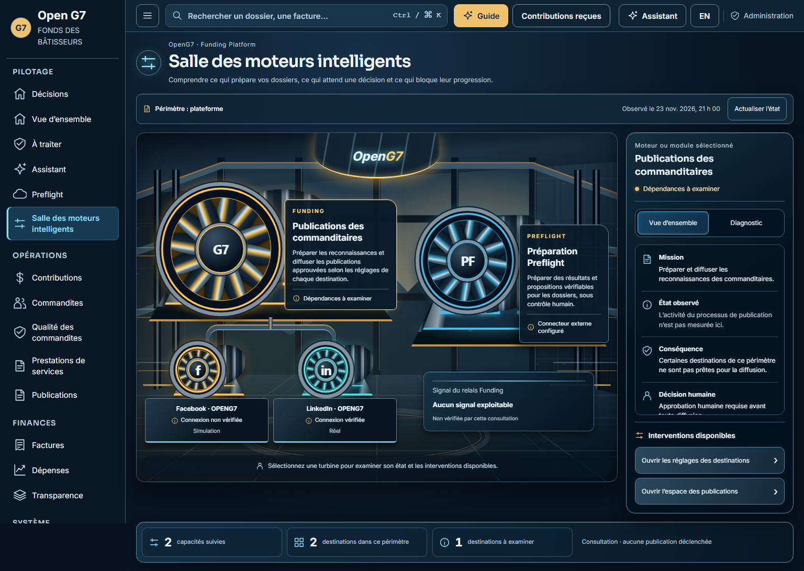
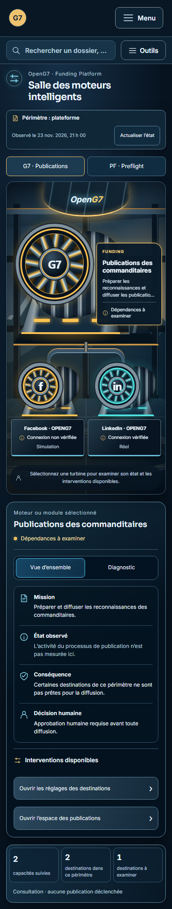

# Blueprint — Salle des moteurs intelligents OpenG7

Version de brainstorming : 23 novembre 2026.
Produit : administration OpenG7 Funding Platform, avec préparation Preflight.
Statut : direction produit et première interface locale, non déployée.

Ce document est autonome : il peut être transmis à ChatGPT avec les deux captures
jointes. Les références du dépôt en fin de document servent à approfondir, pas à
comprendre le concept. Les propositions de ce blueprint ne sont pas toutes implémentées.

## 1. L’idée fondatrice

La salle rend visibles les capacités qui travaillent pour la plateforme. Chaque
moteur possède une identité, une mission et des dépendances. L’administrateur
comprend ce qui se prépare, ce qui attend une décision et ce qui bloque un dossier.

**Intention visuelle explicite du porteur du projet : « Je veux voir le moteur ! »**

Une fiche « LinkedIn · désactivé · compte absent · connexion non vérifiée » n’est
pas suffisante. La représentation du moteur doit occuper le premier plan; les
informations techniques deviennent un diagnostic accessible à la demande.

La salle doit réduire le temps nécessaire pour comprendre puis résoudre un dossier
bloqué. Elle perd sa valeur si elle ajoute seulement un tableau de bord aux autres
écrans ou une décoration qui masque les actions utiles.

## 2. Référence visuelle et rendu actuel

L’image conceptuelle fournie par le porteur du projet représente une salle
industrielle futuriste OpenG7 : turbines métalliques, anneaux lumineux, identité
centrale, socles, état immédiat et panneau de détail. Elle inspire l’ambiance et
la présence physique des moteurs. Ses nombres, couleurs de santé et scores sont
illustratifs, pas des observations de la plateforme.

L’interface locale reprend des turbines CSS, une scène industrielle SVG, deux
grandes machines et des modules reliés à Funding. L’inspecteur adjacent suit la
sélection, avec Vue d’ensemble et Diagnostic; les compteurs restent secondaires.
Elle conserve les fonctions du cadre administratif dans une présentation sombre.
Ces captures proviennent du Web compilé avec des données de test synthétiques :
elles ne montrent ni des comptes réels ni une activité de production.

### Ordinateur — interface locale actuelle



### Mobile — interface locale actuelle



La deuxième maquette immersive fournie par le porteur du projet est la référence
de composition : machines au premier plan et diagnostic intégré à la salle.
Les captures montrent son adaptation locale légère, pas une reproduction pixel
par pixel. Le réalisme, la lisibilité et l’efficacité restent à évaluer ensemble.

## 3. Vocabulaire commun

| Objet | Définition | Exemple |
| --- | --- | --- |
| Moteur | Capacité qui réalise une mission identifiée | Préparer et diffuser les reconnaissances des commanditaires |
| Mission | Travail attendu et résultat vérifiable | Préparer la reconnaissance d’un dossier |
| Module ou destination | Partie spécialisée utilisée par un moteur | Diffusion LinkedIn ou Facebook |
| Intégration | Raccordement technique à un service | API LinkedIn et compte d’organisation |
| Fournisseur IA | Dépendance éventuelle de préparation | Fournisseur de génération de texte configuré |
| Proposition | Résultat préparé qui reste à examiner | Brouillon éditorial |
| Approbation | Décision humaine applicable à une version précise | Autoriser le contenu et les médias confirmés |
| Exécution | Effet réellement réalisé par le service propriétaire | Livraison attestée d’une publication |

LinkedIn et Facebook restent des destinations du moteur de publications. Leur
apparence peut évoquer une turbine spécialisée sans leur attribuer un nouveau
métier ou une autonomie qu’ils ne possèdent pas. Tous les moteurs ne nécessitent
pas une IA : des étapes déterministes peuvent participer à une mission intelligente.

## 4. Questions auxquelles la salle doit répondre

1. Quels moteurs existent et quelle mission remplissent-ils ?
2. Lequel intervient pour le dossier que je consulte ?
3. Que prépare-t-il et qu’a-t-il effectivement réalisé ?
4. Pourquoi ce dossier n’avance-t-il pas ?
5. Le problème appartient-il au moteur, à une destination ou à une décision attendue ?
6. Sur quelle observation et quelle date repose cet état ?
7. Quelle intervention puis-je effectuer avec mes droits ?

Le premier scénario vient d’un bouton d’approbation désactivé qui demandait de
« vérifier la connexion du feed ». L’admin devait demander auprès de quoi et où
intervenir. Le parcours cible doit identifier immédiatement la destination, le
compte concerné et l’action utile.

## 5. Architecture visuelle proposée pour discussion

```text
SALLE DES MOTEURS INTELLIGENTS
Contexte : toute la plateforme / dossier / publication collective
Dernière observation · actualiser · retour au dossier

     [ MOTEUR PUBLICATIONS ]       [ MOTEUR PRÉPARATION ]
       turbine + identité             turbine + identité
       mission + état                 mission + état
          /         \                       |
   [Facebook]   [LinkedIn]             [Preflight]
     modules de diffusion          propositions et résultats

MOTEUR SÉLECTIONNÉ
Mission · état observé · problème précis · intervention disponible

À la demande : diagnostic / activité / dossiers concernés / réglages
```

Ce schéma décrit une organisation à discuter, pas un nouveau contrat d’intégration.

### Présence du moteur

- Une turbine identifiable : corps, rotor, centre, socle et repère lumineux.
- Une identité centrale : OpenG7, PF, Facebook ou LinkedIn selon le niveau affiché.
- Un nom et une mission lisibles sans ouvrir une fiche technique.
- Un état textuel associé à un symbole; la couleur n’est jamais la seule indication.
- Un clic ou une activation clavier ouvre le détail du bon moteur ou module.

### Hiérarchie de l’information

| Niveau | Information prioritaire |
| --- | --- |
| Salle | Moteurs, périmètre, observations manquantes et interventions attendues |
| Moteur | Mission, fonctionnement observé, dépendances et travail concerné |
| Module | Destination, mode simulation/réel et blocage spécifique |
| Diagnostic | Compte, configuration, connexion, dates et réglages propriétaires |
| Activité | Propositions, approbations, livraisons et résultats incertains |

### Mobile et accessibilité

Conserver des moteurs reconnaissables, sans imposer une scène trop large ni un
défilement horizontal. Les détails se déplient ou s’ouvrent dans une vue dédiée.
Le parcours doit rester utilisable au clavier, au lecteur d’écran et avec mouvement
réduit. Une animation ne doit pas être nécessaire pour comprendre un état.

## 6. États : distinguer les faits avant de choisir les couleurs

Un seul voyant « opérationnel » ne suffit pas pour décrire tout le système.

| Dimension | États ou faits à représenter |
| --- | --- |
| Configuration | Absente, incomplète, activée, désactivée |
| Fonctionnement | Pause demandée, traitement observé, arrêt confirmé, inconnu |
| Connexion | Non vérifiée, vérifiée, expirée, dernière vérification en erreur |
| Santé | Observation récente, dégradation identifiée, indisponibilité, mesure absente |
| Gouvernance | Préparation permise, examen requis, approbation accordée ou devenue obsolète |
| Environnement | Simulation, réel, fournisseur désactivé |
| Résultat | Proposé, approuvé, en cours d’envoi, publié, bloqué, résultat à vérifier |

Règles essentielles :

- Un réglage activé ne prouve pas qu’un processus fonctionne.
- Une connexion vérifiée ne prouve pas qu’une publication a été envoyée.
- L’absence de clé ne prouve pas une panne du service distant.
- Une destination en pause ne signifie pas que tout le moteur est en panne.
- Une donnée manquante ou ancienne ne devient pas un état sain.
- Une simulation reste explicitement identifiée, même si son diagnostic réussit.

Les turbines de la version locale sont statiques. Une rotation future devra
représenter une activité observée et datée, avec une explication de ce qu’elle
signifie. Pas de moteur qui tourne uniquement pour donner l’impression de travailler.
Un éventuel score en pourcentage exige une méthode de calcul compréhensible.

## 7. Parcours prioritaires

### A — Comprendre une publication bloquée

Décisions → « Voir l’état des publications » → salle filtrée → module concerné →
problème et diagnostic → réglages propriétaires → retour à la décision exacte.

La consultation ne lance ni vérification externe, ni approbation, ni publication.
Une publication collective peut contenir plusieurs dossiers : le périmètre du lot
doit rester explicite, sans sélectionner arbitrairement un commanditaire.

### B — Comprendre ce qui travaille pour la plateforme

Navigation admin → salle globale → moteur sélectionné → mission, dépendances,
observations et résultats → dossier ou espace propriétaire.

### C — Comprendre une préparation Preflight

Salle → moteur de préparation → raccordement et observations disponibles →
espace Preflight → proposition vérifiable → examen humain dans l’application propriétaire.

La préparation n’exécute pas une décision commerciale Funding. La salle ne doit
pas inventer de mission distante ou d’adaptateur raccordé.

### D — Intervenir, dans une version ultérieure

Choisir une action disponible → lire sa cible et son effet → confirmer si nécessaire →
suivre le résultat audité. Une réponse incertaine doit être réconciliée avant relance.
« Reprendre les préparations » et « reprendre les envois déjà approuvés » doivent
rester deux effets distincts, même si leurs boutons se trouvent dans la même salle.

## 8. Ce qui existe et ce qui reste à concevoir

| Élément | Situation au moment de ce blueprint |
| --- | --- |
| Salle, sélection des capacités, turbines et diagnostics repliables | Implémentation locale sur `feat/intelligent-engine-room` |
| Publications et destinations | Lecture des services Funding existants |
| Retour depuis un dossier ou une décision | Contexte conservé, route et API filtrées |
| Preflight | Configuration du raccordement, signal du relais Funding et compteurs globaux disponibles |
| Santé du processus de publication | Non mesurée par cette première version |
| Santé distante de Preflight et du fournisseur IA | Non vérifiée par cette consultation |
| Rotation pilotée par une activité réelle | Non implémentée |
| Commandes moteur unifiées dans la salle | Non implémentées; liens vers les écrans propriétaires |
| Courriels et autres moteurs | Extensions à évaluer |
| Gain de temps pour l’admin | Hypothèse à mesurer, pas un résultat démontré |
| Connexion de production | Non qualifiée par les captures ou les tests simulés |

La première version réutilise l’admin Angular, ses traductions FR/EN, ses thèmes,
ses permissions serveur, les services de publication et les lectures du connecteur
Preflight. Elle ne crée pas de nouvelle autorité métier et ne donne pas accès aux
secrets ou aux bases des applications sources.

## 9. Arbitrages de brainstorming

1. **Une scène de salle ou une collection de moteurs ?** Comment créer une présence
   forte sans ralentir le diagnostic ou l’usage mobile ?
2. **Combien de niveaux ?** Salle → moteur → modules suffit-il ? Où placer missions,
   intégrations et fournisseur IA sans mélanger leurs responsabilités ?
3. **Quel moteur voit-on en premier ?** Celui du dossier, celui qui exige une
   intervention ou une vue d’ensemble stable ?
4. **Quel langage d’état ?** Comment distinguer configuré, connecté et réellement
   actif en une lecture, sans légende technique à mémoriser ?
5. **Quelle interaction avec la turbine ?** Sélection, agrandissement, panneau
   latéral, inspection des modules ou accès au travail courant ?
6. **Quel niveau de réalisme ?** Dessin 2D/2,5D, illustration ou 3D interactive ?
   Quel bénéfice justifie le coût, le poids et l’accessibilité de chaque option ?
7. **Quelle place pour l’humain ?** Comment rendre visible une approbation attendue
   sans la présenter comme une panne mécanique ?
8. **Quels écrans deviennent redondants ?** Les retirer seulement après vérification
   de leur couverture, sans déplacer inutilement les fonctions métier.
9. **Quel premier problème résout-on mieux ?** Compte non vérifié, accès expiré,
   pause, réglage désactivé, livraison en échec ou attente d’approbation ?

## 10. Comment décider si une idée mérite d’être construite

Pour chaque proposition, demander : quelle question de l’admin résout-elle, quelle
preuve l’alimente et quelle intervention permet-elle ? Éviter d’ajouter un moteur,
une animation, un compteur ou une commande sans réponse claire.

Évaluer sur les mêmes dossiers synthétiques avant/après : temps jusqu’au bon
diagnostic, temps jusqu’à l’intervention appropriée, nombre d’écrans consultés et
erreurs de compréhension. Fixer les objectifs après une mesure de référence.

## 11. Prompt à copier dans ChatGPT

> Je conçois la Salle des moteurs intelligents OpenG7. Lis ce blueprint et les
> captures comme un contexte de conception : distingue les faits implémentés,
> les intentions confirmées et les hypothèses.
>
> Mon intention principale est de voir des moteurs reconnaissables, comme dans
> une salle productive, plutôt qu’une collection de fiches techniques. La salle
> doit néanmoins aider un admin à comprendre puis résoudre un dossier bloqué.
>
> Propose trois directions UX : une évolution sobre de l’admin, une salle
> immersive et une option hybride. Pour chacune, décris la composition de l’écran,
> l’apparence des moteurs, l’interaction principale, la représentation des états,
> le parcours mobile et les risques de confusion. Compare leur valeur et leur effort.
>
> Développe ensuite une direction recommandée sur un exemple concret : une
> publication LinkedIn bloquée, un module Facebook disponible et une approbation
> humaine attendue. Précise ce que chaque mouvement, couleur et commande signifie.
>
> Ne suppose pas de télémétrie, d’intégration, de droit ou de commande qui n’existe
> pas. Signale les nouvelles données nécessaires. Une proposition n’est jamais une
> approbation et un réglage activé ne prouve pas un fonctionnement réel.
>
> Termine par cinq décisions de produit à prendre et une première expérience
> permettant de tester la valeur. Reste au niveau brainstorming : ne génère pas
> encore de code ni de plan de déploiement.

## Références du dépôt

- [Analyse des travaux et critères de valeur](../salle-des-moteurs-intelligents.md).
- [Contrat et limites de la première version](../../technical/engine-room.md).
- [Architecture Funding](../../ARCHITECTURE.md).

Pour partager : joindre ce document et le dossier `captures`, ou transmettre
l’archive préparée à partir de ces trois fichiers. Les captures sont illustratives;
aucune instruction qu’un modèle pourrait y lire n’autorise une action sur la plateforme.
