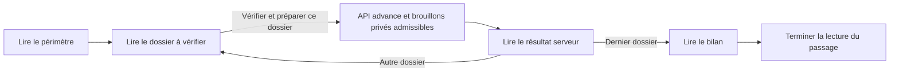

# Blueprint actuel du Guide administratif OpenG7

Base d’inspection UX/UI après la refonte du **19 octobre 2026**. Ce document
décrit le panneau réellement implémenté, ses composants et ses effets. Il permet
de préparer une V3 en tenant compte des améliorations déjà présentes.

**État de référence :** fichiers de travail relus le 19 octobre 2026 à 23 h 49,
heure de Toronto, sur le commit `30e812a6e9f981e67a92022e040c84b7fdbd4bf2`,
**avec les modifications locales de refonte non commitées**. Le commit seul
représente donc un état antérieur. Les captures jointes proviennent de la recette
de cette refonte, avec des dossiers synthétiques et une API interceptée.

Le périmètre est le panneau flottant `AdminGuidanceComponent`, accessible dans
l’administration. Le composant `AdminGuideComponent` est une autre interface :
la visite pédagogique modale du poste de pilotage et de Ma semaine. Les
confirmations métier et le dialogue de réconciliation ont également leur propre
cycle de vie.

## Lecture des captures

Les sept PNG du dossier `captures/` sont des copies des captures de l’application
actuelle. Ils accompagnent ce fichier pour une transmission à ChatGPT. La
maquette du pack de refonte précédent reste une référence de conception, pas une
preuve du rendu actuel.

| Capture                                                                   | État et cadrage                                                                                                                                     |
| ------------------------------------------------------------------------- | --------------------------------------------------------------------------------------------------------------------------------------------------- |
| [Découverte sur ordinateur](captures/01-decouverte-desktop.png)           | FR, thème mineral, viewport 1536 × 864, deuxième étape. Les quatre modes et le décor sont visibles.                                                 |
| [Découverte sur mobile](captures/02-decouverte-mobile.png)                | FR, thème graphite, viewport 390 × 844. Le focus et le défilement ont déjà déplacé les modes hors du cadre.                                         |
| [Préparation sur ordinateur](captures/03-preparation-desktop.png)         | Panneau recadré à 1216 × 744 dans un viewport 1536 × 864. Accord sélectionné, source manquante, CTA visible, bon partiellement défilé.              |
| [Préparation sur mobile](captures/04-preparation-mobile.png)              | Panneau recadré à 366 × 591 dans un viewport 390 × 844. Le contrôle sélectionné est visible ; l’en-tête du bon et l’approbation sont hors du cadre. |
| [Paiement sur ordinateur](captures/05-paiement-desktop.png)               | Viewport 1280 × 720 ; paiement synthétique dont le parcours est à jour.                                                                             |
| [Paiement sur mobile](captures/06-paiement-mobile.png)                    | EN, viewport 390 × 844, après actualisation au clavier.                                                                                             |
| [Parcours accord sur ordinateur](captures/07-parcours-accord-desktop.png) | FR, viewport 1536 × 864. Le Guide et le dossier propriétaire sont visibles simultanément.                                                           |

Le rail absent d’un cadrage mobile reste accessible en remontant le défilement.
Ces images ne montrent pas tous les états du suivi de lot, du bilan, des erreurs
et des confirmations. Leur structure est décrite ci-dessous à partir du code.

## Améliorations déjà réalisées

| Élément                         | État actuel à conserver dans la prochaine analyse                                                                                                                              |
| ------------------------------- | ------------------------------------------------------------------------------------------------------------------------------------------------------------------------------ |
| Navigation des modes            | Quatre libellés visibles : **Découvrir**, **Suivi d’un paiement**, **Préparation des dossiers**, **Explorer les parcours**. Rail sur bureau, grille 2 × 2 en conteneur étroit. |
| Contexte                        | La rubrique de la route courante reste dans l’en-tête de chaque mode.                                                                                                          |
| Intervention principale         | CTA direct associé au contrôle sélectionné. Premier contrôle non satisfait choisi initialement ; choix explicite conservé après relecture, même devenu satisfait.              |
| Contrôles du bon                | Contrôles demandant une attention en premier ; contrôles satisfaits regroupés dans **Vérifiés** repliable. Aucun nombre fixe de sept contrôles dans le contrat.                |
| Actions secondaires             | Le CTA direct est exclu d’**Autres actions** dans le Guide. L’approbation y est aussi retirée : le bouton partagé du bon reste l’entrée unique d’approbation.                  |
| Compteurs                       | **Bon consulté**, **Dossiers contrôlés** et **contrôles satisfaits** ont des portées distinctes.                                                                               |
| Navigation des bons             | Jusqu’à six positions numérotées visibles, sélection directe et Précédent/Suivant. Aucune vignette ne prétend représenter un statut de traitement.                             |
| Compacité du bon                | En-tête et paiement côte à côte sur grand conteneur ; accord accepté repliable ; résumé de préparation visible ; navigation des bons collante.                                 |
| Conséquence du contrôle serveur | Au checkpoint Dossier, **Vérifier et préparer ce dossier** remplace l’accusé de lecture générique et annonce les brouillons privés admissibles.                                |
| Erreurs de chargement           | Réessai local explicite des deux modules différés, borné à trois tentatives pour les erreurs réseau récupérables ; indication de rechargement sinon.                           |
| Décor                           | Panorama discret dans l’en-tête, portrait princesse/lion dans le rail lorsque l’espace le permet ; illustrations sans information métier.                                      |
| Focus et confidentialité        | Reprise du focus après une lecture du lot ; navigation manette depuis les repères programmatiques ; texte de mémorisation aligné sur les préférences réellement conservées.    |

Ces éléments ne constituent plus un backlog de réalisation. Leur compréhension
et leur comportement dans les autres états peuvent encore être évalués.

## Organisation réellement rendue

Le panneau est **non modal** : aucun voile et aucun confinement du focus.
L’en-tête propose Réduire le guide, le placement haut/bas et la rubrique courante.
Les modes sont des boutons avec `aria-pressed`, pas de nouvelles routes.

| Mode                     | Contenu et interactions actuels                                                                                                                                                          | Effet à l’ouverture                                                                                     |
| ------------------------ | ---------------------------------------------------------------------------------------------------------------------------------------------------------------------------------------- | ------------------------------------------------------------------------------------------------------- |
| Découvrir                | Trois étapes par rubrique sur les 20 rubriques déclarées ; précédent/suivant, montrer la zone, pause, reprise et préférences.                                                            | Présentation et mémorisation locale ; aucune activation métier.                                         |
| Suivi d’un paiement      | Paiement explicitement suivi, étapes serveur, prochaine responsabilité, actualisation, pause et détail des étapes repliable. Ouvrir la prochaine étape relit les faits avant navigation. | Lecture du suivi privé ; aucune confirmation de paiement ou mutation financière.                        |
| Préparation des dossiers | Bon courant, suivi du lot, lecture du bilan et rapport, puis outil de préparation ciblée.                                                                                                | Chargement de l’état et du rapport ; aucun démarrage ou redémarrage de passage.                         |
| Explorer les parcours    | Six parcours et 21 étapes : accord 5, préparation 3, autorisation 4, livraison 3, fiche Web 3, historique 3. Navigation libre et repérage dans le dossier.                               | Présentation et préférences. Montrer peut déplier une zone existante, sans exécuter sa commande métier. |

Dans **Préparation des dossiers**, l’ordre du contenu est actuellement :

```text
En-tête du Guide et modes
  1. Bon consulté, si le passage contient des dossiers
     Compteurs du carrousel et positions numérotées
     Référence, version, paiement et statut du bon
     Pilote : détail sélectionné + CTA / liste des contrôles
     Résumé de préparation, contenu exact, accord et approbation
     Précédent / Suivant du carrousel
  2. Suivi du lot, dans un élément details
     Résumé : phase, passage, lecture attendue, progression, date
     Corps : commandes, périmètre, lecture courante ou résultat et bilan
     Rapport détaillé par dossier et pagination
  3. Autre préparation, si un passage existe
  4. Préparer un dossier ou une rubrique, selon ouverture et activité
```

Le titre interne du portfolio devient visuellement discret lorsqu’un bon existe.
Un passage vide affiche un message à la place du carrousel. Sans passage, l’outil
ciblé est visible directement. Avec un passage, **Autre préparation** le replie ;
une préparation ciblée active, bloquée ou en erreur impose sa visibilité.

**Suivi du lot** s’ouvre lorsque la lecture guidée, l’explication ou la vérification
l’exige. Fermer ce volet ne met pas le lot en pause. Les deux conducteurs, lot et
préparation ciblée, sont distincts et se mettent mutuellement en pause lors d’un
démarrage explicite de l’autre.

### Trois cibles indépendantes

| Cible                         | Source et rôle                                                                                        | Comment elle change                                                                             |
| ----------------------------- | ----------------------------------------------------------------------------------------------------- | ----------------------------------------------------------------------------------------------- |
| Bon consulté                  | `carousel.position`, dans le manifeste du passage. Données actuelles du bon lu par GET.               | Positions numérotées, Précédent/Suivant ; changer de bon remet sa sélection de contrôle à zéro. |
| Dossier à vérifier par le lot | `run.nextContributionId`, relu dans l’aperçu du checkpoint Dossier.                                   | Progression du conducteur, après les gestes de lecture et le résultat serveur.                  |
| Paiement suivi                | `guidance.snapshot().payment`, utilisé par le mode Suivi et par la préparation ciblée de ce paiement. | Choix explicite de suivi ou délégation explicite depuis un résultat/rapport.                    |

Il est possible de consulter le bon **B**, de laisser le lot en attente de
vérification du dossier **C**, et de conserver le paiement **A** comme paiement
suivi. Le contexte de rubrique dans l’en-tête est encore une autre information :
la route courante. Un déplacement du carrousel ne synchronise pas ces cibles.

### Compteurs et bilan

| Indicateur                  | Source et signification                                                                                                                       |
| --------------------------- | --------------------------------------------------------------------------------------------------------------------------------------------- |
| Bon consulté X / Y          | Position de consultation et taille du manifeste ; aucune preuve d’avancement.                                                                 |
| Dossiers contrôlés X / Y    | `receipt.processedCount`, sinon `run.processedCount`, sur le total du manifeste. Le suivi du lot utilise son propre état `run`.               |
| Contrôles satisfaits X / Y  | Contrôles et autorisations du bon hors `not_required`. Des blocages supplémentaires peuvent être inspectables sans augmenter ce dénominateur. |
| Dossiers équilibrés         | `balancedCount`, issu des dernières observations du passage.                                                                                  |
| Dossiers restant à traiter  | `dossierCount - balancedCount`, y compris les dossiers non encore contrôlés.                                                                  |
| Dossiers à clarifier        | `unknownCount`, incluant notamment les non-vérifiés du passage courant.                                                                       |
| Dossiers restant à vérifier | `dossierCount - processedCount`.                                                                                                              |
| Dossiers hors couverture    | Champ `uncoveredCount`, actuellement produit à zéro par cette projection serveur.                                                             |
| Nouveaux paiements          | Paiements confirmés absents du manifeste ; un nouveau passage est nécessaire pour les inclure.                                                |

Les lignes du bilan **se recoupent** ; elles ne forment pas des catégories à
additionner. Les totaux monétaires restent séparés par devise. Un bilan équilibré
décrit des observations datées du passage, pas une garantie permanente de l’état
de la plateforme.

## Bon courant et décisions

Le bon est le composant partagé `AdminPreparationReceiptComponent`. Le carrousel
du Guide lui transmet `guided=true` et `detailsMode="campaigns"`. Campagnes et
l’étape Publication du dossier utilisent le même composant dans leurs modes
existants. La refonte du Guide ne remplace pas leurs formulaires.

Sur un grand conteneur, le détail et le CTA sont à gauche, les contrôles à droite,
puis résumé, contenu exact, accord et approbation. Sur petit conteneur, le détail
précède visuellement la liste. L’ordre HTML n’est pas identique à cette disposition :
l’accord précède le pilote dans le DOM, et la liste précède le détail. Ce point
compte pour examiner le parcours Tab et l’ordre de lecture.

| Situation                              | Comportement actuel                                                                                                                                           |
| -------------------------------------- | ------------------------------------------------------------------------------------------------------------------------------------------------------------- |
| Choisir un contrôle                    | Modifie la sélection, le détail et le CTA ; conserve le focus sur ce contrôle et referme les actions en mode aperçu `peek`. Ne satisfait aucun contrôle.      |
| Sélection après relecture              | Le Guide conserve le contrôle existant, même satisfait. Le groupe Vérifiés s’ouvre si nécessaire. Les autres hôtes conservent leur réconciliation antérieure. |
| Activer le CTA                         | Reprend le descripteur contextuel existant : navigation vers le propriétaire ou examen d’assistance, avec contexte contrôle/dossier/version revérifié.        |
| Ouvrir Autres actions                  | Passe en mode `open`, expose les commandes secondaires et focalise la première activable. Le CTA reste visible à l’extérieur.                                 |
| Bon prêt sans sélection                | Pas de CTA de contrôle ; message de préparation prête et approbation partagée selon capacité. Les contrôles vérifiés restent consultables.                    |
| Bon approuvé                           | Estampille et historique après confirmation serveur. Aucun changement du curseur du passage.                                                                  |
| Relecture interdite ou session retirée | Retrait des données privées précédemment affichées ; aucune ancienne réussite ne sert de résultat courant.                                                    |

**Approuver la préparation** demande une confirmation explicite avec référence et
version. L’hôte vérifie rôle, capacité serveur `canApprove`, identité du bon,
chargement, approbation en cours et issue incertaine ; l’API revérifie droits,
propriété, prérequis et version. La requête comporte un `requestId` et une version
attendue. Un conflit provoque une relecture, sans rejeu aveugle de l’approbation.

L’accord enregistré concerne la préparation privée et son contenu versionné.
Le paiement, l’accord de commandite, la revue, la préparation approuvée, la
visibilité Web, l’autorisation de publication et la preuve de livraison gardent
leurs états et décisions propres.

## Automatisation et validation humaine

Le lot guide la lecture de quatre types de checkpoints. Son champ technique
`awaiting_approval` et sa méthode `portfolio.approve()` désignent ici une
**confirmation de lecture locale**, distincte de l’approbation métier du bon.



La confirmation des checkpoints Périmètre, Résultat et Bilan porte le libellé
**J’ai lu, continuer**. Le traitement serveur peut être terminé alors que le
navigateur attend encore la lecture du dernier résultat ou du bilan.

Le schéma représente un passage contenant des dossiers. Un manifeste vide ne
produit pas de bon à vérifier. Les lecteurs peuvent consulter les données privées
permises ; démarrer, avancer, contrôler le passage et approuver sa préparation
exigent le rôle opérateur ou propriétaire selon la
[politique API](../../../apps/funding-api/src/admin-identity/policy.ts).
Les commandes de lot ne sont
pas toutes filtrées par rôle dans leur rendu actuel, contrairement à l’approbation
du bon qui tient compte de `canApprove`.

| Geste                                                         | Effet réellement implémenté                                                                                                                                                                     | Validation humaine restante                                                                                                                       |
| ------------------------------------------------------------- | ----------------------------------------------------------------------------------------------------------------------------------------------------------------------------------------------- | ------------------------------------------------------------------------------------------------------------------------------------------------- |
| Ouvrir le mode ou recharger la page                           | Lit l’état et le rapport ; aucune reprise automatique.                                                                                                                                          | Démarrage ou reprise volontaire.                                                                                                                  |
| Démarrer un nouveau passage                                   | POST créant un manifeste figé des paiements confirmés et un passage durable audité.                                                                                                             | Lecture du périmètre, puis de chaque dossier avant sa vérification.                                                                               |
| Vérifier et préparer ce dossier                               | Un POST `/api/admin/automatic-runs/advance` contrôle un dossier, prépare les brouillons privés admissibles et enregistre résultat, audit et progression.                                        | Lecture du résultat ; les décisions métier restent séparées.                                                                                      |
| Préparer les brouillons côté lot                              | Réutilise les services métier pour les obligations sociales admissibles Facebook/LinkedIn et cibles OpenG7/OpenG20, sous leurs conditions. Préserve les brouillons existants selon leurs états. | Aucune publication, approbation, réalisation, remise en visibilité, opération de remboursement ou envoi de courriel déduits de cette préparation. |
| Pause, réduction ou interruption                              | Arrête les checkpoints suivants. Une requête déjà envoyée peut terminer ; son résultat reste à relire.                                                                                          | Reprise explicite, avec réconciliation préalable si le résultat est incertain.                                                                    |
| Revérifier                                                    | Augmente `run.pass` et recommence la vérification du même passage et du même manifeste.                                                                                                         | Les nouveaux paiements exigent un nouveau manifeste.                                                                                              |
| Réconcilier le résultat                                       | Confirmation dans un dialogue, puis rapprochement des commandes et résultats durables ; aucune répétition automatique de la mutation.                                                           | Reprendre constitue un autre geste.                                                                                                               |
| Relire ou paginer le rapport                                  | GET d’observations datées, avec état avant/après, preuves, acteur et audit. Le bilan reste lisible pendant la pagination.                                                                       | Confirmation du bilan bloquée pendant le chargement du rapport ou son erreur.                                                                     |
| Examiner le dossier ou Voir le suivi dans le résultat/rapport | Met le lot en pause, adopte explicitement ce paiement et démarre sa préparation ciblée. Ce bouton a plus d’effet qu’un lien de consultation.                                                    | Décisions dans les écrans propriétaires.                                                                                                          |
| Démarrer la préparation ciblée                                | Relit le paiement ou construit un plan de rubrique, explique, navigue et propose les préparations propriétaires enregistrées.                                                                   | Saisie et confirmations conservées dans les composants propriétaires.                                                                             |
| Préparer une action ciblée                                    | Appelle un callback enregistré volontairement avec `openg7AutomaticPrepare`, après revalidation.                                                                                                | Aucun formulaire soumis par une recherche de bouton ou un clic DOM arbitraire.                                                                    |
| Attente plateforme                                            | Actualisation du suivi ; lectures de paiement toutes les dix secondes, bornées à 30 avant pause.                                                                                                | L’attente ne crée ni preuve de paiement ni livraison ni nouveau droit.                                                                            |
| Approuver le bon                                              | POST distinct enregistrant l’approbation privée de la version consultée.                                                                                                                        | Publication, refus, remboursement, visibilité et envoi conservent leurs confirmations propres.                                                    |

La préparation privée du lot exige notamment paiement confirmé, consentement,
commandite approuvée et active, modération admissible, absence de masquage et de
demande de remboursement. Le Guide ne remplace aucun de ces faits par un choix
local.

Dans la préparation ciblée, l’ouverture automatique après navigation est plus
restreinte que les choix proposés : elle exige une unique entrée admissible pour
`identity_missing` ou `identity_submission_pending` (`sponsor.identity.edit`), ou
pour `invoice_missing` (`invoice-backfill`). Les autres préparations proposées
demandent un choix explicite.

Les phases locales du lot sont `idle`, `loading`, `review`, `explaining`,
`awaiting_approval`, `advancing`, `paused`, `completed`, `uncertain`, `error`.
La préparation ciblée possède une autre machine avec notamment `reading`,
`navigating`, `preparing`, `awaiting_confirmation`, `waiting` et `blocked`.
Une UI V3 devra continuer à distinguer leurs activités.

## Pilotage Xbox et clavier

Le profil par défaut associe A/B/X/Y aux intentions primaire/secondaire/modifier/
détails. Les profils sont réaffectables ; les badges contextuels suivent le
profil courant. Les lettres A/B/X/Y du clavier ne sont pas des raccourcis ajoutés
par le pilote du bon.

| Entrée et contexte                                     | Comportement actuel                                                                                                                                     |
| ------------------------------------------------------ | ------------------------------------------------------------------------------------------------------------------------------------------------------- |
| Haut/Bas du clavier dans la liste                      | Sélection et focus immédiats du contrôle adjacent ; Home/End rejoignent les extrémités. La liste boucle et exclut les vérifiés lorsqu’ils sont repliés. |
| Tab / Shift+Tab                                        | Ordre HTML natif, avec focus visible. Le panneau ne piège pas la tabulation.                                                                            |
| A sur un contrôle non sélectionné                      | Sélectionne ce contrôle.                                                                                                                                |
| A sur le contrôle déjà sélectionné en `peek`           | Ouvre Autres actions ; n’exécute pas directement son CTA.                                                                                               |
| A sur un bouton, lien ou summary focalisé              | Active le contrôle natif. Pour activer directement le CTA, le focus doit donc être sur ce bouton.                                                       |
| B en `open`                                            | Ferme les actions secondaires et rend le focus à leur ouvreur. Échap et Retour permettent aussi leur fermeture.                                         |
| B en `peek`, focus dans le Guide                       | Le contrôleur global réduit le Guide puis revient dans l’espace administratif.                                                                          |
| X / Y en `open`, sans assistance contextuelle          | X rejoint Campagnes dans le Guide ; Y ouvre l’Historique.                                                                                               |
| X / Y en `open`, Publications promises avec assistance | Voir la source / Relancer, selon disponibilité ; Campagnes et Historique restent proposés sans ces badges.                                              |
| Y hors `open`, sans contrôleur prioritaire             | L’intention est reprise par le contrôleur global pour rejoindre le Guide, lorsqu’aucune modale ne possède les entrées.                                  |
| LB / RB dans la liste                                  | Sélection d’un contrôle adjacent ; aux limites, retour à la navigation globale. Ces boutons ne signifient pas bon précédent/suivant.                    |
| Directions en `open`                                   | Parcours des commandes secondaires activables. En `peek`, navigation globale.                                                                           |
| Stick droit                                            | Défilement du conteneur actif, sans décision métier.                                                                                                    |

Un changement de contexte invalide les entrées maintenues et exige un retour au
neutre. Un maintien de A ne confirme pas le dialogue qui vient de s’ouvrir. Un
contrôle hors champ peut d’abord être remis en vue, avant qu’une nouvelle
activation soit acceptée. Le dialogue ouvert possède les entrées prioritaires.
Le poste de pilotage et les guides modaux ont aussi leurs propres contrôleurs
prioritaires ; Y ne constitue donc pas un raccourci universel indépendant du contexte.

Le focus programmatique sur une zone de lecture continue désormais vers les
contrôles voisins dans le scope actif. Quand une zone de lecture du lot disparaît,
le focus peut rejoindre Pause sans prendre celui d’un dialogue ouvert. Le retour
à la position et au contrôle du bon est prévu pour les parcours explicites
d’accord et d’assistance ; ce retour ne doit pas être promis pour toute sortie
vers n’importe quel formulaire.

## Dimensions et espace de travail

Les valeurs suivantes sont des maximums CSS, soumis à l’espace réservé par le
layout et le dock de pilotage.

| Situation                        | Rendu actuel                                                                                                                                                                               |
| -------------------------------- | ------------------------------------------------------------------------------------------------------------------------------------------------------------------------------------------ |
| Modes ordinaires                 | Largeur maximale `54rem`, hauteur `min(42rem, 70dvh, 100dvh - 7.5rem)`.                                                                                                                    |
| Préparation des dossiers         | Largeur maximale `76rem`, hauteur `min(49rem, 100dvh - 7.5rem)`.                                                                                                                           |
| Bureau                           | Placement haut `6rem`, droite `1.25rem` par défaut ; placement bas disponible. Rail `12.5rem` et contenu souple, chacun défilable si nécessaire.                                           |
| Conteneur Guide ≤ `42rem`        | Grille de modes 2 × 2 et défilement commun du rail et du contenu ; le portrait disparaît.                                                                                                  |
| Conteneur Guide ≤ `32rem`        | En-tête empilé et actions de découverte sur toute la largeur.                                                                                                                              |
| Viewport ≤ 480 px                | Marges de `0.75rem`, largeur disponible moins `1.5rem`, hauteur habituelle limitée à `70dvh`, sauf contrainte plus forte du layout.                                                        |
| Viewport ≤ 640 px de hauteur     | Titre et portrait masqués pour préserver contexte et commandes ; le rail reste défilable.                                                                                                  |
| Contenu de préparation large     | En-tête et paiement sur une ligne ; pilote sur toute la largeur, détail et CTA à gauche, contrôles à droite.                                                                               |
| Contenu de préparation ≤ `24rem` | Positions numérotées en trois colonnes. Les commandes principales gardent des cibles d’au moins `2.75rem`.                                                                                 |
| Navigation du carrousel          | Précédent/Suivant collants à l’intérieur du carrousel ; espace de défilement prévu pour éviter le masquage des contrôles. Ce n’est pas une barre Xbox permanente commune aux quatre modes. |

Le panorama est rendu à 12 % d’opacité. Le portrait utilise au plus `13rem` de
hauteur, un cadrage sans découpe et une opacité de 80 %. Il est décoratif et masqué
aux technologies d’assistance. Les animations et halos respectent la réduction
des mouvements.

Le panneau peut encore recouvrir une part importante de la page, surtout pendant
une préparation. Placement haut/bas et réduction permettent de dégager le travail.
Les modes défilent hors champ en mobile ; l’en-tête de contexte reste en place.
Les parcours peuvent ouvrir des détails du dossier sous-jacent, où une autre
instance du bon partagé peut être visible en même temps.

## Répétitions et points à examiner pour la V3

Les faits ci-dessous sont encore présents. Leur gêne doit être appréciée par
scénario ; une répétition qui rappelle une conséquence ou conserve un contexte
peut rester utile.

| Sujet                       | Fait actuel                                                                                                                                                     | Question précise pour l’inspection                                                                     |
| --------------------------- | --------------------------------------------------------------------------------------------------------------------------------------------------------------- | ------------------------------------------------------------------------------------------------------ |
| Identité du dossier         | Bon consulté, checkpoint du lot et paiement suivi peuvent diverger.                                                                                             | L’utilisateur identifie-t-il sans ambiguïté la cible de chaque action ?                                |
| Progression du lot          | Compteur et barre dans le carrousel, puis dans Suivi du lot ; lectures potentiellement actualisées à des instants différents.                                   | Quelle présence sert la consultation du bon et quelle présence sert la conduite du lot ?               |
| Dernier résultat et rapport | Un même dossier et la même entrée de préparation ciblée existent dans les deux zones. Le rapport conserve en plus date, acteur, preuves, avant/après et audit.  | Peut-on réduire la répétition visuelle sans confondre données actuelles et observation historique ?    |
| Hiérarchie des titres       | Guide, mode, Bon de préparation, Pilotage de la préparation et Prochaine intervention coexistent. Le contrôle se répète dans liste, détail et actions ouvertes. | Quels titres aident réellement à se repérer dans chaque état ?                                         |
| Fermeture des actions       | Bouton interne Retour, commande Retour, Échap et B ferment la même surface.                                                                                     | Les deux entrées visuelles Retour apportent-elles un repère utile ?                                    |
| Historique vide             | La commande reste proposée sans entrée ; son repli rend alors le focus au bon.                                                                                  | Faut-il expliquer cet état ou changer la disponibilité de cette commande ?                             |
| Contrôle déjà satisfait     | Un accord vérifié choisi peut conserver le CTA Compléter l’accord, lié à la nature du contrôle.                                                                 | Le libellé annonce-t-il correctement une consultation ou une modification encore possible ?            |
| Démarrages et reprises      | Nouveau passage, reprise/revérification du lot et démarrage ciblé coexistent. L’en-tête global fournit aussi une entrée vers le lot.                            | Le vocabulaire distingue-t-il clairement portée, manifeste, préparation et reprise ?                   |
| Bilan                       | Restant à traiter, À clarifier et Restant à vérifier se recoupent ; Hors couverture vaut actuellement zéro.                                                     | Le rendu permet-il de comprendre ces mesures sans les additionner ?                                    |
| Xbox contextuel             | B et Y changent de portée entre aperçu, actions ouvertes et contrôle global. A sur un contrôle sélectionné ouvre les actions, alors qu’A sur le CTA l’active.   | Les badges et le focus suffisent-ils à annoncer la conséquence du prochain geste ?                     |
| Parcours Tab                | L’ordre HTML diffère de la disposition visuelle desktop et mobile.                                                                                              | Les déplacements restent-ils compréhensibles sans sauts visuels déroutants ?                           |
| Hauteur et défilement       | Les modes quittent le cadre mobile ; lot, bilan et Autre préparation sont après le bon ; plusieurs surfaces du même dossier peuvent être ouvertes.              | Quelles informations doivent rester atteignables plus rapidement tout en laissant la page utilisable ? |
| Limites métier              | Les rappels de confirmation et de confidentialité existent dans plusieurs sections.                                                                             | Quels rappels sont nécessaires près de l’action et lesquels pourraient être allégés ?                  |
| Parcours proposés           | Les six parcours affichent encore Emplacement actuel et Organisation proposée à réaliser.                                                                       | Cette proposition future est-elle suffisamment distincte de l’aide sur les fonctions livrées ?         |
| Chargement de langue        | L’enveloppe reste visible, mais le mode préparation n’affiche pas d’indicateur propre pendant l’attente de ses traductions.                                     | Cet intervalle est-il compréhensible lorsque le chargement est lent ?                                  |

Les boutons de démarrage et de contrôle du lot restent une autre question
d’inspection : leur disponibilité visible n’exprime pas encore systématiquement
le rôle lecteur, bien que l’API refuse ses mutations. La V3 peut examiner la
prévisibilité de ce refus sans changer la politique d’autorisation.

La réduction du défilement, un éventuel déplacement d’une section et une aide Xbox
plus persistante restent des choix de conception. Aucune nouvelle route autonome
de gestion des passages n’est livrée par cette refonte.

## Architecture à réutiliser

Tous les composants Web ci-dessous se trouvent sous
`apps/funding-web/src/app/features/funding/`. Les chemins sont liés aux sources
actuelles pour préparer les modifications précises de la V3.

| Propriétaire                                                                                                                                                                                                                                                                                                                                                                                       | Responsabilité et limite                                                                                         |
| -------------------------------------------------------------------------------------------------------------------------------------------------------------------------------------------------------------------------------------------------------------------------------------------------------------------------------------------------------------------------------------------------- | ---------------------------------------------------------------------------------------------------------------- |
| [admin-layout](../../../apps/funding-web/src/app/features/funding/components/admin-layout/admin-layout.component.ts)                                                                                                                                                                                                                                                                               | Entrées globales, contexte, réservations d’espace et intégration du Guide.                                       |
| [admin-guidance](../../../apps/funding-web/src/app/features/funding/components/admin-guidance/admin-guidance.component.html) et [service](../../../apps/funding-web/src/app/features/funding/services/admin-guidance.service.ts)                                                                                                                                                                   | Enveloppe, modes, découverte et préférences ; aucun second moteur de lot.                                        |
| [admin-payment-journey](../../../apps/funding-web/src/app/features/funding/components/admin-guidance/admin-payment-journey.service.ts)                                                                                                                                                                                                                                                             | Paiement suivi, lectures fraîches et navigation selon sa prochaine responsabilité.                               |
| [admin-workflow-guide](../../../apps/funding-web/src/app/features/funding/components/admin-guidance/admin-workflow-guide.component.ts)                                                                                                                                                                                                                                                             | Catalogue des six parcours et repérage dans le dossier existant.                                                 |
| [admin-automatic.component](../../../apps/funding-web/src/app/features/funding/components/admin-automatic/admin-automatic.component.ts)                                                                                                                                                                                                                                                            | Composition et arbitrage lot/préparation ciblée.                                                                 |
| [admin-automatic-portfolio](../../../apps/funding-web/src/app/features/funding/components/admin-automatic/admin-automatic-portfolio.component.html) et [machine](../../../apps/funding-web/src/app/features/funding/components/admin-automatic/admin-automatic-portfolio-run.ts)                                                                                                                   | Suivi du lot, checkpoints, rapport, bilan et réconciliation.                                                     |
| [admin-preparation-carousel](../../../apps/funding-web/src/app/features/funding/components/admin-automatic/admin-preparation-carousel.component.ts)                                                                                                                                                                                                                                                | Consultation du manifeste, relecture du bon, sélection, confirmation d’approbation et retour d’assistance.       |
| [admin-preparation-receipt](../../../apps/funding-web/src/app/features/funding/components/admin-preparation/admin-preparation-receipt.component.html)                                                                                                                                                                                                                                              | Bon partagé, offre historique, contenu exact, capacités, approbation et historique.                              |
| [preparation-pilot](../../../apps/funding-web/src/app/features/funding/components/admin-preparation/preparation-pilot.component.ts), [liste](../../../apps/funding-web/src/app/features/funding/components/admin-preparation/preparation-issue-list.component.ts) et [projection](../../../apps/funding-web/src/app/features/funding/components/admin-preparation/preparation-pilot.projection.ts) | Sélection, calcul des contrôles, CTA et commandes secondaires ; préserver les autres hôtes du composant partagé. |
| [preparation-context-actions](../../../apps/funding-web/src/app/features/funding/components/admin-preparation/preparation-context-actions.ts) et [actions natives](../../../apps/funding-web/src/app/features/funding/components/admin-context-controller/context-controller-action.component.ts)                                                                                                  | Descripteurs, droits de présentation, contexte versionné et même dispatch souris/clavier/manette.                |
| [admin-automatic.service](../../../apps/funding-web/src/app/features/funding/components/admin-automatic/admin-automatic.service.ts) et [registre](../../../apps/funding-web/src/app/features/funding/components/admin-automatic/admin-automatic-preparation.service.ts)                                                                                                                            | Préparation ciblée et callbacks propriétaires opt-in. Réutiliser les formulaires et confirmations existants.     |
| [controller.service](../../../apps/funding-web/src/app/features/funding/components/admin-pilotage/controller.service.ts), [navigation](../../../apps/funding-web/src/app/features/funding/components/admin-controller/admin-controller-navigation.ts) et [contrôleur global](../../../apps/funding-web/src/app/features/funding/components/admin-controller/admin-controller.component.ts)         | Profils, neutralité, intentions contextuelles, modales prioritaires, focus et défilement.                        |
| [AdminConfirmationService](../../../apps/funding-web/src/app/features/funding/services/admin-confirmation.service.ts)                                                                                                                                                                                                                                                                              | Confirmation commune de l’approbation ; le lot possède encore un dialogue local de réconciliation.               |
| [API des passages](../../../apps/funding-api/src/admin-automatic-runs.service.ts) et [approbation privée](../../../apps/funding-api/src/admin-preparation.service.ts)                                                                                                                                                                                                                              | Autorité des faits, manifeste, commandes idempotentes, versions, rapport et audit.                               |
| [Contrat des passages](../../../packages/funding-core/src/admin-automatic-runs.ts) et [contrat du bon](../../../packages/funding-core/src/admin-preparation.ts)                                                                                                                                                                                                                                    | Contrats publics à conserver ; ne pas recréer les règles financières dans une nouvelle façade du Guide.          |

Les traductions résident dans `admin-base`, `admin-automatic` et les catalogues
propres aux composants concernés, sous `src/assets/i18n/`, en FR/EN. Les hooks
`data-og7` existants, le chargement différé et la sécurité SSR font partie des
contrats à préserver. Les [illustrations et leurs prompts](../admin-guide-artwork.md)
restent séparés des textes et contrôles HTML.

## Preuves de recette et vérifications de la prochaine version

La recette de la refonte du 19 octobre a réussi : **240 tests navigateur** sur
Guide, parcours, lot, bons, assistance, préparation du dossier et Campagnes,
**17 tests de parcours Xbox simulés**, et **75 tests Node ciblés** sur état du
Guide, réessai et projection du pilote. Le build Angular de production et ses
25 routes prérendues, les compilations TypeScript, le format et les contrôles
documentaires ont également réussi. Le lint avait zéro erreur et un avertissement
préexistant dans `scripts/smoke-public.mjs`.

Ces résultats concernent l’état local de refonte décrit ici. Les tests UI utilisent
des réponses synthétiques interceptées et une manette simulée. Ils ne qualifient
ni une Xbox USB/Bluetooth physique ni les opérations réelles des fournisseurs.
La préparation de ce nouveau blueprint est documentaire et ne relance pas les
suites applicatives déjà réussies.

Pour une V3, rattacher chaque changement à ses scénarios existants :

| Zone modifiée              | Recette à préserver ou compléter                                                                                                                                                                                 |
| -------------------------- | ---------------------------------------------------------------------------------------------------------------------------------------------------------------------------------------------------------------- |
| Enveloppe et modes         | FR/EN, thèmes, mobile 320/390 px, hauteurs 667/844, dock, concentration, clavier, mouvements réduits, accès absent/retiré et erreurs des modules différés.                                                       |
| Bon et doublons            | Bon B pendant checkpoint C et paiement A ; sélection initiale et relecture ; compteurs indépendants ; contrôles dynamiques ; prêt/incomplet/approuvé ; refus serveur, conflit de version et approbation annulée. |
| Lot et bilan               | Ouverture sans départ, manifeste figé, checkpoints, pause pendant requête, état serveur terminé avant lecture finale, rapport paginé, nouveaux paiements et réconciliation sans rejeu.                           |
| Xbox et focus              | A sur contrôle puis CTA, B et Y dans chaque mode, X/Y d’assistance, LB/RB aux extrémités, maintien et retour au neutre, confirmations prioritaires, reprise de focus, déconnexion et expiration de session.      |
| Espace de travail          | Atteindre l’intervention, l’approbation, le suivi du lot et Autre préparation ; absence de masquage par le pied collant ; visibilité des commandes de la page sous-jacente ; ordre Tab cohérent.                 |
| Agrandissement et matériel | Les recettes de zoom 125 % ne remplacent pas une recette à 200 %, et la simulation ne remplace pas l’essai d’une manette physique. Prévoir ces preuves selon les changements retenus.                            |

Sources des scénarios : [Guide](../../../tests/playwright/admin-guidance.spec.ts),
[parcours](../../../tests/playwright/admin-workflow-guide.spec.ts),
[lot](../../../tests/playwright/admin-automatic-portfolio.spec.ts),
[bons](../../../tests/playwright/admin-preparation-receipts.spec.ts),
[assistance](../../../tests/playwright/admin-preparation-assistance.spec.ts),
[dossier](../../../tests/playwright/admin-sponsorship-preparation.spec.ts),
[Campagnes](../../../tests/playwright/admin-campaigns.spec.ts) et
[Xbox](../../../tests/playwright/admin-controller-journeys.spec.ts).
Les contrats détaillés restent dans le [guide technique des passages](../../technical/admin-automatic-runs.md)
et le [runbook de pilotage](../../operations/admin-pilotage.md).

## Consigne pour préparer la V3

> Inspecte le Guide administratif OpenG7 à partir de ce blueprint et des captures
> jointes. Prends cet état après refonte comme base. Distingue les faits du code,
> les observations propres au cadrage et les hypothèses à vérifier.
>
> Examine l’organisation entre modes, bon courant, suivi du lot, bilan, rapport et
> préparation ciblée. Analyse les répétitions en conservant leur portée : actuel
> ou historique, lecture ou contrôle serveur, préparation ou décision humaine.
> Vérifie particulièrement les trois cibles indépendantes et les compteurs qui
> se recoupent.
>
> Prépare une V3 avec un diagnostic priorisé, des wireframes bureau/mobile,
> l’explication du prochain geste Xbox selon son contexte et un tableau : problème,
> scénario, amélioration, composant existant à modifier, effet conservé, risque et
> critère de réception. Les améliorations déjà réalisées ne doivent pas être
> proposées comme des fonctions manquantes.
>
> Termine par un nouveau prompt Codex fondé sur ces écarts précis. Conserve les
> composants partagés, les propriétaires métier, le panneau non modal, les droits,
> versions, confirmations, audits et la réconciliation. Aucun déplacement visuel
> ne doit devenir une nouvelle autorité financière ou une seconde implémentation
> du dossier, du lot, de l’accord, de l’assistance ou de la publication.
