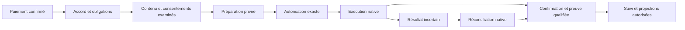

# Alignement architectural et capacité opérationnelle de Funding

Analyse du 25 novembre 2026 sur `57e11deec593143d53ecd202244f63a17d250a39`,
avec le guide local des dix parcours administratifs non encore suivi par Git.
Périmètre : administration Funding, services et contrats de ce dépôt. Le code du
service Preflight distant, sa configuration déployée et les fournisseurs réels
ne sont pas qualifiés par cette analyse.

La priorité est de rendre observable le cycle complet d’une commandite en
réutilisant les responsabilités, prestations et preuves existantes. Le dépôt
possède déjà une grande partie des mécanismes de reprise et de régulation ;
une nouvelle table de missions ou un moteur générique serait prématuré.
L’écart principal est la composition des faits, des responsabilités humaines
et des mesures de charge autour d’une même opération métier.

## 1 Portée des constats et vocabulaire

Les références S01 à S30 ci-dessous désignent les implémentations inspectées,
leurs contrats et les tests concernés. « Existant » signifie présent dans le
code, sans présumer activation ou déploiement. « Partiel » indique précisément la
limite observée. « Manquant » désigne une capacité non identifiée dans ce
périmètre, et non une impossibilité dans un autre dépôt.

| Notion                | Sens retenu                                                                                                |
| --------------------- | ---------------------------------------------------------------------------------------------------------- |
| Happy Path            | Référence fonctionnelle d’une opération réussie ; les dix identifiants du guide sont conservés             |
| Golden Path           | Chaîne transversale avec une identité métier commune et des critères de réussite vérifiables               |
| Définition de mission | Déclencheur, règles, étapes, droits et critères ; n’impose aucun nouveau registre                          |
| Instance de mission   | Opération identifiée par ses objets persistants actuels et leurs versions                                  |
| État opérationnel     | Projection des faits, blocages, responsabilités et actions admissibles ; ne donne aucun droit              |
| Moteur                | Capacité spécialisée ; ni écran, ni fournisseur, ni synonyme de modèle IA                                  |
| Dette opérationnelle  | Engagements restant à honorer ; ne représente ni dette financière ni nombre brut d’alertes                 |
| Réussite métier       | Résultat attesté selon le propriétaire du domaine ; distinct d’un HTTP 200, d’un clic ou d’un test passant |

Le principe économique reste celui de la [raffinerie](../vision/economic-refinery.md) :
les ressources financent des possibilités productives. Une contribution personnelle,
un achat de prestations et une réalisation collective restent distincts.
Les [principes durables](../decisions/2026-11-25-operational-supervision.md)
encadrent les évolutions proposées ici.

## 2 Cartographie des dix Happy Paths

La navigation reste décrite dans le [guide administratif](happy-path-navigation.md).
Les fiches suivantes en donnent la lecture métier. Les étapes sont conceptuelles :
elles ne remplacent pas les unions d’états des contrats cités. Les droits exacts
restent contrôlés par les handlers API et non par cette cartographie.

### HP1 Ouvrir une session administrative

- **Mission et déclencheur :** établir une identité et une session autorisées lors
  d’une demande d’accès à `/admin/login` ou à une page protégée.
- **Préconditions et objets :** fournisseur configuré, personne active, rôle,
  session d’authentification et comptes nominatifs ; second facteur selon le mode.
- **Transitions et dépendances :** authentification fournisseur → callback API →
  session Funding → lecture protégée ; dépendances OIDC et PostgreSQL.
- **Invariants et autorisations :** contrôle serveur, révocabilité, aucune
  affirmation MFA du navigateur ; le mode token local reste distinct.
- **Résultat et preuve :** session persistante valide et accès API accordé pour
  cette identité. Une lecture authentifiée ne prouve pas à elle seule tout le flux OIDC.
- **Blocages et récupération :** compte désactivé, expiration ou fournisseur
  indisponible → reconnexion après résolution ; aucun repli de production sur token.
- **Humain :** authentification et gestion des exceptions d’accès ; provisionnement
  préalable par une personne habilitée. **Existant :** S01, S02, S03.

### HP2 Suivre une contribution reçue

- **Mission et déclencheur :** expliquer un paiement confirmé et ses suites lors
  de la notification ou de l’ouverture de `/admin/fundraiser/contributions`.
- **Préconditions et objets :** contribution, événements Stripe, journal,
  activité, messages et pièces déjà enregistrés.
- **Transitions et dépendances :** confirmation Stripe → écritures → activité et
  messages → consultation ; API, PostgreSQL, Stripe et canaux configurés.
- **Invariants et autorisations :** Stripe fait autorité ; idempotence et devise ;
  lecture admin autorisée, aucun nouveau paiement depuis la notification.
- **Résultat et preuve :** faits corrélés au même paiement et progression relue.
  Le toast ou le SMS simulé n’est pas la preuve financière.
- **Blocages et récupération :** webhook interrompu ou canal indisponible → reprise
  du traitement et inspection des messages existants, sans recréer la contribution.
- **Humain :** supervision et anomalies. **Existant :** S04, S05 ; les indicateurs
  de domaines du cockpit ne remplacent pas ce suivi individuel (S03).

### HP3 Examiner une commandite et sa visibilité

- **Mission et déclencheur :** décider sur le contenu soumis d’un dossier ouvert
  dans `/admin/fundraiser/sponsors`.
- **Préconditions et objets :** paiement admissible, accord, fiche, consentements,
  médias, décisions versionnées et dossier de modération.
- **Transitions et dépendances :** contenu disponible → examen → décision →
  visibilité décidée séparément ; stockage média et services Funding.
- **Invariants et autorisations :** droits d’usage exacts, version examinée,
  confidentialité des notes ; confirmation et droits API pour les décisions.
- **Résultat et preuve :** décision actuelle et reçus/audit ; la visibilité n’est
  ni une autorisation sociale ni une preuve générale de livraison.
- **Blocages et récupération :** données ou droits manquants, contenu obsolète →
  correction puis nouvel examen ; préserver le paiement et les faits historiques.
- **Humain :** décision éditoriale, consentement documenté et cas sensibles.
  **Existant :** S06, S07, S08 ; préremplissage assisté partiel, sans autorité IA (S09).

### HP4 Préparer une reconnaissance et suivre sa livraison

- **Mission et déclencheur :** honorer une prestation ouverte depuis
  `/admin/fundraiser/campaigns` ou le Comptoir `/admin/fundraiser/preflight`.
- **Préconditions et objets :** accord qualifié, obligation exacte, canal, cible,
  ordinal, format, contenu, média et autorisations ; capacité de destination.
- **Transitions et dépendances :** préparation privée → examen → autorisation
  exacte → réservation → exécution → preuve → solde de la prestation.
- **Invariants et autorisations :** ni préparation ni adoption ne publient ;
  contrôle de version et de capacité ; autorisation humaine selon les règles
  actuelles. Web et social conservent leurs propriétaires.
- **Résultat et preuve :** preuve qualifiée rattachée à la prestation ; un lot
  collectif peut livrer plusieurs obligations, jamais plusieurs fois le même passage.
- **Blocages et récupération :** consentement, éléments requis, capacité, compte
  ou résultat incertain → action native, réconciliation puis nouvelle autorisation
  si nécessaire ; aucune relance aveugle.
- **Humain :** examen et autorisation ; attestation documentée pour certaines
  durées Web. **Existant :** S07 à S15. **Partiel :** supervision transversale S16.

### HP5 Consulter une facture et son courriel

- **Mission et déclencheur :** retrouver une pièce émise dans
  `/admin/fundraiser/invoices` et expliquer sa communication.
- **Préconditions et objets :** paiement, facture snapshot, PDF et message.
- **Transitions et dépendances :** émission → consultation PDF → lecture de la
  file → renvoi confirmé si demandé ; PostgreSQL, PDF et SMTP.
- **Invariants et autorisations :** document stable ; contrôle admin et
  confirmation du destinataire pour un renvoi ; aucun nouveau fait financier.
- **Résultat et preuve :** document et référence retrouvés ; état du message
  distinct. Acceptation SMTP ne signifie pas lecture par le destinataire.
- **Blocages et récupération :** pièce absente ou message échoué/incertain →
  réconciliation du document ou traitement natif de la file, sans renvoi aveugle.
- **Humain :** consultation et exception de destinataire. **Existant :** S17, S18.

### HP6 Rembourser une contribution de test

- **Mission et déclencheur :** exécuter une demande autorisée de compensation.
- **Préconditions et objets :** paiement confirmé, montant restant, devise,
  raison, opération de remboursement, remboursement Stripe, facture et avoir.
- **Transitions et dépendances :** confirmation → demande idempotente → résultat
  Stripe → compensation interne → avoir → communication et agrégats.
- **Invariants et autorisations :** droits et confirmation serveur ; aucune
  suppression des faits ni réussite déduite du clic ; production séparément autorisée.
- **Résultat et preuve :** référence et statut fournisseur confirmés, avoir lié
  et journal cohérent ; l’avoir seul ne prouve pas le mouvement externe.
- **Blocages et récupération :** résultat partiel, facture manquante, réponse
  perdue → lire l’opération et les faits Stripe avant reprise.
- **Humain :** décision, raison et autorisation financière ; moteur pour les
  suites déterministes. **Existant :** S19, S17 ; surveillance des suites S20.

### HP7 Publier une affectation et son avancement

- **Mission et déclencheur :** enregistrer une utilisation prévue du fonds depuis
  `/admin/fundraiser/expenses`.
- **Préconditions et objets :** compte propriétaire, montant/devise, allocation,
  statut de visibilité, avancement et références publiques admissibles.
- **Transitions et dépendances :** saisie → confirmation → écriture → relecture ;
  registre PostgreSQL et projection de transparence.
- **Invariants et autorisations :** propriétaire seulement pour les mutations ;
  aucune transaction Stripe créée, visibilité distincte de l’avancement.
- **Résultat et preuve :** reçu serveur et allocation relue ; une réalisation
  déclarée ne certifie ni paiement fournisseur ni résultat indépendant.
- **Blocages et récupération :** réponse perdue → vérifier le reçu exact de
  création, ne pas déduire son absence d’une liste rafraîchie.
- **Humain :** contenu et décision de publication. **Existant :** S21.

### HP8 Prendre en charge une intervention

- **Mission et déclencheur :** prioriser une exception détectée dans
  `/admin/fundraiser/attention` ou `/admin/fundraiser/assistant`.
- **Préconditions et objets :** sources disponibles, intervention dérivée,
  catégorie/priorité et objet métier exact.
- **Transitions et dépendances :** détecter → expliquer → ouvrir le propriétaire
  → agir → relire la situation ; dépendances des domaines analysés.
- **Invariants et autorisations :** absence de données distincte de zéro ;
  proposition privée sans mutation métier ; droit natif de l’action.
- **Résultat et preuve :** correction constatée chez le propriétaire, pas simple
  fermeture du panneau ; les filtres et le retour conservent le contexte.
- **Blocages et récupération :** source indisponible ou alerte périmée → relecture ;
  résultat incertain traité dans son domaine avant toute relance.
- **Humain :** décision et exceptions ; détection déterministe. **Existant :** S20.
  **Risque :** chargement complet avant traitement des listes (S22).

### HP9 Gérer les accès et les sessions

- **Mission et déclencheur :** accorder le rôle approprié ou révoquer une session
  depuis `/admin/fundraiser/access`.
- **Préconditions et objets :** propriétaire actif, identité vérifiée, compte,
  rôle et sessions ; fournisseur pour le provisionnement préalable.
- **Transitions et dépendances :** sélectionner → confirmer → enregistrer →
  révoquer les sessions concernées → vérifier l’accès résultant.
- **Invariants et autorisations :** dernier propriétaire protégé, décisions
  serveur et audit ; l’identifiant fournisseur ne vient pas d’une supposition IA.
- **Résultat et preuve :** rôle relu, sessions révoquées et prochain accès refusé
  selon le cas ; ne pas confondre session Funding et session globale OIDC.
- **Blocages et récupération :** droits insuffisants ou identité incorrecte →
  résolution par propriétaire/fournisseur ; jamais de contournement.
- **Humain :** attribution des privilèges et révocation. **Existant :** S02.

### HP10 Retrouver une action dans l’audit

- **Mission et déclencheur :** reconstruire une action depuis
  `/admin/fundraiser/audit` ou une référence de reçu.
- **Préconditions et objets :** accès autorisé, trace, acteur, cible, corrélation
  et faits métier encore consultables.
- **Transitions et dépendances :** retrouver la trace → lire résultat/contexte →
  rapprocher de l’objet et des preuves ; PostgreSQL et services propriétaires.
- **Invariants et autorisations :** confidentialité et contrôle API ; tentative,
  acquittement fournisseur et réussite métier restent des faits différents.
- **Résultat et preuve :** explication reconstruite avec références ; l’audit
  d’exécution ne remplace pas une preuve qualifiée.
- **Blocages et récupération :** référence absente ou source indisponible →
  recherche et diagnostic sans inventer d’événement historique.
- **Humain :** investigation et arbitrage. **Existant :** S23, S14.

## 3 Cartographie des capacités et degré d’autonomie

Les niveaux décrivent une lecture architecturale des capacités présentes, pas
une nouvelle configuration ni une certification. N0 manuel, N1 observation,
N2 assistance privée, N3 exécution explicitement autorisée, N4 automatisme dans
une politique bornée. N4 ne permet pas d’assouplir les autorisations existantes.

| Capacité                         | Existant et limites                                                                           | Niveau observé selon l’opération                                         | Sources       |
| -------------------------------- | --------------------------------------------------------------------------------------------- | ------------------------------------------------------------------------ | ------------- |
| Confirmation financière          | Vérification Stripe, déduplication, reprise et journal ; aucune IA financière                 | N4 pour traitement déterministe d’événements admissibles                 | S04, S19      |
| Notifications et documents       | File durable, pièces et états indépendants ; incertitude SMTP explicite                       | N4 pour suites transactionnelles configurées ; renvois sensibles humains | S05, S17, S18 |
| Accord et obligations            | Offre figée, versions, qualification historique, ajustements et preuves                       | N4 création après confirmation ; N0 décision de qualification/ajustement | S07           |
| Bilan de responsabilités         | Évalue obligations, preuves et amendements sans autoriser d’action                            | N1                                                                       | S24           |
| Portefeuille automatique         | Parcours persistant, position, passages, rapports et commandes ; préparation privée seulement | N2 ; « completed » du parcours ne signifie pas prestations livrées       | S25           |
| Préparation et assistance locale | Reçus, versions, propositions, baux et tentatives bornées                                     | N2 ; analyse locale par défaut dans le worker inspecté                   | S08, S09      |
| Preflight distant                | Missions HTTP v1, outbox, révisions, import contrôlé, quarantaine                             | N2 ; activation effective non qualifiée ici                              | S10           |
| Atelier et examen                | Préparation commune/déclinaisons, adoption privée, décisions par prestation                   | N2 puis décision humaine ; pas d’autorisation d’envoi par adoption       | S11, S12      |
| Préparation sociale et capacité  | Planification bornée, lots, créneaux, réservations et files                                   | N2 ; confirmations humaines pour les autorisations                       | S13, S15      |
| Diffusion sociale                | Claims versionnés, revalidation, compte réservé, résultats et réconciliation                  | N3 pour contenu exact autorisé ; ambiguïtés suspendues                   | S13, S14, S15 |
| Reconnaissance Web               | Visibilité native et preuve par obligation ; durée requiert attestation documentée            | N3 pour transition autorisée ; N0 attestation humaine de continuité      | S06, S14      |
| Détection et Assistant           | File déterministe priorisée, propositions et navigation contextuelle                          | N1/N2 ; aucune mutation conférée à l’IA                                  | S20, S22      |
| Supervision                      | Salle lecture seule et six parcours du cockpit ; périmètres, fraîcheur et limites visibles    | N1 partiel ; capacité productive globale non calculée                    | S03, S16      |
| Missions synthétiques            | Recette Preflight persistante et tests isolés ; pas une sonde périodique de tous les domaines | N1 partiel ; programmation périodique globale non identifiée             | S26, S27      |

Les médias ont aussi leurs files d’analyse et de revue, leurs décisions et leurs
droits propres (S06, S09). Ils restent une capacité réutilisable par plusieurs
parcours, sans nouveau moteur par fichier ou par page.

## 4 Golden Paths transversaux

### GP1 Honorer la reconnaissance promise pour une commandite

**Référence prioritaire.** HP2 → HP3 → HP4, avec HP5, HP8 et HP10 comme appuis.
HP1 est une précondition d’intervention, pas un passage obligatoire du moteur.

La préparation privée peut commencer avant la revue ; le schéma exprime la chaîne
de garanties jusqu’à l’envoi, sans imposer un ordre artificiel aux propositions.
L’audit accompagne les décisions et résultats à chaque étape, pas seulement à la fin.
Une visibilité publique ou un total financier n’affiche pas le dossier privé complet.

| Étape                            | Ancrage persistant et réussite attendue                                             | Propriétaire et limite                                                                                  |
| -------------------------------- | ----------------------------------------------------------------------------------- | ------------------------------------------------------------------------------------------------------- |
| Contribution confirmée           | `contributionId`, PaymentIntent, événement traité et montant/devise concordants     | Stripe et ingestion Funding ; retour Checkout insuffisant (S04)                                         |
| Accord et prestations identifiés | `commitmentId`, offre/version, `obligationId`, canal, cible, format et ordinal      | Engagements ; historique non qualifié reste explicite (S07)                                             |
| Contenu examiné                  | Sources, consentement, médias et décisions actuelles                                | Modération et préparation ; pas de droit IA (S06, S08)                                                  |
| Préparation                      | Révision/empreinte source, mission/proposition et brouillon natif                   | Atelier ou connecteur ; registres distincts, activation simultanée refusée (S10, S11)                   |
| Autorisation                     | Snapshot exact des obligations et livraison versionnée, ou transition Web autorisée | Services Funding ; décision de préparation seule insuffisante (S08, S13, S14)                           |
| Exécution                        | Claim/bail, réservation de compte, tentative et résultat fournisseur                | Worker natif ; un timeout peut cacher un effet déjà produit (S13, S15)                                  |
| Preuve et solde                  | Preuve qualifiée exacte et obligation soldée atomiquement                           | Acquittement/vérification fournisseur ou preuve Web admissible (S14)                                    |
| Transparence et audit            | Trace corrélée, état des engagements et projection publique admissible              | Propriétaires natifs ; pas de traçabilité causale de chaque dollar vers une réalisation (S21, S23, S24) |

**Identité de lecture proposée :** partir de `contributionId`, relier ses accords,
obligations et preuves, puis suivre chaque `deliveryId` et ses participants. Une
livraison collective reste partagée ; son succès ne doit être attribué qu’aux
obligations réellement couvertes. Deux prestations d’une même destination ont
des ordinaux distincts. Les versions observées accompagnent chaque rapprochement.
Les UUID de requêtes, missions et traces ne remplacent pas cette identité métier.

**Critère terminal proposé :** toutes les prestations enregistrées ont une preuve
qualifiée ou une dispense explicite. Afficher séparément « livrées », « dispensées »,
« ouvertes », « bloquées » et « qualification inconnue ». Une dispense clôt un
suivi mais ne compte jamais comme livraison. La visibilité courante peut changer
sans effacer la preuve historique ; durée Web et destination OpenG20 conservent
leurs restrictions. Les simulations ne réduisent pas la dette réelle (S14, S24).

**Existant partiel :** `AdminPaymentJourney`, progression des obligations,
`ResponsibilityBalance`, Comptoir et Salle composent déjà des segments. Les six
parcours du cockpit prennent des témoins corrélés par domaine ; ils ne sont ni
les dix Happy Paths ni une instance GP1 persistante commune à tous les domaines
(S03, S16, S24, S28). Ne pas réécrire leur signification pour les faire paraître complets.

### Autres Golden Paths identifiés

| Golden Path proposé                            | Chaîne et critère de réussite                                                                              | Base et limite                                                                         |
| ---------------------------------------------- | ---------------------------------------------------------------------------------------------------------- | -------------------------------------------------------------------------------------- |
| GP2 Encaisser et communiquer de manière fiable | Paiement → journal → pièce requise → message accepté par SMTP → agrégats explicables                       | HP2/HP5/HP10 ; S04, S17, S18. Acceptation SMTP distincte de réception et lecture       |
| GP3 Compenser un paiement                      | Décision autorisée → remboursement confirmé → compensation/avoir → message suivi → admissibilité réévaluée | HP6/HP5/HP8/HP10 ; S19. Ni refus éditorial ni avoir ne prouvent un remboursement       |
| GP4 Traiter une exception sans doublon         | Détection → contexte → décision native → réconciliation → résultat relu et audité                          | HP8/HP10 et parcours concerné ; S20, S23, S26. Pas de moteur universel de réparation   |
| GP5 Rendre compte d’une affectation            | Allocation → décision de publication → avancement déclaré et référence admissible                          | HP7/HP10 ; S21. Distinct du paiement fournisseur et d’une certification de réalisation |

Ces identifications sont des regroupements d’analyse ; aucun nouveau workflow
exécutable n’est créé par ce document.

## 5 Matrice des responsabilités

Le mot Preflight recouvre ici l’intégration à un service qui prépare aussi des
propositions. Le réduire à un simple feu vert serait contraire au contrat réel.
Les contrôles ultimes restent déterministes dans Funding (S08, S10, S11).

| Responsabilité             | Moteurs spécialisés                                                  | Preflight                                        | Atelier et examen                                        | Assistant                         | Salle des moteurs                   | Audit                               |
| -------------------------- | -------------------------------------------------------------------- | ------------------------------------------------ | -------------------------------------------------------- | --------------------------------- | ----------------------------------- | ----------------------------------- |
| Détecter les besoins       | Faits et détecteurs de domaine                                       | État de mission distante                         | Présenter les prestations à préparer/examiner            | Prioriser les interventions       | Composer les observations           | Conserver les traces                |
| Vérifier les préconditions | Autorité déterministe Funding avant mutation/envoi                   | Contrat, provenance et contrôles de préparation  | Exposer manques et versions                              | Expliquer le blocage              | Montrer source, date et portée      | Tracer contrôles/actions utiles     |
| Préparer                   | Services natifs et jobs bornés                                       | Proposition privée                               | Éditer/adopter sans écraser l’humain                     | Proposer, sans décision métier    | Observer, sans lancer               | Conserver provenance et opération   |
| Décider et autoriser       | API propriétaire exécute les validations                             | Aucune autorisation de diffusion                 | Recueillir décision et confirmation vers le propriétaire | Orienter vers l’action native     | Lien d’intervention natif           | Tracer acteur et version            |
| Exécuter                   | Publication, courriel, ingestion ou remboursement selon leurs règles | Exécuter seulement sa mission de préparation     | Pas de deuxième ordonnanceur                             | Pas de mutation IA implicite      | Lecture seule actuellement          | Aucun effet métier autonome         |
| Confirmer et prouver       | Finalisation et preuves qualifiées du domaine                        | Résultat de préparation, pas preuve de livraison | Afficher les faits relus                                 | Réévaluer les interventions       | Montrer résultat sans l’inventer    | Contexte ; trace seule insuffisante |
| Reprendre                  | Baux, reçus, réconciliation et commandes natives                     | Déduplication, polling et quarantaine            | Session personnelle et conflits de version               | Présenter l’intervention restante | Conserver le contexte de diagnostic | Corréler tentatives et résultat     |

**Conséquence :** consolider les projections et la navigation, sans déplacer
l’autorité des services propriétaires vers l’Assistant, la Salle ou un modèle IA.
Le vocabulaire « terminé » doit toujours préciser l’objet terminé : examen,
préparation, tentative, livraison ou ensemble des prestations (S12, S25).

## 6 Missions observables et persistance réutilisable

| Besoin                            | Mécanisme déjà présent                                                              | Écart et évolution proposée                                                                           |
| --------------------------------- | ----------------------------------------------------------------------------------- | ----------------------------------------------------------------------------------------------------- |
| Définition                        | Contrats de parcours, engagement, préparation et publication                        | Formaliser les fiches de mission dans la documentation avant tout registre exécutable (S03, S07, S08) |
| Instance                          | Contribution, engagement, obligation et livraison                                   | Vue GP1 dérivée de ces identifiants ; pas de copie du statut financier (S07, S14, S28)                |
| Progression et prochaines actions | Bilan de responsabilités, suivi de publication et Comptoir                          | Réutiliser les motifs/actions natifs ; éviter une deuxième politique d’admissibilité (S24, S29)       |
| Contexte humain reprenable        | Session de travail privée par acteur et révision, commandes idempotentes            | Contexte borné à 100 prestations, distinct de la mission et de la session OIDC (S12)                  |
| Traitement d’un ensemble          | Portefeuille automatique persistant, passages, curseur et rapports                  | Réutiliser pour préparation ; ne pas transformer sa fin de parcours en preuve de livraison (S25)      |
| Mission externe                   | Mission/event IDs, outbox, révisions et propositions Preflight                      | Ne pas dupliquer ces missions ; liaison vers les objets Funding (S10, S11)                            |
| Effet externe et reprise          | Livraisons, claims clôturés par version, baux et quarantaines ; messages incertains | Reprendre selon le propriétaire ; absence de réponse ne signifie pas absence d’effet (S13, S15, S18)  |
| Preuve                            | Registre de fulfilment et reçus exacts                                              | Projection commune possible ; aucun stockage concurrent de « preuves IA » (S14, S21)                  |

Une éventuelle matérialisation de lecture se justifierait seulement après mesure
du coût des jointures et définition de l’invalidation, du retard et de la reprise.
Elle resterait reconstruisible, sans devenir l’autorité des paiements ou décisions.

## 7 Travail humain répétitif et réduction possible

| Opération                          | Ce qui augmente avec le volume                               | Réutilisation et réduction proposée                                                                                         | Décision humaine conservée               |
| ---------------------------------- | ------------------------------------------------------------ | --------------------------------------------------------------------------------------------------------------------------- | ---------------------------------------- |
| Retrouver le dossier et son état   | Navigation entre contribution, accord, publication et preuve | GP1 contextualisé, liens exacts, Comptoir/Assistant (S20, S24, S29)                                                         | Diagnostic final d’une anomalie          |
| Préparer les déclinaisons          | Saisie répétée par canal et passage                          | Atelier commun et variantes privées, prochain passage ouvert (S11)                                                          | Revue du contenu exact                   |
| Vérifier médias et droits          | Nombre de fichiers et destinations                           | Analyse assistée et manifeste de revue exact ; ne pas redemander une preuve encore valide (S06, S09)                        | Droits et décision éditoriale            |
| Relire des rapports administratifs | Validation humaine par dossier et par résultat               | Mesurer le coût du portefeuille ; proposer ensuite une lecture groupée distincte, sans supprimer les décisions métier (S25) | Autorisations sensibles                  |
| Vérifier chaque prestation         | Obligations et preuves par passage                           | Progression et bilan dérivés, exceptions seules mises en avant (S14, S24)                                                   | Durée Web nécessitant attestation        |
| Relancer les communications        | Échecs et corrections de destinataire                        | File persistante, groupement d’erreurs et reprises certaines (S18, S20)                                                     | Destinataire corrigé et relance sensible |
| Reconstruire une incertitude       | Fournisseurs et comptes touchés                              | Références distantes et audit de réponse conservés, lien de réconciliation (S13, S15)                                       | Attestation d’absence avant nouvel envoi |
| Qualifier l’historique             | Dossiers sans accord fiable                                  | File dédiée et preuves disponibles ; jamais appliquer le barème actuel rétroactivement (S07, S20)                           | Qualification et amendements             |

Le gain potentiel vient d’abord de la suppression des recherches et saisies
redondantes. Le gain réel en minutes reste à mesurer ; aucun pourcentage de
réduction du travail n’est démontré par les tests actuels.

## 8 Risques de saturation et hypothèses de volume

### Modèle de dimensionnement proposé

Soit `C` contributions par jour, `s` la fraction de commandites, `o` le nombre
moyen de prestations promises par commandite. Le flux entrant de prestations est
`C × s × o` ; les contributions personnelles n’héritent pas d’obligations publicitaires.
La charge humaine journalière est la somme des interventions par catégorie
multipliées par leur durée mesurée. Une alerte ne vaut pas une intervention unique.

| Contributions par jour | Entrée de prestations | Exemple de charge humaine          |
| ---------------------- | --------------------- | ---------------------------------- |
| 1                      | `s × o`               | 2 minutes/jour                     |
| 100                    | `100 × s × o`         | 200 minutes, soit 3 h 20/jour      |
| 1 000                  | `1 000 × s × o`       | 2 000 minutes, soit 33 h 20/jour   |
| 10 000                 | `10 000 × s × o`      | 20 000 minutes, soit 333 h 20/jour |

La dernière colonne suppose volontairement **deux minutes humaines par
contribution**, uniquement pour rendre l’effet linéaire tangible. Ce n’est ni
une mesure du produit ni une prévision. Mesurer séparément dossiers standards,
exceptions, qualification historique et prestations à durée.

### Goulots observables dans le code

| Risque                          | Fait actuel                                                                                                                    | Implication et mesure nécessaire                                                                                                                                                                                                    |
| ------------------------------- | ------------------------------------------------------------------------------------------------------------------------------ | ----------------------------------------------------------------------------------------------------------------------------------------------------------------------------------------------------------------------------------- |
| Cadence de diffusion            | Au plus cinq livraisons par tick ; timer de 30 s ; exécution séquentielle et tick protégé contre recouvrement (S13, S30)       | Plafond théorique optimiste de 14 400 prises de livraison/jour par instance, pas un débit garanti. Temps réseau, tâches précédentes et reprises réduisent ce chiffre ; plusieurs instances restent contraintes par les réservations |
| Compte partagé                  | Espacement technique live de 60 s, réservation et suspension en cas d’incertitude (S15)                                        | Borne idéale de 1 440 départs/jour/compte avant autres limites. Ce n’est pas un quota fournisseur ; un collectif représente plusieurs prestations pour un seul départ                                                               |
| Préparation et remplissage      | Préparation auto réclamée au plus toutes les cinq minutes par flux ; capacité/horizon bornés (S13, S27)                        | Mesurer âge de la file, dossiers différés et collectifs incomplets ; ne pas réduire le minimum de participants pour vider la file                                                                                                   |
| Revue et autorisation           | Versions, contenu et droits nécessitent des décisions ; rapports du portefeuille ont leurs confirmations de lecture (S08, S25) | La préparation automatique ne supprime pas le coût des décisions. Mesurer attente humaine et temps actif par catégorie                                                                                                              |
| Lecture complète de l’Assistant | Loader demande les listes complètes quand `complete=true`, puis détection en mémoire (S22)                                     | Pagination de l’UI ne suffit pas à borner coût CPU/DB/mémoire. Profiler avant de déplacer les détecteurs ou matérialiser                                                                                                            |
| État complet des publications   | Limites d’affichage distinctes des agrégats complets ; test synthétique sur 3 000 dossiers et 6 000 obligations (S27)          | Base de benchmark réutilisable, pas qualification à 10 000 contributions/jour. Rapport historique signale une lecture encore coûteuse ; mesurer la révision courante                                                                |
| File de courriels               | Lot par défaut de dix, boucle de traitement, tentatives et incertitude (S18, S30)                                              | Mesurer arrivée, âge et service par message ; taux SMTP externe non qualifié. Ne pas multiplier les retries incertains                                                                                                              |
| Relais Preflight et IA          | Lot par défaut de vingt, polling, baux, cinq tentatives par défaut ; budget par mission (S10)                                  | Budget par mission n’est pas budget journalier global. Mesurer attente, latence, quarantaine et coût réel distant ; préserver un seul mode de préparation actif                                                                     |
| Partage du processus API        | Plusieurs timers de jobs dans le runtime API (S30)                                                                             | Mesurer CPU, pool SQL et latence interactive avant d’extraire un worker. Le relais Preflight possède déjà son exécutable séparé                                                                                                     |
| Incertitude de compte           | Une opération incertaine retient sa réservation (S15)                                                                          | Blocage volontaire pour éviter doublons ; suivre durée et intervention requise, jamais compter ce blocage comme capacité libre                                                                                                      |

Les mécanismes de baux, contraintes et `SKIP LOCKED` sont déjà des protections de
concurrence. Ils ne prouvent ni équité complète ni débit suffisant à ces volumes.
Les délais commerciaux, fenêtres éditoriales, durées promises et quotas distants
peuvent être plus contraignants que le timer du worker.

### Dette opérationnelle dérivée

La base existante est le calcul global de fiabilité : obligations ouvertes,
retards, engagements non qualifiés, livraisons autorisées en retard et comptes
incertains (S27). Le bilan individuel contrôle les preuves et amendements (S24).

**Écart de sémantique constaté :** `reliability-facts.ts` définit
`evidence_matches` par présence, identité d’obligation/dossier, canal, cible et
version. Le compteur `fulfilledWithEvidence` utilise cette condition. Le bilan
individuel charge aussi la qualification du snapshot et les règles d’amendement
via `sponsorship-progress-evidence.ts`. Ces deux lectures n’attestent donc pas
exactement la même chose. Les agréger sous un même libellé « livré et qualifié »
serait trompeur ; réutiliser la qualification propriétaire pour GP1 et conserver
la définition du compteur global tant qu’une évolution contractuelle n’est pas
explicitement réalisée et testée (S24, S27, S28).

**Proposition :** présenter un vecteur d’engagements plutôt qu’un score : ouverts
qualifiés, livrés avec preuve, dispensés, non qualifiés, sans date et en retard.
Un envoi autorisé non exécuté est une étape d’une obligation ouverte, pas une
seconde dette à additionner. Les interventions sont un axe de travail distinct :
plusieurs alertes peuvent concerner la même obligation. Séparer les cohortes par
canal, cible, format, mode et échéance ; ne pas sommer des devises pour en faire
une dette monétaire. Aucune nouvelle table d’engagements n’est nécessaire.

## 9 Données nécessaires aux indicateurs

Les définitions ci-dessous sont proposées. Les compteurs existants cités restent
utilisables dans leur périmètre ; les autres mesures ne doivent pas apparaître
comme disponibles avant instrumentation et validation.

| Indicateur           | Calcul et périmètre proposés                                                                                                                     | Provenance existante et données manquantes                                                                                                                       |
| -------------------- | ------------------------------------------------------------------------------------------------------------------------------------------------ | ---------------------------------------------------------------------------------------------------------------------------------------------------------------- |
| Débit                | Prestations distinctes avec première preuve qualifiée dans `[t0,t1)` / durée ; compter les livraisons collectives séparément                     | Preuves `delivered_at`, obligation, canal et cible (S14) ; définir fuseau et cohortes                                                                            |
| Autonomie            | Missions d’une cohorte closes sans intervention humaine requise / missions closes de cette cohorte ; publier effectifs et exclusions             | Acteurs/audit et preuves existent ; taxonomie exhaustive des interventions manquante. Une autorisation humaine compte comme intervention                         |
| Charge humaine       | Somme du temps actif observé par catégorie et période                                                                                            | Sessions/visites existantes (S12) ; temps actif non déductible de la durée d’une session. Mesure dédiée à concevoir avec minimisation des données                |
| Saturation           | Charge occupée / capacité configurée d’une ressource et fenêtre données                                                                          | Lots/créneaux et réservations (S15, S27) ; saturation CPU/SQL et capacité humaine non fournies par ces compteurs                                                 |
| Dette opérationnelle | Cardinalité des obligations ouvertes uniques, avec axes non qualifiés/retard et âge du plus ancien                                               | Fiabilité globale et bilan (S24, S27) ; pas de pourcentage synthétique                                                                                           |
| Fiabilité            | Prestations attendues d’une cohorte effectivement livrées selon les critères avant échéance / prestations attendues admissibles de cette cohorte | Preuves, échéances et dispenses disponibles ; définir traitement des échéances inconnues et cohortes non mûres, publier exclusions                               |
| Coût                 | Ressources effectivement attribuées à une préparation/prestation, avec méthode d’allocation pour les collectifs                                  | `maxCostUsd` est une limite, pas un coût réalisé (S10) ; coût IA/CPU/stockage effectif et allocation non consolidés                                              |
| Temps de cycle       | Première réussite qualifiée moins déclencheur défini ; médiane et percentiles, avec nombre de cas                                                | Paiement/prestation et dates de preuve (S04, S14) ; choisir distinctement cycle économique et cycle de traitement                                                |
| Récupération         | Retour confirmé au résultat attendu moins début du blocage corrélé                                                                               | Incidents, audit et résultats disponibles (S13, S23, S27) ; épisodes transversaux et horodatage initial à définir, ne pas utiliser la date d’un rafraîchissement |

Chaque lecture doit donner définition/version, source, heure d’évaluation,
périmètre, unité, complétude et effectif. Inconnu, partiel, désactivé et indisponible
restent distincts. Aucun pourcentage avec dénominateur nul ou population incomplète.

## 10 Écarts vers la vision cible

| Sujet                           | État constaté                                                                    | Écart et suite pertinente                                                                                     |
| ------------------------------- | -------------------------------------------------------------------------------- | ------------------------------------------------------------------------------------------------------------- |
| Dix parcours admin              | Existant documentaire, correspondances avec code/tests ci-dessus                 | Formalisation métier fournie ici ; conserver leur fonction de navigation                                      |
| Golden Path individuel          | Partiel : segments et identifiants persistants déjà présents                     | Relier les lectures dans une vue cohérente d’une même commandite                                              |
| Mission persistante universelle | Manquante comme abstraction commune ; missions spécifiques présentes             | Aucune nécessité démontrée d’en créer une ; réutiliser les instances natives                                  |
| Dette et fiabilité              | Existant pour obligations/publications ; bilan individuel plus strict disponible | Harmoniser les explications et cohortes, sans altérer leurs définitions                                       |
| Salle des moteurs               | Existant en lecture seule pour deux ensembles de capacités                       | Couverture partielle ; pas de heartbeat publication, capacité libre globale ou santé distante confirmée (S16) |
| Intervention humaine            | Assistant et examen existants                                                    | Mesure du temps et classement commun des interventions partiels/manquants                                     |
| Préparation par IA              | Contrats et propositions privés présents                                         | Activation/fournisseur/coût réel non qualifiés ; ne pas attribuer au dépôt le moteur distant complet          |
| Reprise                         | Existant par domaine et session personnelle                                      | Continuité de diagnostic transversale à composer ; aucun rejeu générique                                      |
| Charge et dimensionnement       | Test d’arriéré et garde de capacité présents                                     | Pas de preuve à 10 000 contributions/jour ni modèle validé de capacité humaine                                |
| Assurance continue              | Tests, recette synthétique Preflight et observations réelles présentes           | Pas de supervision synthétique périodique complète identifiée ; trois mécanismes à garder distincts           |

## 11 Proposition d’évolution incrémentale

Les tranches A à G possèdent désormais une première implémentation locale décrite dans
la [référence de supervision](../technical/engine-room.md). Cette analyse conserve
le diagnostic de la révision indiquée en ouverture. La tranche G se limite à une
[préparation privée d'un dossier sous politique explicite](../technical/admin-automatic-runs.md#bounded-private-preparation),
accessible par API, sans extension générale de l'autonomie. L'assurance synthétique
reste [isolée et optionnelle](../operations/admin-identity-and-alerts.md#isolated-operational-assurance),
sans déploiement implicite.

| Tranche proposée                      | Livrable et résultat attendu                                                                 | Critère de réception et dépendance                                                                                                     |
| ------------------------------------- | -------------------------------------------------------------------------------------------- | -------------------------------------------------------------------------------------------------------------------------------------- |
| A Corrélation GP1 en lecture seule    | Vue par commandite réutilisant bilan, obligations, preuves, blocages et liens natifs         | Une même identité de bout en bout ; source/date/mode/limite visibles ; aucune mutation à la lecture                                    |
| B Priorisation par exception          | Assistant et Salle exposent les mêmes motifs propriétaires et désignent humain ou plateforme | Un envoi autorisé en attente normale n’est pas une nouvelle tâche humaine ; pas de double file de décisions                            |
| C Mesure des flux et de la charge     | Cohortes, entrées/sorties, âge, attente et mesure humaine consentie                          | Définitions et provenance vérifiées ; baseline avant toute promesse de gain                                                            |
| D Réduction de préparation répétitive | Préremplissage et préparation groupée via Atelier/portefeuille existants                     | Préserver éditions humaines, droits médias, exactitude du manifeste et autorisations ; mesurer minutes et reprises évitées             |
| E Charge contrôlée                    | Étendre benchmark et profils aux hypothèses 100/1 000/10 000, files et pool SQL              | Fournisseurs synthétiques, pas de secrets réels ; publier latences, débit, backlog et limites, sans qualifier un VPS par extrapolation |
| F Assurance opérationnelle            | Synthétiques isolées périodiques et alertes d’épisodes ; reprise native documentée           | Aucun effet financier/social réel, aucune mission payante implicite, réconciliation d’une réponse perdue                               |
| G Autonomie encadrée ciblée           | Politique explicite pour une capacité démontrée et à faible risque                           | Décision séparée, portée/droits/budget/arrêt/audit/reprise ; aucune autorisation générale de publication ou remboursement              |

L’ordre peut être ajusté par les mesures ; une saturation démontrée d’une lecture
ou du pool peut justifier une optimisation ciblée avant l’extension de l’interface.

### Premier chantier recommandé

**Composer une observation GP1 par commandite, sans nouveau moteur ni nouvelle
table métier.** Commencer par les lectures des étapes paiement → accord → obligations
→ préparation → autorisation → livraison → preuve, puis leur présentation dans
les surfaces de suivi existantes. L’entrée de la Salle reste un lien contextualisé.

Le contrat de lecture devra être défini à partir des producteurs actuels, avec
références, versions, source, date, mode, complétude, blocage et prochaine action
native. Ne pas exiger un snapshot distribué : rendre l’éventuel décalage visible.
Ne pas recopier dans Angular la politique d’admissibilité des services Funding.
La qualification des preuves doit venir du bilan et des faits qualifiés natifs,
sans assimiler le simple rapprochement global à cette qualification complète.

La première réception doit couvrir : une prestation Web sans durée ; une durée
Web attendant attestation ; une diffusion individuelle ; une collective avec
plusieurs dossiers ; plusieurs passages ; une dispense ; un accord non qualifié ;
une simulation ; un contenu modifié ; un remboursement ; un résultat incertain ;
une source absente et une lecture partielle. Vérifier permissions et absence de
mutation, liens de retour, preuve exacte, fraîcheur et refus d’un faux succès.
Réutiliser S14, S16, S24, S27 et S29 pour les fixtures et critères.

**Valeur à mesurer :** temps pour expliquer où un dossier attend et qui doit agir,
nombre d’écrans nécessaires, confusions entre préparation et livraison.
**Fiabilité à prouver séparément :** corrélation exacte, confidentialité, version,
complétude, absence d’effets et maintien des gardes métier.

### Évolutions prématurées ou contre-productives

- Moteur générique, bus distribué ou nouveau registre de missions avant mesure :
  ferait concurrence aux outbox, obligations, sessions et livraisons existantes.
- Un moteur par Happy Path, écran ou réseau : confondrait capacité, parcours et dépendance.
- Suppression des confirmations pour réduire le nombre de clics : changerait les
  autorisations sans résoudre la qualité du contexte ou la charge éditoriale.
- Statut global vert ou taux d’autonomie calculé depuis le worker activé :
  masquerait les périmètres partiels et les résultats inconnus.
- Relance automatique de toute anomalie : pourrait répéter un effet externe déjà produit.
- Activation simultanée des deux relais Preflight : contredirait leurs gardes et versions sources.
- Dispenses, baisse des exigences ou changement des promesses pour vider l’arriéré :
  ne constituent pas un gain de productivité démontré.
- Promesse de traçabilité individuelle de chaque dollar : non établie par les
  projections actuelles et non nécessaire à la preuve des prestations.

## 12 Références vérifiables

Les tests ci-dessous sont des preuves de couverture disponible dans le dépôt,
pas une déclaration d’exécution lors de cette analyse documentaire.

| ID  | Implémentation et contrat                                                                                                                                                                                                                                 | Routes et tests concernés                                                                                                                                                                                                           |
| --- | --------------------------------------------------------------------------------------------------------------------------------------------------------------------------------------------------------------------------------------------------------- | ----------------------------------------------------------------------------------------------------------------------------------------------------------------------------------------------------------------------------------- |
| S01 | [Routes administratives](../../apps/funding-web/src/app/admin.routes.ts)                                                                                                                                                                                  | `/admin/login`, `/admin/fundraiser` et sous-pages                                                                                                                                                                                   |
| S02 | [Identité](../operations/admin-identity-and-alerts.md), [services identité](../../apps/funding-api/src/admin-identity)                                                                                                                                    | [Recette OIDC](../../tests/identity/keycloak-identity.integration.mjs)                                                                                                                                                              |
| S03 | [Lecture des parcours](../../apps/funding-api/src/admin-cockpit/journeys.ts), [projection](../../apps/funding-api/src/admin-cockpit/journeys.projection.ts), [contrat](../../packages/funding-core/src/admin-platform-journeys.ts)                        | [Tests parcours](../../tests/admin-platform-journeys.test.mjs), [intégration](../../tests/integration/admin-platform-journeys.integration.mjs)                                                                                      |
| S04 | [Webhook](../../apps/funding-api/src/stripe-webhook.service.ts), [événements](../../apps/funding-api/src/stripe-events.repository.ts)                                                                                                                     | [Recettes financières](../payment-trust-validation.md), [parcours contribution](../../tests/playwright/contribution-journey-acceptance.spec.ts)                                                                                     |
| S05 | [Activité de contribution](../operations/contribution-activity.md)                                                                                                                                                                                        | `/admin/fundraiser/contributions`, [acceptation](../../tests/playwright/contribution-journey-acceptance.spec.ts)                                                                                                                    |
| S06 | [Modération](../../apps/funding-api/src/moderation), [règles de commandite](sponsorship-rules.md)                                                                                                                                                         | `/admin/fundraiser/sponsors`, [gardes](../../tests/integration/moderation-publication-guards.integration.mjs), [revue média](../../tests/sponsor-media-review.test.mjs)                                                             |
| S07 | [Engagements](../../apps/funding-api/src/sponsorship-commitments), [projection](../../apps/funding-api/src/sponsorship-commitments/projection.ts), [contrat](../../packages/funding-core/src/sponsorship-commitments.ts)                                  | [Intégration](../../tests/integration/sponsorship-commitments.integration.mjs), [parcours propriétaire](../../tests/identity/owner-obligation-journey.spec.ts)                                                                      |
| S08 | [Préparation](../../apps/funding-api/src/admin-preparation.service.ts), [préconditions](../../apps/funding-api/src/admin-preparation-readiness.ts)                                                                                                        | [Préparation](../../tests/integration/admin-preparation.integration.mjs), [préconditions](../../tests/admin-preparation-readiness.test.mjs)                                                                                         |
| S09 | [Assistance](../../apps/funding-api/src/preparation-assistance/worker.ts), [analyse média](../../apps/funding-api/src/sponsor-media-analysis)                                                                                                             | [Assistance](../../tests/preparation-assistance.test.mjs), [analyse](../../tests/sponsor-media-analysis.test.mjs)                                                                                                                   |
| S10 | [Contrat Preflight](../../apps/funding-api/src/preflight/contracts.ts), [worker](../../apps/funding-api/src/preflight/worker.ts), [configuration](../../apps/funding-api/src/preflight/config.ts), [connecteur](../technical/preflight-connector.md)      | [Producteur](../../tests/preflight-producer.test.mjs), [consommateur](../../tests/preflight-consumer.test.mjs), [intégration](../../tests/integration/preflight-connector.integration.mjs)                                          |
| S11 | [Atelier](../../apps/funding-api/src/preflight/workshop.ts), [adoption](../../apps/funding-api/src/preflight/workshop-adoption.ts), [contrat](../../packages/funding-core/src/publication-workshop.ts)                                                    | [Référence](../technical/publication-workshop.md), [tests](../../tests/integration/publication-workshop.integration.mjs)                                                                                                            |
| S12 | [Sessions](../../apps/funding-api/src/admin-preflight-work-sessions.service.ts), [contrat](../../packages/funding-core/src/admin-preflight-work-sessions.ts)                                                                                              | [Référence](../technical/preflight-work-sessions.md), [intégration](../../tests/integration/admin-preflight-work-sessions.integration.mjs)                                                                                          |
| S13 | [Moteur](../../apps/funding-api/src/publication-automation/service.ts), [worker](../../apps/funding-api/src/publication-automation/delivery-worker.ts), [claims](../../apps/funding-api/src/publication-automation/claims.ts)                             | `/admin/fundraiser/publications/automation`, [tests worker](../../tests/publication-automation-delivery-worker.test.mjs), [claims](../../tests/integration/publication-worker-claims.integration.mjs)                               |
| S14 | [Preuve et écriture](../../apps/funding-api/src/sponsorship-fulfilment/evidence-write.ts), [finalisation](../../apps/funding-api/src/publication-automation/delivery-outcomes.ts), [contrat](../../packages/funding-core/src/sponsorship-fulfilment.ts)   | [Référence preuves](../technical/sponsorship-fulfilment.md), [intégration](../../tests/integration/sponsorship-fulfilment.integration.mjs)                                                                                          |
| S15 | [Réservations de compte](../../apps/funding-api/src/publication-automation/account-reservations.ts), [capacité](../../apps/funding-api/src/fund-publication-capacity.persistence.ts)                                                                      | [Comptes concurrents](../../tests/integration/publication-account-reservations.integration.mjs), [capacité](../../tests/integration/publication-capacity-concurrency.integration.mjs)                                               |
| S16 | [Salle service](../../apps/funding-api/src/admin-engine-room.service.ts), [HTTP](../../apps/funding-api/src/admin-engine-room.http.ts), [contrat](../../packages/funding-core/src/engine-room.ts)                                                         | `/admin/fundraiser/engine-room`, `GET /api/admin/engine-room`, [tests](../../tests/admin-engine-room.test.mjs), [UI](../../tests/playwright/admin-engine-room.spec.ts)                                                              |
| S17 | [Factures](../../apps/funding-api/src/sponsorship-invoices.repository.ts), [règles financières](financial-rules.md)                                                                                                                                       | `/admin/fundraiser/invoices`, [recette remboursements et pièces](../../tests/playwright/refund-journey-acceptance.spec.ts)                                                                                                          |
| S18 | [Service de file](../../apps/funding-api/src/services/email/email-queue.service.ts), [persistance](../../apps/funding-api/src/email-queue.persistence.ts)                                                                                                 | `/admin/fundraiser/email-queue`, [livraison](../../tests/email-queue-delivery.test.mjs), [incertitude](../../tests/identity/email-uncertain-reconciliation-journey.spec.ts)                                                         |
| S19 | [Remboursement administratif](../../apps/funding-api/src/admin-sponsorship-refund.http.ts), [opérations](../../apps/funding-api/src/sponsorship-refund-operations.ts), [confirmation Stripe](../../apps/funding-api/src/stripe-refunds.service.ts)        | [HTTP](../../tests/admin-sponsorship-refund-http.test.mjs), [événements](../../tests/integration/stripe-refund-events.integration.mjs), [recette](../../tests/playwright/refund-journey-acceptance.spec.ts)                         |
| S20 | [Assistant](../../apps/funding-api/src/admin-assistant/attention.service.ts), [détecteur obligations](../../apps/funding-api/src/admin-assistant/attention/obligation.detectors.ts), [référence](../admin-assistant-overview.md)                          | `/admin/fundraiser/attention`, `/admin/fundraiser/assistant`, [détecteurs](../../tests/admin-attention-sponsorship-detectors.test.mjs), [UI](../../tests/playwright/admin-attention.spec.ts)                                        |
| S21 | [Transparence et allocations](../funding-transparency.md), [reçus de création](../technical/expense-creation-receipts.md)                                                                                                                                 | `/admin/fundraiser/expenses`, `/admin/fundraiser/transparency` ; [reçus de création](../../tests/integration/expense-creation-receipts.integration.mjs)                                                                             |
| S22 | [Chargement des sources](../../apps/funding-api/src/admin-assistant/attention/dataset.ts)                                                                                                                                                                 | [Tests dataset](../../tests/admin-attention-dataset.test.mjs)                                                                                                                                                                       |
| S23 | [Audit HTTP](../../apps/funding-api/src/admin-audit.http.ts), [registre](../../apps/funding-api/src/fund-admin-audit.repository.ts)                                                                                                                       | `/admin/fundraiser/audit`, `GET /api/admin/audit-log`, [tests HTTP](../../tests/admin-audit-http.test.mjs)                                                                                                                          |
| S24 | [Bilan](../../apps/funding-api/src/admin-responsibility-balance.service.ts), [contrat](../../packages/funding-core/src/admin-responsibility-balance.ts)                                                                                                   | [Bilan unitaire](../../tests/admin-responsibility-balance.test.mjs), [intégration](../../tests/integration/admin-responsibility-balance.integration.mjs), [parcours](../../tests/identity/admin-automatic-responsibilities.spec.ts) |
| S25 | [Portefeuille automatique](../../apps/funding-api/src/admin-automatic-runs.service.ts), [contrat](../../packages/funding-core/src/admin-automatic-runs.ts)                                                                                                | [Service](../../tests/integration/admin-automatic-runs.service.integration.mjs), [confirmations de lecture](../../tests/admin-automatic-portfolio.test.mjs)                                                                         |
| S26 | [Recette synthétique](../../apps/funding-api/src/preflight/rehearsal.ts), [contrat](../../packages/funding-core/src/preflight-rehearsal.ts)                                                                                                               | [Reprise et périmètre](../../tests/preflight-rehearsal.test.mjs), [HTTP](../../tests/preflight-rehearsal-http.test.mjs)                                                                                                             |
| S27 | [Fiabilité globale](../../apps/funding-api/src/publication-automation/reliability.ts), [faits](../../apps/funding-api/src/publication-automation/reliability-facts.ts), [performance](publication-performance.md)                                         | [Arriéré synthétique](../../tests/integration/publication-backlog-performance.integration.mjs), [observabilité](../../tests/integration/publication-observability-upgrade.integration.mjs)                                          |
| S28 | [Parcours paiement](../../apps/funding-api/src/admin-payment-journey.service.ts), [progression](../../apps/funding-api/src/sponsorship-progress-obligations.ts), [qualification des preuves](../../apps/funding-api/src/sponsorship-progress-evidence.ts) | [Tests du parcours](../../tests/admin-payment-journey.test.mjs)                                                                                                                                                                     |
| S29 | [Comptoir](../../apps/funding-api/src/preflight/desk.ts), [contrat](../../packages/funding-core/src/preflight-desk.ts)                                                                                                                                    | `/admin/fundraiser/preflight`, [tests](../../tests/preflight-desk.test.mjs), [prestations](../../tests/identity/admin-campaigns-journey.spec.ts)                                                                                    |
| S30 | [Timers et tâches](../../apps/funding-api/src/api-background-workers.ts)                                                                                                                                                                                  | Cadence publication, activité, assistance, Atelier et courriel définie dans le runtime                                                                                                                                              |

## 13 Validation de cette analyse

Lecture statique du code, des contrats et des tests cités, sans démarrage de
services ni appel fournisseur. Aucun scénario applicatif n’a été exécuté pour
cette analyse documentaire. Les mesures historiques de performance restent
attribuées à leur référence datée ; les calculs de charge sont des hypothèses.
Les contrôles de format, liens, standards et diff accompagnent la livraison.
