# Blueprint complet — Démo des prestations OpenG7

Version 1.0 · 25 octobre 2026 · document de transmission pour poursuivre avec
ChatGPT.

Référence examinée :
[commit a4370ba3](https://github.com/OpenG7/openg7-funding-platform/tree/a4370ba3133a42e4f37a9c3c615943b698149144),
[PR #383](https://github.com/OpenG7/openg7-funding-platform/pull/383).
Le code de cette révision et les captures associées décrivent le prototype;
ils ne prouvent ni sa fusion ni son activation en production.

Actualisation fonctionnelle ciblée du 27 octobre 2026 : les descriptions de
navigation, d'état local et d'actions ci-dessous suivent l'implémentation locale
actuelle. La révision de référence, les captures et les preuves datées restent
celles du livrable d'origine; cette actualisation ne les réattribue pas au code
courant et ne décrit aucune activation en production.

## 1. Ce que ce blueprint permet de faire

Reprendre la démo sans connaître la conversation d'origine, comprendre chaque
écran et chaque détour, choisir les améliorations utiles et préparer leur
développement. Le document rassemble une description produit, un inventaire
exhaustif des vues, les états réellement conservés, les limites, une direction
visuelle, les scénarios de recette et des propositions d'évolution identifiées.

Trois qualifications s'appliquent dans tout le document :

<!-- prettier-ignore -->
| Qualification | Sens |
| --- | --- |
| **Présent** | Fonction exécutée localement dans la démo à la révision de référence. |
| **Illustratif** | Écran, valeur ou action qui explique un parcours sans réaliser l'opération métier. |
| **Proposé** | Évolution à décider et à construire; aucun statut de livraison ou d'autorisation implicite. |

Le blueprint porte sur la **démo des prestations**. Il ne remplace pas les
contrats financiers, les offres acceptées par les commanditaires, les règles
de publication ou l'architecture de la plateforme.

## 2. Intention produit et vocabulaire

L'espace aide une personne de l'équipe OpenG7 à retrouver un dossier, comprendre
les prestations prévues, préparer son contenu, examiner le consentement et
relire les conditions d'une publication. L'interface doit toujours permettre
de répondre à quatre questions : quel dossier est ouvert, que consulte-t-on,
quelle est la prochaine action et comment revenir sans perdre sa saisie.

<!-- prettier-ignore -->
| Terme | Définition à conserver |
| --- | --- |
| Dossier | Contexte d'une entreprise et de ses prestations. Dans la démo, il s'agit d'une fixture. |
| Prestation | Ce qui a été promis et doit être préparé puis justifié. La démo illustre une présentation Web et une publication Facebook. |
| Contenu | Texte, visuel, description du visuel, lien et mention utilisés dans les aperçus. |
| **Consentement** | Acceptation de la diffusion des informations ou du contenu, avec une personne, une portée et des éléments à examiner. C'est le libellé court retenu. |
| Accord et prestations promises | Lecture de l'engagement commercial; ce titre conserve son sens distinct. |
| Autorisation d'envoi | Décision administrative sur un contenu exact, une version, un média, une destination, un mode et un horaire. |
| Visibilité Web | Décision de rendre une présentation visible sur le site; distincte d'un envoi social. |
| Preuve de réalisation | Élément qualifié attestant la prestation effectivement livrée. Un aperçu ou un nom de pièce n'en est pas une. |
| Brouillon local | Saisie en mémoire pendant la visite; aucune persistance serveur dans la démo. |

Le libellé visible est **Consentement**, sans « du client ». Le contexte indique
le dossier concerné; l'aide précise le contenu, le canal, la personne et la
portée. Les mots techniques des URL peuvent rester `autorisation` ou
`accord-recu` pour conserver les liens existants.

L'utilisateur de la démo est un explorateur du parcours administratif, pas un
compte auquel elle attribue des droits réels. Un futur opérateur, un responsable
de publication et un commanditaire ont des responsabilités différentes; cette
distinction ne constitue pas un nouveau modèle de rôles implémenté.

## 3. Périmètre réellement présent

<!-- prettier-ignore -->
| Capacité | État dans la démo |
| --- | --- |
| Liste et recherche | Trois dossiers synthétiques, recherche par nom, filtres et contexte dans l'URL. |
| Parcours | Synthèse, trois étapes et accès directs aux écrans secondaires. |
| Éditeur | Cinq onglets, saisie réactive et aperçu actualisé. |
| Visuels | Choix entre deux images livrées avec le dépôt; affichage facultatif et texte alternatif. |
| Conservation | Un dernier contenu conservé en mémoire par dossier, puis comparaison et rétablissement de ce contenu. |
| Notes et pièces | Saisies locales; seul le nom d'un fichier sélectionné est retenu. |
| Historique | Cinq événements fixes, filtrables; aucune journalisation réelle des actions. |
| Consentement | Message, conditions, contact et confirmation d'exemple. |
| Planification | Date et fuseau saisis localement, repris dans le récapitulatif. |
| Publication et visibilité | Écrans de confirmation et de suivi; commandes réelles désactivées. |
| Assistance IA | Proposition de texte fixe, fournie avec la démo. |
| Langues | Français canadien et anglais, sept paires de fichiers de traduction. |
| Adaptation | Présentation ordinateur et mobile; prévisualisation standard ou compacte. |
| Services distants | Aucun paiement, envoi, téléversement ou appel à un fournisseur métier réalisé par la démo. Les assets et l'application Web restent chargés normalement. |

Il n'existe pas dans cette démo de gestion des lots collectifs, d'éditeur
LinkedIn, de parcours de contribution personnelle, de création de dossier,
de pagination distante ou de sélection multiple. Leur ajout serait une
évolution de périmètre.

Les trois dossiers sont Atelier Boréal, Collectif Rivages et Studio Canopée.
Leurs étapes affichées sont respectivement Contenu, Consentement et Publication.
Leurs statuts ne changent pas lorsqu'on parcourt les écrans. Les compteurs
« 3 dossiers », « 6 prestations » et « 3 prochaines interventions » proviennent
de ces fixtures.

L'offre « Commandite Web + Facebook » sert à explorer l'interface. Elle ne fixe
ni prix, ni nouvelle contrepartie, ni droit à une publication individuelle.
En production, l'offre figée du dossier et ses engagements font autorité.

## 4. Carte des parcours

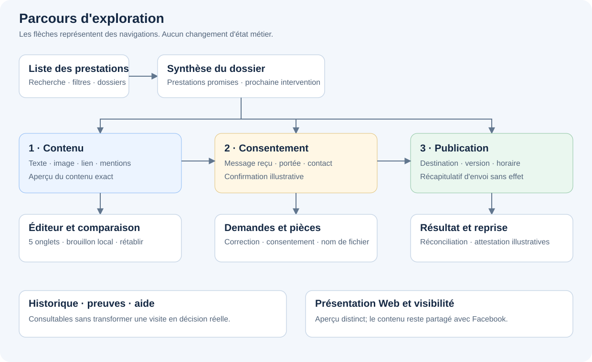

Parcours principal : liste → dossier → Contenu → Consentement → Publication.
Ces étapes restent navigables directement. Une navigation n'autorise pas une
opération et les coches de contrôle ne sont pas des résultats de validation.

<!-- prettier-ignore -->
| Parcours utilisateur | Séquence de référence | Résultat actuel |
| --- | --- | --- |
| Retrouver un dossier | Rechercher → filtrer → ouvrir le nom ou l'action de la ligne. | Le bon dossier et le bon contexte sont affichés. |
| Préparer un contenu | Contenu → éditeur → modifier texte, image, lien ou mention → aperçu. | Le rendu local reflète la saisie. |
| Conserver puis comparer | Conserver → modifier à nouveau → comparer à la version conservée. | Les différences sont lisibles, sans créer d'historique serveur. |
| Revenir à une version | Examiner le dernier contenu conservé → rétablir si différent. | Le contenu conservé remplace la saisie courante; les notes et l'horaire restent distincts. |
| Examiner le consentement | Consentement → message reçu → conditions → contact → confirmation. | Les éléments fictifs sont consultables; aucune décision réelle n'est créée. |
| Préparer une demande | Demander une correction ou un consentement → saisir → prévisualiser → revenir. | Le message local est conservé pendant ce détour; son envoi est désactivé. |
| Préparer une publication | Publication → planifier → contenu exact → récapitulatif. | L'horaire et le dossier sont repris; aucune programmation externe. |
| Examiner un résultat | Résultat → réconciliation → attestation. | Les états de reprise sont expliqués; aucune relance ou attestation réelle. |
| Examiner la fiche Web | Présentation Web → aperçu Web → confirmation de visibilité. | Le rendu diffère de Facebook; aucun changement de visibilité réelle. |

## 5. Organisation de l'espace

L'enveloppe commune contient la marque, l'accès à la liste, le changement de
langue et la sortie. Le bandeau rappelle que les données sont fictives. Le cadre
de travail porte le fil d'Ariane, le titre, le dossier, l'offre illustrative,
l'état du brouillon, le menu secondaire et les trois étapes.

Le corps affiche la tâche et, lorsque la vue le permet, son aperçu à côté.
Le pied regroupe retour, action principale, actions utiles et état local. Les
actions du pied changent avec la page au moyen d'un template partagé. L'aide
se déplie dans le contexte courant.

Sur ordinateur large et suffisamment haut, le corps possède son défilement;
l'en-tête et le pied restent visibles. Sur une largeur plus petite, l'ensemble
s'organise dans le flux de la page. La position du corps est mémorisée par URL
pendant la visite. Il faut conserver ce fonctionnement lors d'une refonte.

À 760 px de largeur ou moins, les numéros des étapes passent au-dessus de leur
libellé; à 600 px ou moins, les sous-titres sont masqués. Cette disposition garde
« Consentement » lisible à 640 px de largeur, y compris dans un viewport
équivalent à un écran de 1280 px zoomé à 200 %.

La liste privilégie le nom et la prochaine intervention. La synthèse privilégie
les prestations promises. Les étapes privilégient la vérification en cours.
L'éditeur privilégie la saisie et son rendu. Les opérations moins fréquentes
restent dans les détours ou dans « Autres actions ».

Le catalogue exhaustif de l'annexe A décrit les **43 vues par dossier** : une
synthèse, trois étapes, cinq onglets d'éditeur, un historique et 33 détails.
La liste est une vue supplémentaire commune. L'alias `corriger` ne fait que
rediriger vers `corriger/texte`.

## 6. Direction visuelle et adaptation

La référence visuelle est l'interface existante et ses captures, pas une
nouvelle identité à inventer. Le style est clair, calme, administratif et
centré sur le dossier. Les éléments éditoriaux illustrent la démo sans devenir
des données métier.

<!-- prettier-ignore -->
| Élément | Valeur observée |
| --- | --- |
| Surface | Blanc `#ffffff`; fond général clair `#edf2f8` avec dégradé doux. |
| Texte principal | Bleu sombre `#142843`. |
| Texte secondaire | `#52647a`. |
| Bordures | `#dce5ef`; variantes proches selon le composant. |
| Couleur d'action et focus | Bleu `#075dde`. |
| Typographie | Inter, puis polices système; base 15 px, 14 px sur petit écran. |
| Cadre de travail | Largeur maximale 1 360 px; coins de 18 px. |
| Titre principal | Taille adaptative de 24 à 32 px. |
| Titres secondaires | Environ 20 px et 17 px selon leur niveau. |
| Disposition principale | Deux colonnes sur grand écran; une colonne à partir de 1 040 px et en dessous. |
| Petite largeur | Règles dédiées à 600 px et en dessous; actions regroupées sur plusieurs lignes. |
| Grande fenêtre | Corps défilant si largeur minimale de 1 041 px et hauteur minimale de 700 px. |
| Aperçu compact | Canevas de 360 px au maximum; ne change pas le viewport du navigateur. |

Les états restent lisibles par leur texte, leur icône et leur position, sans
dépendre seulement d'une couleur. Les noms longs, les liens et les traductions
doivent pouvoir se répartir sur plusieurs lignes. Les boutons importants
restent atteignables sans débordement horizontal.

Le mode compact d'aperçu est un outil de lecture du contenu. Il ne constitue
ni une simulation du rendu exact de Facebook, ni une recette sur tous les
téléphones. L'aperçu social ne montre pas de statistiques ou de preuve de
diffusion inventées. La fiche Web conserve sa propre structure visuelle.

## 7. Règles d'interaction à préserver

<!-- prettier-ignore -->
| Geste | Comportement attendu dans la démo |
| --- | --- |
| Saisir du texte | Actualiser l'aperçu et signaler le brouillon modifié. Un texte volontairement vide reste vide. |
| Modifier un lien | Afficher une aide si l'URL ne peut être analysée ou n'utilise pas HTTP/HTTPS; ne pas contacter sa destination. Cet indicateur ne bloque pas la conservation locale. |
| Choisir un visuel | Modifier l'asset local et le rendu; conserver un texte alternatif personnalisé ou utiliser celui de l'exemple. |
| Saisir une mention | Afficher du texte; aucune recherche de compte, notification ou identification sociale. |
| Conserver le brouillon | Remplacer le dernier snapshot de contenu du dossier pour la visite; ne pas approuver, publier ou créer d'audit. |
| `Ctrl+S` ou `Cmd+S` | Dans l'éditeur uniquement, effectuer la même conservation locale. |
| Comparer | Montrer la saisie actuelle face au contenu conservé ou à une référence fictive, avec les champs qui diffèrent. |
| Rétablir | Reprendre le dernier contenu conservé; aucune réécriture d'un fait confirmé et aucune restauration d'une décision. |
| Sélectionner une pièce | Retenir son nom dans le dossier local; ne pas lire son contenu ni le téléverser. |
| Cocher une confirmation | Modifier un état de lecture de la vue; les commandes réelles restent désactivées. |
| Changer de dossier | Retrouver les saisies locales de chaque dossier sans mélanger leur contenu, leurs notes ou leurs noms de pièces. |
| Recharger le document | Demander la confirmation native du navigateur si un dossier contient du travail local, y compris un contenu conservé; si le rechargement est accepté, réinitialiser les saisies et snapshots et relire URL/langue. |
| Quitter la démo | Demander confirmation s'il reste du travail dans un des dossiers; rester conserve la visite, un départ confirmé et effectif purge l'état local. |

Les données de contenu et les données du dossier ne partagent pas exactement
la même portée de sauvegarde. L'annexe B détaille ces différences, notamment
les horaires, destinataires, notes et commentaires. La protection est portée par
le shell parent : elle couvre aussi la liste et les dossiers précédemment
modifiés ou conservés, sans interrompre les détours internes à la démo. La purge
intervient après un départ confirmé et effectif, pas lors de l'ouverture de la
confirmation ni après son annulation.

## 8. Consentement, visibilité et publication

Le consentement se lit avec son auteur, sa date, sa méthode, son contenu et sa
portée. Une future implémentation doit pouvoir montrer précisément ce qui a
été examiné. Un courriel reçu, une case cochée ou le paiement ne remplace pas
toutes les décisions nécessaires.

<!-- prettier-ignore -->
| Fait ou décision | Question à laquelle il répond |
| --- | --- |
| Paiement confirmé | Les fonds ont-ils été confirmés par Stripe ? |
| Prestations promises | Quelles obligations proviennent de l'offre acceptée ? |
| Revue éditoriale | Le contenu examiné a-t-il reçu la décision applicable ? |
| Consentement | La personne concernée a-t-elle accepté cette diffusion et sa portée ? |
| Visibilité Web | Cette présentation peut-elle être exposée sur le site ? |
| Autorisation d'envoi | Cet envoi exact peut-il être exécuté selon sa version et sa destination ? |
| Résultat externe | Qu'a confirmé le fournisseur et que reste-t-il à réconcilier ? |
| Réalisation attestée | Quelle preuve qualifiée justifie que la prestation est accomplie ? |

Dans la démo, ces éléments sont des illustrations ou des parcours de lecture.
En intégration réelle, l'autorité et la validation sont côté serveur. Toute
édition susceptible de modifier le contenu exact impose de réexaminer les
décisions qui en dépendent. Un résultat externe ambigu exige une réconciliation
avant nouvelle tentative; une erreur de réseau ne prouve pas l'absence d'envoi.

La publication collective regroupe plusieurs commandites admissibles dans un
message social. Cette capacité existe dans d'autres parties de la plateforme;
elle n'est pas modélisée par les trois dossiers de la démo. Le futur écran doit
indiquer clairement la place du dossier dans un lot si ce cas est ajouté. Il
ne faut pas transformer implicitement une prestation collective en publication
individuelle. La reconnaissance personnelle suit également son propre parcours.

## 9. États de lecture et d'erreur

<!-- prettier-ignore -->
| Situation | Référence actuelle | Évolution à concevoir si nécessaire |
| --- | --- | --- |
| Recherche sans résultat | État vide avec réinitialisation. | Conserver le contexte en cas de données distantes. |
| Aucun événement après filtre | Historique vide, notamment Publications. | Expliquer l'absence sans déduire qu'aucune livraison réelle n'existe. |
| Texte supprimé | Aperçu vide explicite. | Déterminer les exigences avant une validation serveur. |
| URL mal formée | Message local associé au champ. | Réutiliser la validation serveur et les contraintes des liens publics. |
| Aucune version conservée | Référence fictive proposée; pas de rétablissement du dernier contenu absent. | Définir l'historique persistant et les conflits de version. |
| Destination ou dossier inconnu | Routes bornées et réponses 404 du serveur de recette pour les chemins inconnus. | Vérifier aussi le routage et les réponses HTTP de la cible déployée. |
| Conflit de version | Écran d'exemple. | Comparaison, relecture de la version serveur et reprise sans écrasement silencieux. |
| Indisponibilité/session expirée | Écran d'exemple. | Distinguer réseau, session, droits et résultat de commande inconnu. |
| Résultat d'envoi incertain | Écrans de résultat, réconciliation et attestation illustratifs. | Quarantaine, observation et audit selon les contrats existants. |
| Chargement d'une liste métier | Aucun chargement distant de dossiers dans la démo. | Concevoir chargement, pagination, erreurs partielles et actualisation. |

## 10. Accessibilité, langues et retours

Le parcours dispose d'un lien d'évitement, de titres structurés, de noms
accessibles, de focus visibles et d'annonces d'état. Après navigation, le
focus rejoint le titre; entre onglets d'éditeur, il rejoint l'onglet actif.
Échap ferme le menu et rend le focus au déclencheur. Un clic extérieur ferme
aussi ce menu. L'aide est facultative et consultable au clavier.

Les retours doivent préserver le dossier, l'étape d'origine et les saisies
encore en mémoire. La liste retrouve sa recherche et ses filtres. Historique,
comparaison et aperçus ont leurs paramètres dédiés. Les origines de retour
sont bornées à des destinations internes connues.

Le français canadien est la langue de référence, avec une version anglaise
équivalente. Les routes de démo n'ont pas de préfixe linguistique. Le choix de
langue est mémorisé par le service existant; les quatorze fichiers de traduction
propres à la feature sont regroupés sous `service-delivery/i18n/` et conservent
les mêmes clés et paramètres d'interpolation dans chaque paire.
Les détails d'URL sont inventoriés dans l'annexe A.

Les captures documentaires sont prises à 1 536 × 960 et 390 × 844. La recette
historique de la démo utilise Chromium à 1 536 × 864 et le profil mobile Pixel 5.
Ces dimensions ne constituent pas une qualification de tous les appareils ou
une certification d'accessibilité. Ajouter une recette lecteur d'écran et des
tests d'agrandissement si l'interface doit être mise en service.

## 11. Raccordement futur aux services réels

Cette section est une **direction proposée**, pas une liste de fonctionnalités
déjà raccordées. Le dépôt possède des contrats de commandite, médias,
engagements, publication et audit : les inspecter avant d'inventer un modèle
parallèle. Le Web appelle l'API; il n'accède ni à PostgreSQL ni aux secrets des
fournisseurs. Les droits sont vérifiés côté API.

<!-- prettier-ignore -->
| Sujet à raccorder | Décision ou contrat à examiner |
| --- | --- |
| Liste et dossier | Identifiants réels, pagination, permissions, projection minimale et prochaine intervention justifiée. |
| Prestations | Offre figée et obligations existantes; distinguer Web, canal social, cible, format, délai et preuves. |
| Brouillon | Version serveur, conservation, concurrence, portée par prestation et état non enregistré. |
| Médias | Téléversement privé, validation, revue, sélection d'exposition et droits de diffusion. |
| Consentement | Référence de preuve, auteur, portée, version examinée, dates et retrait; ne pas fabriquer un accord reçu. |
| Messagerie | Prévisualisation, destinataire validé, confirmation, file idempotente et état d'envoi vérifiable. |
| Publication | Autorisation exacte, destination, mode, horaire, capacité du canal et worker existant. |
| Lots | Réservation et appartenance du dossier, contenu complet de chaque bénéficiaire et absence de doublon. |
| Visibilité Web | Décision distincte, contrôle d'admissibilité et maintien privé applicable. |
| Réalisation | Preuves qualifiées et rapprochement avec les obligations; historique et visibilité ne suffisent pas. |
| Reprise | Résultat incertain, observation externe, corrélation, audit et nouvelle autorisation lorsque requise. |

Aucun endpoint, nom de table, migration ou rôle nouveau n'est prescrit ici.
Le futur contrat doit être décidé à partir des propriétaires du dépôt, avec
les consommateurs mis à jour dans le même changement.

## 12. Décisions de conception à reprendre avec ChatGPT

Ces questions organisent la suite. Les propositions sont des points de départ
à confirmer, pas des préférences supplémentaires déjà acceptées.

<!-- prettier-ignore -->
| Priorité | Décision | Proposition de départ |
| --- | --- | --- |
| P0 | Poursuivre la démo ou raccorder l'application ? | Stabiliser d'abord les parcours et états de la démo; traiter le raccordement comme un chantier distinct. |
| P0 | Un contenu partagé ou un contenu par prestation ? | Prévoir des contenus séparables pour le site et chaque canal; ne pas prétendre qu'ils sont déjà distincts. |
| P0 | Que signifie « conserver » et combien de temps ? | Garder un libellé explicite tant que la conservation reste en mémoire; choisir une politique avant toute persistance. |
| P0 | Quelle preuve de consentement est admissible ? | Définir auteur, portée, version et source avec le métier; distinguer preuve reçue et déclaration administrative. |
| P0 | Comment montrer une publication collective ? | Afficher le lot, le passage du dossier et l'aperçu collectif lorsqu'un tel cas est ajouté. |
| P1 | Comment présenter la prochaine intervention ? | Utiliser une action justifiée par les faits réels; conserver les badges de fixtures comme exemples tant que rien n'est calculé. |
| P1 | Que doit créer un commentaire ? | Choisir entre note privée et événement de l'historique; ne pas simuler un journal persistant à partir de la chronologie fixe. |
| P1 | Comment conserver plusieurs versions ? | Définir comparaison, restauration par copie et conflit; le prototype ne possède qu'un dernier contenu conservé par dossier. |
| P1 | Quel comportement à la sortie ? | Définir une conservation durable pour la cible; la démo confirme déjà les départs avec travail local et purge la visite après une sortie effective. |
| P1 | Comment organiser les nombreuses actions secondaires ? | Prioriser les parcours fréquents; conserver les autres derrière des liens contextuels et un menu clairement nommé. |
| P2 | Quels autres canaux ou prestations ? | Ajouter les variantes après clarification de leurs engagements, formats, preuves et autorisations. |
| P2 | Faut-il une assistance IA réelle ? | Évaluer le besoin après l'édition manuelle; conserver proposition, relecture humaine, version et droits distincts. |

## 13. Déroulement proposé du développement

<!-- prettier-ignore -->
| Étape proposée | Résultat concret | Condition de sortie |
| --- | --- | --- |
| 1. Clarifier | Réponses aux décisions P0, vocabulaire et scénarios retenus. | Chaque opération a un objet, un acteur, une portée et un résultat attendu. |
| 2. Consolider l'expérience | Maquettes et parcours desktop/mobile à partir des captures. | Retours compréhensibles, saisies préservées et action principale lisible. |
| 3. Compléter la démo | Variantes et états explicitement simulés; fixtures déterministes. | Scénarios de recette et FR/EN vérifiés, sans effet métier implicite. |
| 4. Préparer l'intégration | Correspondance avec les contrats réels, droits et versions. | Aucune duplication métier; états d'erreur et de reprise définis. |
| 5. Raccorder un parcours | Implémentation bornée et vérifiable, dans un environnement autorisé. | Lecture, validation, audit et tests adaptés au contrat raccordé. |
| 6. Recevoir | Recette de bout en bout et preuves datées. | Les simulations, la recette technique et l'autorisation de mise en service restent identifiables. |

Le document ne chiffre pas un délai sans connaître l'équipe, les décisions
retenues et les services à réutiliser. Aucun déploiement, envoi ou traitement
de données réelles ne découle de cette séquence proposée.

## 14. Sources et niveau de preuve

Les annexes A et B proviennent de la lecture des sources de la révision
`a4370ba3`. Les illustrations de l'annexe C sont des captures de son build
local, pas des maquettes reconstruites. Leur manifeste conserve routes,
dimensions, état, empreintes et éventuelles limites de capture.

La recette locale précédant le commit a exécuté **21 scénarios sur deux
projets navigateur**, soit 42 exécutions réussies, ainsi que deux tests de
routage, le typage de la suite admin et le build Angular production avec
25 routes pré-rendues. Le lint n'avait aucune erreur et conservait un
avertissement préexistant dans `scripts/smoke-public.mjs`. Ces preuves portent
sur ce snapshot et un environnement local Node 24.21.0/Yarn 4.9.4; elles ne
certifient pas un autre commit, un fournisseur réel ou une production.

Les captures créées pour ce blueprint constituent une visite documentaire
supplémentaire; elles ne sont pas présentées comme une nouvelle exécution
complète de la suite applicative.

Références propriétaires utiles dans le dépôt :

- [Instructions du Web](../../../apps/funding-web/AGENTS.md),
  [architecture française](../../ARCHITECTURE.md) et
  [matrice de validation](../validation.md).
- [Règles des commandites](../sponsorship-rules.md),
  [engagements enregistrés](../../technical/sponsorship-commitments.md) et
  [preuves de réalisation](../../technical/sponsorship-fulfilment.md).
- [Publication différée](../../operations/publication-automation.md),
  [formats de publication](../../technical/publication-formats.md) et
  [identité administrative](../../operations/admin-identity-and-alerts.md).
- Sources des écrans :
  [feature et frontière publique](../../../apps/funding-web/src/app/features/funding/service-delivery/README.md),
  [point d'entrée](../../../apps/funding-web/src/app/features/funding/service-delivery/index.ts),
  [routes](../../../apps/funding-web/src/app/features/funding/service-delivery/service-delivery.routes.ts),
  [état de la démo](../../../apps/funding-web/src/app/features/funding/service-delivery/service-demo-state.ts),
  [contrôleur des détails](../../../apps/funding-web/src/app/features/funding/service-delivery/service-demo-detail.component.ts)
  et [recette navigateur](../../../tests/playwright/service-demo.ui.spec.ts).

Pour la reprise, joindre ce blueprint puis utiliser le
[prompt prêt à copier](prompt-reprise-chatgpt.md). Les annexes qui suivent font
partie de la référence complète; elles précisent les détails qui ne doivent
pas être remplacés par des suppositions lors du développement.

## Annexe A — Catalogue exhaustif des écrans et des parcours

Référence : `a4370ba3`. Inventaire établi par lecture des sources et des tests.

### A.1. Comptage et principes de lecture

- Racine : `/demo/prestations` (liste).
- Base d'un dossier : `/demo/prestations/dossier/:id`.
- Identifiants admis : `atelier-boreal` (Atelier Boréal, étape statique Contenu), `collectif-rivages` (Collectif Rivages, Consentement), `studio-canopée` (Studio Canopée, Publication; segment encodé en URL).
- Chaque dossier possède 43 vues : 1 synthèse + 3 étapes + 5 onglets d'éditeur + 1 historique + 33 détails. La liste porte donc le total à 130 vues adressables avec les trois dossiers. L'alias `/corriger` redirige vers `/corriger/texte` et ne compte pas comme vue supplémentaire.
- Les étapes et statuts des trois dossiers sont des fixtures immuables. La démo ne fait pas évoluer une machine métier réelle lorsque l'utilisateur clique sur « étape suivante ».
- Le vocabulaire affiché est « Consentement ». Les segments techniques historiques `autorisation`, `accord-recu`, `demander-accord` et les clés de traduction restent inchangés.
- Le titre « Accord et prestations promises » désigne l'offre commerciale et n'a pas été renommé Consentement.
- Les 43 vues ne sont pas 43 composants différents : trois pages d'étape et la synthèse réutilisent Workspace; les 33 détails partagent Detail.

### A.2. Enveloppe commune et navigation

La barre supérieure comprend la marque OpenG7 et un lien vers la liste qui retrouve ses filtres, l'indication « Démo interactive », le changement FR/EN et « Quitter » vers `/admin/fundraiser`. Le bandeau permanent dit que les données sont fictives, les brouillons locaux et qu'aucun envoi ni publication n'est réalisé.

Le cadre principal présente un fil d'Ariane liste → dossier, un H1 propre à la vue, le nom du dossier et l'offre illustrative « Commandite Web + Facebook ». Un indicateur signale un brouillon modifié ou conservé pour la visite. Les étapes Contenu / Consentement / Publication restent accessibles directement; `aria-current="step"` marque le contexte actif.

Le menu « Autres actions » propose Historique, Accord et prestations promises, Preuves de réalisation, Ajouter un commentaire interne et Toutes les actions. Il se ferme après navigation, avec Échap ou par clic extérieur; Échap restitue le focus à son déclencheur. Le corps est une zone de défilement dédiée. Le shell mémorise la position par URL complète et la restaure au retour.

Après une navigation entre pages, le focus va au H1. Entre onglets de l'éditeur, il va à l'onglet actif. Un lien d'évitement rejoint le contenu. Le pied présente le retour contextuel, les actions de la page injectées via un template et l'état local du brouillon. L'aide dépliable varie selon liste, synthèse, Contenu, Consentement, Publication, éditeur, historique ou détail générique.

Le `canDeactivate` du shell parent intercepte une sortie de la démo si un des
dossiers contient du travail local, même déjà conservé pour la visite. Le panneau
de confirmation identifie les dossiers concernés; rester ou fermer le panneau
préserve leurs saisies. Après un départ accepté et effectif, la destruction du
shell purge la visite. Un `beforeunload` demande aussi la confirmation native
pour un rechargement, une fermeture ou un départ hors application lorsque le
navigateur l'autorise après interaction. Les navigations internes entre dossiers,
onglets et détails restent libres.

#### Paramètres d'URL réellement gérés

<!-- prettier-ignore -->
| Paramètre | Portée et valeurs |
| --- | --- |
| `q` | Recherche dans la liste; texte libre; mise à jour avec remplacement d'URL pendant la saisie. |
| `etat` | Liste : `all`, `contenu`, `autorisation`, `publication`; valeur inconnue rabattue sur Tous. |
| `retour` | Origine de l'éditeur et des détours : limitée à `contenu`, `autorisation`, `publication`; défaut Contenu. |
| `origine` | Origine de l'aperçu de contenu/message, limitée aux vues de la démo et différente de la vue courante. |
| `source` | Source de la demande à retrouver après prévisualisation : `demander-correction` ou `demander-accord`. |
| `filtre` | Historique : `tout`, `modifications`, `commentaires`, `fichiers`, `autorisations`, `publications`; clé technique `autorisations` affichée « Consentements ». Une valeur inconnue donne une liste vide, pas un rabattement. |
| `version` | Identifiant sélectionné dans l'historique : `v3`, `c1`, `a1`, `f1`, `v1`. La sélection est bornée aux événements visibles; défaut premier événement visible. |
| `ordre` | Historique : `ancien` inverse l'ordre initial, toute autre valeur garde le récent d'abord. |
| `comparaison` | Comparaison : `exemple` ou référence `conserve` si une sauvegarde locale existe. Sans sauvegarde, référence fictive automatiquement. |

Ne pas présenter les origines comme des redirections ouvertes ou une autorisation métier; elles ne font que maintenir le contexte de navigation.

### A.3. Vues principales

#### Liste `/demo/prestations`

- Trois métriques de fixtures : 3 dossiers, 6 prestations (Web + Facebook pour chacun), 3 prochaines interventions. Ce ne sont pas des agrégats d'une API.
- Recherche par nom, insensible à la casse et aux accents, filtrage par étape; les comptes par onglet restent ceux des fixtures, indépendamment de la recherche.
- Champ recherche accessible, compteur de résultats en `aria-live`, filtres actifs sous forme de pastilles amovibles, réinitialisation globale. Après suppression d'un filtre, focus rendu au champ recherche.
- Chaque ligne : initiales et couleur, nom ouvrant la synthèse, badge de brouillon local s'il y a une saisie, offre Web + Facebook, deux prestations, étape et action menant à cette étape.
- État vide : aucun dossier trouvé, aide, réinitialisation. La saisie de recherche et le filtre reviennent lors du retour par la marque/le fil d'Ariane/le bouton depuis la synthèse.
- Il n'y a ni création de dossier, ni suppression, ni pagination, ni sélection multiple, ni chargement distant.

#### Synthèse `/dossier/:id`

- Faits illustratifs : paiement fictif confirmé, consentement d'exemple, référence DEMO.
- Deux cartes distinctes : présentation sur le site (à préparer) → `web`; publication Facebook (à vérifier) → `contenu`.
- Prochaine intervention et aide adaptées à l'étape fictive du dossier; lien vers l'offre commerciale, proposition d'IA illustrative → `proposition`.
- Aperçu Facebook à droite et accès aux preuves → `preuves`.
- Pied : Historique → `historique`, puis une action principale selon l'étape du dossier : Vérifier le contenu → `contenu`, Vérifier le consentement → `autorisation` ou Préparer la publication → `publication`; retour vers la liste.
- Les états de ces cartes restent des textes de démonstration même après édition ou conservation locale.

#### Contenu `/contenu`

- Liste de contrôles/accès : texte → `corriger/texte`, image → `corriger/image`, lien → `corriger/liens`, mentions → `corriger/mentions`.
- Aperçu Facebook actualisé, avertissement qui sépare préparation et consentement.
- Pied : Voir le contenu exact → `apercu?origine=contenu`; Corriger le contenu → `corriger/texte?retour=contenu`; Examiner le consentement → `autorisation`.
- Les coches des lignes sont illustratives, sans calcul de validation de dossier.

#### Consentement `/autorisation`

- Contrôles : consentement reçu → `accord-recu`, conditions → `conditions`, contact → `contact`.
- Aperçu, métadonnées d'exemple (date, contact, méthode : courriel fictif).
- Pied : aperçu exact avec origine; Demander une correction → `demander-correction?retour=autorisation`; Examiner la confirmation d'exemple → `confirmer-autorisation`.
- La confirmation n'écrit ni consentement ni autorisation administrative.

#### Publication `/publication`

- Contrôles : destination → récapitulatif `confirmer-envoi`, contenu exact → `apercu`, horaire → `planifier`.
- Aperçu Facebook; lien séparé vers présentation Web → `web`.
- Pied : aperçu exact avec origine; Corriger le contenu → éditeur avec `retour=publication`; Voir le récapitulatif → `confirmer-envoi`.
- Aucun état planifié n'est enregistré côté serveur.

### A.4. Éditeur à cinq onglets

Tous les onglets partagent les mêmes valeurs locales du dossier, l'aperçu Facebook et les actions de pied : Historique, Examiner une version conservée (`retablir`), revenir à l'étape d'origine, conserver le brouillon pour cette visite. `Ctrl+S` / `Cmd+S` dans l'éditeur fait la même conservation locale.

<!-- prettier-ignore -->
| Route | Champs / contrôles | Comportement réel et limite |
| --- | --- | --- |
| `corriger/texte` | Zone de texte; compteur de graphèmes `Intl.Segmenter('fr-CA')`; aide; état texte vide; liens Insérer un lien et Proposition IA | Saisie réactive, compteur réel sans limite métier imposée; texte vide intentionnel conservé grâce à `textEdited`; lien vers onglet Liens et vers proposition fixe, aucun appel IA. |
| `corriger/image` | Deux radios Panorama/Companion; champ texte alternatif; case Inclure le visuel; Revoir l'image | Deux assets fixes : `admin-guide-panorama.webp`, `admin-guide-princess-lion.webp`; aucun téléversement. L'alternative vide utilise le libellé de l'asset traduit. Revoir → `medias`. |
| `corriger/liens` | Champ `type=url`; aide/erreur associée au champ | Une URL non vide est marquée invalide si l'analyse échoue ou si le protocole n'est pas HTTP/HTTPS. Aucune requête distante. Ceci n'est pas la validation serveur sécurisée d'une URL de production. Le bouton de conservation n'est pas bloqué par cet indicateur. |
| `corriger/mentions` | Champ texte libre Mention | Affiché comme texte dans l'aperçu, aucune résolution de compte social ni tag externe. |
| `corriger/options` | Case Afficher le lien dans l'aperçu | Règle uniquement l'affichage local. Destination, consentement et autorisation d'envoi se consultent dans leurs étapes; aucune option cachée d'envoi. |

Conserver remplace un unique snapshot local du contenu du dossier (texte, mention, lien, présence du lien, visuel, alternative). Les messages, commentaires, destinataire, noms de pièce, horaire et champs de préparation de réconciliation/attestation restent dans l'état de visite par dossier mais ne sont pas une version de contenu à rétablir. Un rechargement accepté réinitialise ces états; une sortie confirmée et effective les purge aussi.

### A.5. Historique `/historique`

- Cinq événements statiques : correction `v3`, commentaire `c1`, preuve de consentement `a1`, ajout d'image `f1`, version initiale `v1`.
- Filtres Tous / Modifications / Commentaires / Fichiers / Consentements / Publications; ce dernier est vide dans la fixture. Le tri inverse les événements affichés.
- Sélection d'un événement dans l'URL; colonne détail avec date, type et textes avant/après lorsqu'ils existent. Autres types montrent la description.
- Pied : Comparer, Ajouter un commentaire, Retour au contenu.
- L'ajout d'un commentaire local ne produit pas une nouvelle ligne dans cette chronologie fixe. Le choix `version=v1` ne transforme pas cette fixture en version restaurable; la comparaison et le rétablissement se fondent sur le dernier contenu conservé pendant la visite ou sur la référence fictive.

### A.6. Inventaire exhaustif des 33 détails

Tous les suffixes sont relatifs à `/demo/prestations/dossier/:id/`. La colonne Retour indique le parent par défaut; l'aperçu peut retrouver son origine grâce aux paramètres décrits plus haut. La référence et le lien de réconciliation ainsi que le motif d'attestation sont des saisies locales liées au snapshot de chaque dossier; les quitter pour un autre écran ou dossier ne les efface pas. Ils ne déclenchent aucune vérification fournisseur.

<!-- prettier-ignore -->
| Suffixe et titre affiché | Contenu / champs | Actions et effet actuel | Retour par défaut |
| --- | --- | --- | --- |
| `apercu` — Aperçu du contenu exact | Canal, version locale, destination fictive; rendu Facebook ou Web selon origine | Corriger → `web` pour origine Web, sinon éditeur texte; mode standard/compact partagé | Contenu, ou origine bornée |
| `preuves` — Preuves de réalisation | Emplacements de preuve Web et Facebook; aucun résultat effectif | Consulter les pièces → `preuve`; aucune preuve qualifiée fabriquée | Synthèse |
| `accord` — Accord et prestations promises | Prestations Web et Facebook illustratives; avertissement sans valeur d'offre réelle | Examiner conditions → `conditions` | Synthèse |
| `controle` — Comprendre ce qui manque | Priorité consentement reçu, raison, source et prochaine étape fixes | Vérifier consentement → `autorisation` | Synthèse |
| `proposition` — Examiner une proposition de l’IA | Texte actuel et variante fixe livrée avec la maquette | Utiliser dans le brouillon remplace le texte local, marque modifié et rejoint éditeur texte; aucun fournisseur IA | Éditeur texte |
| `comparer` — Comparer deux versions | Sélecteur référence conservée/exemple; deux textes; champs modifiés; détails lien/mention/image/alternative/lien visible | Choisir référence modifie `comparaison` dans URL; continuer édition ou rejoindre `retablir`; aucune écriture à la simple lecture | Historique |
| `commentaire` — Ajouter un commentaire interne | Zone texte liée au brouillon de commentaire; information sur visibilité | Conserver commentaire dans la visite (désactivé si vide), retour de succès local puis action principale vers l'historique; pas d'envoi ni d'audit serveur | Historique |
| `demander-correction` — Préparer une demande de correction | Destinataire d'exemple non modifiable ici; message libre partagé | Prévisualiser → `apercu-envoi`, avec `origine` et `source` ; aucun envoi | Contenu |
| `demander-accord` — Préparer une demande de consentement | Même formulaire local, portée texte/visuel/destination dans l'aide | Prévisualiser → `apercu-envoi`; une demande ne constitue pas un consentement | Consentement |
| `preuve` — Examiner une pièce locale | Sélecteur de fichier PNG/JPEG/PDF/TXT; nom du fichier sélectionné; note source/portée | Seul `files[0].name` est lu, aucun contenu lu ni stocké; Enregistrer preuve désactivé; note et nom gardés localement par dossier; reprendre l'examen du consentement → `autorisation` | Consentement |
| `accord-recu` — Lire le consentement reçu | Courriel fictif de `contact@example.test`, date illustrative, objet et texte reçus | Consulter pièces → `preuve`; lire ne change aucun état | Consentement |
| `conditions` — Examiner les conditions | Portée, durée/dates, contenu concerné; données fixes | Voir prestations promises → `accord`; action principale reprendre l'examen du consentement → `autorisation` | Consentement |
| `contact` — Vérifier le contact | Nom fictif non modifiable; courriel d'exemple modifiable | Modifie le destinataire local; Préparer une demande → `demander-accord`; aucune correction de destinataire réelle | Consentement |
| `planifier` — Préparer un horaire de publication | `datetime-local`; choix fuseau Toronto / Vancouver / Paris / UTC; récapitulatif; aperçu | Saisies gardées en mémoire; Voir récapitulatif → `confirmer-envoi`; aucun calcul/validation de conversion DST serveur ni programmation | Publication |
| `confirmer-envoi` — Relire la confirmation d’envoi | Portée Facebook/OpenG7, version locale, horaire/fuseau, aperçu, case récapitulatif relu | Revoir contenu; case locale; bouton confirmer toujours désactivé; Explorer suivi → `resultat` | Publication |
| `resultat` — Suivre le résultat | « Aucune opération »; références/lien externes absents, aucune preuve disponible | Explorer réconciliation → `reconcilier`; ne simule pas une publication réussie | Publication |
| `reconcilier` — Examiner un résultat incertain | Référence externe et URL liées au snapshot de visite par dossier | Examiner attestation → `attester`; Réconciliation désactivée; aucun fournisseur interrogé | Résultat |
| `attester` — Examiner une attestation d'absence | Zone motif/vérifications liée au snapshot de visite par dossier | Attestation désactivée; aucune attestation réelle créée; retour au suivi → `resultat` | Réconciliation |
| `web` — Présentation sur le site | Nom dossier non modifiable; description liée au même texte que l'éditeur social; site lié au même lien; aperçu Web distinct | Description/lien modifient le brouillon commun; Voir confirmation → `confirmer-visibilite`; aucune fiche publiée | Synthèse |
| `confirmer-visibilite` — Relire la confirmation de visibilité | Portée présentation Web, contenu local, aperçu Web, case relu | Revoir aperçu; confirmer désactivé; revenir à la présentation → `web`; décision de visibilité distincte du consentement/social | Présentation Web |
| `approuver-preparation` — Relire l’approbation de préparation | Récapitulatif générique, portée, version, case relu | Confirmation désactivée; reprendre la revue → `contenu`; ne crée ni approbation éditoriale ni autorisation d'envoi | Synthèse |
| `autres-actions` — Autres actions | Liens principaux Historique / Preuves / Offre / Web / Guide; section repliable de tous les détails | Navigation vers les 32 autres détails; aide à explorer les vues hors chemin principal | Synthèse |
| `quitter` — Quitter l’éditeur | Explication de la conservation limitée à la visite | Continuer saisie → éditeur texte; Revenir dossier → synthèse; ces détours internes ne quittent pas le shell protégé | Éditeur texte |
| `conflit` — Résoudre un conflit de version | Exemple explicatif de conflit distant | Comparer → `comparer`; reprendre ma saisie → éditeur; aucun conflit serveur détecté/résolu | Éditeur texte |
| `indisponible` — Indisponibilité ou session expirée | Exemple d'erreur/session; aucune session interrogée | Revenir dossier → synthèse; aucun retry réel | Synthèse |
| `medias` — Revue des médias | Case inclure illustration, aperçu et explication locale | Active/retire l'image du brouillon; Revenir éditeur image; ne supprime pas de fichier ni ne valide de droits médias | Éditeur image |
| `guide` — Guide du parcours | Trois étapes décrites : Contenu, Consentement, Publication | Revenir dossier | Synthèse |
| `destinations` — Repères administratifs | Références explicatives paiement, campagne, contact; aucune donnée réelle | Consulter contact fictif; aucun accès à des dossiers admin réels | Synthèse |
| `filtres` — Filtrer les prestations | Liste de choix Tous / Contenu / Consentement / Publication | Retour liste avec `etat` choisi; navigation effective, pas de requête API | Synthèse |
| `retablir` — Rétablir une version dans le brouillon | Dernier contenu conservé et saisie actuelle; états aucune sauvegarde / identique / différences / rétabli | Comparer, rétablir si différent, continuer édition; copie uniquement le dernier snapshot local de contenu; ne touche ni notes, ni horaire ni autorisation | Historique |
| `annuler-autorisation` — Relire le retrait d’autorisation | Récapitulatif illustratif d'une autorisation d'envoi précise, case relu | Confirmation désactivée; reprendre la préparation → `publication`; aucune autorisation retirée ni historique financier/publication effacé | Publication |
| `apercu-envoi` — Prévisualiser un message au client | Destinataire local, objet fixe, note saisie ou texte par défaut | Revoir contenu → aperçu; Envoi désactivé; retour à la source correction/consentement via `source` | Demande de consentement ou source bornée |
| `confirmer-autorisation` — Relire la confirmation de consentement | Portée et version, case relu, aperçu; demande de preuve du consentement reçu | Confirmation désactivée même après cochage; explorer la préparation → `publication`; une case administrative ne crée jamais le consentement | Consentement |

### A.7. Aperçus et contenu commun

Les modes Standard / Compact changent réellement la largeur de l'aperçu et sont partagés entre vues et dossiers pendant la visite. Le mode n'est pas un profil fournisseur ou un média responsive généré.

L'aperçu Facebook affiche auteur OpenG7, contexte de démo, texte courant (ou fallback initial tant que jamais édité), mention libre, visuel optionnel et carte de lien optionnelle. L'aperçu Web dispose d'un masthead OpenG7, de l'image, d'un bloc partenaire, du nom dossier, du même texte, de la même mention et du même lien. Aucun faux like, nombre d'impressions ou succès d'envoi n'est produit. Le lien est du texte affiché, pas une navigation externe résolue.

Limite à porter explicitement dans le blueprint : les contenus Web et Facebook sont actuellement **partagés**, et non deux versions indépendantes. Modifier la description Web modifie le texte utilisé dans le rendu social. Les rôles « client » / « éditeur » de l'historique sont des libellés fictifs, pas une gestion des droits.

### A.8. Parcours de référence à documenter

1. Liste → recherche/filtre → synthèse → Contenu → éditeur texte/image/liens/mentions/options → conserver → comparer → rétablir → Contenu.
2. Contenu → Consentement → courriel reçu → pièce (nom seul) → conditions → contact → demande de consentement → aperçu message → aperçu contenu → retour à la demande.
3. Consentement → demander correction → aperçu message → aperçu contenu → retour exact à la demande de correction et conservation du message.
4. Publication → éditeur avec retour Publication → aperçu depuis le pied → retour éditeur/Publication; Publication → planifier → confirmer-envoi → aperçu → retour confirmation avec même horaire.
5. Synthèse → Web → confirmer visibilité → aperçu Web → retour confirmation; aucune publication.
6. Historique → filtre, ordre, événement → commentaire → retour avec filtre/événement/défilement conservés.
7. Résultat → réconcilier → attester : parcours d'incertitude entièrement explicatif et sans relance.
8. Dossier A édité → liste → dossier B édité → retour A : brouillons distincts; une sortie ou un rechargement demandent confirmation pour l'ensemble de ces dossiers, même déjà conservés; le départ effectif ou le rechargement accepté réinitialise la visite, tandis que la langue reste choisie par le service de langue.

### A.9. Différences à ne pas masquer en rédigeant la cible

- Navigation et saisie fonctionnent; serveur, paiement, approbation, envoi, médias réels, audit et authentification ne sont pas raccordés dans la démo.
- Cliquer Continuer/Examiner/Confirmer un récapitulatif n'avance aucun statut du dossier.
- La comparaison distingue une référence fixe d'une vraie sauvegarde de visite; la fixture d'historique n'est pas la preuve du dernier contenu réellement conservé.
- Le rétablissement réel disponible est limité au dernier snapshot local, sans sélection arbitraire d'anciennes versions.
- Le calendrier n'a pas de worker, de capacité ou de lot collectif effectif; l'offre de démonstration est seulement Web + Facebook. LinkedIn, lots multi-entreprises et OpenG20 ne sont pas montrés ici.
- Les badges de paiement et de consentement sont explicitement des exemples. Les convertir en états serveur demanderait des contrats et gardes indépendants.
- La présence d'un nom de pièce ne prouve ni téléversement, ni conformité, ni consentement.
- Les pages de conflit/indisponibilité/fin de session sont des destinations navigables, pas des erreurs réellement déclenchées par un service.
- L'éditeur accepte pour sa maquette une indication HTTP ou HTTPS : la cible serveur doit réutiliser la politique de liens du dépôt, sans assimiler cette indication visuelle à un contrôle de sécurité.

### A.10. Sources propriétaires

L'implémentation courante réside dans
`apps/funding-web/src/app/features/funding/service-delivery/`. La feature est
chargée à la demande depuis les routes de l'application; `index.ts`, qui expose
`serviceDeliveryRoutes`, est sa seule API publique. Les composants, état et
directives restent internes à cette frontière. Les URL `/demo/prestations` et
les hooks `data-og7` conservent leur contrat de navigation et de recette.

- `index.ts` : point d'entrée public des consommateurs de la feature.
- `service-delivery.routes.ts` : composition interne et bornes des routes.
- `service-demo-detail.component.ts` : `DEMO_DETAIL_PAGES`, comparaison, rétablissement, liste de confirmations.
- `service-demo-detail.component.html` : contenu des 33 vues, champs et actions désactivées.
- `service-demo-workspace.component.{ts,html}` : synthèse et trois étapes.
- `service-demo-editor.component.{ts,html}` : cinq onglets et validations visuelles locales.
- `service-demo-state.ts` : fixtures, snapshots, brouillons séparés par dossier, conservation/restauration.
- `service-demo-shell.component.{ts,html}` : navigation, origines, stepper, focus, défilement et raccourci sauvegarde.
- `service-demo-list.component.{ts,html}` : recherche, filtres et accès dossiers.
- `service-demo-history.component.{ts,html}` : cinq événements fixes et query params.
- `service-demo-preview.component.ts` : rendus Web/Facebook et absence de navigation externe des liens saisis.
- `service-demo-help.component.{ts,html}` : aide contextuelle dépliable.
- `i18n/` : sept paires `service-demo*.fr-CA.json` / `.en.json` propres à la feature, dont la protection de navigation.
- `tests/playwright/service-demo.ui.spec.ts` et `tests/service-demo-routing.test.mjs` : scénarios de démo et routes/404; aucune preuve d'effet fournisseur.

## Annexe B — Données, états, conservation et recette

Référence : `a4370ba3`. Inventaire établi par lecture des sources et des tests.

### B.1. Statut exact du livrable

La route `/demo/prestations` est un prototype fonctionnel dans le navigateur. Elle contient une liste synthétique, trois dossiers et les écrans de préparation, consentement, publication, historique et détails. Les entrées depuis connexion/cockpit administratifs conduisent à la démo ; la route de démonstration elle-même n'exige pas de session admin, car elle ne lit ni n'écrit les données réelles.

Le prototype ne contient aucun chargement de dossiers serveur, appel `HttpClient`, `fetch`, appel Stripe, publication sociale, sauvegarde serveur, téléversement de fichier ni appel d'IA. Les boutons correspondant aux effets sensibles sont désactivés. Les liens vers les étapes, aperçus et résultats explorent les écrans ; ils n'exécutent pas les opérations qu'ils décrivent.

Les trois étapes ne forment pas un automate métier : on peut les visiter librement. Une conservation locale, une case cochée ou un clic « suivant » ne fait progresser aucun statut réel, ne crée aucun consentement et ne vaut aucune autorisation administrative.

Sources principales de la feature courante : `index.ts`, `service-delivery.routes.ts`, `service-demo-state.ts`, `service-demo-workspace.component.html` et `service-demo-detail.component.html`.

### B.2. Modèles réellement présents

#### 2.1 Dossiers synthétiques

`DEMO_DOSSIERS` dans `service-demo-state.ts:18` contient uniquement :

<!-- prettier-ignore -->
| id | Nom | Initiales | Étape initiale | Ton |
| --- | --- | --- | --- | --- |
| `atelier-boreal` | Atelier Boréal | AB | `contenu` | blue |
| `collectif-rivages` | Collectif Rivages | CR | `autorisation` | amber |
| `studio-canopée` | Studio Canopée | SC | `publication` | green |

L'étape `autorisation` est affichée « Consentement » en français et « Consent » en anglais. Les identifiants d'URL et clés internes historiques sont conservés.

Ces objets n'ont aucun montant, facture, paiement Stripe, identifiant d'engagement réel, identité privée, date de paiement, preuve qualifiée, permission serveur ou numéro de version métier. Les textes « paiement fictif confirmé », date, contact et offre sont des contenus de présentation.

Les métriques sont constantes : trois dossiers, six prestations (`3 * 2`), trois prochaines interventions. Les compteurs de filtres sont calculés sur l'ensemble des trois fixtures, indépendamment du texte recherché. La liste n'est ni paginée ni chargée à distance.

L'offre « Commandite Web + Facebook » et les deux prestations par dossier sont des fixtures d'illustration. Elles ne définissent aucun barème, nouveau forfait, seuil monétaire, nombre de passages, durée ou engagement commercial. La future version doit lire les termes enregistrés de l'offre acceptée, sans les déduire de cette démo.

#### 2.2 Contenu conservable

`ServiceDemoContent`, `service-demo-state.ts:44` :

- `text: string` et `textEdited: boolean` : contenu courant et distinction entre texte non initialisé et texte volontairement vidé.
- `mention: string` : texte libre affiché ; aucune recherche/identification de compte.
- `showLink: boolean`, `link: string` : affichage et valeur du lien, présenté comme texte sans ouvrir la destination.
- `imageIncluded: boolean`, `imageAsset: 'panorama' | 'companion'`, `imageAlt: string` : inclusion, choix parmi deux images locales et description alternative.

Les images sont deux assets déjà suivis dans Git : `assets/admin-guide-panorama.webp` et `assets/admin-guide-princess-lion.webp`. Le prototype n'accepte pas d'URL d'image arbitraire.

#### 2.3 Brouillon de navigation par dossier

`ServiceDemoDraft` étend le contenu avec :

<!-- prettier-ignore -->
| Champ | Usage |
| --- | --- |
| `note` | Message préparé pour une demande de correction ou de consentement |
| `commentDraft` | Saisie d'un commentaire interne en cours |
| `comment` | Copie du commentaire conservée par le bouton local |
| `proofName` | Nom d'une pièce choisie localement |
| `proofNote` | Origine/portée de cette pièce, texte libre local |
| `saved`, `dirty` | Indicateurs de présentation du brouillon, pas versions serveur |
| `schedule` | Chaîne de date/heure locale illustrative |
| `timeZone` | Nom de fuseau sélectionné |
| `recipient` | Adresse d'exemple modifiable sur la vue contact |
| `reconciliationReference` | Référence externe préparée localement pour l'examen d'un résultat incertain |
| `reconciliationLink` | Lien externe saisi pour cet examen, sans résolution ni vérification distante |
| `absenceReason` | Motif et vérifications saisis pour l'exemple d'attestation d'absence |

Valeurs initiales : texte vide avec repli sur un exemple traduit ; image panorama incluse ; lien affiché `https://example.com/<id-encodé>` ; mention/note/commentaires/pièces/référence de réconciliation/lien de réconciliation/motif d'absence vides ; date `2026-10-28T10:00` ; fuseau `America/Toronto` ; destinataire `contact@example.test` ; `saved=false`, `dirty=false`.

#### 2.4 États de présentation hors brouillon de dossier

`previewMode` (`standard`/`compact`) appartient à la visite entière et n'est pas copié dans les snapshots par dossier. Il reste identique entre les vues, y compris après changement de dossier, jusqu'au rechargement ou à la purge après sortie confirmée et effective.

`query`, `filter`, `page`, `editorTab` sont des états d'orchestration de la navigation. Les actions de pied de page sont fournies par `TemplateRef` et `ServiceDemoActionsDirective` ; ce ne sont pas des commandes métier.

Le shell possède menu ouvert, titre, icône, origine d'édition, page de retour et positions de défilement. Les détails possèdent des indicateurs locaux tels que `checked`, `restored`, `commentSaved` et `statusFilter`. Leur durée dépend de l'instance du composant ; ils ne sont pas un historique, ne sont pas sauvegardés par dossier et ne doivent pas être transférés comme des décisions administratives persistantes.

### B.3. Durée de vie et sémantique de « conserver »

`ServiceDemoState` est fourni au niveau de la route de démonstration. Il utilise des `signal` et deux Maps en mémoire :

1. `drafts` : snapshot complet de navigation de chaque dossier quitté pour un autre dossier.
2. `savedVersions` : dernière copie explicitement conservée du seul `ServiceDemoContent`, indexée par dossier.

`selectDossier(id)` refuse les identifiants hors catalogue, ignore le dossier déjà actif, photographie le dossier courant, puis recharge le snapshot du dossier cible ou ses valeurs initiales. Les saisies non explicitement conservées restent donc disponibles pendant les navigations internes, y compris entre les dossiers.

`saveDraft()` (bouton de l'éditeur ou Ctrl/Cmd+S dans l'éditeur) :

- Initialise le texte d'exemple s'il n'a jamais été saisi.
- Remplace la dernière copie locale `savedVersions[currentId]` par le contenu courant.
- Passe `saved=true`, `dirty=false`.
- Ne conserve dans cette copie ni commentaire, ni pièce, ni message, ni horaire, ni destinataire, ni référence/lien de réconciliation ou motif d'absence.
- N'écrit ni dans le stockage navigateur ni sur un serveur.

Modifier du contenu, une date, un fuseau, un destinataire ou le message appelle selon la vue un marquage `dirty=true`, `saved=false`. Le badge de liste détecte aussi explicitement les notes, commentaires, noms/notes de pièces, référence/lien de réconciliation et motif d'absence; ces trois derniers champs restent détectés sans dépendre du marquage `dirty`. Le badge « brouillon local » n'est pas la preuve d'une sauvegarde durable et n'est pas la projection d'une version de contenu réelle.

`restoreSavedDraft()` recopie uniquement les huit champs `ServiceDemoContent` de la dernière conservation. Il laisse les commentaires, pièces, message, horaire, destinataire et trois champs de réconciliation/attestation tels quels. Il ne rétablit aucune autorisation, décision, visibilité ou offre. Il passe `saved=true`, `dirty=false`, même si des données hors contenu restent présentes. Le bouton n'est actif que si une copie existe et diffère du contenu courant ; `textEdited` seul est ignoré dans ce test de différence.

`hasLocalWork()` s'appuie sur les dossiers identifiés par `draftIds()`, pas seulement sur le dossier actif ou sur `dirty`. Un contenu conservé pour la visite reste du travail local exposé à la perte, comme les commentaires, pièces, horaires et champs de préparation. Le shell parent utilise ce signal pour sa confirmation de sortie et son `beforeunload`; le raccourci de conservation est suspendu pendant l'ouverture du panneau de sortie.

Un rechargement accepté du document perd toutes les Maps, saisies, commentaires, noms de pièces, horaires choisis, champs de préparation et versions conservées. Refuser la confirmation native laisse la visite courante intacte. Les preuves datées de la révision d'origine sur le rechargement restent présentées séparément en B.7.

Une sortie SPA confirmée ne purge pas la visite dès le clic : `canLeave()` attend la décision dans le panneau, puis le shell appelle `clearLocalWork()` lors de sa destruction après un départ accepté et effectif. Annuler le panneau ou abandonner la navigation ne purge rien. La purge vide `drafts` et `savedVersions`, remet le dossier courant à ses valeurs initiales et réinitialise recherche, filtre et mode d'aperçu. Une réentrée dans la démo ne récupère donc pas les saisies de la visite quittée, même si l'injecteur de route est réutilisé.

Les éléments qui survivent au rechargement sont le contexte porté par l'URL et la langue choisie, si `localStorage` est disponible. Le prototype ne stocke aucune donnée du dossier dans `localStorage` ; seule la préférence globale `openg7.language` est persistée.

Sources : `service-demo-state.ts` (`draftIds`, `hasLocalWork`, `selectDossier`, `saveDraft`, `restoreSavedDraft`, `clearLocalWork`), `service-demo-shell.component.ts` (`canLeave`, `answerExit`, `beforeunload`, destruction du shell), `service-demo.routes.ts` (`canDeactivate`) et `funding-i18n.service.ts` (préférence de langue).

### B.4. URL, retours et restauration de contexte

<!-- prettier-ignore -->
| Clé | Valeurs/sens réels | Comportement et limite |
| --- | --- | --- |
| Chemin `dossier/:id` | Trois identifiants synthétiques | `canMatch` borne le catalogue ; `encodeURIComponent` conserve l'accent de Studio Canopée dans les liens |
| Chemin `corriger/:tab` | `texte`, `image`, `liens`, `mentions`, `options` | Onglet routé ; `/corriger` redirige vers `/corriger/texte` ; onglet inconnu refusé |
| `q` | Texte recherché | Le nom est comparé sans accents, casse ni espaces de bord ; saisie conservée dans l'URL avec remplacement de l'entrée d'historique |
| `etat` | `contenu`, `autorisation`, `publication`, sinon tous | Filtre combiné à `q` ; valeur inconnue traitée comme « tous » |
| `filtre` | `tout`, `modifications`, `commentaires`, `fichiers`, `autorisations`, `publications` | Filtre de la chronologie synthétique ; une valeur inconnue donne une liste vide, sans validation métier |
| `version` | Identifiant d'événement `v3`, `c1`, `a1`, `f1`, `v1` | Sélection visible ; faute de correspondance, premier événement du filtre. Le choix de filtre retire `version` |
| `ordre` | `ancien` ou défaut | Inverse l'ordre affiché des cinq événements ; ne modifie ni leur contenu ni leur date |
| `retour` | `contenu`, `autorisation`, `publication` | Origine de l'édition ; toute autre valeur retombe sur `contenu` |
| `origine` | Destination connue de la démo | Retour d'un aperçu à sa vue d'origine ; valeurs non reconnues ignorées ; pas de redirection vers un domaine externe |
| `source` | `demander-correction` ou `demander-accord` | Sur `apercu-envoi`, donne priorité à la demande d'origine après deux aperçus imbriqués |
| `comparaison` | `exemple` ou copie conservée disponible | Choix de la référence de comparaison ; sans copie, repli sur l'exemple. Une autre valeur utilise la copie conservée si elle existe |

Les query params sont souvent propagés avec `merge` ou `preserve` pour revenir à la même recherche, chronologie et origine. Ils ne contiennent ni texte édité, ni commentaires, ni fichier, ni état de consentement. La recherche libre `q` se trouve bien dans l'URL et l'historique navigateur ; elle doit rester limitée au contexte synthétique de la démo.

Les retours vers la liste utilisent `state.listParams()`, gardé en mémoire lors de la dernière visite de la liste. Un accès direct à un dossier après un nouveau chargement ne permet pas de reconstruire un ancien filtre de liste qui ne figure plus dans son URL.

Le shell enregistre `scrollTop` du corps par URL complète lors de `NavigationStart`, puis le rétablit après rendu si le chemin a changé. Les changements de query params seuls ne forcent ni retour de focus ni restauration de scroll. La Map de défilement est perdue au rechargement. Le focus va au H1 de la nouvelle vue, ou à l'onglet actif lors d'un changement d'onglet d'édition. Échap ferme le menu et remet son focus sur le déclencheur.

Le host de test et Nginx ont leurs listes explicites de destinations ; les ajouts doivent rester cohérents avec les routes Angular. Le test Node vérifie la regex Nginx déclarée, pas une instance Nginx réelle. Les tests Playwright vérifient les réponses HTTP du serveur statique Node.

Sources : `service-demo-shell.component.ts:98`, `:150`, `:179` ; `service-demo-list.component.ts:19`, `:43`, `:96` ; `service-demo-history.component.ts:178` ; `service-demo-detail.component.ts:321`, `:453`.

### B.5. Comparaison, historique, pièces et calendrier

#### Comparaison

La comparaison affiche le contenu courant face soit au dernier contenu local conservé, soit à un exemple initial fictif. Elle compare texte, lien, mention, image (inclusion + choix d'asset), texte alternatif et visibilité du lien. Les autres champs du dossier ne sont pas comparés. Elle ne produit aucun diff serveur, numéro de version autoritaire ni résolution de concurrence.

La sélection `version` de l'historique n'est pas la source de cette comparaison : `referenceContent` dépend de `comparaison` et de `savedContent`. Les événements historiques ne correspondent pas à cinq snapshots réels restaurables. Le texte de référence d'exemple reste identifié comme fictif.

#### Historique

Cinq événements constants : correction `v3`, commentaire `c1`, exemple de preuve de consentement `a1`, image ajoutée `f1`, version initiale `v1`. Les dates et auteurs sont des textes synthétiques. Le filtre `autorisations` s'affiche désormais « Consentements » et ne représente pas une autorisation d'envoi.

Conserver un commentaire ne crée pas de nouvel événement dans cette chronologie. Le filtre publications reste vide. Le code ne génère aucune attestation de publication ni aucun audit officiel.

#### Pièces

Le sélecteur accepte dans l'interface PNG, JPEG, PDF et texte. Le handler lit uniquement `files[0].name`. Il ne lit pas le contenu, ne conserve pas de `File` dans l'état, ne téléverse rien et ne produit aucune preuve qualifiée. Le nom et la note sont remis dans la vue depuis le snapshot par dossier ; le véritable input file n'est pas repeuplé après navigation.

#### Horaire

La démo conserve et affiche une chaîne `datetime-local` et l'un des quatre choix proposés : `America/Toronto`, `America/Vancouver`, `Europe/Paris`, `UTC`. Le récapitulatif remplace simplement `T` par un séparateur. Aucun calcul UTC, passage heure d'été/hiver, validation d'admissibilité d'une date, réservation de capacité ou job planifié n'est réalisé.

#### Éditeur et langue

Le compteur utilise `Intl.Segmenter('fr-CA', { granularity: 'grapheme' })`. Il ne fixe pas une limite fournisseur ni le budget serveur des publications collectives. L'URL est signalée invalide si elle n'est pas une URL absolue HTTP(S), mais cela n'est pas un contrôle serveur et n'empêche pas la conservation locale. Aucun lien saisi n'est ouvert par cet aperçu.

Le texte volontairement vide reste vide grâce à `textEdited`. Le texte par défaut est traduit lors de son initialisation ; lorsqu'il a été matérialisé dans le champ de l'éditeur, changer la langue ne traduit pas automatiquement ce contenu. Ne pas confondre traduction de l'interface et traduction du texte rédigé.

Sources : `service-demo-detail.component.ts:335`, `:357`, `:447`, `:464` ; `service-demo-editor.component.ts:176`, `:182`, `:193` ; `service-demo-history.component.ts:18` ; `service-demo-detail.component.html:235`, `:349`.

### B.6. Contrats à préserver lors d'un raccordement ultérieur

Les contraintes suivantes viennent des règles actuelles du dépôt ; elles ne décrivent pas un backend livré par cette démo.

1. Séparer paiement confirmé, termes acceptés, consentement, revue, visibilité Web, autorisation de diffusion, résultat externe et preuve de réalisation.
2. L'affichage « Consentement » concerne le commanditaire et la portée du contenu ; conserver « autorisation d'envoi » pour la décision administrative distincte. Une case administrateur ne crée pas le consentement du commanditaire.
3. Les termes commerciaux proviennent de l'offre enregistrée. Le Web + Facebook des fixtures n'est pas un forfait de référence ; aucun montant ou durée ne doit être inféré du prototype. Les historiques non qualifiés ne reçoivent pas un barème rétroactif.
4. Une préparation, une correction locale, un aperçu ou une date ne vaut ni approbation ni publication. Un contenu modifié doit être relu selon les contrats de version existants.
5. La production nécessite droits côté API, validation de version, confirmation sensible, audit, idempotence et traitement des résultats incertains selon les services existants. Un guard Angular ou un bouton désactivé n'est pas une protection suffisante.
6. Le navigateur n'accède pas directement à PostgreSQL ni aux secrets Stripe ou sociaux. Réutiliser les contrats publics Web → API existants. Aucun schéma/table/endpoint nouveau n'est décidé par cette annexe.
7. Les montants réels sont des entiers en unités mineures avec devise ; ils ne doivent pas être dérivés d'un texte UI. Stripe confirme le paiement.
8. Les fichiers réels devront suivre les règles existantes de stockage privé, droits médias, versions, revue et qualification de preuve. Un nom de fichier n'est pas une preuve.
9. Un résultat fournisseur ambigu exige réconciliation avant toute reprise ; l'écran synthétique ne permet pas de qualifier ce parcours. Aucun envoi réel ni activation de worker n'est autorisé par la rédaction du blueprint.
10. Les données privées, notes et références de preuves ne doivent pas être recopiées dans les projections publiques ou des fixtures.

Références propriétaires à consulter avant implémentation : `docs/development/sponsorship-rules.md`, `docs/development/financial-rules.md`, `docs/technical/sponsorship-commitments.md`, `docs/operations/publication-automation.md`, `docs/operations/admin-identity-and-alerts.md`, règles Web/API et packages selon les fichiers touchés. Le détail courant des services existants fait autorité ; le blueprint ne doit pas transformer cette liste en promesse de fonctionnalité livrée.

### B.7. Couverture des 21 scénarios Playwright

La suite dédiée répète les mêmes 21 scénarios sur `chromium` desktop 1536×864 et `mobile-chrome` (émulation Pixel 5, moteur Chromium), soit 42 exécutions prévues. Ce ne sont pas 42 scénarios métier différents. Les tests s'appuient sur le Web compilé servi en loopback par un serveur statique Node ; aucune API, base, seed ni fournisseur externe n'est lancé. Les profils sont isolés par test, avec contournement de nettoyage spécifique à Windows dans `support/test.ts`.

<!-- prettier-ignore -->
| No / ligne du test | Ce qui est vérifié | Limite spécifique |
| --- | --- | --- |
| 1 / 21 | Navigation liste/dossier/éditeur, texte/lien/image conservés entre onglets, retour aperçu, absence erreurs page et appels `/api/` | Conservation en mémoire uniquement |
| 2 / 93 | Recherche, vide, filtre étape dans URL, retour navigateur et rechargement du filtre | Pas de pagination ni API recherche |
| 3 / 145 | Sélection chronologique `filtre`/`version`, rechargement et publications vides | Historique constant, aucune preuve d'audit |
| 4 / 184 | Lien profond étape consentement HTTP 200, consentement reçu, confirmation désactivée, bascule EN/FR et langue après navigation/rechargement, zéro `/api/` | Ne parcourt pas tous les écrans en anglais |
| 5 / 244 | Menu au clavier, Tab, Échap et focus restauré | Position dans viewport de l'action vérifiée seulement desktop |
| 6 / 268 | Éditeur focus/saisie/conservation, absence débordement horizontal, capture | Pas d'audit d'accessibilité automatisé complet |
| 7 / 295 | HTTP 404 sur dossier, détail et onglet inconnus | HTTP servi par Node, pas Nginx réel |
| 8 / 311 | Les 33 détails accessibles HTTP 200, rendus sans clés de traduction visibles ciblées, zéro erreur page et `/api/` | Principalement lecture FR ; regex ne couvre pas tous les namespaces possibles |
| 9 / 373 | Horaire + fuseau dans récapitulatif, ouverture des deux autres dossiers, encodage de l'accent et redirection `/corriger` | Aucune programmation ni conversion de fuseau |
| 10 / 409 | Retour d'aperçu au bon onglet publication depuis le pied de page | Parcours d'origine précis |
| 11 / 430 | Contenu, mention, lien masqué, image, horaire distincts par dossier, badge, récupération interne puis perte au rechargement, zéro `/api/` | Ne teste pas sortie admin puis retour SPA |
| 12 / 550 | Recherche sans accents, retrait filtres, retour à la liste filtrée | Trois fixtures seulement |
| 13 / 591 | Aide au clavier, texte contextuel changeant, brouillon préservé, focus | Pas de lecteur d'écran réel |
| 14 / 621 | Origine publication conservée via onglet, médias, suggestion, Ctrl/Cmd+S, édition ensuite signalée, zéro `/api/` | Suggestion constante, aucun service IA |
| 15 / 684 | Retour planifier/confirmation après aperçu et horaire préservé | Pas de décision autoritaire |
| 16 / 717 | Contexte chronologie filtre/version après commentaire, restauration scroll | Assertion de scroll seulement desktop |
| 17 / 756 | Sans copie restauration désactivée, comparaison dernière copie vs changements texte/lien, restauration puis bouton désactivé | Visibilité de l'action seulement desktop ; pas historique serveur |
| 18 / 824 | Image compagnon, alt, aperçu compact, largeur <=375, mode entre vues, texte vidé et retour standard | Deux images fixes ; aucune transformation/fournisseur |
| 19 / 883 | Fiche Web différente de Facebook, aperçu de visibilité désactivé, retour Facebook, zéro `/api/` | Action dans viewport vérifiée seulement desktop |
| 20 / 922 | Commentaire en cours, nom et note de pièce retrouvés sans mélange entre dossiers | Le fichier est synthétique ; aucun traitement binaire prouvé |
| 21 / 986 | Message de correction préservé après aperçu du message puis du contenu, retour en deux étapes et focus H1 | Pas d'envoi ni statut de réception |

Seuls six scénarios (1, 4, 8, 11, 14, 19) surveillent explicitement les requêtes dont le chemin commence par `/api/`. Deux scénarios (1 et 8) surveillent explicitement les erreurs JavaScript de page. Cette surveillance n'est pas une preuve réseau universelle pour tout événement, domaine externe ou toutes les branches du prototype. L'inspection de code complète ce constat.

La suite ne qualifie pas Firefox, WebKit/Safari, un appareil Android physique, un lecteur d'écran, la production, les accès OIDC/MFA, les droits API, Stripe, PostgreSQL, le stockage d'images, les emails, les workers sociaux, la concurrence, les erreurs réseau réelles, la réconciliation fournisseur, les termes commerciaux ni les preuves qualifiées.

Les captures explicites sont des pièces de lecture ; elles ne constituent pas des assertions visuelles de référence `toHaveScreenshot`. Les scénarios de session expirée, conflit, indisponibilité, réconciliation et attestation sont des écrans de présentation, pas des échecs backend provoqués.

Les deux tests Node supplémentaires vérifient l'alignement de la regex Nginx avec les trois IDs et 33 détails déclarés, puis l'exclusion des fichiers/descendants/prefixes/onglets inconnus. Ils ne démarrent pas Nginx et ne remplacent pas les 21 scénarios navigateur.

### B.8. Matrice de recette pour transfert autonome

La colonne « prototype » sert de socle actuel à conserver. La colonne « raccordement réel » indique les critères à confirmer avec les contrats existants avant une éventuelle implémentation autorisée ; aucune opération réelle n'est demandée par cette annexe.

<!-- prettier-ignore -->
| Domaine | Recette prototype à maintenir | Critère supplémentaire avant raccordement réel |
| --- | --- | --- |
| Route/entrée | Entrées admin et liens directs, IDs/onglets connus, 404, accents encodés | Protéger les lectures réelles côté API et gérer accès absent/expiré/révoqué |
| Liste | Recherche sans accents, filtres combinés/vide, URL et retour navigateur | États chargement/erreur/partiel, pagination et total autoritaires selon contrat |
| Édition | Tous champs aperçus, texte volontairement vide, champs isolés par dossier | Valider contenu et versions côté API ; définir sauvegarde durable/conflit avec services existants |
| Conservation | Copie locale par dossier, statut modifié après édition, rechargement perdu explicite | Ne pas appeler « enregistré » un succès non confirmé ; définir reprise après échec |
| Comparaison/restauration | Référence fictive clairement marquée, copie conservée identifiable, restauration contenu seul | Identifier versions réelles et provenance, audit selon opération ; aucune restauration de décision implicite |
| Messages/commentaires | Séparation note interne/message, aperçu imbriqué, aucune fuite dans un autre dossier | Droits, destinataire corrigé/confirmé, trace et idempotence pour les effets réels autorisés |
| Pièces/médias | Nom seul, aucun upload/lecture, alt et images locales, données perdues au reload | MIME/contenu/droits/versions/revue/stockage privé, erreurs de remplacement et preuve qualifiée |
| Consentement | Vocabulaire distinct de l'autorisation d'envoi, message et portée lisibles, aucune case créatrice de consentement | Source, acteur, date, portée/contenu/version et révocation conformes au contrat existant |
| Visibilité Web | Aperçu Web distinct et confirmation désactivée | Décision autonome, droits/audit, projection publique admissible ; paiement ne suffit pas |
| Calendrier | Date/fuseau préservés dans la visite et affichés dans récapitulatif | Valider temps/fuseau/DST, capacité, version, autorisation et reprise selon planification existante |
| Publication | Aucun envoi depuis la démo, contenu exact relisible, confirmation désactivée | Confirmation/admin/version/audit/idempotence et contrôles worker ; source/média/compte/horaire exacts |
| Résultat/incertitude | Écrans sans faux succès ni référence fournisseur inventée | Résultat externe confirmé ou explicitement incertain, réconciliation avant relance, preuves qualifiées |
| Historique | Sélections URL, contexte/scroll, chronologie clairement fictive | Historique autoritaire daté/acteur/corrélation, données privées non projetées publiquement |
| i18n | FR/EN, choix langue conservé, aucune clé brute, texte rédigé non retraduit implicitement | Couvrir les messages serveur stables et descriptions de contrat dans leurs sources propriétaires |
| Clavier/responsive | Focus navigation, menu, aide, Ctrl/Cmd+S, actions atteignables, sans overflow | Tests navigateurs/accessibilité complémentaires adaptés aux composants réellement modifiés |
| Non-régression financière | Aucune écriture ou publication déduite d'une URL/date/case | Tests paiements/rejeux/retards/refunds/consentements selon domaine réellement raccordé |

### B.9. Exécution locale reproductible et preuve à rapporter

Lire AGENTS et la matrice de validation avant toute implémentation. Sur Node 22/Yarn 4 avec dépendances et navigateurs disponibles :

```text
node --test tests/service-demo-routing.test.mjs
yarn workspace @openg7/funding-web build --configuration production
yarn exec tsc --noEmit -p tests/tsconfig.admin-ui.json
yarn exec playwright test --config tests/playwright-service-demo.config.mjs
git diff --check
```

Le build Angular est nécessaire : `yarn build` du dépôt compile TypeScript et ne remplace pas le build Web. La suite dédiée démarre son serveur statique sur `http://127.0.0.1:4179`, sans réutiliser un serveur déjà lancé. Préserver ce port libre ou adapter explicitement la configuration pour une recette isolée. La suite a un seul worker, aucun retry, timeout de test 30 s (tour des détails 60 s), attente assertions 7,5 s. Le même spec figure aussi dans la suite admin existante et dans son tsconfig.

Pour un changement source/UI : ajouter format ciblé, lint, vérification i18n, clavier et responsive selon le périmètre. Pour une rédaction documentaire seule : ne pas relancer les suites applicatives uniquement pour fabriquer une preuve ; contrôler format/liens/diff de l'artefact concerné.

Rapporter séparément : nombre de scénarios exécutés, projets, révision testée, erreurs éventuelles, limites et date d'exécution. Distinguer « tests présents et inspectés » de « tests exécutés et réussis ». La présente annexe atteste la lecture des 21 scénarios et de leurs configurations, sans nouvelle exécution navigateur.

### B.10. Points de décision explicites pour la suite

- Choisir la prochaine portée avant de remplacer les fixtures : conserver un prototype, raccorder une lecture seule ou implémenter une commande précise ; ne pas activer implicitement tous les effets suggérés par les écrans.
- Définir le sens d'une conservation durable, le traitement d'un changement de dossier, d'un rechargement et d'une sortie/réentrée ; la démo ne tranche pas l'expérience future de perte/reprise.
- Identifier, pour chaque champ affiché, son contrat propriétaire existant et les droits nécessaires, sans inventer une nouvelle table ou un endpoint à partir du signal local.
- Déterminer les versions et sources exactes des consentements et preuves ; les événements `a1`/`v1` et noms de fichiers sont exclusivement synthétiques.
- Décider si la future interface représente une obligation individuelle, plusieurs passages ou un lot collectif : une fiche démo Web+Facebook ne détermine pas la granularité métier réelle.
- Compléter la recette avec les échecs réellement introduits par le raccordement ; la réussite du prototype ne prouve ni livraison sociale ni comptabilité ni sécurité serveur.

## Annexe C — Captures réelles de référence

Les 20 images suivantes proviennent du build local de la révision de référence. Elles sont conservées sans retouche. Les captures ordinateur montrent notamment le corps à défilement interne; une capture ne révèle donc pas tous les éléments situés plus bas dans cette zone. Les captures mobiles sont intégrales et peuvent être plus hautes que leur viewport. Pour les lire à leur taille naturelle, utiliser le HTML ou les fichiers PNG du dossier. Le lecteur musical global éventuellement visible ne fait pas partie des commandes de prestation.

[Manifeste des captures et empreintes SHA-256](captures/manifest.json).

<!-- prettier-ignore -->
| Capture | Vue | Format | Route |
| --- | --- | --- | --- |
| C.01 | Liste des prestations | Ordinateur | `/demo/prestations` |
| C.02 | Résumé du dossier | Ordinateur | `/demo/prestations/dossier/atelier-boreal` |
| C.03 | Étape Contenu | Ordinateur | `/demo/prestations/dossier/atelier-boreal/contenu` |
| C.04 | Éditeur · Texte | Ordinateur | `/demo/prestations/dossier/atelier-boreal/corriger/texte` |
| C.05 | Éditeur · Image | Ordinateur | `/demo/prestations/dossier/atelier-boreal/corriger/image` |
| C.06 | Historique | Ordinateur | `/demo/prestations/dossier/atelier-boreal/historique` |
| C.07 | Étape Consentement | Ordinateur | `/demo/prestations/dossier/collectif-rivages/autorisation` |
| C.08 | Consentement reçu | Ordinateur | `/demo/prestations/dossier/collectif-rivages/accord-recu` |
| C.09 | Étape Publication | Ordinateur | `/demo/prestations/dossier/studio-canopée/publication` |
| C.10 | Planification | Ordinateur | `/demo/prestations/dossier/studio-canopée/planifier` |
| C.11 | Confirmation d’envoi | Ordinateur | `/demo/prestations/dossier/studio-canopée/confirmer-envoi` |
| C.12 | Présentation Web | Ordinateur | `/demo/prestations/dossier/atelier-boreal/web` |
| C.13 | Liste des prestations | Mobile | `/demo/prestations` |
| C.14 | Résumé du dossier | Mobile | `/demo/prestations/dossier/atelier-boreal` |
| C.15 | Éditeur · Texte | Mobile | `/demo/prestations/dossier/atelier-boreal/corriger/texte` |
| C.16 | Étape Consentement | Mobile | `/demo/prestations/dossier/collectif-rivages/autorisation` |
| C.17 | Étape Publication | Mobile | `/demo/prestations/dossier/studio-canopée/publication` |
| C.18 | Planification | Mobile | `/demo/prestations/dossier/studio-canopée/planifier` |
| C.19 | Confirmation d’envoi | Mobile | `/demo/prestations/dossier/studio-canopée/confirmer-envoi` |
| C.20 | Présentation Web | Mobile | `/demo/prestations/dossier/atelier-boreal/web` |

### C.01 — Liste des prestations · Ordinateur

Route : `/demo/prestations`. Viewport : 1536 × 960; image : 1536 × 960. État initial fictif, français canadien.

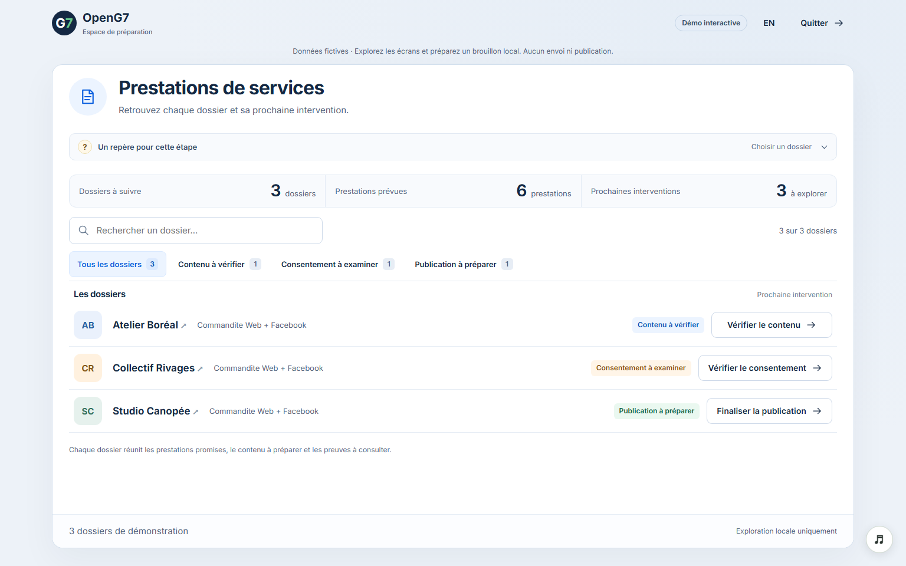

### C.02 — Résumé du dossier · Ordinateur

Route : `/demo/prestations/dossier/atelier-boreal`. Viewport : 1536 × 960; image : 1536 × 960. État initial fictif, français canadien.


### C.03 — Étape Contenu · Ordinateur

Route : `/demo/prestations/dossier/atelier-boreal/contenu`. Viewport : 1536 × 960; image : 1536 × 960. État initial fictif, français canadien.

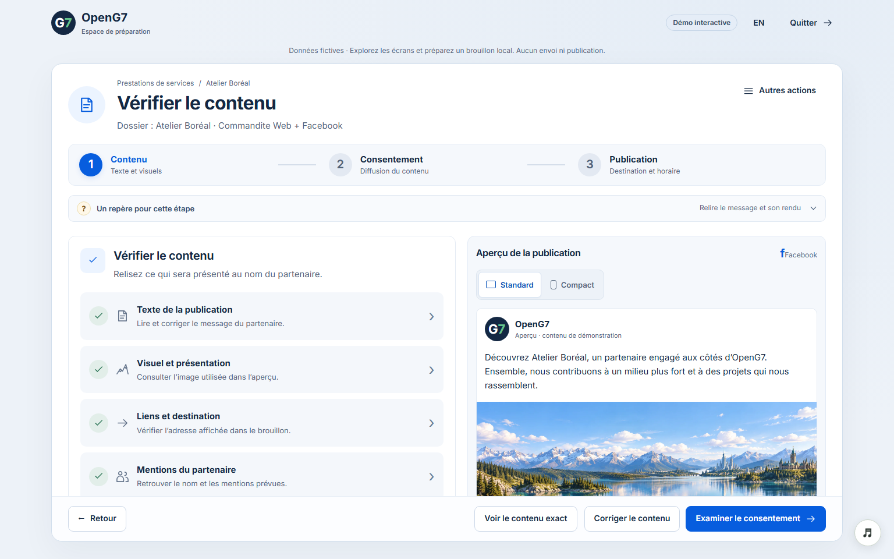

### C.04 — Éditeur · Texte · Ordinateur

Route : `/demo/prestations/dossier/atelier-boreal/corriger/texte`. Viewport : 1536 × 960; image : 1536 × 960. État initial fictif, français canadien.

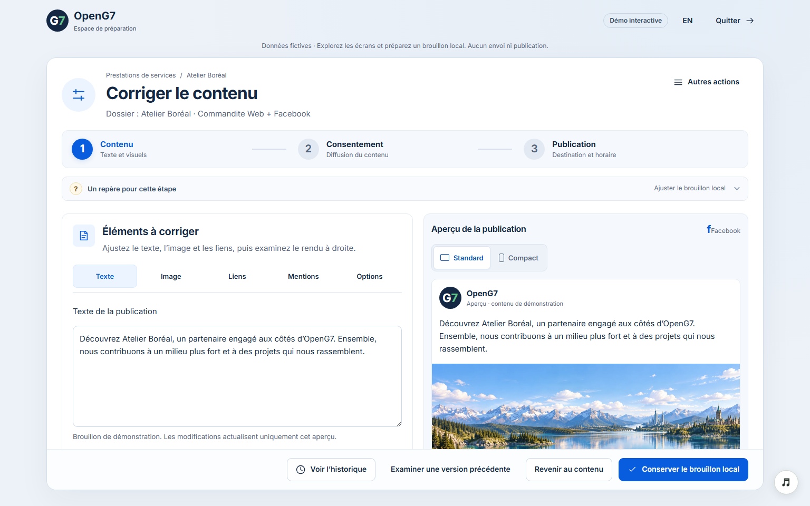

### C.05 — Éditeur · Image · Ordinateur

Route : `/demo/prestations/dossier/atelier-boreal/corriger/image`. Viewport : 1536 × 960; image : 1536 × 960. État initial fictif, français canadien.

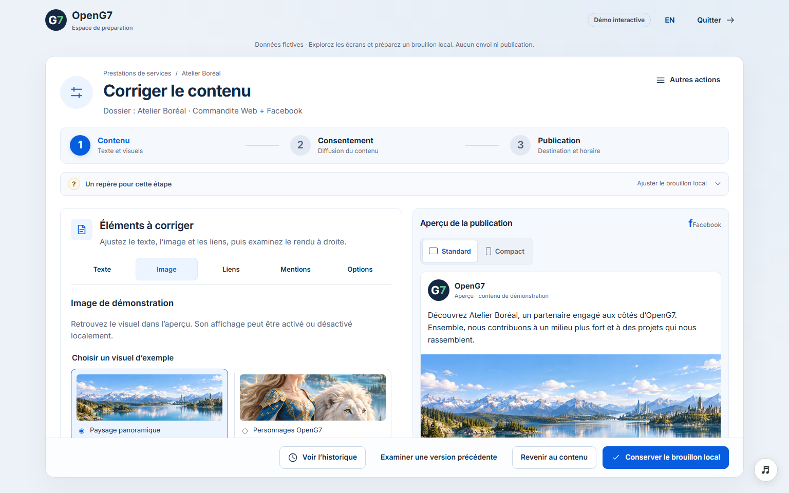

### C.06 — Historique · Ordinateur

Route : `/demo/prestations/dossier/atelier-boreal/historique`. Viewport : 1536 × 960; image : 1536 × 960. État initial fictif, français canadien.

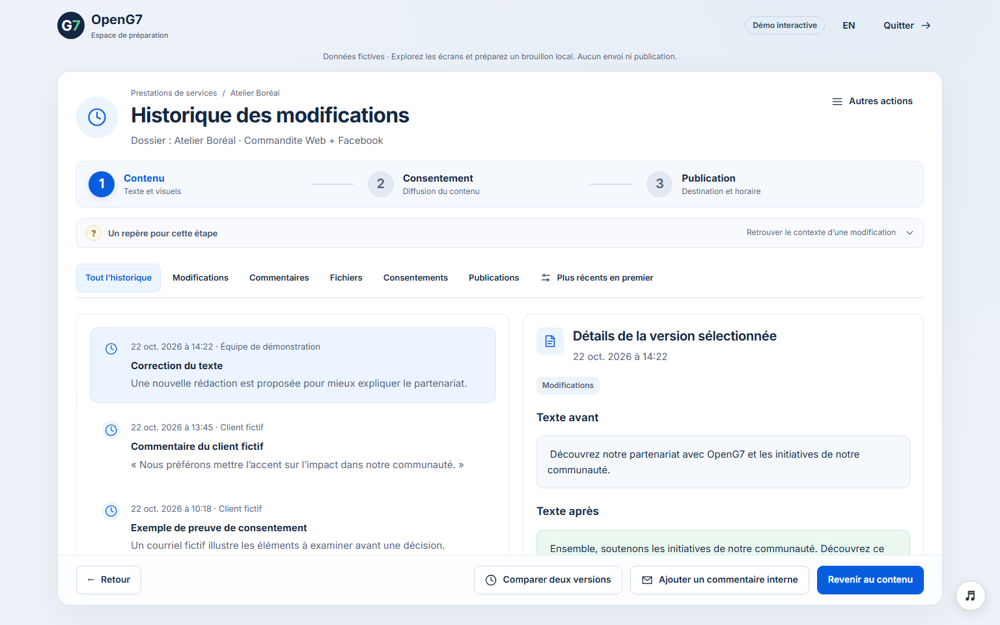

### C.07 — Étape Consentement · Ordinateur

Route : `/demo/prestations/dossier/collectif-rivages/autorisation`. Viewport : 1536 × 960; image : 1536 × 960. État initial fictif, français canadien.

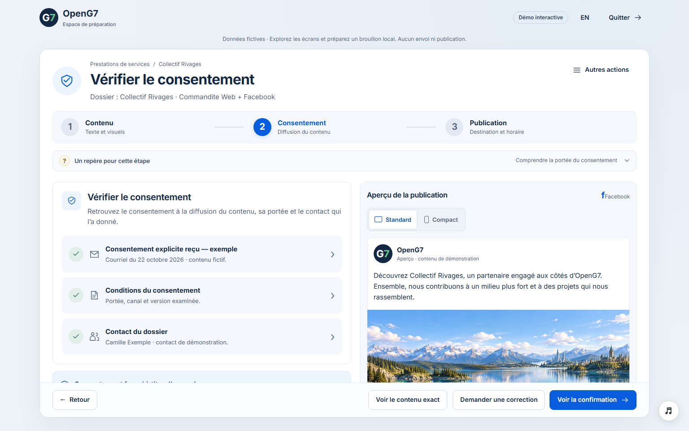

### C.08 — Consentement reçu · Ordinateur

Route : `/demo/prestations/dossier/collectif-rivages/accord-recu`. Viewport : 1536 × 960; image : 1536 × 960. État initial fictif, français canadien.

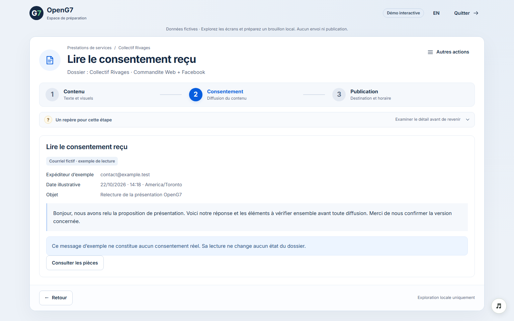

### C.09 — Étape Publication · Ordinateur

Route : `/demo/prestations/dossier/studio-canopée/publication`. Viewport : 1536 × 960; image : 1536 × 960. État initial fictif, français canadien.

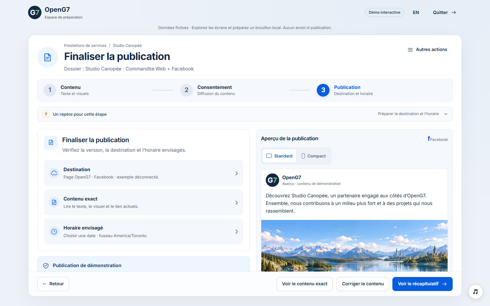

### C.10 — Planification · Ordinateur

Route : `/demo/prestations/dossier/studio-canopée/planifier`. Viewport : 1536 × 960; image : 1536 × 960. État initial fictif, français canadien.

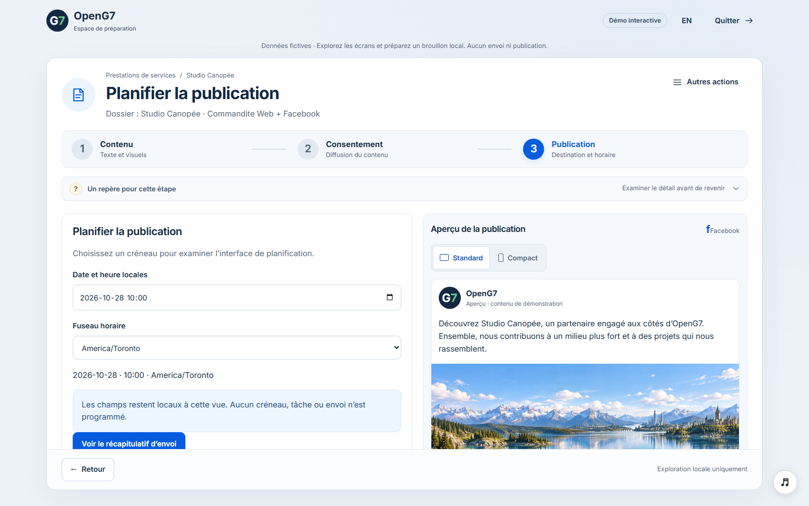

### C.11 — Confirmation d’envoi · Ordinateur

Route : `/demo/prestations/dossier/studio-canopée/confirmer-envoi`. Viewport : 1536 × 960; image : 1536 × 960. État initial fictif, français canadien.

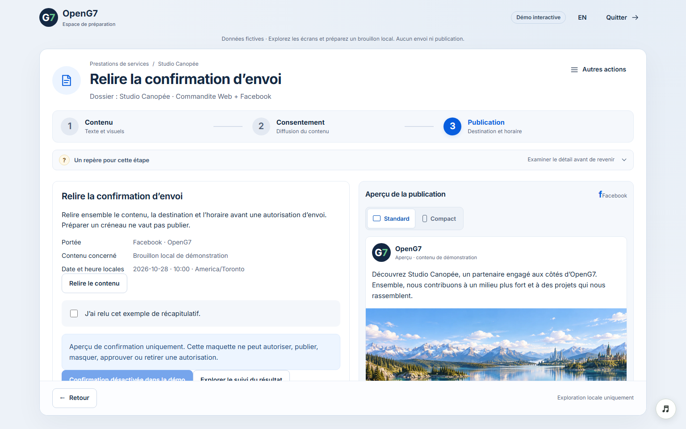

### C.12 — Présentation Web · Ordinateur

Route : `/demo/prestations/dossier/atelier-boreal/web`. Viewport : 1536 × 960; image : 1536 × 960. État initial fictif, français canadien.

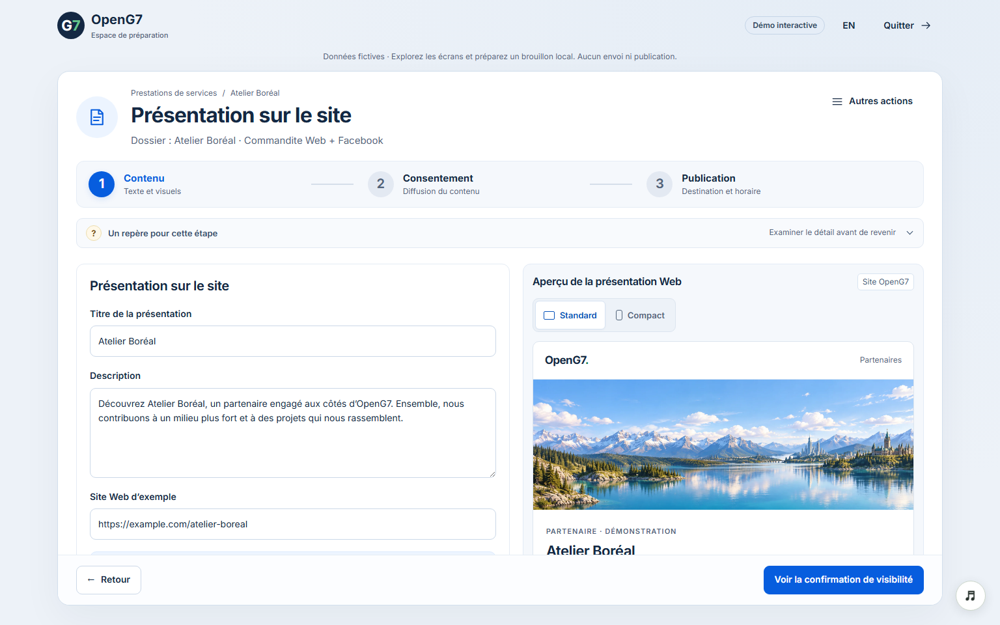

### C.13 — Liste des prestations · Mobile

Route : `/demo/prestations`. Viewport : 390 × 844; image : 390 × 1453. État initial fictif, français canadien.

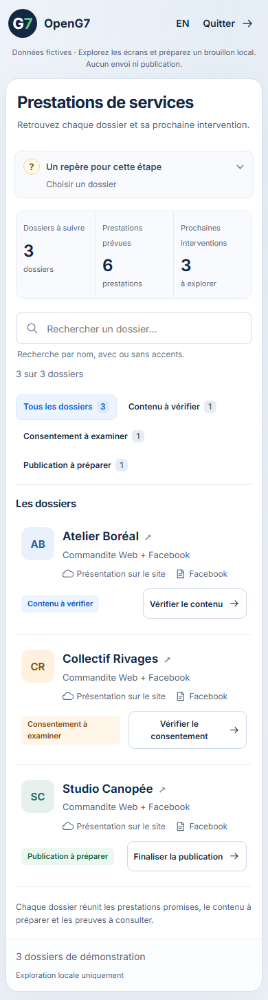

### C.14 — Résumé du dossier · Mobile

Route : `/demo/prestations/dossier/atelier-boreal`. Viewport : 390 × 844; image : 390 × 2111. État initial fictif, français canadien.

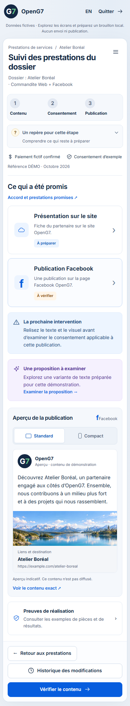

### C.15 — Éditeur · Texte · Mobile

Route : `/demo/prestations/dossier/atelier-boreal/corriger/texte`. Viewport : 390 × 844; image : 390 × 2231. État initial fictif, français canadien.

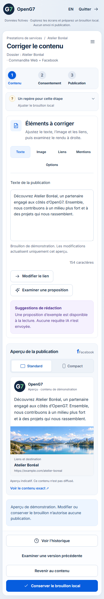

### C.16 — Étape Consentement · Mobile

Route : `/demo/prestations/dossier/collectif-rivages/autorisation`. Viewport : 390 × 844; image : 390 × 2004. État initial fictif, français canadien.

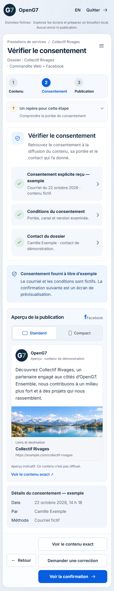

### C.17 — Étape Publication · Mobile

Route : `/demo/prestations/dossier/studio-canopée/publication`. Viewport : 390 × 844; image : 390 × 1919. État initial fictif, français canadien.

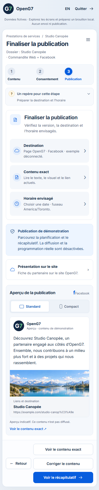

### C.18 — Planification · Mobile

Route : `/demo/prestations/dossier/studio-canopée/planifier`. Viewport : 390 × 844; image : 390 × 1651. État initial fictif, français canadien.

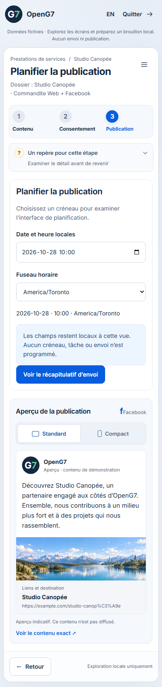

### C.19 — Confirmation d’envoi · Mobile

Route : `/demo/prestations/dossier/studio-canopée/confirmer-envoi`. Viewport : 390 × 844; image : 390 × 1791. État initial fictif, français canadien.

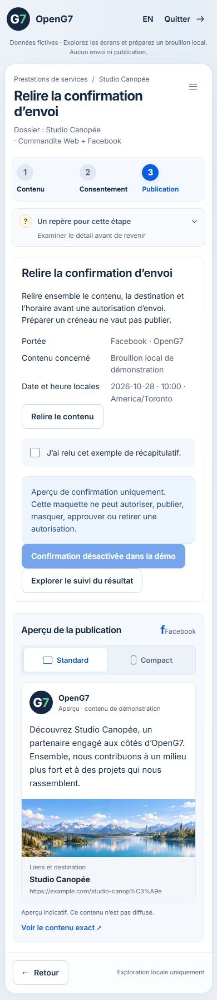

### C.20 — Présentation Web · Mobile

Route : `/demo/prestations/dossier/atelier-boreal/web`. Viewport : 390 × 844; image : 390 × 1906. État initial fictif, français canadien.

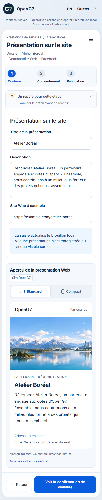

## Annexe D — Prompt de reprise pour ChatGPT

Joindre le blueprint complet et, si possible, le ZIP avec ses captures. Copier
ensuite le texte ci-dessous. Le document contient suffisamment d'explications
pour commencer une discussion fonctionnelle sans accès au dépôt.

---

Je veux poursuivre la conception et le développement de la démo des prestations
OpenG7 décrite dans les documents joints. Sa référence initiale est le commit
`a4370ba3133a42e4f37a9c3c615943b698149144`, PR #383.

Le parcours principal est **Contenu → Consentement → Publication**. Le libellé
affiché doit rester **Consentement**, sans ajouter « du client ». Le contexte
et l'aide précisent qui consent, à quel contenu, sur quels canaux et pour
quelle portée. L'accord sur les prestations promises reste un autre concept.

Commence par lire le blueprint et ses annexes. Présente ensuite une synthèse
de l'expérience actuelle, ses points forts, ses limites et les décisions à
prendre. Si tu n'as pas accès aux sources, fonde tes propositions sur les
documents et les captures; indique les détails techniques qui restent à
vérifier au lieu d'inventer des contrats existants.

Je souhaite d'abord travailler l'expérience et le fonctionnement de la démo.
Une décision de conception ne vaut pas demande d'activer une opération réelle.
Organise tes propositions écran par écran et parcours par parcours, avec le
déclencheur, les informations visibles, l'action principale, le résultat et
le retour. Conserve un parcours court, des libellés simples, une action
principale lisible et la continuité du dossier lorsqu'on ouvre un détour.

Respecte les distinctions du blueprint :

- Fonctions locales réellement présentes, illustrations fixes et évolutions
  proposées doivent être identifiables séparément.
- Conserver un brouillon dans la démo ne l'enregistre pas dans une base. Le
  rechargement efface les saisies locales. La langue et certains paramètres
  d'URL ont une durée de vie différente.
- Les dossiers et leurs étapes sont fictifs. Les coches et l'historique ne
  constituent pas une validation ou un audit réel.
- Le contenu Web et Facebook est actuellement partagé. Ne présume pas que
  deux versions indépendantes existent déjà.
- Une mention saisie est du texte, pas un compte social résolu. Le choix d'une
  pièce conserve seulement son nom; aucun téléversement n'est réalisé.
- Le paiement, la revue, le consentement, la visibilité Web, l'autorisation
  administrative d'envoi et la preuve de réalisation sont distincts.
- Ne déduis aucune nouvelle offre commerciale de la fixture « Web + Facebook ».
  Les engagements réels proviennent de l'offre figée du dossier. Les lots
  collectifs, LinkedIn et les contributions personnelles ne sont pas des
  fonctionnalités de cette démo.
- Modifier le contenu à publier doit conduire, dans une future intégration
  réelle, à réexaminer les décisions qui dépendent de sa version exacte.
- Les opérations d'envoi, publication, visibilité, réconciliation et attestation
  restent sans effet réel tant qu'un raccordement explicitement demandé et
  contrôlé n'a pas été réalisé.

Pour chaque évolution retenue, livre :

1. Le besoin utilisateur et un exemple concret avant/après.
2. Les écrans et composants concernés, avec un schéma ou une maquette si utile.
3. Les données et états nécessaires, leur portée et leur durée de conservation.
4. Les états vide, erreur, indisponible, lecture seule et succès applicables.
5. Les règles clavier, focus, mobile et français/anglais.
6. Les critères d'acceptation et les scénarios de recette.
7. Les décisions à confirmer avant de passer à un service réel.

Si nous passons ensuite au code, tiens compte du monorepo Yarn 4, d'Angular 21
standalone, de TypeScript strict et des instructions AGENTS du dépôt. Examine
les contrats réels avant de proposer un nouvel endpoint, modèle persistant ou
statut. Réutilise les services existants et vérifie les droits côté API. Ne
remplace pas tout l'existant pour reproduire une maquette.

Propose maintenant une liste courte des décisions les plus utiles à traiter,
puis nous développerons le premier parcours choisi. N'active ni publication,
ni envoi, ni opération de production à partir de ce prompt.
