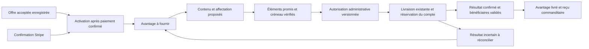

# Analyse de la reconnaissance et de la diffusion des commandites

Date : 11 octobre 2026. Révision de code examinée : `8edb18ee6b3f`.

La plateforme possède déjà un moteur de préparation, d'approbation et d'envoi
social. Le chantier prioritaire consiste à relier chaque avantage promis à une
reconnaissance effectivement présente dans le contenu, puis à une preuve de
diffusion. La personnalisation par photo, l'aperçu commanditaire et le reçu de
diffusion apportent ensuite une valeur visible sur cette base fiable.

Cette analyse développe les [19 garanties à traiter](sponsorship-publication-guarantees.md).
Elle couvre engagements, textes, photos, calendrier, autorisations, incidents,
suivi et adoption des données existantes. Les constats portent sur le code et
les tests présents à cette révision; ils ne qualifient pas une instance en service.
Les propositions et critères de réception restent des travaux à réaliser.

Le feu vert pour leur réalisation locale est consigné dans le
[plan de tâches](sponsorship-publication-tasks.md), qui devient la référence
d'exécution et de suivi. Il ne modifie pas les constats de cette analyse.

## Valeur attendue pour les commanditaires

L'hypothèse produit à vérifier auprès des commanditaires est qu'une reconnaissance
personnelle, une date compréhensible et une preuve accessible valent davantage
qu'un simple statut administratif. Il faut distinguer quatre engagements.
Le tableau définit les preuves cibles; plusieurs restent à implémenter :

| Engagement          | Preuve à établir pour cet engagement                                                                                                       |
| ------------------- | ------------------------------------------------------------------------------------------------------------------------------------------ |
| Reconnaissance      | Le nom et les éléments convenus figurent dans le contenu approuvé.                                                                         |
| Diffusion           | Le fournisseur confirme la création d'une publication sur la destination prévue.                                                           |
| Visibilité actuelle | Une vérification datée établit ce qui est encore accessible, selon les droits de lecture disponibles.                                      |
| Audience            | Des mesures identifiées décrivent impressions, interactions ou clics sur une période; ces chiffres ne sont pas des garanties de diffusion. |

Le produit devrait proposer un parcours simple : fournir sa présentation et ses
photos, connaître ses avantages, consulter la prochaine étape, demander une
correction, puis retrouver la publication réalisée. Les coordonnées privées,
montants non consentis et notes administratives restent exclus du contenu social.

Les améliorations les plus pertinentes sont : un portrait de l'équipe, de
l'atelier ou du produit; une phrase concrète sur le soutien au projet; un aperçu
de présentation; une date proposée puis confirmée; un lien après diffusion;
un visuel de remerciement réutilisable. Un bilan des réalisations du projet
peut compléter ce parcours avec des faits vérifiés, sans attribuer arbitrairement
une réalisation à un financement particulier.

## Fonctionnement actuel et frontières à conserver

Les avantages actuels sont la mention Web et les reconnaissances collectives
Facebook et LinkedIn. Leur définition appartient à la
[configuration de tarification](../../packages/funding-core/src/sponsorship-pricing.ts)
et aux [contrats des avantages](../../packages/funding-core/src/sponsorship-benefits.ts).
Une publication individuelle, une photo personnelle garantie, plusieurs passages
ou un objectif d'impressions ne découlent pas automatiquement de ces avantages.
Réduire la capacité d'un lot à un participant produit techniquement une publication
pour ce participant, sans modifier l'offre acceptée.

La préparation récurrente crée des brouillons privés à partir de paiements
confirmés avec consentement. Elle accepte une revue de dossier encore en attente.
L'administration approuve ensuite le contenu exact, les participants concernés,
le média, le compte, le mode et la date. Le worker revalide les faits avant l'envoi.
Le [runbook](../operations/publication-automation.md) définit les conditions
d'activation et de reprise; les [règles de commandite](sponsorship-rules.md)
restent les invariants métier.

Le média peut être approuvé tout en restant privé, et une autorisation sociale
ne rend pas automatiquement la fiche visible sur le site. Un nouveau message
social exige un paiement admissible à l'envoi. La visibilité Web peut conserver
une reconnaissance historique avec un paiement remboursé ou contesté, selon
sa politique propre. Ne pas fusionner ces décisions dans un statut unique.
Sources : [admissibilité Web](../../apps/funding-api/src/sponsorship-website-eligibility.ts),
[sources sociales](../../apps/funding-api/src/publication-automation/sources.ts)
et [guide commanditaires](../public-sponsors.md).

## Diagnostic des engagements et des preuves

### Avantages figés et avantages recalculés

La facture conserve des notes décrivant les avantages au moment de son émission.
Cette stabilité protège le document émis. Cependant, le suivi commanditaire,
le calcul de progression et l'admissibilité du planificateur utilisent encore
le barème actif. Ces notes libres ne constituent pas un contrat structuré et
versionné enregistré avant paiement.

Le risque apparaît lors d'un changement d'offre : un ancien paiement peut
continuer d'avoir sa facture originale, tout en obtenant un suivi opérationnel
calculé avec de nouvelles règles. Il faut figer l'offre validée par le serveur
avant la soumission du Checkout, puis activer ses obligations uniquement sur
confirmation Stripe. Le retour navigateur reste informatif.

Sources : [émission des factures](../../apps/funding-api/src/sponsorship-documents/invoices.write.ts),
[paiements publics](../../apps/funding-api/src/public-payments.http.ts),
[suivi commanditaire](../../apps/funding-api/src/sponsorship-followup.repository.ts)
et [progression administrative](../../apps/funding-api/src/sponsorship-progress.service.ts).

### Texte final et bénéficiaires

Les commandes de composition et d'édition acceptent un message libre tout en
conservant séparément le snapshot des sources du lot. L'approbation vérifie
les sources et leur admissibilité, mais ne vérifie pas que chaque participant
figure dans le message final. Après succès réel, les brouillons du snapshot
sont marqués publiés.

Ainsi, une retouche peut supprimer un nom tout en laissant le dossier dans les
bénéficiaires réputés publiés. Il s'agit d'un écart confirmé par les contrats
et le code, sans reproduction d'une diffusion réelle dans cette analyse.
Le correctif doit relier la composition approuvée aux éléments obligatoires
de chaque participant. Une recherche textuelle naïve du nom ne couvre pas les
homonymes, abréviations, mentions incidentes ou liens appartenant au mauvais dossier.

Préférer des blocs de reconnaissance associés au dossier, avec nom d'affichage,
éléments convenus et média retenu. Le rendu reste éditable, mais une édition
incompatible doit bloquer l'approbation ou conduire à une nouvelle répartition
explicite des bénéficiaires. Conserver l'empreinte du rendu et la correspondance
entre obligations et blocs approuvés.

Sources : [commandes](../../apps/funding-api/src/publication-automation/commands.ts),
[préflight](../../apps/funding-api/src/publication-automation/preflight.ts)
et [finalisation](../../apps/funding-api/src/publication-automation/delivery-outcomes.ts).

### Préparation et preuve de livraison

Une couverture par brouillon actif signifie qu'un canal a été préparé.
Le calcul de progression compte actuellement les canaux publiés; il ne vérifie
pas un nombre de passages convenu, une destination historique ou la représentation
effective dans le texte. Un statut publié déclaré manuellement peut aussi
contribuer à la complétude sans preuve fournisseur.

Conserver les déclarations historiques avec leur provenance, en distinguant
publication déclarée, publication fournisseur confirmée et simulation. Une
attestation manuelle future doit identifier sa preuve et son niveau de vérification.
Ne pas transformer automatiquement les anciens statuts en confirmations externes.
Les impressions et la disponibilité ultérieure du lien restent des faits séparés.

Si un nom est retiré ou une publication supprimée après diffusion confirmée,
conserver la preuve historique et enregistrer séparément la visibilité actuelle
avec sa date de vérification. Si un contenu ou une durée de visibilité était
promis, ouvrir une décision de correction de la reconnaissance : adaptation
de contenu, nouvelle publication autorisée ou autre traitement convenu. Ne pas
effacer la livraison historique ni renvoyer automatiquement. Une correction
financière éventuelle suit ses règles et autorisations propres.

Sources : [couverture de préparation](../../apps/funding-api/src/sponsorship-publication-coverage.ts),
[progression](../../apps/funding-api/src/sponsorship-progress.service.ts)
et [brouillons manuels](../../apps/funding-api/src/fund-publication-drafts.repository.ts).

## Diagnostic des textes et de la file

Le planificateur respecte la capacité en nombre de participants et interrompt
l'ajout avant que le texte source cumulé dépasse 2 900 unités UTF-16. La composition
et l'édition contrôlent le texte final. Les préférences éditoriales conservent
le texte précédent si leur transformation dépasse cette limite. Les résumés
automatiques sont déjà limités à 300 caractères; ce raccourcissement d'une source
doit être distingué d'une suppression de participants dans une publication entière.

Le surplus reste non affecté et peut être considéré aux dates suivantes. Cependant,
la boucle s'arrête au premier élément trop long. Si celui-ci ne tient pas même
seul, il peut empêcher tous les suivants d'être placés. Aucun état individuel
de correction ne décrit ce problème. Les affectations manuelles ne calculent
pas systématiquement le rendu complet du lot.

La politique de composition cible doit produire quatre résultats : participants
retenus, participants différés, dossiers nécessitant une correction et longueur
du rendu final. Elle s'applique à la préparation, à la réparation, aux affectations
manuelles, à l'édition et à l'approbation. Les séparateurs, mentions et adaptations
du canal entrent dans le calcul. Les unités de mesure doivent être explicites;
la limite applicative actuelle ne doit pas être présentée comme une limite
universelle identique de toutes les interfaces des réseaux sociaux.

L'équité nécessite une date métier d'entrée dans la file, conservée lors des
reports et corrections. Le classement actuel par date de création du brouillon
est utile, mais une création initiale massive ne démontre pas l'ordre des paiements.
Un dossier bloqué doit garder son ancienneté sans immobiliser toute la file.
Une priorité exceptionnelle conserve acteur, motif et impact sur les dossiers
déplacés. Les réservations humaines et les refus restent protégés.

Sources : [préparation](../../apps/funding-api/src/publication-automation/planning.ts),
[réparation des sources](../../apps/funding-api/src/publication-automation/sources.ts),
[politique](../../apps/funding-api/src/publication-automation/policy.ts)
et [transformations éditoriales](../../packages/funding-core/src/editorial-programme.ts).

## Diagnostic du calendrier et de la concurrence

### Réservations et conflits

La récurrence garantit un lot par destination interne et instant; une contrainte
garantit aussi une livraison non annulée par lot. Ces contraintes évitent des
doublons locaux. Elles ne réservent pas globalement l'heure sur un compte fournisseur.
Les créneaux manuels peuvent avoir le même horaire. Les compositions et éditions
de livraisons ne consultent pas une prévention commune des conflits.

Le programme éditorial détecte les publications espacées de moins de trente
minutes sur un même feed et refuse les déplacements concernés. Ce contrôle
ne couvre pas tous les parcours. Deux feeds peuvent utiliser le même compte
réel sans être rapprochés par cette règle. L'identité de réservation cible
doit donc inclure fournisseur, compte normalisé et mode, sans inclure de secret.
La simulation reste distincte de la réservation d'un compte réel.

Une préparation privée sans compte configuré peut continuer de proposer des
dates provisoires. L'approbation doit fixer une destination effective et obtenir
la réservation commune. Un changement de compte doit revalider cette réservation
et l'autorisation concernée.

Sources : [schéma des créneaux](../../apps/funding-api/migrations/016_create_publication_slots.sql),
[schéma des récurrences](../../apps/funding-api/migrations/022_create_publication_automation.sql),
[programme](../../apps/funding-api/src/editorial-programme.service.ts)
et [commandes](../../apps/funding-api/src/publication-automation/commands.ts).

### Capacité concurrente

Le planificateur récurrent verrouille le feed, le lot et les brouillons concernés.
Des affectations manuelles calculent en revanche la capacité utilisée puis
modifient des lignes enfants distinctes, sans verrou explicite du parent partagé.
Le fait de réunir lecture et mise à jour dans une seule requête ne démontre pas
la protection contre deux réservations concurrentes de la dernière place.

Le risque de dépassement est déduit de ces requêtes, pas reproduit sur une base
dans cette analyse. PostgreSQL décrit la lecture par snapshot en isolation
[Read Committed](https://www.postgresql.org/docs/16/transaction-iso.html)
et la portée des [verrous de lignes](https://www.postgresql.org/docs/16/explicit-locking.html).
La qualification doit utiliser deux connexions réellement concurrentes.

La solution minimale est une transaction courte verrouillant la ressource
commune avant un nouveau calcul de capacité, puis une affectation atomique.
Les participants, lots, créneaux et destinations doivent suivre un ordre
de verrouillage cohérent dans tous les chemins. Ne pas ajouter un verrou
isolé sans vérifier son interaction avec les ordres existants.

Sources : [affectation aux lots](../../apps/funding-api/src/fund-publication-batches.repository.ts)
et [affectation aux créneaux](../../apps/funding-api/src/fund-publication-calendar.repository.ts).

### Dates exploitables et espacement effectif

Les récurrences utilisent un fuseau IANA et excluent les instants déjà atteints.
L'horizon inclut aujourd'hui : avec un horizon d'un jour et une heure passée,
aucune date future ne peut être proposée. Une proposition automatique intacte
échue est reportée; une proposition modifiée humainement conserve son contenu.
Le contrat manuel de certaines dates accepte actuellement une chaîne interprétable
sans offset, alors que celui des livraisons exige un offset ou `Z`.

Le worker traite jusqu'à cinq livraisons échues par passage. Plusieurs instances
peuvent réserver des livraisons différentes sur le même compte. Il manque un
contrôle commun de l'espacement réel des appels. Une pause peut donc accumuler
des publications prêtes à partir presque ensemble.

Une réservation persistante du compte doit contrôler à la fois dates prévues
et prochains envois admissibles. Les transactions sont closes avant HTTP; une
réservation ou un bail représente l'appel en cours. Une réponse incertaine
conserve une trace et une règle de reprise prudente pour ce compte.

Définir une tolérance de retard approuvée : quelques secondes de traitement ne
doivent pas être assimilées à une nouvelle programmation. Au-delà de la fenêtre
autorisée, proposer un nouvel horaire et demander une nouvelle approbation.
L'espacement ne doit pas transformer silencieusement un horaire approuvé en
un autre engagement. Le seuil actuel de retard de vingt-quatre heures est un
garde-fou technique, pas un délai de livraison promis au commanditaire.

Sources : [dates manuelles](../../apps/funding-api/src/admin-publication-http.shared.ts),
[récurrences](../../apps/funding-api/src/publication-automation/policy.ts),
[worker](../../apps/funding-api/src/publication-automation/delivery-worker.ts),
[claims](../../apps/funding-api/src/publication-automation/claims.ts)
et [exécution](../../apps/funding-api/src/publication-automation/delivery-execution.ts).

## Photos et équité de présentation

### Capacités disponibles

Le suivi privé accepte un logo et plusieurs photos; les plafonds effectifs
appartiennent à la [configuration média](../../apps/funding-api/src/sponsor-media-limits.ts).
Les formats sont décodés, les dimensions et la taille contrôlées, et des dérivés
sont créés par le [service image](../../apps/funding-api/src/sponsor-image.service.ts).
La revue et les accès restent contrôlés côté API.

Une publication possède un seul `mediaId`. L'administrateur sélectionne une image
admissible d'un membre du lot. L'API vérifie l'appartenance au lot, le consentement,
la revue, la version et les octets avant l'envoi. Lorsqu'une image est sélectionnée,
le fournisseur reçoit cette image avec le texte. La présence d'une photo approuvée dans un dossier ne force pas
son inclusion dans la publication.

Le choix d'une seule photo d'un participant pour un groupe est techniquement
possible, mais il lui donne une place visuelle particulière. Une reconnaissance
textuelle des huit participants ne constitue pas huit photos dédiées. L'offre
et l'aperçu doivent rendre cette distinction compréhensible.

Sources : [upload privé](../../apps/funding-api/src/sponsorship-followup-media.http.ts),
[sélection et portée](../../apps/funding-api/src/publication-automation/media.ts),
[adaptateur fournisseur](../../apps/funding-api/src/publication-automation/provider.ts)
et [éditeur administratif](../../apps/funding-web/src/app/features/funding/components/admin-publications/publication-delivery-drawer.component.html).

### Comparaison des formules

| Formule                                | Valeur proposée                                    | Capacité et travail nécessaires                                                                                     |
| -------------------------------------- | -------------------------------------------------- | ------------------------------------------------------------------------------------------------------------------- |
| Collective avec texte et image commune | Reconnaissance groupée, coût éditorial limité      | Base disponible; expliciter le rôle de l'image et vérifier chaque mention.                                          |
| Portrait individuel avec photo propre  | Présentation personnelle, facile à repartager      | Lot d'un participant possible; définir l'offre, réserver plus de publications et suivre la photo réellement livrée. |
| Collective avec montage équitable      | Chaque participant dispose d'une présence visuelle | Ajouter média dérivé du lot, composition, approbation et validation de lisibilité.                                  |
| Collective avec plusieurs images       | Photo par participant dans un même ensemble        | Faire évoluer modèle, UI, uploads fournisseur, approbation et réconciliation; qualifier chaque canal.               |

Un montage doit appartenir au lot et référencer ses sources. Ne pas l'attacher
artificiellement à un participant pour contourner les contrôles de portée.
Conserver propriétaires, versions et empreintes des sources, bénéficiaires,
ordre de présentation et version de la composition. Un retrait de source ou
de consentement invalide le visuel et son autorisation.

L'équité visuelle se vérifie sur mobile : taille comparable des zones, noms longs,
proportions des logos, fonds clairs ou sombres, contraste et recadrages acceptés.
La capacité visuelle peut être inférieure à la capacité textuelle. Le nom et
la reconnaissance doivent aussi rester accessibles hors image. Les originaux
et les droits d'utilisation des dérivés demandent une politique explicite;
le modèle actuel ne structure pas crédits, restrictions et usages par canal.

Le WebP consulté dans l'aperçu est transformé en JPEG pour l'envoi. Qualifier
les logos transparents et montrer le dérivé préparé quand cette différence
affecte leur présentation. L'aperçu ne garantit pas le recadrage ou le rendu
final de chaque interface du fournisseur.

Concernant les images multiples, la
[documentation LinkedIn MultiImage](https://learn.microsoft.com/en-us/linkedin/marketing/community-management/shares/multiimage-post-api?view=li-lms-2026-08)
décrit un format de deux à vingt images, distinct du `content.media` unique
utilisé ici. Les permissions et restrictions du format doivent être qualifiées;
la disponibilité de l'API ne prouve pas l'accès du compte OpenG7. Le terme
publicitaire du fournisseur ne doit pas être assimilé automatiquement à la
commandite du projet. Un format Facebook équivalent demande sa propre étude
du contrat fournisseur avant d'être annoncé.

## Parcours commanditaire et administratif cible

### Suivi privé du commanditaire

Le contrat de [suivi privé](../../packages/funding-core/src/sponsorship-followup.ts)
expose aujourd'hui identité, revue et avantages, mais pas le brouillon final,
la prochaine date ni un reçu individuel de diffusion. La dernière étape de
l'[interface de suivi](../../apps/funding-web/src/app/features/funding/components/sponsorship-followup/sponsorship-followup-status.component.html)
conserve une information de publication inconnue. Le dossier administratif
possède déjà une projection plus détaillée, à réutiliser par une projection
privée limitée au bénéficiaire.

Le parcours cible affiche : avantages acceptés, éléments encore à fournir,
photo préférée proposée, photo retenue, prochaine étape, date proposée ou
confirmée, motif compréhensible d'un report, puis preuve de diffusion.
La préférence de photo et un accord de présentation restent des demandes du
commanditaire; ils ne constituent pas une autorisation d'envoi.

Un aperçu collectif ne doit pas exposer les coordonnées, médias privés ou
dossiers non approuvés des autres participants. Avant leur publication autorisée,
définir précisément les éléments visibles et les consentements correspondants.
À défaut, montrer uniquement la contribution propre au commanditaire et la
formule annoncée. Un éventuel lien d'aperçu utilise un accès restreint et révocable,
sans droit d'édition global ni droit administratif.

Après une correction, l'aperçu versionné indique ce qui est à nouveau en revue.
L'interface distingue données non disponibles, absence de place et erreur de
chargement. Dates, noms accessibles, alternative textuelle, clavier, focus,
FR/EN et protections SSR font partie de la réception.

### Travail de l'administration

La préparation doit expliquer pourquoi un dossier est retenu, reporté ou bloqué.
L'éditeur conserve l'aperçu existant du texte, de la photo et de la date, en y
ajoutant obligations satisfaites, éléments manquants et impact d'une modification.
Une approbation de groupe reste une approbation du groupe affiché intégralement.

Le calendrier montre la ressource effective, les places et conflits. Une
reprogrammation présente ancienne date, nouvelle date, participants déplacés
et nécessité de réapprobation. Une file dédiée retrouve les avantages jamais
affectés, ceux hors horizon et ceux dont une composition n'a pas produit de livraison.

Les compteurs utilisent des agrégations serveur complètes avec des listes paginées.
Les limites actuelles d'une réponse de cockpit ou d'un dataset d'assistant ne
doivent pas devenir la base d'un contrôle global de conflit ou d'un total métier.
L'opérateur traite les actions autorisées; le propriétaire décide des offres,
réglages et opérations réservées. Les nouveaux endpoints refusent par défaut
et réutilisent les [règles d'identité](../operations/admin-identity-and-alerts.md).

## Modèle cible minimal et réutilisation

Conserver PostgreSQL, le moteur de publication, ses livraisons, son audit et ses
adaptateurs. Ce chantier ne justifie pas une nouvelle file distribuée, un nouveau
service déployable, un second calendrier autoritaire ou un second journal financier.
Les [frontières d'architecture](../ARCHITECTURE.md) restent applicables.

| Concept proposé              | Responsabilité et données minimales                                                                                                  |
| ---------------------------- | ------------------------------------------------------------------------------------------------------------------------------------ |
| Offre acceptée               | Version et snapshot serveur des avantages et conditions applicables avant paiement.                                                  |
| Obligation de reconnaissance | Dossier, avantage, destination logique, formule, quantité ou ordinal convenu, éléments obligatoires, ancienneté et situation métier. |
| Affectation active           | Lien de l'obligation vers brouillon, lot et livraison existants; une affectation active par passage convenu.                         |
| Réservation de destination   | Compte effectif, mode, instant et fenêtre autorisée; prévention commune des conflits et régulation de l'envoi.                       |
| Preuve de livraison          | Livraison existante, provenance, résultat fournisseur, contenu et média approuvés, bénéficiaires effectivement validés.              |
| Média dérivé collectif       | Lot, sources approuvées, versions, règle de composition, bénéficiaires et droits applicables.                                        |

Ces concepts sont une proposition de responsabilité, pas un schéma déjà créé.
Choisir colonnes ou tables additives lors du changement concret et documenter
les contraintes d'unicité utiles. Les obligations n'enregistrent aucun nouveau
montant comptable; elles référencent les faits existants.

Les contrats et calculs purs appartiennent aux exports publics des packages
partagés. L'API orchestre droits, transactions, audit, stockage et fournisseur.
Le Web affiche les projections utiles sans décider de l'admissibilité.
Les helpers actuels de bénéfices, composition, sources et progression sont
étendus par leurs propriétaires; aucun calcul parallèle n'est ajouté uniquement
pour le nouveau suivi commanditaire.

Le dernier lien conserve l'obligation en attente d'une décision; il ne déclenche
aucun renvoi automatique d'un résultat incertain.

Les situations métier de l'obligation sont distinctes du statut technique d'une
livraison : à fournir, bloquée avec raison, livrée sur preuve, ou ajustée par
décision explicite. Une proposition refusée impose une nouvelle décision humaine.
La réservation et l'approbation sont des étapes de traitement, pas des preuves
de reconnaissance livrée.

## Fiabilité des envois et traitement des incidents

Le moteur actuel réserve les livraisons avec version croissante et bail. Il
recontrôle la réservation avant l'appel fournisseur, conditionne ses écritures
à la version active, met en quarantaine les baux expirés et conserve les retours
tardifs observés. Les erreurs certaines peuvent être reprises avec backoff;
les erreurs ambiguës restent incertaines. Ces protections doivent être conservées,
pas remplacées par un simple statut de succès dans la nouvelle interface.

Un résultat fournisseur reçu puis un échec de commit local peut actuellement
laisser une livraison incertaine sans identifiant externe dans son état. La
preuve observée doit être conservée dans la tentative ou l'audit dès que la
persistance est disponible, sans présenter la livraison comme confirmée tant
que sa réconciliation n'est pas terminée. Une indisponibilité persistante de
la base demeure une exception; elle n'autorise aucun renvoi aveugle.

La réconciliation automatique des publications avec image est actuellement
refusée par `MEDIA_RECONCILIATION_REQUIRED`. La nouvelle expérience doit donc
prévoir une investigation humaine réelle pour ces messages et conserver tous
les identifiants observés. Une lecture fournisseur inaccessible ne démontre
pas l'absence du message. L'attestation d'absence reste motivée et auditée.

Le contrôle de fréquence par compte doit respecter les retours fournisseur,
notamment une consigne de nouvelle tentative lorsqu'elle est disponible.
Les retries ne consomment pas un passage supplémentaire. La création du message
externe et le commit PostgreSQL ne forment pas une transaction distribuée;
la cible est une seule livraison logique avec traitement explicite de l'incertitude.

Sources : [claims](../../apps/funding-api/src/publication-automation/claims.ts),
[exécution](../../apps/funding-api/src/publication-automation/delivery-execution.ts),
[résultats](../../apps/funding-api/src/publication-automation/delivery-outcomes.ts)
et [réconciliation fournisseur](../../apps/funding-api/src/publication-automation/provider.ts).

## Capacité et décisions commerciales

Pour un ensemble homogène, une estimation initiale du nombre de publications est
`arrondi_supérieur(nombre de commandites / capacité effective)`. La capacité effective est
le minimum permis par le nombre de participants, le texte et le format visuel.
Avec des textes de tailles différentes, seule la composition réelle détermine
la répartition; cette estimation ne constitue pas une réservation.

| Exemple synthétique avec huit dossiers                | Publications nécessaires                                           |
| ----------------------------------------------------- | ------------------------------------------------------------------ |
| Capacité de cinq, tous les textes tiennent            | Deux lots de cinq et trois.                                        |
| Le rendu n'accepte que trois participants par lot     | Trois lots de trois, trois et deux.                                |
| Chaque dossier doit avoir un portrait individuel      | Huit publications avec huit photos propres.                        |
| Un visuel collectif lisible accepte les huit dossiers | Une publication possible si texte, offre et créneau le permettent. |

Pour une semaine, la capacité théorique de reconnaissance collective est la somme
des capacités effectives des publications de commandite disponibles. Retirer
les créneaux éditoriaux, les réservations fixes et les indisponibilités. Les
approbations, corrections et incidents réduisent la capacité exploitable.

Si les nouvelles obligations arrivent durablement plus vite que les livraisons,
la file augmente. Un délai promis exige donc une capacité suffisante et des
préconditions explicites. Prévoir une alerte de saturation et une décision sur
la fréquence, les places réservées, la formule ou l'acceptation de nouvelles offres.
Ne pas augmenter automatiquement la fréquence ou diminuer les éléments promis
pour masquer le retard. Une formule individuelle peut être plus valorisante,
mais son coût éditorial et sa consommation de créneaux sont supérieurs.

Avant toute nouvelle offre, décider : reconnaissance collective ou individuelle;
photo propre ou image commune; éléments obligatoires; nombre de passages;
canaux; délai et point de départ; conditions de dossier complet; intervalle
minimal; tolérance de retard; visibilité durable éventuellement promise.
Les engagements existants restent inchangés sans décision explicite correspondante.

## Matrice des garanties et des écarts

Priorité 0 : éviter une livraison fictive ou une perte d'avantage.
Priorité 1 : rendre attribution et calendrier fiables dans tous les parcours.
Priorité 2 : compléter l'expérience et la présentation.
Le statut décrit la lecture de code, pas une certification par tests exécutés.

| Garantie | État observé                              | Travail principal                                                                            | Priorité   |
| -------- | ----------------------------------------- | -------------------------------------------------------------------------------------------- | ---------- |
| G01      | Partielle                                 | Figer offre et avantages structurés avant paiement.                                          | 0          |
| G02      | Partielle                                 | Suivre une obligation indépendante des lots et refus de brouillon.                           | 0          |
| G03      | Manque de contrôle                        | Relier bénéficiaires au rendu final approuvé.                                                | 0          |
| G04      | Partielle                                 | Généraliser la composition sans disparition des participants.                                | 0          |
| G05      | Partielle                                 | Contrôler le rendu définitif et ses transformations dans tous les chemins.                   | 0          |
| G06      | Partielle, risque concurrent à reproduire | Sérialiser les réservations manuelles sur la ressource commune.                              | 1          |
| G07      | Manque identifié                          | Isoler le dossier trop long et poursuivre la file.                                           | 1          |
| G08      | Partielle                                 | Ancienneté métier, priorités tracées et reprise équitable.                                   | 1          |
| G09      | Partielle                                 | Exposer non-affectation, absence de date et dossiers hors horizon.                           | 1          |
| G10      | Partielle                                 | Délai cible par obligation, causes et alertes de saturation.                                 | 1          |
| G11      | Manque global                             | Réservation partagée par compte réel et mode.                                                | 1          |
| G12      | Manque identifié                          | Réguler aussi l'instant effectif d'envoi après pause ou panne.                               | 1          |
| G13      | Partielle                                 | Unifier contrats de dates, marge et fenêtres autorisées.                                     | 1          |
| G14      | Base solide                               | Appliquer à toutes les affectations et aux nouveaux médias dérivés.                          | 0          |
| G15      | Base solide                               | Conserver préflight et politiques site/social distinctes; résoudre les obligations bloquées. | 0          |
| G16      | Base solide avec écarts                   | Préserver résultat observé, obligation et gouvernance du compte pendant reprise.             | 0          |
| G17      | Partielle                                 | Distinguer preuve réelle, historique déclaré et bénéficiaires conformes.                     | 0          |
| G18      | Partielle                                 | Projection privée, compteurs complets et suivi de toutes les obligations.                    | 1          |
| G19      | Tests présents, réception à compléter     | Ajouter recettes de nouveaux comportements et preuves de qualification.                      | Chaque lot |

La photo dédiée et le montage collectif complètent G01, G03, G14, G15 et G17;
ils ne doivent pas être déclarés livrés grâce au seul contrôle de longueur.

## Plan de réalisation proposé

| Lot | Livrable                                           | Dépendances et réception                                                                               |
| --- | -------------------------------------------------- | ------------------------------------------------------------------------------------------------------ |
| A   | Offre figée et suivi des obligations               | G01, G02, G15; contrat A conservé après évolution du barème B, historique classé sans preuve inventée. |
| B   | Composition complète et file équitable             | A; G03 à G09, G17; surplus conservé, dossier trop long isolé, bénéficiaires validés dans le rendu.     |
| C   | Réservation commune et espacement réel             | A et B; G06, G10 à G14; collisions et dernières places testées avec sessions et workers concurrents.   |
| D   | Preuves, réconciliation et reçu privé              | A à C; G16 à G18; résultat incertain sans renvoi, preuve réelle distincte du manuel et du mock.        |
| E   | Portraits et aperçu commanditaire                  | B et D; choix proposé, rendu préparé, confidentialité collective et corrections versionnées.           |
| F   | Montage collectif puis éventuels formats multiples | C à E; droits des sources, équité mobile, nouveaux adaptateurs et reprise média qualifiés.             |

G19 s'applique à chaque lot. Les corrections urgentes de contrôle du contenu
peuvent être préparées avant le modèle complet des obligations, à condition de
ne pas créer un suivi métier parallèle qu'il faudrait ensuite remplacer.
Le détail des changements doit réutiliser les propriétaires actuels, mettre à
jour contrats, consommateurs et guides dans la même livraison, et prévoir un
ADR pour toute évolution structurante selon les règles du dépôt.

Les erreurs existantes, dont `VERSION_CONFLICT`, `SCHEDULE_EXPIRED` et
`MEDIA_RECONCILIATION_REQUIRED`, restent exploitables. Des codes supplémentaires
pour texte individuel trop long, capacité dépassée, horizon sans place, conflit
de compte et bénéficiaire absent sont à définir dans le contrat API concret.
Le report d'un envoi pour respecter l'espacement doit être distingué d'un échec fournisseur.

## Adoption des données existantes

Prévoir des migrations additives numérotées, immuables une fois appliquées,
conformément au [runbook de migrations](../operations/database-migrations.md).
Conserver identifiants de dossiers, brouillons, lots, livraisons, factures et audits.
Le nouveau suivi référence ces faits plutôt que de les dupliquer.

Classer les dossiers historiques selon leurs preuves disponibles : engagement
documenté, publication déclarée, publication fournisseur confirmée ou éléments
à confirmer. Les notes textuelles de facture peuvent aider une revue humaine;
elles ne doivent pas être analysées aveuglément pour créer des engagements exacts.
Ne pas déduire une confirmation fournisseur d'un ancien statut publié.

Un aperçu de rapprochement présente comptes, doublons, avantages sans affectation,
preuves manquantes et autorisations actives avant toute correction. Les corrections
conservent leur provenance et ne touchent pas rétroactivement les documents émis.
Les lots autorisés restent protégés; le passage au nouveau système doit empêcher
que deux chemins concurrents préparent la même obligation.

La migration ne réactive aucun worker, ne dépause aucun feed et n'approuve aucun
contenu. Une adoption historique, un envoi de notifications, une migration de
production ou une mise en service constituent des opérations séparément autorisées.
Prévoir sauvegarde, estimation des verrous, reprise et contrôles post-migration
dans le changement opérationnel concret.

## Mesures de fiabilité et de valeur

| Mesure                           | Définition et usage                                                                              |
| -------------------------------- | ------------------------------------------------------------------------------------------------ |
| Avantages restant à fournir      | Obligations admissibles non livrées, distinguées des obligations bloquées ou ajustées.           |
| Âge de la file                   | Ancienneté depuis le point métier convenu, avec reports et blocages expliqués.                   |
| Dossiers sans date               | Obligations non affectées, y compris au-delà de l'horizon chargé.                                |
| Saturation                       | Arrivées d'obligations et capacité effective disponible sur une période comparable.              |
| Conflits et reports              | Conflits refusés, motif des reports et impact sur les engagements.                               |
| Conformité de contenu            | Bénéficiaires manquants détectés avant approbation; aucun avantage soldé sans éléments convenus. |
| Incidents de diffusion           | Échecs certains, états incertains et durée de réconciliation, séparés par compte et mode.        |
| Qualité du service commanditaire | Compréhension du suivi, corrections demandées, délai de traitement et accès au reçu.             |
| Audience éventuelle              | Source fournisseur, période, fraîcheur et disponibilité des chiffres, séparées du statut livré.  |

Les compteurs sont calculés côté serveur sur le périmètre complet. La pagination
ne réduit pas le total. Les tableaux de bord n'exposent aucun secret ni donnée
personnelle inutile. Une notification de date ou de reçu, si retenue, réutilise
la file persistante de courriels avec une clé logique unique; elle reste distincte
du succès de la publication et ne crée pas une seconde preuve de livraison.

## Validation à préparer avec les changements

Les suites présentes donnent des points de départ, sans prouver les extensions :

- [Préparation](../../tests/publication-automation-planning.test.mjs) : propositions
  privées, remplissage, reports et conservation des décisions humaines.
- [Frontières applicatives](../../tests/publication-application-boundaries.test.mjs) :
  sources, longueur UTF-16, portée des médias et préflight.
- [Commandes](../../tests/publication-automation-commands.test.mjs) : versions,
  approbation combinée, édition et réconciliation.
- [Worker](../../tests/publication-automation-delivery-worker.test.mjs) et
  [claims concurrents](../../tests/integration/publication-worker-claims.integration.mjs) :
  réservations, baux, retour tardif, incertitude et simulation.
- [Progression](../../tests/sponsorship-progress.test.mjs) et
  [factures et avantages](../../tests/integration/sponsorship-invoice-benefits.integration.mjs) :
  projection des canaux, visibilité Web et stabilité des documents.
- [Portée des médias](../../tests/integration/publication-media-scope.integration.mjs) :
  accès et appartenance d'une photo aux participants du lot.

La réception cible comprend au minimum les scénarios suivants :

| Scénario                                                        | Attendu                                                                                                               |
| --------------------------------------------------------------- | --------------------------------------------------------------------------------------------------------------------- |
| Offre A payée puis barème B activé                              | Offre A conservée dans suivi, réservation et documents.                                                               |
| Huit dossiers avec capacité effective de trois                  | Trois lots de trois, trois et deux; huit obligations suivies.                                                         |
| Premier texte trop long même seul                               | Correction individuelle et progression des autres dossiers.                                                           |
| Nom ou élément promis supprimé avant approbation                | Approbation refusée ou répartition corrigée, sans livraison fictive.                                                  |
| Emoji, noms longs, séparateurs et transformation finale         | Limite du rendu exacte et reconnaissance complète.                                                                    |
| Dernière place réservée par deux connexions                     | Une seule affectation acceptée, aucun dépassement.                                                                    |
| Manuel, récurrent et éditorial sur un compte commun             | Même prévention des conflits, y compris sous concurrence.                                                             |
| Pause prolongée et workers multiples                            | Espacement effectif conservé, retards et autorisations explicités.                                                    |
| Horizon épuisé et créneau exactement atteint                    | Absence de place ou prochaine date exploitable, dossier toujours suivi.                                               |
| Heure ambiguë, inexistante ou entrée sans fuseau                | Contrat temporel cohérent et erreur compréhensible.                                                                   |
| Compte, texte, participants ou photo modifiés après approbation | Ancienne autorisation inutilisable.                                                                                   |
| Consentement ou admissibilité retirés avant envoi               | Blocage explicite; site et reconnaissance historique suivent leur politique propre.                                   |
| Succès fournisseur puis commit local en échec                   | Incertitude, conservation du résultat observé et aucune relance aveugle.                                              |
| Publication avec image et résultat incertain                    | Investigation appropriée, sans conclure à l'absence par comparaison de texte seul.                                    |
| Publication manuelle historique ou simulation                   | Niveau de preuve conservé, aucun succès fournisseur inventé.                                                          |
| Mauvaise destination ou plusieurs passages convenus             | Seul l'avantage correspondant à la bonne preuve est soldé.                                                            |
| Publication confirmée puis nom retiré ou message supprimé       | Preuve historique conservée, visibilité actuelle datée et traitement explicite si un engagement durable était promis. |
| Accès au dossier d'un autre commanditaire                       | Refus serveur et aucune donnée privée exposée.                                                                        |
| Photo étrangère, supprimée ou remplacée après aperçu            | Portée et version contrôlées, autorisation à revoir.                                                                  |
| Montage avec huit logos sur mobile                              | Noms et logos lisibles, bénéficiaires conformes, alternative textuelle.                                               |
| Logo transparent et transformation d'envoi                      | Rendu préparé validé, aucun remplacement visuel silencieux.                                                           |
| Liste dépassant les limites du cockpit                          | Compteurs complets, conflits détectés et dossiers accessibles par pagination.                                         |
| Notifications répétées ou échec d'envoi de reçu                 | Pas de message logique dupliqué; publication et avantage restent correctement établis.                                |
| Navigation FR/EN, clavier et SSR                                | Même information utile, états accessibles et hydratation cohérente.                                                   |

Appliquer la [matrice de validation](validation.md) lors des changements : tests
de domaine pour politiques pures, intégrations PostgreSQL pour concurrence réelle,
contrats HTTP pour droits et projections, UI pour états et aperçu, puis recette
fournisseur séparée pour les capacités réellement activées. Cette passe documentaire
n'exécute aucune suite applicative et ne produit aucune qualification live.

## Décisions nécessaires pour passer à la réalisation

1. Valider les formules de reconnaissance souhaitées et leur application aux
   seules nouvelles offres ou à des engagements existants explicitement adaptés.
2. Fixer éléments obligatoires et définition d'une preuve suffisante, y compris
   pour les déclarations manuelles historiques.
3. Définir délai cible, point de départ, marge de préparation, fenêtre de retard
   et conduite à tenir en cas de saturation.
4. Définir intervalle effectif par compte, places éditoriales et éventuels plafonds.
5. Choisir d'abord portrait individuel ou montage collectif, avec droits des
   sources et règle d'équité; réserver les formats multiples à une qualification dédiée.
6. Déterminer la projection du suivi privé, l'accès aux aperçus collectifs et les
   notifications utiles, sans modifier l'autorité de publication administrative.
7. Approuver le traitement des dossiers historiques à preuves incomplètes et
   le plan d'adoption avant toute opération sur les données.

La réalisation peut commencer par le contrôle des bénéficiaires et la composition
complète, tout en préparant le suivi des obligations. Les engagements commerciaux
nouveaux, la mise en service et les effets externes restent des décisions distinctes.
