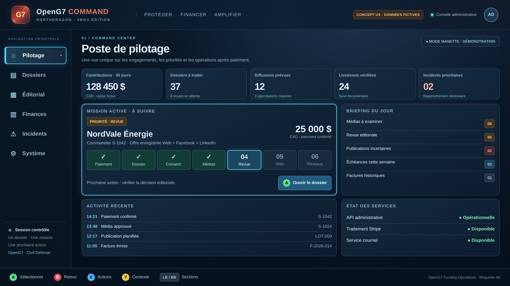
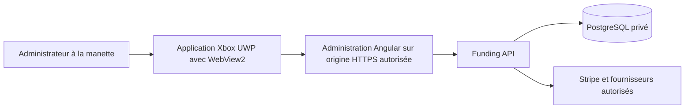

# Plan de travail pour le pilotage OpenG7 sur Xbox One

Date : 15 octobre 2026. Statut : **à réaliser ultérieurement**.

Préparer une application de pilotage administratif sur Xbox One, utilisable sur
téléviseur à la manette, pour gérer les parcours après paiement d’OpenG7. La
direction proposée réutilise l’administration Angular et l’API existantes, avec
une interface adaptée à la lecture à distance et un hôte UWP contenant WebView2.

Ce plan conserve le cadrage, les maquettes, le périmètre et les questions à
reprendre. Il ne constitue ni une application Xbox livrée, ni une décision
d’architecture approuvée, ni une autorisation d’opération en production. Tous
les lots de réalisation ci-dessous restent à faire.

## Objectif et périmètre

Depuis la console, retrouver un paiement, comprendre le travail restant, ouvrir
le dossier approprié, prendre les décisions permises et vérifier leur résultat.
Le suivi doit conserver le contexte entre les rubriques, après une interruption
et lors d’une nouvelle lecture des faits serveur.

Le périmètre couvre les soutiens personnels, les commandites, les engagements,
les médias, la revue, les documents, les communications, les publications et les
incidents. Dépenses, transparence, audit et administration des accès complètent
le pilotage selon les droits du compte.

Le premier prototype sera consacré à une Xbox One physique et à un environnement
de test dédié. Les paiements et fournisseurs simulés doivent rester identifiables.
Les conditions des opérations réelles restent celles des
[garde-fous du dépôt](../AGENTS.md#garde-fous).

## Maquettes de référence

Les deux images ont été fournies pour préparer la conception. Leur répartition
ci-dessous est une proposition à confirmer au cadrage.

| Maquette                                                                                                          | Utilisation proposée                                                                                      |
| ----------------------------------------------------------------------------------------------------------------- | --------------------------------------------------------------------------------------------------------- |
| [Centre de Commandement OpenG7](Centre%20de%20Commandement%20OpenG7%20_%20Op%C3%A9rations%20de%20Financement.png) | Inspiration pour la vue détaillée du dossier, les prérequis, le contenu prévu et les décisions.           |
| [Pilotage Xbox 4K](openg7_xbox_pilotage_4k.png)                                                                   | Base principale de l’accueil : dossier prioritaire, briefing, indicateurs, activité et état des services. |

À conserver : les six espaces stables, une mission active, une prochaine action
compréhensible, les commandes en bas de l’écran et la séparation entre suivi,
activité et santé des services. La deuxième maquette ouvre le dossier avant la
décision sensible et identifie explicitement les données fictives.

À adapter avant réalisation :

- Distinguer le focus manette, la rubrique sélectionnée et l’étape courante.
  Un seul contrôle doit être la cible effective du bouton A.
- Afficher chaque destination promise avec son état propre. Web, Facebook et
  LinkedIn ne forment pas une séquence obligatoire commune à tous les dossiers.
- Garder revue et autorisation sociale identifiables lorsqu’une opération les
  regroupe explicitement. La visibilité Web exige sa décision séparée. Une revue
  en attente ne doit pas être présentée comme une autorisation acquise.
- Utiliser les rôles, offres et indicateurs réellement définis par l’application.
  Les valeurs, noms, logos et labels des images restent des exemples de conception.
- Définir « livraisons vérifiées » à partir de preuves qualifiées. Un statut
  historique « publié », une simulation ou une visibilité actuelle ne suffit pas.
- Vérifier les textes, marges, contrastes et densités sur téléviseur à distance,
  en 1080p comme en 4K. Une image 4K ne qualifie pas cette lisibilité.

## Socle existant à réutiliser

L’état de travail inspecté contient des changements locaux, dont des fichiers non
suivis pour le contrôleur global et le guide de paiement. Refaire leur inventaire
au démarrage : leur présence ne garantit ni intégration ni qualification Xbox.
Les chemins locaux indiqués ci-dessous décrivent l’état du 15 octobre 2026;
ils seront à réconcilier lors de leur intégration. Ces fichiers applicatifs
ne font pas partie de la livraison documentaire.

| Surface                 | Référence et portée                                                                                                                                                                                                                                                                                           |
| ----------------------- | ------------------------------------------------------------------------------------------------------------------------------------------------------------------------------------------------------------------------------------------------------------------------------------------------------------- |
| Administration          | [Routes Angular](../apps/funding-web/src/app/admin.routes.ts) et 18 rubriques locales décrites dans `apps/funding-web/src/app/features/funding/components/admin-guidance/admin-guidance-pages.ts`.                                                                                                            |
| Manette globale         | Composant local `apps/funding-web/src/app/features/funding/components/admin-controller/admin-controller.component.ts` et [service d’entrée](../apps/funding-web/src/app/features/funding/components/admin-pilotage/controller.service.ts) : navigation, saisie, listes, défilement et priorité des dialogues. |
| Parcours après paiement | Projection locale `apps/funding-api/src/admin-payment-journey.service.ts` et contrat local `packages/funding-core/src/admin-payment-journey.ts` : étapes et prochaine action issues des faits serveur. La lecture ne réalise aucune opération métier.                                                         |
| Commandes rapides       | [Catalogue du cockpit](../packages/funding-core/src/admin-pilotage.ts) : 13 actions avec cible, version, confirmation et reçu. Les autres actions passent par les écrans spécialisés.                                                                                                                         |
| Identité                | [Comptes et sessions](operations/admin-identity-and-alerts.md) : droits API, OIDC, MFA et sessions révocables.                                                                                                                                                                                                |
| Contrats métier         | [API admin](technical/admin-api.md), [engagements](technical/sponsorship-commitments.md) et [preuves de réalisation](technical/sponsorship-fulfilment.md).                                                                                                                                                    |

Les tests manette `tests/playwright/admin-controller-journeys.spec.ts` et
`tests/playwright/admin-guidance.spec.ts` définissent déjà plusieurs
scénarios de navigation et de confirmation. La substitution de Gamepad et les
interceptions API de ces recettes ne qualifient pas le matériel Xbox. Les preuves
UI, API/PostgreSQL et fournisseurs restent distinctes dans le
[runbook de pilotage](operations/admin-pilotage.md#recette-et-limites-de-preuve).

## Architecture proposée

L’hôte charge l’administration depuis son origine HTTPS habituelle. Angular
continue d’appeler l’API selon le contrat existant. La logique financière, les
droits, les confirmations et les reçus ne sont pas dupliqués dans la console.
Le serveur Node et PostgreSQL restent sur le serveur de la plateforme.

Microsoft a annoncé [WebView2 sur Xbox](https://blogs.windows.com/msedgedev/2023/11/01/webview2-for-xbox-announcement/)
et fournit des [exemples UWP avec hôte C# ou C++](https://github.com/microsoft/Media-App-Samples-for-Xbox).
Vérifier au prototype les versions du système, du SDK et du moteur sur la Xbox
One cible. Une ancienne WebView EdgeHTML ne constitue pas la cible proposée.
Le [plan Windows](funding-windows-plan-de-travail.md) est un chantier distinct :
son hôte de bureau ne devient pas automatiquement un paquet compatible Xbox.

La connexion doit conserver le flux OIDC/MFA et la session serveur existants.
Le login, la page externe d’identité, les dialogues système et les autres onglets
sont hors de la capture du contrôleur Angular actuel. Leur usage à la manette est
un point de validation du prototype, sans affaiblissement des protections Web.
Un éventuel client natif indépendant ou un appairage de terminal demanderait un
cadrage d’identité séparé, hors de cette estimation.

L’application fonctionne en ligne. Après veille ou perte réseau, elle relit les
faits et les reçus avant de proposer une action. Aucun envoi différé local ni
rejeu automatique d’une mutation incertaine n’est prévu.

## Parcours produit après paiement

| Parcours                             | Travail à suivre                                                                                 |
| ------------------------------------ | ------------------------------------------------------------------------------------------------ |
| Soutien personnel                    | Confirmation serveur, communications et incidents éventuels. Aucune contrepartie de commandite.  |
| Commandite Web                       | Dossier, consentements, médias, revue, documents et présence Web promise.                        |
| Commandite Web et Facebook           | Parcours Web et suivi indépendant de la préparation, de l’autorisation et de la preuve Facebook. |
| Commandite Web, Facebook et LinkedIn | Suivi indépendant des obligations des deux réseaux, en complément du Web.                        |

Les branches exactes viennent de l’offre enregistrée avant paiement. Les montants
et seuils courants restent dans la [configuration métier](../packages/funding-core/src/sponsorship-pricing.ts)
et son [consommateur Web](../apps/funding-web/src/app/features/funding/config/openg7-funding.config.ts).
Un dossier historique ne reçoit pas rétroactivement les avantages du tarif actuel.
Un refus, un remboursement ou un incident peut rouvrir le suivi sans solder les
engagements à lui seul.

## Organisation proposée des espaces

Les six entrées des maquettes regroupent les écrans existants. Ce regroupement
reste à traduire en navigation sans perdre les liens directs vers un dossier.

| Espace Xbox proposé | Écrans et outils à rendre accessibles                                                        |
| ------------------- | -------------------------------------------------------------------------------------------- |
| Pilotage            | Accueil, indicateurs, poste de pilotage, briefing, guide de paiement et accès à l’Assistant. |
| Dossiers            | Contributions, commanditaires, fiche, médias, revue, engagements, échéances et preuves.      |
| Éditorial           | Accueil publications, brouillons, lots, calendrier, livraisons et programme de la semaine.   |
| Finances            | Factures, avoirs, remboursements admissibles, dépenses, réalisations et transparence.        |
| Incidents           | File À suivre, erreurs Stripe, courriels, publications incertaines, diagnostics et reçus.    |
| Système             | Accès et sessions, configuration, santé, sauvegardes, audit et préférences.                  |

L’Assistant, la recherche et le guide doivent rester accessibles depuis le
contexte courant. Le rôle lecteur consulte; les mutations opérateur/propriétaire
suivent la [politique API](../apps/funding-api/src/admin-identity/policy.ts).
Les gardes et boutons de l’interface ne remplacent pas cette autorisation.

## Catalogue fonctionnel à couvrir

Ce catalogue décrit le périmètre à rendre utilisable sur console. La disponibilité
d’une action reste soumise aux droits, à l’état serveur, à l’offre et au fournisseur.

| Parcours                        | Actions et limites à conserver                                                                                                                                                                                                                                                           |
| ------------------------------- | ---------------------------------------------------------------------------------------------------------------------------------------------------------------------------------------------------------------------------------------------------------------------------------------- |
| Retrouver un paiement           | Rechercher, filtrer, consulter référence, montant, devise, statut, chronologie et événements associés.                                                                                                                                                                                   |
| Suivre le paiement              | Démarrer, suspendre et reprendre le guide; relire les faits; ouvrir la prochaine étape sans exécuter la décision.                                                                                                                                                                        |
| Corriger la fiche               | Modifier entreprise, nom public, contact et site avec raison; consulter la soumission et les consentements. L’admin ne crée pas le consentement du commanditaire.                                                                                                                        |
| Obtenir des compléments         | Préparer et confirmer une demande de renseignements; propriétaire : renvoyer l’accès privé au destinataire vérifié. Le commanditaire complète et soumet son dossier dans son propre parcours.                                                                                            |
| Consigner une intervention      | Note interne, trace d’appel/courriel, prolongation et prochain examen. Une trace n’effectue pas l’envoi, le remboursement ou l’amendement qu’elle décrit.                                                                                                                                |
| Examiner les médias             | Voir logo et images, droits et restrictions; approuver/refuser, modifier texte alternatif et usage; téléverser/remplacer le logo; supprimer lorsque permis et confirmé.                                                                                                                  |
| Effectuer la revue              | Accepter, refuser avec motif, remettre en attente; consulter les décisions, effectuer une revue indépendante et traiter un réexamen lorsque requis.                                                                                                                                      |
| Gérer les engagements           | Consulter l’offre; propriétaire : qualifier un accord historique avec preuve, ajuster destination/format ou accorder une dispense motivée.                                                                                                                                               |
| Suivre délais et durées         | Documenter les origines et observations, puis attester une durée admissible avec preuve. Les capacités restent celles du [contrat de suivi](technical/sponsorship-obligation-timing.md), notamment pour le site OpenG7.                                                                  |
| Auditer les preuves historiques | Propriétaire : filtrer, examiner les lacunes et consigner une conclusion sans réécrire les faits, selon le [contrat historique](technical/sponsorship-historical-audit.md).                                                                                                              |
| Publier sur le site             | Préparer la fiche, examiner les blocages, décider explicitement de sa visibilité et ouvrir le résultat public.                                                                                                                                                                           |
| Gérer les brouillons            | Créer, éditer, soumettre en revue, approuver/refuser, planifier et déclarer publié; assigner à un lot ouvert ou retirer du lot. Un statut déclaré ne prouve pas une livraison externe.                                                                                                   |
| Gérer les lots                  | Créer, choisir canal/capacité, regrouper les brouillons, planifier ou annuler; distinguer déclaration de publication et diffusion sociale effective.                                                                                                                                     |
| Gérer le calendrier             | Créer/modifier les créneaux, horaires, fuseaux et capacités; affecter un brouillon ou un lot; déclarer publié ou annuler selon le contrat.                                                                                                                                               |
| Préparer une diffusion sociale  | Composer, choisir destination/format/média, relire le contenu exact, régler l’horaire, approuver, refuser ou annuler l’autorisation.                                                                                                                                                     |
| Choisir un format admissible    | Texte collectif, portrait individuel, composition collective et collection LinkedIn selon l’offre et les médias. La collection Facebook est indisponible; les capacités locales ne prouvent pas la qualification d’un compte réel. Voir les [formats](technical/publication-formats.md). |
| Organiser la semaine            | Briefing, session courte, propositions de calendrier, variantes, préférences et répétition; revoir les changements avant application. Voir le [programme éditorial](operations/editorial-programme.md).                                                                                  |
| Piloter les destinations        | Consulter les connexions, préparer, régler cadences/capacités/horizon, pause/reprise ciblée ou globale et commande du moteur selon droits. Activation réelle distincte de la préparation.                                                                                                |
| Réconcilier une diffusion       | Examiner une livraison incertaine, rapprocher une référence externe, vérifier visibilité ou attester l’absence avec motif; aucune relance aveugle.                                                                                                                                       |
| Gérer factures et avoirs        | Consulter et ouvrir les PDF; renvoyer avec confirmation et destinataire vérifié; propriétaire : émettre les factures historiques manquantes. Documents émis immuables.                                                                                                                   |
| Rembourser une commandite       | Propriétaire : montant partiel/intégral admissible, motif, confirmation, notification et suivi Stripe/avoir. Le portail actuel ne propose pas ce remboursement pour le soutien personnel.                                                                                                |
| Traiter les courriels           | Inspecter destinataire/contenu/état/erreur, confirmer une reprise ciblée, documenter une livraison incertaine à partir de preuves avant une éventuelle nouvelle tentative.                                                                                                               |
| Récupérer des faits Stripe      | Inspecter événements/anomalies; propriétaire : aperçu borné, confirmation et reçu du [backfill](operations/admin-stripe-backfill.md). Cette récupération ne crée pas de nouveau paiement ou remboursement.                                                                               |
| Gérer dépenses et réalisations  | Propriétaire : créer/modifier allocation, montant, avancement et preuves; publier, masquer ou archiver la réalisation.                                                                                                                                                                   |
| Consulter la transparence       | Lire agrégats, allocations et réalisations publiées; actualiser. Cet écran ne modifie pas les chiffres.                                                                                                                                                                                  |
| Rechercher et auditer           | Recherche privée, chronologie, reçus et journal; propriétaire : export CSV privé confirmé et borné.                                                                                                                                                                                      |
| Utiliser l’Assistant            | Lire faits/recommandations, poser une question, préparer note/publication/relance et rejoindre l’écran métier. La préparation n’accorde aucun droit d’exécution libre.                                                                                                                   |
| Administrer les accès           | Connexion, expiration, déconnexion; propriétaire : autorisations, rôles, désactivation et révocation de sessions. La gestion du fournisseur MFA reste externe.                                                                                                                           |
| Diagnostiquer et sauvegarder    | Consulter la configuration et les services, confirmer un courriel de test; propriétaire : demander une sauvegarde DB et suivre son reçu. Aucun bouton de restauration ou de modification des secrets n’est prévu ici.                                                                    |
| Adapter le confort              | Français/anglais, apparence, concentration, aide manette et guides; conserver les préférences sans stocker les données privées du dossier.                                                                                                                                               |

Les publications utilisent les cibles OpenG7/OpenG20 et canaux autorisés par
l’engagement. Une approbation groupée du commanditaire et de sa diffusion peut
rester possible avec identifiants, versions et confirmations explicites, photo
approuvée et audits distincts. Elle ne décide pas implicitement de la visibilité
Web. Les [règles commandites](development/sponsorship-rules.md) et les
[règles financières](development/financial-rules.md) restent les références
propriétaires pour ces conditions.

## Interactions à spécifier

- Établir le parcours complet sans souris : menu, listes, filtres, dossier,
  panneaux, saisie, confirmation, annulation et retour au contrôle d’origine.
- Arbitrer le mapping des boutons avant réalisation. La maquette propose X pour
  Actions, Y pour Contexte et LB/RB pour les sections; le contrôleur existant
  utilise aussi X pour la saisie, Y pour le guide et LB/RB pour les contrôles ou
  les guides selon le contexte. Préserver les priorités et le retour au neutre.
- Distinguer action disponible, action bloquée et attente d’un fournisseur. Donner
  la raison et un accès à l’étape qui peut lever le blocage.
- Après un changement de page, de panneau ou de périphérique, exiger une nouvelle
  pression. Une reconnexion ou une touche maintenue ne doit rien confirmer.
- Séparer sélection d’une valeur, application de la saisie et soumission du
  formulaire. Prévoir la saisie des motifs et confirmations exactes à la manette.
- Définir l’ouverture des PDF, les exports et l’ajout de fichiers. Les dialogues
  système et champs de fichiers ne sont pas couverts par l’éditeur actuel.
- Prévoir états vide, erreur, non autorisé, données partielles, conflit de version,
  chargement et résultat incertain, ainsi que FR/EN et mouvement réduit.

## Estimation initiale

Ordre de grandeur pour une personne expérimentée, avec réemploi des écrans et de
l’identité Web à la même origine. À réviser après le prototype matériel.

| Lot de travail                                    | Jours-personnes |
| ------------------------------------------------- | --------------- |
| Prototype physique et identification des blocages | 2 à 4           |
| Adaptation TV, focus, densité et navigation       | 5 à 9           |
| Hôte UWP/WebView2, démarrage et packaging         | 4 à 7           |
| Connexion, sessions, veille, réseau et documents  | 3 à 6           |
| Recette des parcours et corrections               | 5 à 10          |
| Total avant marge                                 | 19 à 36         |
| Budget de travail avec marge d’incertitude        | **25 à 45**     |

Cela représente environ cinq à neuf semaines de travail à cinq jours par semaine;
ce n’est pas un engagement de calendrier. Le prototype est inclus. Les délais de
revue Microsoft, les comptes/outils/matériel nécessaires et une éventuelle
application compagnon pour les fichiers sont séparés. Une réécriture native,
un nouveau protocole d’identité ou de nouveaux parcours métier demanderaient un
autre chiffrage. Promettre toutes les opérations sans ordinateur ni téléphone
nécessite d’abord de résoudre les limites de fichiers et de connexion.

La [distribution Xbox via Microsoft Store](https://learn.microsoft.com/en-us/windows/apps/publish/publish-your-app/msix/upload-app-packages#xbox-devices)
demande un paquet compatible et une soumission distincte. Choisir le canal de
distribution au cadrage; préparer un paquet ne vaut pas autorisation de publier.

## Lots de réalisation à reprendre

### Prototype sur console

- [ ] Identifier la Xbox One cible, son système, sa manette et le moteur Web;
      traiter une éventuelle cible Xbox Series comme une qualification distincte.
- [ ] Vérifier le Web actuel dans Edge, puis un hôte UWP/WebView2 minimal en mode
      développeur sur une cible dédiée.
- [ ] Exercer connexion OIDC/MFA, retour à l’application, expiration et déconnexion.
- [ ] Ouvrir un paiement synthétique, utiliser la saisie, annuler puis confirmer
      une opération de test et vérifier son reçu.
- [ ] Qualifier PDF, export, fichiers, veille, reprise et perte de connexion.
- [ ] Consigner les résultats, les blocages et le chiffrage révisé.

### Spécification de la navigation et des vues

- [ ] Confirmer l’usage des deux maquettes, les six espaces et les écrans détaillés.
- [ ] Choisir une route/vue TV dédiée ou une adaptation du layout partagé, en
      préservant les parcours Web existants et les liens directs.
- [ ] Définir les variantes personnel, Web, Facebook et LinkedIn ainsi que les
      étapes non requises, bloquées, en attente et rouvertes.
- [ ] Valider focus, mapping des boutons, confirmations, saisies et lisibilité
      en 1080p/4K, FR/EN et mouvement réduit.
- [ ] Définir chaque indicateur de la maquette depuis une source réelle, avec
      période, devise et portée; écarter les valeurs fictives en usage réel.

### Intégration de l’application Xbox

- [ ] Créer l’hôte et ses limites de navigation, avec l’origine HTTPS prévue.
- [ ] Adapter le rendu TV en réutilisant composants, contrôleur et services publics.
- [ ] Qualifier session, autorisation API, confidentialité, reprise des reçus et
      erreurs sans introduire de secret embarqué ou de nouvelle file financière.
- [ ] Réaliser la solution retenue pour fichiers, PDF et exports et documenter
      les opérations nécessitant éventuellement un autre appareil.

### Couverture des parcours et remise

- [ ] Vérifier chaque ligne du catalogue avec son rôle, ses préconditions, son
      action, sa confirmation éventuelle et son résultat observable.
- [ ] Couvrir soutien personnel et les trois variantes de commandite, puis
      refus, remboursement, documents manquants, incidents et historique.
- [ ] Vérifier séparation des destinations, preuves qualifiées et absence de
      publication ou de double effet provoqué par navigation, reprise ou maintien.
- [ ] Compléter les tests ciblés et la recette physique, avec preuves distinctes
      pour UI simulée, API/DB réelles et fournisseurs de test autorisés.
- [ ] Préparer paquet, installation, mise à jour, désinstallation et documentation.
      Toute soumission ou mise en production suit une instruction distincte.

## Questions à trancher au démarrage

1. L’usage sera-t-il limité à quelques consoles administratives ou distribué
   depuis le Microsoft Store? Quelles versions et résolutions seront soutenues?
2. Toutes les opérations doivent-elles être réalisables sans second appareil,
   notamment MFA, médias, documents et exports?
3. Quel regroupement des écrans et quel mapping manette valider avec les
   utilisateurs? Quels détails resteront accessibles dans un panneau secondaire?
4. Quels rôles seront réellement utilisés sur console, avec quelles règles de
   fermeture de session et de présentation des informations privées sur TV?
5. Quels indicateurs existants correspondent aux cartes de la maquette et quelles
   nouvelles projections seraient nécessaires avant de les afficher?
6. Quels parcours et fournisseurs de test pourront être qualifiés avec des
   preuves admissibles, sans assimiler leur simulation à une livraison réelle?

## Réception et reprise du travail

La réception devra démontrer un parcours à la manette depuis la connexion jusqu’à
la vérification du résultat, puis la reprise après interruption. Vérifier les
trois rôles, les confirmations annulées, les conflits, la révocation de session,
les données privées à l’écran et les résultats incertains. Consigner modèle de
console, version système/moteur, manette, résolution, scénario, résultat et limite.
Les recettes de manette sur ordinateur ne remplacent pas cette réception.

Au démarrage, relire ce plan, les maquettes et le
[runbook de pilotage](operations/admin-pilotage.md), puis vérifier `git status --short`
et les changements locaux avant de choisir le premier lot. Retrouver les règles
des chemins dans [AGENTS.md](../AGENTS.md), les frontières dans
l’[architecture](ARCHITECTURE.md) et les vérifications dans la
[matrice de validation](development/validation.md). Les commandes et suites
applicatives seront choisies selon les changements effectivement réalisés.
