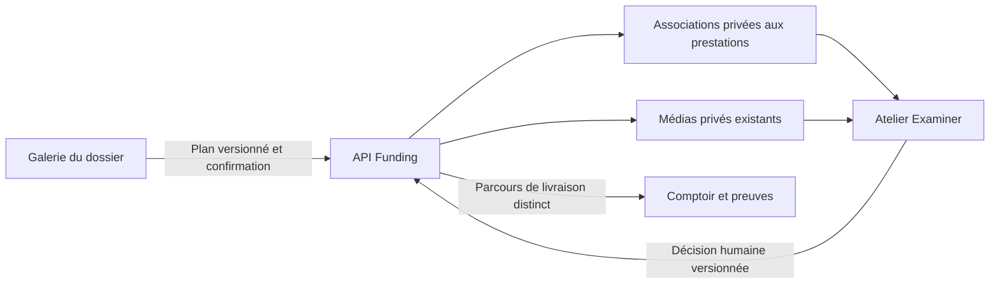

# Galerie de préparation du dossier

## A. Diagnostic initial

L’audit du 5 novembre 2026 porte sur le code présent dans le workspace, y compris
les travaux locaux non encore publiés. La maquette définit la direction visuelle;
elle ne prouve pas l’existence d’une capacité d’analyse ou de publication.

La galerie évolue dans l’organisme `MediaReviewWorkspaceComponent` existant.
Funding conserve les fichiers, droits, associations préparatoires, décisions et
livraisons. Preflight prépare des propositions; Examiner consulte leurs sources
et recueille la décision humaine. Le Comptoir suit les prestations et leurs preuves.

| Fonction                               | Emplacement et propriétaire existants                                      | Contrat et modèle                                                       | Cible / adaptation                                                                                            |
| -------------------------------------- | -------------------------------------------------------------------------- | ----------------------------------------------------------------------- | ------------------------------------------------------------------------------------------------------------- |
| Identité, consentement et transmission | `AdminSponsorDetailIdentityComponent`, éditeur du dossier                  | Profil commanditaire, API administrative existante                      | Onglet Identité distinct; lien contextuel depuis la galerie, aucun second formulaire                          |
| Galerie et sélection                   | `components/media-review/`, contrôleur du workspace                        | `SponsorMediaWorkspace`, `/admin/sponsorships/media/workspace`          | Même organisme, galerie dominante, filtres et pagination; sélection bornée au dossier                         |
| Revue collective                       | `MediaReviewCommands`, `sponsor-media-workspace/` côté API                 | Plans, manifeste exact, exécution confirmée, reçus de la migration 060  | Réutiliser versions, droits, audit et réconciliation                                                          |
| Import multiple                        | `MediaReviewUpload`, `SponsorMediaUploadService`                           | `/admin/sponsorships/media/upload`, `SponsorMediaAsset`                 | Orchestration de requêtes idempotentes; résultat par fichier et arrêt sur résultat incertain                  |
| Logo                                   | Galerie `kind=logo`; ancien panneau de consultation                        | Même stockage et revue que les autres images                            | Une seule bibliothèque; ne pas confondre type logo et choix du logo publié                                    |
| Droits de diffusion                    | `sponsor-media-usage`, règles dossier/lot/média                            | Références héritées, preuve privée, versions                            | Conserver le propriétaire et les confirmations; aucune autorisation déduite d’une analyse                     |
| Préférences commanditaire              | `AdminSponsorMediaPreferenceComponent`                                     | `sponsor_media_preferences`, `/media/preference-review`                 | Vue Corrections et demandes, sans répétition dans Médias                                                      |
| Demande de correction                  | Modération native et son historique                                        | Dossier de modération, motifs et explication                            | Réutiliser le domaine de modération; distinguer demande, rejet et modification de fichier                     |
| Analyse technique                      | `MediaReviewAnalysis`, `sponsor-media-analysis/`                           | Migration 061, runs, checksum, version et revue                         | Résultats réellement obtenus, provenance et obsolescence explicites                                           |
| Preflight transverse                   | Contrats texte de `openg7-preflight/packages/contracts` et fournisseurs IA | Titre, synthèse, corps, avertissements                                  | Aucun contrat Vision/OCR ou d’affectation visuelle; extension à définir avant raccordement                    |
| Sélection du site Web                  | Plan natif `website_select` / `website_deselect`                           | `website_selected`, effets de visibilité explicites                     | Conserver sa confirmation spécifique; cette sélection peut modifier une fiche déjà visible                    |
| Affectation préparatoire               | Absente avant cette refonte                                                | Extension native du plan/exécution et associations versionnées          | Lier média/version à prestation/version dans Funding, sans changer la visibilité ni autoriser une publication |
| Préparation sociale                    | `publication_deliveries.media_id/photo_selections`                         | Commandes de livraison et autorisations versionnées                     | Garder le parcours propriétaire; ne pas appeler une commande de livraison pour une simple association privée  |
| Examiner                               | Composant d’examen et aperçu de prestation                                 | Préparation, versions sources, sessions d’examen                        | Consulter les mêmes références; rejoindre la galerie plutôt que l’embarquer une seconde fois                  |
| Documents                              | Factures/avoirs privés dans Finances                                       | Client administratif des documents financiers                           | Ne pas les importer dans la bibliothèque publique; aucun upload de document générique actuellement            |
| Aperçus et stockage                    | `sponsor-media/`, pilotes local et OVH S3                                  | Métadonnées en DB, objets privés, WebP dérivé, miniatures authentifiées | Garder les références et les contrôles d’accès; aucun déplacement de fichiers                                 |
| Historique                             | `MediaReviewHistory`, `/media/workspace/history`                           | Journaux propriétaires et projection paginée                            | Réutiliser l’audit existant, sans journal concurrent                                                          |

Les répétitions constatées étaient surtout des assemblages visuels : résumé,
logo consultatif, préférences et galerie étaient empilés. Les contrôleurs métier
et les pilotes de stockage restent réutilisables; ils ne doivent pas être remplacés
par une nouvelle bibliothèque parallèle.

## B. Architecture retenue

Preflight transverse conserve ses contrats actuels; la galerie ne prétend pas
lui avoir raccordé une analyse visuelle. Une association préparatoire ne modifie
pas le choix de fichiers d’une livraison déjà constituée.

- Une galerie appartient à une seule contribution. Changer de dossier invalide
  les lectures, sélections, aperçus, plans et intentions du dossier précédent.
- La sélection de page est explicite. Un filtre ne doit pas masquer la portée
  d’une opération; le manifeste confirme les identifiants et versions concernés.
- Affecter prépare des références privées. Accepter une suggestion, approuver un
  média, sélectionner une image Web et autoriser une prestation restent distincts.
- Les associations périmées restent identifiables et ne doivent pas alimenter
  silencieusement une préparation présentée comme courante.
- Retirer une association et supprimer un fichier sont des commandes différentes.
  Les suppressions conservent confirmation, contrôle des dépendances et audit.
- Les noms privés restent dans le contexte administratif autorisé. Les projections
  publiques continuent d’appliquer les consentements et l’admissibilité.

### Capacités et limites vérifiées pendant l’audit

Les images natives sont JPEG, PNG et WebP; le serveur vérifie contenu, taille et
dimensions. Les téléchargements de prévisualisation retournent un WebP traité,
pas nécessairement le fichier original. Une archive ZIP n’existe pas dans le socle.
Les documents financiers ne sont pas des médias de présentation.

L’adaptateur `local_technical_v1` produit de véritables contrôles techniques.
Vision et OCR sont déclarés `not_configured`. Une classification technique,
une proposition IA, une simulation et une décision humaine doivent conserver
leurs libellés et leur provenance propres. Aucun compteur d’analyse ne vient de
la maquette et aucune recommandation Facebook n’est inventée sans prestation.

## C. Modifications réalisées

La page du dossier distingue six onglets : Aperçu, Identité, Fiche et médias,
Publication, Finances et Historique. `identity` et `media` ne sont plus des alias.
Les ancres, indicateurs et retours de l’Assistant respectent cette séparation.
Dans la galerie, la file des autres dossiers est masquée et les outils globaux
restent disponibles dans un panneau repliable. Les retours restituent le focus.
Le changement d’onglet conserve la hauteur du dossier pendant les deux chargements
différés de traduction, puis libère cette réserve quand la galerie est prête.
Cela préserve le défilement mobile sans masquer un bornage légitime. Le retour
dans Médias ne relance plus la lecture de l’ancien panneau média.

`AdminSponsorDetailMediaComponent` compose les quatre vues autour du même
`MediaReviewWorkspaceComponent`. Recherche, type, destination préparée, revue,
affectation, lot, tri, grille/liste et pagination 8/16/25 utilisent les données
du workspace. Les sélections hors page ou filtre sont comptées explicitement.
Les imports affichent un résultat par fichier, y compris les fichiers non envoyés.

Les contrats `SponsorMediaWorkspace` et `SponsorMediaBatchPlanRequest` sont étendus
dans `packages/funding-core/src/sponsor-media-review.ts`. La migration additive
066 crée `sponsor_media_preparation_assignments`, sans recopier de fichiers.
Les modules `sponsor-media-workspace/preparation.ts` et `export.ts` réutilisent
transactions, reçus et audit. Les plans/exécutions conservent leur propriétaire.
La notification différée de modération est interne et strictement limitée à
la demande collective N1 sur des médias.

Examiner réutilise son composant d’aperçu et la projection de la bibliothèque.
Les versions des associations et des retraits participent à la version source
de préparation. Les réponses tardives et les refus 401/403 ne réaffichent pas
de contenu privé.

## D. Traitements par lot

| Action livrée                       | Effet réel et limite                                                                                                              |
| ----------------------------------- | --------------------------------------------------------------------------------------------------------------------------------- |
| Import multiple                     | Requêtes idempotentes natives, résultat par fichier, limites serveur effectives; arrêt sur réception incertaine                   |
| Sélection                           | Individuelle, page courante, prêts filtrés, désélection; plafond explicite de 100 et portée affichée                              |
| Analyse                             | Demandes individuelles natives sur une sélection, contrôles techniques réellement exécutés                                        |
| Revue / droits / classement         | Plans, manifeste exact, confirmations et transitions natives; aucun second système de statuts                                     |
| Affectation / retrait préparatoires | Références média/version → prestation/version du même dossier; aucun changement de visibilité ou publication                      |
| Correction collective               | Décisions N1, motif, raison interne, explication et confirmation; demande enregistrée sans courriel                               |
| Téléchargement                      | Export privé confirmé de copies WebP traitées, reçu et audit par média; arrêt et réconciliation sur incertitude, sans archive ZIP |
| Suppression                         | Commande native distincte du retrait d’affectation, effets et dépendances explicités avant confirmation                           |

Une opération confirmée de plan reste atomique : un membre devenu incompatible
bloque l’exécution et le manifeste explique lequel. L’import et l’export présentent
leurs résultats par fichier. Un échec réseau ne devient pas un succès métier.

## E. Intégration Preflight et extensions

Une future préparation visuelle doit préciser le contrat d’entrée (références
privées et versions, destinations réellement promises, droits et limites),
l’accès temporaire autorisé aux fichiers et la sortie versionnée par média et
prestation. Elle exige provenance, capacités réelles, traitement des simulations,
idempotence, audit, obsolescence et revue humaine. Le contrat texte actuel ne
suffit pas à activer ce raccordement.

Les compteurs proviennent des données reçues, avec capacités, versions,
provenance et résultats obsolètes explicites. Le titre de préparation des
ressources ne présente pas ces contrôles natifs comme une analyse Preflight.

## F. Rationalisation

Le formulaire d’identité n’est plus monté dans Médias. Le panneau consultatif de
logo et l’ancien empilement préférences/galerie ne sont plus montés ensemble.
La préférence du commanditaire reste dans son composant propriétaire, dans
Corrections et demandes. Examiner ne monte plus la galerie de gestion complète.

Les contrôleurs de revue, droits, historique, import et analyse sont conservés.
Le composant historique `detail-media/admin-sponsor-logo-panel` reste dans le
dépôt : des tests de contrat source et deux blueprints historiques le référencent,
mais aucune surface applicative ne l’importe après cette refonte. Il ne constitue
pas une seconde interface active. Aucun fichier métier ou média n’est supprimé
par le nettoyage de la composition.

## G. Validation

Les preuves distinguent les fixtures navigateur, les services réels avec PostgreSQL
jetable et la pile utilisateur. Aucun test ne qualifie un envoi réel à un fournisseur.
La qualification initiale ci-dessous concerne le workspace de développement,
qui contient aussi la refonte du Guide proposée séparément.

- Compilation TypeScript et build Angular production : réussis, 25 routes
  statiques/SSR. La dernière qualification navigateur utilise ce build final.
- Playwright final : **47/47 parcours réussis**, galerie, dossier, Examiner et
  reprises ciblées des parcours voisins. Couverture FR/EN, 390/768/1536 px,
  accessibilité, import partiel, affectation/retrait, correction, export, rôle,
  conflit, références exactes, obsolescence, retour canonique et purge sur 401/403.
- Les parcours voisins ont d’abord donné **349 réussites sur 362**. Les treize
  échecs ont été corrigés et repris dans les 47 parcours finaux, y compris le
  défilement mobile et le suivi sans lecture redondante. Il ne s’agit pas d’une
  seconde exécution intégralement verte des 362 parcours.
- PostgreSQL : 10/10 tests de préparation média et 2/2 tests d’upgrade avec faits
  préexistants; les migrations 064–066 puis le rejeu préservent ces faits.
- Suite Node complète : **7 645 réussites, 8 tests ignorés selon la plateforme,
  aucun échec**. Après la dernière suppression de lecture redondante, les
  contrôleurs de dossier, navigation et médias ont été revérifiés : **88/88**.
- ESLint global réussi, avec un avertissement préexistant de directive inutilisée
  dans `scripts/smoke-public.mjs`.

Les traces des premières assertions de test corrigées restent séparées des
exécutions finales. Les captures utilisent des médias synthétiques, sans exposer
de contenu client. Le build de l’image API Node 22 a également réussi; la
[procédure locale](../operations/intelligent-media-gallery-activation.md) consigne
la sauvegarde chiffrée et sa restauration réellement vérifiée sur PostgreSQL jetable.

La branche de revue est ensuite isolée sur la base de la PR #398, sans la refonte
du Guide : nouvelle compilation TypeScript et Angular production réussie,
**7 640 tests Node réussis, 8 ignorés, aucun échec**, ESLint, typecheck des tests UI
et contrôles documentaires réussis. Le lot navigateur donne **78/79** : sa seule
assertion française attendait « transmission » alors que l’aide nomme l’action
« Soumettre mes informations à l’équipe ». L’assertion utilise désormais le
libellé réel et vérifie aussi « ne remplace pas »; les reprises **FR/EN sont 2/2**,
avec les contrôles de droits, désactivation et absence d’écriture conservés.
Le code API et les contrats des tests PostgreSQL sont identiques à ceux qualifiés
dans le workspace initial.

## H. Fidélité à la maquette

La galerie dominante, les quatre vues, la synthèse, les filtres, le panneau latéral
repliable et les actions de sélection suivent la composition fournie. Le cadre
administratif et ses palettes restent ceux de Funding. Les premiers médias sont
visibles avant 800 px de hauteur de page à 1536 px de largeur, vérifié en navigateur.

Les nombres de la maquette ne sont pas recopiés. Les suggestions Preflight,
Vision/OCR, le téléchargement d’originaux et les documents génériques ne sont pas
simulés. Les factures/avoirs restent dans Finances. Le logo est géré dans la même
bibliothèque; un ancien logo externe n’est pas importé automatiquement.

## I. Activation et travaux restants

L’activation de développement locale du 5 novembre 2026 est effectuée :
migrations 065/066 appliquées, registre vérifié sans attente, nouvelle API saine
et quota de vingt photos persistant. Seule l’API a été recréée; PostgreSQL,
Keycloak, Traefik et le conteneur Web ont été conservés. Le lanceur Web de
développement sert maintenant les sources sur `https://localhost`.

Le client Vite répond en HTTPS avec un statut 200 et un contenu JavaScript;
la configuration d’authentification répond 200 en mode OIDC. La
[procédure d’activation locale](../operations/intelligent-media-gallery-activation.md)
consigne les six couches Compose conservées, la sauvegarde DB chiffrée et
restaurée sur une cible isolée, l’ancienne image conservée et la reprise.
La recette n’a exécuté ni décision métier, ni publication, ni export de média réel.

Coordination avant fusion : la base de la PR #398 s’arrête à la migration 063.
La [PR #396](https://github.com/OpenG7/openg7-funding-platform/pull/396) utilise
également le numéro 064 pour `064_create_preflight_connector.sql`, tandis que
cette branche ajoute `064_service_preparation_decisions.sql`, puis 065/066.
Leur réunion exige une réconciliation explicite des numéros et des registres.
La migration 064 des décisions est déjà appliquée en développement local et
reste immuable; aucun renommage ou remplacement d’une migration appliquée
n’est réalisé par cette livraison.

Les évolutions restantes sont le contrat visuel Preflight réellement raccordé,
le stockage et la politique d’accès de documents génériques, et les originaux ou
archives ZIP si nécessaires. La publication des médias préparés conserve le
sélecteur et l’autorisation de livraison propriétaires, distincts de la galerie.

## Références propriétaires

- [Gestion du dossier](../admin-sponsorship-editing.md).
- [Droits et usages des médias](sponsor-media-usage.md).
- [Examen de prestation](preflight-examination.md).
- [Sessions de travail](preflight-work-sessions.md).
- [Règles de commandite](../development/sponsorship-rules.md).

L’état d’activation consigné concerne le développement local. Les parcours
navigateur et les tests d’intégration utilisent des données synthétiques.
